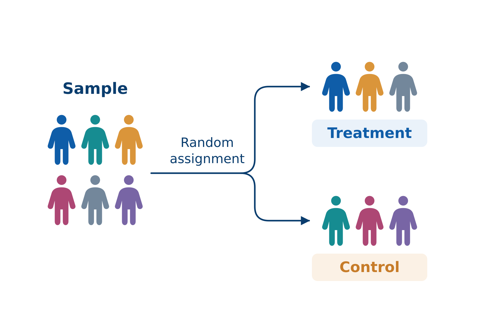
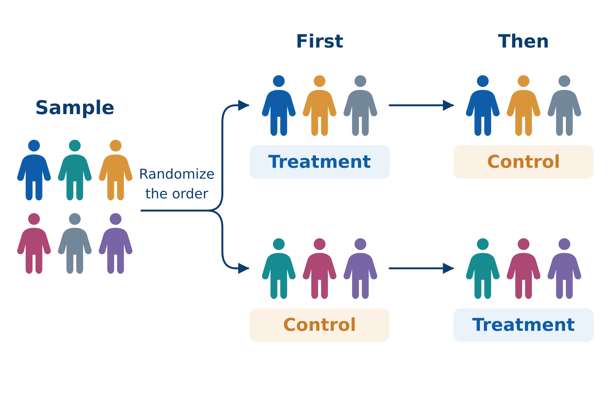

# Marketing Analytics as Decision-Making {#sec-foundations}

::: {.callout-note appearance="simple"}
📽 [Slides for this chapter](slides/chapter01_slides.html){target="_blank" rel="noopener"} · [PDF handout](slides/chapter01_slides_handout.pdf){target="_blank" rel="noopener"}
:::

```{r setup-ch01}
#| echo: false
#| warning: false
#| message: false
source("R/ch01-figures.R")
```

This chapter lays the foundation for everything that follows in this course. Its goal is *not* to teach you a statistical method — no R output and no tests will appear on the following pages, and the only formula is a simple difference of differences. Instead, this chapter will equip you with a way of thinking about data that separates good analysts from dangerous ones: the ability to recognize **which question you are actually asking**, **what your data can and cannot tell you**, and **why two analyses that look identical can support completely different conclusions**. After working through this chapter you will be able to:

- Distinguish the four types of questions that analytics can answer — descriptive, predictive, causal, and prescriptive — and explain why most managerial decisions ultimately depend on the causal one
- Explain what a counterfactual is and why causal claims are always claims about counterfactuals
- Recognize the roles that variables can play in an analysis: outcome, treatment, confounder, mediator, and moderator — and recognize selection bias when you see it
- Explain why randomization licenses causal conclusions — and what must be *assumed* when we work with data that were not randomized
- Explain the logic of quasi-experiments and of the difference-in-differences comparison
- Translate a vague management problem into a precise, answerable research question

Everything else in this course — summary statistics, standard errors, tests, regression, mediation and moderation analysis — exists to serve the ideas in this chapter.

## Motivation: data and AI in marketing {#sec-why-data}

The task of allocating marketing budgets effectively has always been plagued by uncertainty. As the nineteenth-century Philadelphia retailer John Wanamaker supposedly said:

> "Half the money I spend on advertising is wasted; the trouble is I don't know which half."
>
> — John Wanamaker

More than a century later, the underlying problem is unchanged — but the environment has been transformed. Every purchase, click, swipe, share, and like leaves a trace, and most firms today sit on far more behavioral data than they are able to use. Three developments make analytical skills more important for marketers today than ever before.

### Marketing is reorganizing around AI and data

According to the 35th edition of The CMO Survey [@cmosurvey2026], a survey of 308 U.S. marketing leaders, AI and machine learning already perform about a quarter of all marketing activities — nearly twice the share of two years earlier (@fig-ai-adoption). Generative AI alone grew from 7.0% to 22.4% of marketing activities over the same period (+220%). And marketing leaders expect **more than half** of all marketing work to be performed by AI within three years. The activities that lead the adoption list — content creation, personalization, data analysis and reporting, targeting — are the mechanical layer of marketing work.

```{r}
#| label: fig-ai-adoption
#| echo: false
#| warning: false
#| message: false
#| fig-width: 7
#| fig-height: 4.8
#| fig-cap: "Share of marketing activities performed by AI/ML, as reported by U.S. marketing leaders (The CMO Survey, 2026)."
fig_ai_adoption()
```

### … while budgets are flat: every euro must justify itself

Total marketing spending grew by only 1.7%, the weakest growth since 2021, while 15.3% of marketing budgets now go to AI initiatives [@cmosurvey2026; @gartner2026]. Asked why their organizations invest in marketing capabilities, 78.2% of marketing leaders name the goal of achieving a higher return per marketing dollar as the most important reason [@cmosurvey2026]. Gartner's 2026 CMO Spend Survey of 401 CMOs in North America and Europe sums up the situation:

> "CMOs are being asked to deliver growth, efficiency and transformation without meaningful budget expansion. Those who succeed will make deliberate, data-driven trade-offs."
>
> — Gartner CMO Spend Survey (2026)

Flat budgets combined with rising expectations are exactly the environment in which measurement wins arguments: analytics is how a marketer defends a budget.

### The scarce skill is judgment

70% of CMOs consider becoming an AI leader a critical goal — but only 30% say their organization is ready to scale AI capabilities [@gartner2026]. The labor market data point in the same direction: in the World Economic Forum's *Future of Jobs Report 2025*, analytical thinking is the most important core skill (seven out of ten employers consider it essential), and AI and big data are the fastest-growing skills for 2025–2030 [@wef2025].

This has an important implication for what you should take away from this course. The bottleneck in modern marketing organizations is rarely the *production* of numbers — dashboards, tracking tools, and, increasingly, AI assistants produce numbers in abundance and at almost no cost. **The mechanical layer of marketing is being automated; what remains scarce is judgment**: knowing which analysis answers which managerial question, what a given number does and does not license you to conclude, and where an analysis can silently go wrong. That judgment is what this course trains. The story in the next section shows what happens when it is missing — even at a company with world-class data and world-class analysts.

## Case study: search advertising at eBay {#sec-ebay}

### eBay, 2012: what the dashboards showed

Around 2012, eBay was spending roughly \$50 million *per year* on paid search advertising — the sponsored links that appear above the results on Google, Bing, and Yahoo! when users search for terms like "used gibson les paul" or simply "ebay". Was that money well spent?

The data seemed to leave little doubt. Users who were exposed to eBay's search ads purchased far more than users who were not — @fig-ebay-naive shows a stylized version of this comparison, with each dot representing one user. Measured this way, the return on advertising looked spectacular — the kind of number that makes a budget discussion very short. (Aggregate patterns told the same story: weeks with more advertising were weeks with more sales — a correlation with problems of its own, to which we return in @sec-dgp.)

::: {.callout-note collapse="true" title="Under the hood: where the naive numbers came from"}
The "spectacular returns" were produced by **click-based attribution**, the standard accounting of online advertising to this day: when a user clicks a paid link (recorded via a tracking parameter) and purchases within a set time window, the revenue is *attributed* to the ad. Attributed revenue divided by ad spend then yields the return figure shown in campaign dashboards. Notice what this measures: *how much revenue flowed through ad clicks* — not *how much revenue the ads caused*. For a user who searched "ebay" with the intent to buy, the purchase is attributed in full, even though she would have reached the site via the free organic link directly below the ad. Whenever you see a "ROAS" number in an advertising dashboard, this is how it was computed — and the eBay experiments showed how far it can be from a causal effect: when brand-keyword ads were switched off, organic clicks absorbed about 99.5% of the paid traffic [@blake2015].
:::

```{r}
#| label: fig-ebay-naive
#| echo: false
#| warning: false
#| message: false
#| fig-width: 7
#| fig-height: 4.5
#| fig-cap: "A stylized version of the evidence for eBay's search advertising: users exposed to the ads purchased far more, on average, than unexposed users. The groups are self-selected — in this simulation, purchases are driven entirely by (unobserved) intent, and the true effect of ad exposure is exactly zero."
fig_ebay_naive()
```

Before reading on, pause for a moment and ask yourself: as eBay's CMO, would you sign off on next year's \$50 million based on this evidence? And if not — how would you measure the payoff instead?

### What happened when the ads were switched off

Here is what happened next. A team of economists working inside eBay ran a series of large-scale field experiments [@blake2015]. First, eBay **halted all brand-keyword ads** (queries containing "ebay") — in March 2012 on Microsoft's search engine, with Google serving as a comparison, and in summer 2012 on Google itself. If the ads were driving the attributed sales, traffic and sales should have collapsed.

They barely moved: paid clicks fell to zero, but about **99.5% of that traffic instantly reappeared through the free organic link** sitting directly below where the ad had been; total visits to eBay were essentially unchanged. The users who had clicked the ad for "ebay" were people who had *searched* for eBay — on their way to the site anyway. The attributed revenue had been almost entirely *re-labeled*, not *created*. Second, for non-brand keywords ("used guitar", "cheap shoes"), eBay **suspended all search advertising in a randomly selected ~30% of US regions for 60 days** and compared the change in *total* sales against the remaining regions — a real comparison group, created by design. The ads turned out to influence only new and infrequent users, while the frequent shoppers who generate most clicks (and most ad cost) were unmoved. The customers most likely to click were the customers least influenced — and averaged over everyone, the returns on the spending were *negative*.

### Why the dashboard and the experiment disagree

Take a moment to appreciate what went wrong here — because it was not a lack of data, computing power, or intelligence. The naive analysis compared people **with purchase intent** (those who searched and saw the ad) to people **without purchase intent** (those who never searched) and credited the entire difference to the advertising. @fig-ebay-dag makes this structure explicit: purchase intent drives both who sees the ads *and* who buys. The dashboard's correlation mixes the ad effect with the intent difference — and in this case, intent was nearly the whole story. The problem was not the math; it was the comparison. And no amount of additional data would have fixed it: more data would only have made the wrong answer more precise.

```{r}
#| label: fig-ebay-dag
#| echo: false
#| warning: false
#| message: false
#| fig-width: 7
#| fig-height: 4.1
#| fig-cap: "Why the dashboard and the experiment disagree: unobserved purchase intent drives both ad exposure and sales. The dashed arrow is the effect in question — for brand keywords, it turned out to be close to zero."
dgm_ebay_confounded()
```

### The comparison that matters

The comparison eBay actually needed is summarized in @tbl-ebay-comparison.

| | What eBay **observed** | What the decision **needs** |
|:---|:---|:---|
| Group A | Users arriving via **paid search** | The same users, **with** ads |
| Group B | Users arriving via **other channels** | **The same users, without ads** |
| The difference measures… | Ad effect **+ intent difference** | The ad effect. **Nothing else** |

: The comparison that matters {#tbl-ebay-comparison}

::: {.callout-important title="The counterfactual"}
The question eBay actually needed to answer was: *what would our sales have been **without** the ads — everything else unchanged?* This hypothetical alternative world is called the **counterfactual**. A causal claim ("the ads increased sales by X") is always a comparison between the world we observed and a counterfactual world we did not observe. Since we can never observe both worlds at once, all of causal inference is about constructing a credible **stand-in** for the counterfactual — and how well such a stand-in can be constructed depends on **how the data came into being**. The exposed and unexposed users in eBay's data were *not* credible stand-ins for one another — they differed in exactly the characteristic that mattered most (intent). The experiment's randomly switched-off regions *were* credible stand-ins. That single difference was worth about \$50 million a year.
:::

This story sets the agenda for the entire course. To avoid eBay's mistake, you need to know which type of question you are asking (@sec-four-questions), how your data came into being (@sec-dgp), which variables are playing which roles (@sec-cast), and why randomization has the special status it has (@sec-randomization).

## Types of research questions {#sec-four-questions}

### Every analytics task answers one of four questions

Every analytics task you will encounter — in this course and in your career — answers one of four kinds of questions. This classification, adapted from @hernan2019, is the single most useful piece of structure you can impose on any analytics problem, and we will return to it at the start of every session of this course.

| | Question | Type | Typical marketing examples |
|---|---|---|---|
| 1 | *What is going on?* | **Descriptive** | How large are our customer segments? What is our churn rate? Where in the funnel do we lose users? |
| 2 | *What will happen?* | **Predictive** | Which customers are likely to churn next quarter? How much demand should we expect next month? |
| 3 | *What happens if we act?* | **Causal** | Does the discount *cause* additional sales? Did the campaign *work*? |
| 4 | *What should we do?* | **Prescriptive** | Which price should we set? How should we allocate the budget across channels? |

: The four kinds of analytics questions {#tbl-four-questions}

**Descriptive questions** ask you to capture and compactly represent the structure of your data: summarizing, visualizing, segmenting. Descriptive analysis is where every project starts — you cannot model data you do not understand — and it is the subject of Module 2.

### Prediction ≠ causation: same data, different questions

**Predictive questions** ask you to forecast an unknown outcome from known inputs. The defining feature of prediction is that you do *not* need to understand *why* the inputs relate to the outcome; you only need the relationship to be stable. If customers who read your newsletter churn 40% less, then newsletter readership is a useful churn predictor — *even if the newsletter itself does absolutely nothing*, because readership may simply reveal engagement. For targeting purposes ("flag the non-readers as churn risks"), that is perfectly fine.

**Causal questions** ask what an *intervention* would change: they compare the observed world to a counterfactual. This is a fundamentally harder question, because the counterfactual is unobservable. Note the contrast with prediction: the newsletter's predictive value tells you *nothing* about whether sending more newsletters would reduce churn. That would only follow if readership *causes* retention — and engaged customers both read newsletters *and* stay, whether or not the newsletter does anything.

**Prescriptive questions** — what should we do? — are the questions managers are actually paid to answer. And here is the crucial link: **prescription requires causation**. To choose between actions, you must know what each action would *cause*; that is, you must compare counterfactuals. A prediction, however accurate, is not a basis for action on the predicted variable itself. Confusing question 2 with question 3 — using a predictive relationship as if it described the effect of an intervention — is precisely the eBay mistake, and it is the most common serious error in applied analytics.

### Four types of questions, four kinds of analytics

@tbl-four-analytics shows what each type of question demands from the data and which methods typically answer it — using the same online store in every column. Notice the second row: the four questions differ not only in their methods but in what the data must *contain*. For a causal question without an experiment, the data must contain the relevant confounders — the row in which the eBay case lived. And notice the last column: prescription *consumes* causal answers. You cannot optimize targeting on correlations; eBay's dashboard was, implicitly, a prescriptive claim ("keep spending") built on a broken causal one.

| | Description | Prediction | Causal inference | Prescription |
|:---|:---|:---|:---|:---|
| **Typical question** | How can our customers be grouped into segments based on their characteristics? | Which of last year's visitors will purchase from our store next month? | Does behavioral targeting *increase* the probability of purchase — and by how much? | Which customers should we target, at what budget, to maximize profit? |
| **What the data must contain** | *Features:* user characteristics (age, location, …), products viewed, … | *Inputs* (features) and the *output* to be predicted (purchase next month) | *Outcome*, *treatment*, and — without an experiment — the relevant *confounders* | Causal effect estimates *plus* costs, margins, and constraints |
| **Typical analytics** | Cluster analysis, descriptive statistics, visualization | Regression, trees, random forests, neural networks | Randomized experiments; regression, difference-in-differences, instrumental variables, regression discontinuity | Targeting & uplift models, optimization, simulation |

: Four types of questions, four kinds of analytics — based on @hernan2019, prescription column added {#tbl-four-analytics}

::: {.callout-note title="Why this course is structured the way it is"}
Because most managerial questions are ultimately causal, this course devotes most of its time to the question of *when a comparison supports a causal conclusion*. Modules 2–3 build the descriptive and statistical foundations; Modules 4 and 5 then work through the two main ways of earning a causal claim — experiments and adjusted observational comparisons — and Module 6 asks *why* and *for whom* an effect occurs (mediation and moderation). Prescription is not a separate module: it runs through how we interpret results and through the group project, where every analysis ends in a recommendation. Prediction is acknowledged but not covered in depth — for an excellent introduction, see [An Introduction to Statistical Learning](https://www.statlearning.com/).
:::

::: {.callout-tip title="Practice: classify these questions"}
Which type of question is being asked? (a) "Which ad creative will get the highest click-through rate?" (b) "How large is our Gen-Z segment?" (c) "Should we raise the price by 5%?"
:::

## Correlation and causation {#sec-dgp}

### Did Internet Explorer prevent murders?

Consider @fig-spurious-ie. Between 2006 and 2011, the market share of Microsoft's Internet Explorer and the number of murders in the US fell in almost perfect lockstep — the correlation between the two series is about 0.98. Did the decline of Internet Explorer prevent murders?

```{r}
#| label: fig-spurious-ie
#| echo: false
#| warning: false
#| message: false
#| fig-width: 9
#| fig-height: 4.6
#| fig-cap: "Internet Explorer market share vs. murders in the US, 2006–2011. Data: FBI Uniform Crime Reports; StatCounter (approximate values). Chart style after the internet classic."
fig_spurious_ie()
```

Obviously not. This is a **spurious correlation**: two variables move together **without any causal link** — here simply because both **trend in the same direction over time**. Any two trending quantities correlate, and hundreds more examples of this kind can be found in the [spurious correlations](https://www.tylervigen.com/spurious-correlations) collection. Correlation is cheap; causation is not.

The chart teaches a second lesson, too. Look at the two y-axes: their ranges were chosen so that the two series overlap. With a dual axis, you can manufacture a picture like this for almost *any* two declining series — a small visualization crime, committed deliberately here, to which we return in Module 2 when we discuss honest visualization.

### Two pictures of "X relates to Y"

The Internet Explorer example is easy to see through. Most real cases are not. Consider the two panels in @fig-two-pictures, which both concern the same newsletter. Panel (a) shows the result of an **email holdout test**: the firm *randomly* withholds the newsletter from part of its subscriber list and compares the subsequent purchases of those who received it with those who did not. This is the industry standard for measuring the incremental effect of email and CRM activities — and the same logic as eBay switching off its ads in random regions. Panel (b) shows what the analytics data warehouse gives you for free: the purchases of customers who receive the newsletter (because they subscribed) compared with those who do not (because they did not subscribe).

```{r}
#| label: fig-two-pictures
#| echo: false
#| warning: false
#| message: false
#| fig-width: 11
#| fig-height: 4.5
#| fig-cap: "Two pictures of the same newsletter. Panel (a): experimental data — newsletter delivery was randomized (holdout among subscribers). Panel (b): observational data — customers chose for themselves whether to subscribe. In both simulated worlds, the true effect of the newsletter is +3 (simulated data)."
fig_two_pictures()
```

Both pictures are "positive results". Both would look good on a slide. And notice: both have exactly the visual form of the eBay comparison in @fig-ebay-naive — two groups, a gap in means. Here is the twist: the data behind both panels were simulated with the **same true effect of +3**. Panel (a) recovers it. Panel (b) reports a difference of about **+11** — because customers who subscribe to a newsletter differ from those who do not *before* any newsletter arrives.

The uncomfortable and important lesson: **the difference between the two panels is invisible in the data**. It lies in the **data-generating process (DGP)** — the real-world mechanism by which the numbers came into being. Two datasets that look alike can support completely different conclusions depending on how they were generated. This is why "let the data speak" is bad advice: data never speak about causation on their own. Throughout this course, the first question you should ask about any dataset is therefore not "what's in it?" but "**how did it come to be?**"

### What generates panel (b)

@fig-newsletter-dag shows the DGP behind panel (b). The customer's underlying **brand interest** makes people *subscribe* — and it also makes them *buy*. The observed difference of +11 is therefore a mixture of the true effect (+3) and a selection effect (about +8). Notice what is new compared with the eBay case: there, the direct arrow from ads to sales was essentially zero; here, the newsletter has a real effect. Confounding does not mean "no effect" — it means that the observed number **mixes the effect with selection**. And the figure already shows what randomization does: randomizing delivery — as in panel (a) — cuts the arrow from brand interest to newsletter delivery, and only the +3 remains (@sec-randomization).

```{r}
#| label: fig-newsletter-dag
#| echo: false
#| warning: false
#| message: false
#| fig-width: 7
#| fig-height: 4.1
#| fig-cap: "The data-generating process behind panel (b): unobserved brand interest drives both newsletter subscription and purchases."
dgm_newsletter()
```

::: {.callout-note collapse="true" title="Under the hood: the simulation behind the two panels"}
Because the data are simulated, we know the true mechanism with certainty — we wrote it. The variable `brand_interest` is the unobserved confounder of @fig-newsletter-dag. The *only* difference between the two worlds is how newsletter delivery (`sub`) is determined: by a coin flip in (a), by `brand_interest` in (b). The effect of the newsletter on purchases (`true_effect = 3`) is identical in both.

```{r}
#| eval: false
set.seed(42)
n <- 120
true_effect <- 3

# (a) EXPERIMENTAL data: delivery randomized (holdout among subscribers)
d_exp <- data.frame(sub = rbinom(n, 1, 0.5), brand_interest = rnorm(n))
d_exp$purchases <- pmax(0, 20 + true_effect * d_exp$sub + 8 * d_exp$brand_interest + rnorm(n, 0, 4))

# (b) OBSERVATIONAL data: delivery self-selected (subscribing driven by brand interest)
d_obs <- data.frame(brand_interest = rnorm(n))
d_obs$sub <- rbinom(n, 1, plogis(1.5 * d_obs$brand_interest - 0.2))
d_obs$purchases <- pmax(0, 20 + true_effect * d_obs$sub + 8 * d_obs$brand_interest + rnorm(n, 0, 4))
```
:::

### Four ways to get the same scatter plot

To make this more general, @fig-four-scatters shows four scatter plots with similar positive correlations. All four are simulated — which is the honest way to teach this point, because for simulated data *we know the true mechanism with certainty*. @fig-four-dgps shows the data-generating process behind each panel.

```{r}
#| label: fig-four-scatters
#| echo: false
#| warning: false
#| message: false
#| fig-width: 12.8
#| fig-height: 3.6
#| fig-cap: "Four data-generating processes, one visual pattern. Panel 1: X truly causes Y. Panel 2: a third variable (customer segment, shown by color) drives both X and Y — within each segment, the relationship vanishes. Panel 3: two independently trending series correlate by construction. Panel 4: Simpson's paradox — within each product tier the relationship is negative, pooled it is positive (simulated data)."
fig_four_scatters()
```

```{r}
#| label: fig-four-dgps
#| echo: false
#| warning: false
#| message: false
#| fig-width: 12.8
#| fig-height: 3.4
#| fig-cap: "The data-generating processes behind the four panels of the previous figure."
fig_four_dgps()
```

- In **panel 1**, X genuinely causes Y: intervening on X would move Y.
- In **panel 2**, the relationship is **confounded**: a third variable — here a customer segment — drives both X and Y (loyal customers receive more newsletters *and* spend more). The pooled cloud shows a clear positive relationship, but look at the colors: *within* each segment, X and Y are unrelated. If you intervened on X, nothing would happen to Y.
- In **panel 3**, the relationship is **spurious**: X and Y are two completely independent series that both trend over time — the Internet Explorer chart in miniature. Notice that the DGPs of panels 2 and 3 have the *same shape*: time is, in this sense, the ultimate confounder.
- In **panel 4**, confounding operates at full strength and produces **Simpson's paradox**. Think of X as price and Y as units sold across three product tiers: higher tiers have both higher prices and more units sold, so the pooled slope is positive — but *within every tier*, the slope is negative. Aggregation can *reverse* the truth, not just inflate it.

A decision framing makes the point concrete. Suppose you increase X in each of the four worlds. In world 1, Y rises. In worlds 2 and 3, nothing happens. In world 4, Y *falls*. Four similar scatter plots, four different consequences of the same action. The plot shows the **correlation**; only the **DGP** says what X does to Y — and thus what happens if you **act on X**. This is the precise sense in which "correlation does not imply causation": correlation is a property of the data; causation is a property of the process that generated them.

### Reverse causality: who is causing whom?

There is one more way a correlation can mislead, and marketing data are unusually rich in it. Suppose you observe that regions with higher advertising spend have higher sales. The natural reading is that advertising drives sales. But many firms set advertising budgets **as a percentage of (expected) sales** — in which case sales drive advertising, and the correlation would appear even if advertising were completely ineffective. The same pattern of data supports two opposite stories:

```{r}
#| label: fig-reverse
#| echo: false
#| warning: false
#| message: false
#| fig-width: 9
#| fig-height: 2.2
#| fig-cap: "Two stories, one correlation: advertising drives sales (left) — or budget rules make sales drive advertising (right)."
if (requireNamespace("patchwork", quietly = TRUE)) {
  patchwork::wrap_plots(dgm_reverse("forward"), dgm_reverse("backward"), ncol = 2)
} else {
  gridExtra::grid.arrange(dgm_reverse("forward"), dgm_reverse("backward"), ncol = 2)
}
```

Because budgeting rules, targeting algorithms, and managerial reactions to performance are everywhere in marketing, **reverse causality is a routine hazard in marketing data, not an exotic one**. Whenever you see a correlation involving a variable that managers *set in response to something*, ask which way the arrow runs.

### The classical conditions for causality

Going back to the philosopher John Stuart Mill, the methodological literature states three conditions that must hold for X to be accepted as a cause of Y [@shadish2002]:

1.  **Concomitant variation** — X and Y vary together as the hypothesis predicts. The data establish this directly: all examples in this section satisfy it — eBay's dashboard, the newsletter gap, Internet Explorer and murders, all four scatter panels. It is the cheap condition, and precisely for that reason it proves nothing on its own.
2.  **Temporal order** — the cause precedes the effect. This is sometimes checkable in data, but the advertising-budget example shows how it can fail: sales also drive spending. (Note that the Internet Explorer chart satisfies conditions 1 *and* 2 and is still nonsense.)
3.  **Absence of other possible causal factors** — no alternative explanation accounts for the association. No dataset can certify this on its own: intent, segments, time, tiers…

The entire difficulty of causal inference lives in **condition 3** — and the tools of this course (randomization, adjustment, and the designs discussed in @sec-quasi) are all strategies for making it plausible. "Which condition does this analysis fail?" is a question worth practicing on every example in this chapter.

## Variables and their roles {#sec-cast}

You now know that whether a comparison supports a causal claim depends on the process behind the data. To reason about such processes, it helps enormously to have names for the roles that variables can play. Think of them as the recurring cast of characters in every causal story. In this chapter your job is only to *recognize* them; the tools for *handling* each of them come in Modules 4–6.

### The two lead roles

```{r}
#| label: fig-dv-iv
#| echo: false
#| warning: false
#| message: false
#| fig-width: 6.5
#| fig-height: 2.2
#| fig-cap: "The two lead roles in every causal question."
dgm_dv_iv()
```

The **dependent variable (DV)** is the *outcome*: the quantity the manager ultimately cares about — purchases, churn, willingness to pay, clicks. The **independent variable (IV)** is the *presumed cause*: the variable whose influence we want to establish — a discount, ad exposure, a price change. In **experiments**, the independent variable under the researcher's control is called the **treatment**; its values define the *experimental conditions* (e.g., treatment vs. control group).

A note on terminology. IV and DV are the *general* terms — they apply to observational data too, where nobody manipulates anything. "Treatment" is the experiment-specific name for the IV, and strictly speaking it earns that name only when the researcher sets it: the newsletter holdout of @fig-two-pictures had a treatment; the self-selected comparison merely had an independent variable. (In econometrics, "IV" is also used as an abbreviation for *instrumental variable*; in this course, IV always means independent variable.)

Defining these two *precisely* — *whose* purchases, over *what horizon*, *which* discount — is half of research design (@sec-design), and vagueness here is a reliable early-warning sign of a doomed analysis. "Does advertising work?" is not a research question. "Does exposure to the retargeting campaign increase the probability that a website visitor purchases within 30 days?" is: it names the treatment, the outcome, the unit of analysis, and the time horizon.

### The villain: the confounder

```{r}
#| label: fig-confounder
#| echo: false
#| warning: false
#| message: false
#| fig-width: 6
#| fig-height: 3.6
#| fig-cap: "The confounder: a variable that causes both the treatment and the outcome, creating an association between them that is not causal."
dgm_confounder()
```

A **confounder** is a variable that causes *both* the treatment and the outcome. Confounders manufacture correlation without causation — panel 2 of @fig-four-scatters was exactly this structure, and so was the eBay case: *purchase intent* caused people to search for eBay (and thus see the ad) and *also* caused them to buy. The apparent effect of the ad was, to a first approximation, entirely the work of the confounder.

When the confounding arises because units **choose their own exposure** — customers pick the channel through which they arrive, subscribe to the newsletter, install the app, join the loyalty program — the resulting distortion is called **selection bias**. In marketing data, it is the default, not the exception: *almost everything customers do, they chose to do.* In this course's usage, selection bias is confounding with a choice mechanism: the confounder is whatever drives the choice. (There is a second kind of selection problem — selection into the *sample*, i.e., who ends up in your data at all: survey non-response, churned customers missing from the database. It returns when you design your own survey in the group project — who answers a survey is itself a choice.)

Confounders are the central villain of observational data analysis. They can be dealt with — if they are *observed*, they can be adjusted for, which is a large part of what regression is for (Module 5) — but as we will see in @sec-randomization, the ones you cannot see are the ones that should keep you up at night.

### Supporting roles: mediator and moderator

#### The mechanism: the mediator

```{r}
#| label: fig-mediator
#| echo: false
#| warning: false
#| message: false
#| fig-width: 6
#| fig-height: 3.2
#| fig-cap: "The mediator: the channel through which the treatment affects the outcome."
dgm_mediator()
```

A **mediator** lies *on the causal path* between treatment and outcome: it is the mechanism — the *how* — through which the effect operates. An advertising campaign may increase sales *by way of* increased brand awareness; a price cut may increase repurchase *by way of* higher perceived fairness. Why should a manager care about the mechanism, and not just the total effect? Because the mechanism tells you **what to optimize**: if the campaign works through awareness, then creative that builds awareness is the design goal, and awareness is worth tracking as an early indicator. Mediation analysis — decomposing a total effect into its direct and indirect (mediated) components — is part of Module 6.

#### The qualifier: the moderator

```{r}
#| label: fig-moderator
#| echo: false
#| warning: false
#| message: false
#| fig-width: 6
#| fig-height: 3.2
#| fig-cap: "The moderator: a variable that changes the strength (or direction) of the treatment effect — visually, it points at the arrow, not at a variable."
dgm_moderator()
```

A **moderator** does not sit on the causal path — it changes the *strength* of the effect. "The discount increases purchases among new customers, but does nothing for loyal ones": here, customer type moderates the discount effect. Notice the visual convention in the diagram: the moderator's dashed arrow points *at the causal arrow itself*, not at a variable. Moderators answer the questions *for whom?* and *under what conditions?* — which is often exactly what a manager needs for targeting decisions. Statistically, moderation corresponds to an interaction effect, which you will estimate in Module 6.

### The full cast around one causal question

@fig-full-cast assembles all roles around a single causal question. This figure will accompany us for the rest of the course — it reappears when we formalize these ideas in Modules 5 and 6.

```{r}
#| label: fig-full-cast
#| echo: false
#| warning: false
#| message: false
#| fig-width: 9
#| fig-height: 4.5
#| fig-cap: "The full cast of variables around one causal question. Blue: the question itself. Red: threatens the causal interpretation. Green: explains the mechanism. Orange: qualifies the effect."
dgm_full_cast()
```

::: {.callout-warning title="A preview of a subtle danger"}
You might think the safe strategy is to "control for everything you can measure". It is not. Adjusting for a **mediator** removes part of the very effect you are trying to measure, and adjusting for certain other variables (so-called *colliders*) can *create* bias out of nothing. Which variables to adjust for is a question about the causal structure, not about data availability — one of the most practically important lessons of Modules 5 and 6. For now, remember only: **the roles matter, and "more controls" is not automatically better.**
:::

## Randomization {#sec-randomization}

We have established that causal questions are comparisons with counterfactuals, and that confounders are what make naive comparisons break down. Experiments — introduced by example in the eBay story — deserve their special status because randomization solves the confounding problem *wholesale*. As @box1978 put it:

> "To find out what happens when you change something, it is necessary to change it."
>
> — Box, Hunter & Hunter (1978)

### Randomization cuts every arrow into the treatment

```{r}
#| label: fig-random-dag
#| echo: false
#| warning: false
#| message: false
#| fig-width: 6
#| fig-height: 3.6
#| fig-cap: "Randomization severs the arrow from the confounder into the treatment: exposure now depends only on the coin flip. Intent may still drive purchases — but it can no longer create a spurious association between exposure and purchases."
dgm_randomization()
```

When treatment is assigned by a coin flip (or its digital equivalent), assignment depends on *nothing else*: not on intent, not on engagement, not on income, not on mood, not on anything a targeting algorithm might quietly use. In the language of @sec-cast: randomization **cuts every arrow pointing into the treatment**. Confounders may still affect the outcome — intent still drives purchases — but they can no longer differ systematically between the groups, and therefore can no longer masquerade as a treatment effect.

The classic texts describe this with two kinds of variation. **Systematic variation** is the difference in the outcome created *by the treatment* — this is what we want to measure. **Unsystematic variation** stems from everything else (age, mood, time of day, …) — and randomization spreads it *evenly* across the groups. The difference between the groups is therefore **treatment effect + noise**: no bias, and the noise can be quantified (Module 3). Randomization does **not remove** other influences on the outcome — it makes them **unsystematic**: noise instead of bias. Noise averages out as the sample grows; bias does not.

The consequence is what makes experiments the gold standard: the control group becomes a valid stand-in for the counterfactual. The treated and untreated groups are, in expectation, alike in *every* respect — **including characteristics nobody measured, and characteristics nobody even thought of**. That last clause is the remarkable part, and it deserves to be seen rather than believed.

### "Balanced — even on what we never measured"

@fig-balance shows a simulation of 2,000 customers with six characteristics, one of which — purchase intent — we will pretend is unobservable, as it realistically is. In the left panel, customers *self-select* into ad exposure (as they did at eBay): the exposed and unexposed groups differ substantially, and they differ most on the variable we cannot see. In the right panel, the *same customers* are split by a coin flip: every characteristic is balanced, including the unobserved one.

```{r}
#| label: fig-balance
#| echo: false
#| warning: false
#| message: false
#| fig-width: 10
#| fig-height: 4.2
#| fig-cap: "Covariate balance under self-selection vs. randomization (simulation, n = 2,000). Randomization balances all characteristics at once — including 'intent', which we never measured. Self-selection produces groups that differ most on exactly the variable we cannot see."
fig_balance()
```

Pause on the right panel: the coin flip balanced *intent* without knowing that intent existed. Randomization is the only design that protects you against the confounders you have not thought of. This is why @angrist2009 write that "the most credible and influential research designs use random assignment".


::: {.callout-tip title="Try it: can more data fix a biased comparison?" icon="false"}

The simulation below creates `n` customers. Each customer has a **purchase intent** that nobody observes — and intent is the *only* thing that drives purchases: the true effect of seeing the ad is **exactly zero**. The same customers are then split into "exposed" and "not exposed" in two ways: by a **coin flip** (left), or by **self-selection**, where customers with higher intent are more likely to see the ad (right).

```{ojs}
//| echo: false
html`<style>
  .ojs-sim-controls button { background: #0f5da8 !important; color: #fff !important;
    border: none; border-radius: 6px; padding: 0.35em 1em; font-weight: 600; cursor: pointer; }
  .ojs-sim-controls button:hover { background: #0a3d6e !important; }
  .ojs-sim-controls form { margin-bottom: 0.3em; }
</style>`
```

::: {.ojs-sim-controls}

```{ojs}
//| echo: false
viewof n = Inputs.range([200, 50000], {step: 200, value: 1000, label: "Sample size n", transform: Math.log, invert: Math.exp})
```

```{ojs}
//| echo: false
viewof sel = Inputs.range([0, 2], {step: 0.1, value: 1.2, label: "Selection strength (how much intent drives exposure)"})
```

```{ojs}
//| echo: false
viewof redraw = Inputs.button("🎲 Draw a new sample")
```

:::

```{ojs}
//| echo: false
sim = {
  redraw;
  const N = Math.round(n);
  const rnorm = d3.randomNormal(0, 1);
  const noise = d3.randomNormal(0, 6);
  const people = Array.from({length: N}, () => {
    const intent = rnorm();
    return {
      intent,
      purchases: Math.max(0, 20 + 12 * intent + noise()),        // purchases depend ONLY on intent
      expRct: Math.random() < 0.5,                                // coin flip
      expSel: Math.random() < 1 / (1 + Math.exp(-(sel * intent))) // higher intent -> more likely exposed
    };
  });
  const designs = [
    {key: "expRct", label: "Randomized assignment"},
    {key: "expSel", label: "Self-selected exposure"}
  ];
  const summary = [];
  for (const d of designs) {
    const g1 = people.filter(p => p[d.key]), g0 = people.filter(p => !p[d.key]);
    if (g1.length < 2 || g0.length < 2) continue;
    const m1 = d3.mean(g1, p => p.purchases), m0 = d3.mean(g0, p => p.purchases);
    const se = Math.sqrt(d3.variance(g1, p => p.purchases) / g1.length + d3.variance(g0, p => p.purchases) / g0.length);
    summary.push({
      design: d.label, est: m1 - m0, lo: m1 - m0 - 1.96 * se, hi: m1 - m0 + 1.96 * se,
      m1, m0, i1: d3.mean(g1, p => p.intent), i0: d3.mean(g0, p => p.intent),
      n1: g1.length, n0: g0.length
    });
  }
  // at most 600 points are drawn per panel (the estimates always use all n)
  const shown = d3.shuffle(people.slice()).slice(0, 600);
  const points = designs.flatMap(d => shown.map(p => ({
    design: d.label, intent: p.intent, purchases: p.purchases,
    group: p[d.key] ? "Exposed to the ad" : "Not exposed"
  })));
  return {summary, points};
}
```

```{ojs}
//| echo: false
means = sim.summary.flatMap(s => [
  {design: s.design, group: "Not exposed", purchases: s.m0, intent: s.i0, above: s.m0 >= s.m1},
  {design: s.design, group: "Exposed to the ad", purchases: s.m1, intent: s.i1, above: s.m1 > s.m0}
])
```

```{ojs}
//| echo: false
Plot.plot({
  width: 760,
  height: 330,
  marginTop: 30,
  marginRight: 20,
  fx: {label: null, padding: 0.08},
  x: {label: "Purchase intent (unobserved) →", domain: [-3.5, 3.5], grid: true},
  y: {label: "↑ Purchases", domain: [0, 65], grid: true},
  color: {domain: ["Exposed to the ad", "Not exposed"], range: ["#0f5da8", "#d99a2b"], legend: true},
  marks: [
    Plot.dot(sim.points, {fx: "design", x: "intent", y: "purchases", fill: "group", r: 2.2, fillOpacity: 0.45}),
    // mean purchases per group: horizontal lines
    Plot.ruleY(means, {fx: "design", y: "purchases", stroke: "group", strokeWidth: 2.5}),
    // labels: the higher line is labeled above, the lower one below
    Plot.text(means.filter(d => d.above), {fx: "design", y: "purchases", text: d => `mean ${d.purchases.toFixed(1)}`,
                      fill: "group", frameAnchor: "right", dx: -2, dy: -9, fontWeight: "bold"}),
    Plot.text(means.filter(d => !d.above), {fx: "design", y: "purchases", text: d => `mean ${d.purchases.toFixed(1)}`,
                      fill: "group", frameAnchor: "right", dx: -2, dy: 11, fontWeight: "bold"}),
    // mean intent per group: triangles on the x-axis (blue drawn smaller, on top)
    Plot.dot(means.filter(d => d.group === "Not exposed"), {fx: "design", x: "intent", y: 0, fill: "group",
                     symbol: "triangle", r: 8, stroke: "white"}),
    Plot.dot(means.filter(d => d.group === "Exposed to the ad"), {fx: "design", x: "intent", y: 0, fill: "group",
                     symbol: "triangle", r: 5.5, stroke: "white"})
  ]
})
```

```{ojs}
//| echo: false
{
  const r = sim.summary.find(s => s.design === "Randomized assignment");
  const s = sim.summary.find(s => s.design === "Self-selected exposure");
  if (!r || !s) return html``;
  return html`<div style="display:grid; grid-template-columns: 1fr 1fr; gap: 1em; font-size: 0.92em; margin: 0.3em 0 0.8em 0;">
    <div><b>Coin flip:</b> average intent ${r.i1.toFixed(2)} (exposed) vs. ${r.i0.toFixed(2)} (not exposed) — the groups are <b>alike</b>.
      Difference in purchases: <b>${r.est.toFixed(1)}</b>.</div>
    <div><b>Self-selection:</b> average intent ${s.i1.toFixed(2)} (exposed) vs. ${s.i0.toFixed(2)} (not exposed) — the exposed customers
      are <b>more interested to begin with</b>. Difference in purchases: <b style="color:#b03a2e">${s.est.toFixed(1)}</b>.</div>
  </div>`;
}
```

```{ojs}
//| echo: false
Plot.plot({
  width: 760,
  height: 150,
  marginLeft: 170,
  x: {label: "Estimated 'effect' of the ad on purchases, with 95% confidence interval (true effect = 0) →",
      domain: [Math.min(-2, d3.min(sim.summary, d => d.lo) - 0.5), Math.max(14, d3.max(sim.summary, d => d.hi) + 0.5)]},
  y: {label: null, domain: ["Randomized assignment", "Self-selected exposure"]},
  marks: [
    Plot.ruleX([0], {stroke: "#b03a2e", strokeWidth: 2}),
    Plot.text([{x: 0, y: "Randomized assignment"}], {x: "x", y: "y", text: () => "truth", fill: "#b03a2e", dy: -18, dx: 4, textAnchor: "start"}),
    Plot.ruleY(sim.summary, {y: "design", x1: "lo", x2: "hi", stroke: "#0a3d6e", strokeWidth: 3}),
    Plot.dot(sim.summary, {y: "design", x: "est", fill: "#0a3d6e", r: 5})
  ]
})
```

**How to read it.** In the scatter plots, each dot is a customer; the horizontal lines mark the average purchases of each group, and the triangles on the x-axis their average intent. With the coin flip, both colors are spread evenly across all intent levels — the lines lie on top of each other. With self-selection, the blue dots crowd to the right: the exposed group simply consists of more interested customers, and its line lies far above — although the ad does nothing at all.

**Now experiment.** The bars in the bottom chart are 95% confidence intervals. *Increase n*: the clouds get denser and both intervals shrink — but only one shrinks toward the truth. The self-selected comparison becomes *more confidently wrong*: that is what "inconsistent" means — more data cannot fix a biased comparison. *Set the selection strength to 0*: the blue dots spread out like in the left panel, and the bias disappears — randomization is precisely the design that forces the selection strength to 0.

:::


### Two ways to randomize: between vs. within subjects

Randomized experiments come in two basic forms, which differ in *what* is randomized (@fig-between-within, @tbl-between-within).

::: {#fig-between-within layout-ncol="2"}
{#fig-between}

{#fig-within}

Two ways to randomize. In a between-subjects design (a), randomization decides who gets which condition; in a within-subjects design (b), it decides the order of the conditions.
:::

| | Between-subjects | Within-subjects |
|:---|:---|:---|
| **Design** | Each person sees **one** condition | Each person sees **all** conditions (repeated measures) |
| **Example** | Group A sees a targeted ad, group B a generic ad | Everyone rates ad no. 1, then ad no. 2 |
| **Comparison** | **Across people:** mean(A) vs. mean(B) | **Within person:** condition 1 vs. condition 2 |
| **Pros** | No order or carryover effects; **realistic:** customers usually see only one version | Each person is their **own control** — can require **fewer participants**, *if* responses are correlated within a person and carryover is limited |
| **Cons** | **More participants** needed; groups differ by chance, which adds noise | **Carryover:** the first condition can change the response to the second (learning, anchoring, a purchase already made) — counterbalancing the order helps, but cannot undo it |

: Between-subjects vs. within-subjects designs {#tbl-between-within}

In a between-subjects design, randomization decides *who gets which condition*; in a within-subjects design, it decides *the order of the conditions* (@fig-between-within). The within-subjects idea — each person serves as their own control — is the closest real design to the impossible "same users, without ads" comparison of @tbl-ebay-comparison. But it rests on a strong assumption: that experiencing the first condition does not change how a person responds to the second. In many marketing settings, this assumption fails. Consider testing two checkout designs on the same users:

- **Learning:** someone who has completed checkout A already knows the process when encountering B.
- **A changed situation:** a user who bought the product under A no longer needs to buy it under B.
- **Missing second observations:** many visitors never return, and comparing only those who do brings back selection — especially if version A itself affects who returns.
- **Switching is itself an experience:** alternating between interfaces can confuse users — and the business usually wants to know what happens when customers *consistently* see A or B.

Randomizing the order (*counterbalancing*: half see A first, half B first) balances which condition comes first, but it cannot make someone forget an ad, undo a purchase, or unlearn a process. This is why online A/B tests keep each user in the same condition throughout the experiment.

A rule of thumb: **within-subjects designs work well for judgments that do not change the person** — rating several ads, tasting products, comparing package designs — provided order effects are acceptable. **Between-subjects designs are the default whenever the outcome is a behavior or decision** — purchases, clicks, sign-ups — or whenever the first exposure could change the response to the second. The experiment in your group project will be a between-subjects design: the Qualtrics randomizer assigns each respondent to exactly one condition. The practical details follow in Module 4.

### Why the industry runs on experiments

Causal inference is not academic hygiene — it is how the most valuable firms allocate their resources:

> "Our success at Amazon is a function of how many experiments we do per year, per month, per week, per day."
>
> — Jeff Bezos

> "At any given point in time, there isn't just one version of Facebook running, there are probably 10,000."
>
> — Mark Zuckerberg

The **A/B test** is the industry name for a between-subjects randomized experiment, run continuously and at scale. The vocabulary of this section — treatment, control, between-subjects — is the daily operating language of these companies. (The same industry that produced eBay's misleading dashboard also built the experimentation culture: the lesson of 2012 has been learned at scale.)

### Guidelines for field experiments

Three guidelines help to design field experiments that deliver what they promise (see, e.g., Lambrecht & Tucker, 2016):

1.  **Choose the unit of randomization.** Finer units (users rather than regions) provide more statistical power — but this has to be weighed against logistics and spillovers. In digital environments, user-level A/B tests make fine granularity cheap. eBay randomized *regions*, not users: search-ad exposure cannot easily be switched off for individual users, and regional switching sidesteps the problem.
2.  **Watch for spillovers and crossover.** *Spillovers* occur when treated units affect untreated ones: product adoption spreads to friends; a tipping prompt in a ride-hailing app changes driver behavior for *all* riders (Chandar, Gneezy, List & Muir, 2019). If spillovers loom, randomize at a **higher level** (households, cities). *Crossover* occurs when a unit meant for the control group gets treated anyway (multiple devices, shared accounts).
3.  **Complete vs. stratified randomization.** Pure coin flips can leave small samples imbalanced by chance. **Stratification** — splitting units into homogeneous subgroups first and randomizing within each — is worth it when a covariate strongly predicts the outcome.

These guidelines double as a checklist for the experiment you will design in the group project.

### The price of observational data

If experiments are so powerful, why does most analysis use observational data anyway? The statistician Andrew Gelman gives the honest answer:

> "Given the manifest virtues of experiments, why do I almost always analyze observational data? The short answer is almost all data out there are observational."
>
> — @gelman2010

Experiments can be infeasible (you cannot randomize your brand's reputation), unethical or commercially risky (customers resent randomized prices), too slow, or simply not what happened — the data you have are the data that exist. Working with observational data is therefore not a lapse of rigor; it is the normal condition of applied analytics. But it has a price, which Judea Pearl states in one sentence:

> "Behind any causal conclusion there must be some causal assumption, untested in observational studies."
>
> — @pearl2009

::: {.callout-important title="The key assumption — and its epistemic status"}
Causal conclusions from observational data require the assumption of **no unobserved confounders**: every variable that affects both the treatment and the outcome has been measured and appropriately adjusted for.

This assumption is **untestable in principle**. You can check balance on the variables you observed — but by definition, you cannot check it on the ones you did not. No statistical test, no matter how sophisticated, can certify the assumption; it can only be made more or less *plausible* through domain knowledge and design.

This is the fundamental asymmetry of the course: **experiments buy this assumption by design; observational studies must argue for it.** Whenever you read (or write) a causal claim based on observational data, the first question is: *what is the argument that nothing unobserved drives both X and Y?*
:::

If one idea from this chapter survives into your professional life, it should be that boxed asymmetry — remember it whenever anyone says "we controlled for everything". It is not a counsel of despair — Module 5 is devoted to making the argument as credible as possible — but it draws the line between what your data can show and what you must assume.

### In-class reading: does personalization pay?

Digital advertising offers a particularly instructive case of these problems. Before reading on, read the article by @delanghe2021 in the *Harvard Business Review* ([link](https://hbr.org/2021/12/are-personalized-ads-a-waste-of-money){target="_blank" rel="noopener"}; about 10 minutes).

::: {.callout-tip title="Reading questions: does personalization pay?"}
1.  According to its **objective**, what type of research question (@tbl-four-questions) is being asked here — descriptive, predictive, causal, or prescriptive?
2.  What exactly makes it **difficult to measure** the effect of personalized ads on sales?
:::

### Threats to causal inference: who sees a personalized ad?

The objective is causal: do personalized ads *change* sales? But what advertising platforms' dashboards deliver is descriptive and predictive — who clicked, who converted. @fig-targeting-dag shows why this gap matters. The targeting algorithm shows the ad *to people already interested in the product category*: the platform **optimizes** for finding exactly the users who would buy anyway. This is **selection bias, machine-made**: nobody chose anything — the selection happened inside the algorithm. Note the uncomfortable inversion: the *better* the targeting, the *more severe* the selection, and the more the reported lift overstates the causal effect.

```{r}
#| label: fig-targeting-dag
#| echo: false
#| warning: false
#| message: false
#| fig-width: 7
#| fig-height: 4.1
#| fig-cap: "Who sees a personalized ad? The targeting algorithm selects users with high (unobserved) category interest — who are more likely to purchase anyway."
dgm_targeting()
```

::: {.callout-note collapse="true" title="Under the hood: ghost ads — finding the right comparison group"}
How can an experiment measure the effect of a targeted ad, if the algorithm decides who actually sees it? A simple holdout test randomly assigns users to a treatment group (eligible for the ad) and a control group (not eligible). But within the treatment group, only *some* users receive an impression — those the algorithm selects. Comparing all treatment users with all control users dilutes the effect with users who never saw the ad; comparing only the *exposed* treatment users with all control users brings back exactly the selection problem of @fig-targeting-dag.

**Ghost ads** solve this [@johnson2017]: in the control group, the platform runs the same ad auction and records when the ad *would have* been shown — a "ghost impression" — but displays something else instead. The analysis then compares users who actually saw the ad with control users who *would have* seen it: the same algorithm selected both groups, so they are comparable, and the difference measures the causal effect of the ad on the people it actually reaches. Google implemented the method for its display network and offers it in its conversion lift tests; other platforms, such as Meta and TikTok, offer randomized lift studies as well, but do not publicly document whether their control groups are built this way. Ghost ads require control over the ad auction itself, so only the platforms can run them — and only they can see the data..
:::

### Even A/B tests can break: divergent delivery

Surely, you might think, the platforms' built-in A/B testing tools solve this problem? Not necessarily. @braun2025 show that ad platforms' algorithms deliver different ads to **systematically different mixes of users — even during A/B tests**. You randomize users into "sees ad A" and "sees ad B", but the platform's delivery algorithm then decides *who within each arm* actually gets an impression — and since it optimizes delivery separately for each ad, ad A reaches one audience mix and ad B another. This **divergent delivery** confounds the effect of the ad *content* with *targeting* effects; the resulting imbalance can distort both the **magnitude and the sign** of the estimated difference between the ads. Platform A/B tools are therefore useful for picking the better-performing ad *within the same platform* — but they cannot reveal the causal effect of ad content *across* contexts, platforms, or audiences.

A practical way around divergent delivery — and around the self-selection of ad exposure in general — is to randomize **regions** instead of individual users. In a **geo experiment**, a campaign (or a change to it, such as a new creative or a higher budget) runs in a randomly selected set of regions and not in the others, and the outcome is compared at the level of the regions — e.g., total sales per region. Because everybody in a region is treated alike, the delivery algorithm can no longer decide *who* ends up in which group: the comparison measures the total incremental effect of the campaign, including whatever targeting the platform does within the treated regions. This is exactly the logic of eBay's regional experiment (@sec-ebay), and advertising platforms now offer tools for it — e.g., Google's open-source GeoX methods, documented as part of its Meridian measurement framework ([developers.google.com/meridian/geox](https://developers.google.com/meridian/geox)). The price: there are far fewer regions than users, and regions differ a lot from each other, so geo experiments need many regions, enough time, and careful stratification or matching of regions (see the guidelines for field experiments above).

For your group project, this problem does not arise: in a Qualtrics survey experiment, there is no delivery algorithm between the randomizer and the respondent. That contrast is one reason why survey experiments remain a clean setting for learning experimental analysis.

## Quasi-experiments {#sec-quasi}

### Between the poles: quasi-experiments

Experiments and observational studies are not a binary; there is fertile ground between them:

> "Quasi-experimental tools mimic the random assignment that is inherent in lab experiments and that is often referred to as the 'gold standard' for identifying causal relationships."
>
> — @goldfarb2014

In a **quasi-experiment** (or *natural experiment*), the "randomization" comes from an **exogenous shock** that is not controlled by the researcher — a market entry, a policy change, a staggered product rollout, a regulatory boundary. The units may still **self-select** into treatment and control, so the challenge is to argue that the shock **credibly proxies for random assignment**. In exchange, quasi-experiments often raise **fewer external-validity concerns** than lab experiments: they study real people, in real markets, spending real money. 

### A spectrum of designs

@tbl-spectrum places quasi-experiments on the spectrum of research designs.

| | Experiment | Quasi-experiment | Observational study |
|---|---|---|---|
| Who assigns treatment? | The researcher (coin flip) | An external event or rule | The units themselves |
| Marketing example | A/B test of a discount | A platform launches in some countries first | Newsletter readers vs. non-readers |
| Key requirement | Correct execution | "As-good-as-random" timing or rule | **No unobserved confounders** |

: The spectrum of research designs {#tbl-spectrum}

### Example: does streaming cannibalize music sales?

An example from research conducted at our institute: @wloemert2016 analyze the effect of music streaming services on (1) the demand for music in *other* distribution channels (downloads, CDs) and (2) total music industry revenues — a typical **multi-channel distribution** problem in marketing, in which Spotify's market entry serves as a quasi-experiment.

A first look at the data seems encouraging for the industry: Spotify users spend *more* on music in other channels than non-users (@fig-spotify-cross). Comparisons of exactly this kind ("users of X spend more on Y") are routinely used by industry and journalists to argue that a new channel does *not* cannibalize existing ones — Netflix and movie theaters, Spotify and downloads. Is this evidence of a causal effect? Would you conclude that streaming *boosts* CD and download sales?

```{r}
#| label: fig-spotify-cross
#| echo: false
#| warning: false
#| message: false
#| fig-width: 5
#| fig-height: 3.4
#| fig-cap: "Monthly spending on CDs and downloads of Spotify users and non-users, observed at one point in time (stylized figures after Wlömert & Papies, 2016)."
fig_spotify_cross_section()
```

You now have the vocabulary to answer: who adopts Spotify first? Music enthusiasts — who already spent more on music before Spotify existed. The triangle of @fig-confounder appears again, with *music enthusiasm* as the confounder. A comparison at one point in time — a **cross-sectional design** — cannot separate the enthusiasts' high spending from an effect of Spotify.

### Snapshots vs. following people over time

What helps is a **longitudinal (panel) design**, which observes the **same units** repeatedly (@fig-design-timeline). The Wlömert & Papies study surveyed the same consumers before and after some of them adopted Spotify. The enthusiasts' high spending is a *stable* trait; by following people over time, we can see how each group's spending **changes** — not just where it stands.

```{r}
#| label: fig-design-timeline
#| echo: false
#| warning: false
#| message: false
#| fig-width: 11
#| fig-height: 4.4
#| fig-cap: "Cross-sectional vs. longitudinal design: a snapshot at one point in time vs. the same sample observed repeatedly."
fig_design_timeline()
```

### Difference-in-differences: the logic

The **difference-in-differences (DiD)** comparison is the workhorse of quasi-experimental analysis and one of the most widely used causal tools in industry and research [@varian2016]. @fig-did-stylized shows its logic. The treated and control groups start at different *levels* — that is the selection problem, and DiD tolerates it. The key idea is to borrow the control group's *change* over time: it tells us what would have happened to the treated group without the treatment. Adding this change to the treated group's starting level yields the **counterfactual** (dashed line), and the treatment effect **Δ** is the gap between what happened and what would have happened.

```{r}
#| label: fig-did-stylized
#| echo: false
#| warning: false
#| message: false
#| fig-width: 5.5
#| fig-height: 3.7
#| fig-cap: "The logic of difference-in-differences (stylized, after Varian, 2016). Here the treatment effect is negative: the treated group ends up below its counterfactual."
fig_did_stylized()
```

| Period | Treated | Control | Counterfactual |
|---|---|---|---|
| Before | $Y_{t,\text{pre}}$ | $Y_{c,\text{pre}}$ | $Y_{t,\text{pre}}$ |
| After | $Y_{t,\text{post}}$ | $Y_{c,\text{post}}$ | $Y_{t,\text{pre}} + (Y_{c,\text{post}} - Y_{c,\text{pre}})$ |

: The difference-in-differences table {#tbl-did}

The effect of the treatment on the treated is therefore:

$$
\Delta = (Y_{t,\text{post}} - Y_{t,\text{pre}}) - (Y_{c,\text{post}} - Y_{c,\text{pre}})
$$

The name describes the computation: two differences over time, and the difference between them. The first difference removes stable differences between the groups (the enthusiasts' higher spending); the second removes changes over time that affect everyone (the whole market moving).

::: {.callout-important title="Key assumption: parallel trends"}
Without the treatment, the treated group would have changed **by the same amount** as the control group. Differences in *levels* between the groups are fine; different *trends* are not. This is the assumption DiD needs *instead of* "no unobserved confounders" — weaker, but still an assumption that must be argued for.
:::

### DiD in action: the Spotify example

@fig-spotify-did and @tbl-spotify-did apply this logic to stylized figures from the Spotify study.

```{r}
#| label: fig-spotify-did
#| echo: false
#| warning: false
#| message: false
#| fig-width: 5.5
#| fig-height: 3.7
#| fig-cap: "Monthly spending on CDs and downloads of the same consumers before (T1) and after (T2) Spotify adoption (stylized figures after Wlömert & Papies, 2016)."
fig_spotify_did()
```

| Period | Treated (Spotify users) | Control (non-users) | Counterfactual |
|---|---|---|---|
| Before | 10.40€ | 4.60€ | 10.40€ |
| After | 7.90€ | 4.60€ | 10.40€ + (4.60€ − 4.60€) = 10.40€ |

: Difference-in-differences for the Spotify example (stylized figures) {#tbl-spotify-did}

$$
\Delta = (7.90€ - 10.40€) - (4.60€ - 4.60€) = -2.50€
$$

**Same data, opposite conclusion.** The snapshot says that Spotify users spend 3.30€ *more* per month than non-users (7.90€ vs. 4.60€); following the same people over time says that adopting Spotify *reduced* their spending on CDs and downloads by 2.50€ per month. Adopters were already heavy spenders before adopting (10.40€ vs. 4.60€) — that gap is selection. After adoption, their spending fell by 24%, while non-adopters' spending remained flat. The snapshot measured *who adopts*, not *what adoption does*. The press comparisons mentioned above answered a descriptive question and claimed a causal one — the confusion of @sec-four-questions once more.

The −2.50€ rests on the parallel-trends assumption: would the enthusiasts' spending on CDs and downloads have stayed as flat as the non-users' without Spotify, at a time when these channels were declining in general? The control group's flat line is what licenses the claim — and it is the part of the analysis a critical reader should probe first.

Incidentally, the eBay regional experiment of @sec-ebay was analyzed with the same logic — comparing the *change* in sales in the switched-off regions with the change in the remaining regions. There, however, the regions had been *randomized*: randomization made the parallel-trends assumption hold by design.

We introduce quasi-experiments for two reasons. First, so that the spectrum in @tbl-spectrum completes your mental map from day one: *experiment / quasi-experiment / observational study*, ordered by how hard you must work to defend a causal claim. Second, because DiD-style arguments are everywhere in business practice ("sales rose in the test market by more than elsewhere…"), and you should be able to recognize — and question — them. The estimation of DiD models with panel data is beyond the scope of this course; if you want to go further, @angrist2009 is an excellent starting point.

## From business problem to research design {#sec-design}

The concepts are now in place; what remains is the craft of *using* them — translating a manager's loosely stated problem into a design you can actually execute. This translation is a skill you will practice all semester (and in the group project, where you will design and field your own experiment). The template is simple; filling it in rigorously is not.

### The translation template

Consider a typical request: *"I want to know whether our loyalty program is worth the money."* A useful translation:

| Design element | Translation |
|---|---|
| **Outcome (DV)** | Customer contribution margin over 12 months |
| **Treatment (IV)** | Loyalty program membership |
| **Unit of analysis** | Customer |
| **Question type** | Causal — feeding a prescriptive decision (continue, expand, or cut the program) |
| **Likely confounders** | Purchase frequency and engagement *before* joining (heavy buyers join loyalty programs!) |
| **Feasible designs** | Randomize *invitations* to the program; staggered rollout across regions (quasi-experiment); observational comparison with adjustment (weakest) |

: From management problem to research design {#tbl-translation}

Three habits are worth building from the start. First, **state the hypothesis as a precise, falsifiable claim** — "program membership increases 12-month contribution margin" — rather than a vague aspiration ("the program creates value"). Precision dictates what data you need, which design is appropriate, and what analysis applies. Second, **name the likely confounders before you see any data**; if you cannot name them, you are not ready to interpret an observational comparison. Third, **rank the feasible designs** by the spectrum of @tbl-spectrum and ask what stands in the way of the stronger ones — often, a partial experiment (randomizing *invitations*, a pilot region) is feasible where a full one is not.

### Your turn

::: {.callout-tip title="Practice"}
Translate the following requests into the template above — outcome (DV), treatment (IV), unit, question type, two plausible confounders, and the best feasible design (experiment / quasi-experiment / observational): (1) "Should we invest more in influencer marketing?" (2) "Is our app driving retention, or do loyal customers just download the app?" (3) "Did last spring's rebranding damage our sales in Germany?" We will discuss these in the session; note that (2) is reverse causality on a silver platter, and (3) permits no experiment at all — the event already happened, and happened everywhere at once. What could a credible comparison look like anyway?
:::

## The analytics workflow {#sec-ai}

A realistic picture of analytics work in 2026 has four steps: **formulate the question → obtain and understand the data → analyze → communicate**. Generative AI assistants (Claude, ChatGPT, Copilot and their successors) have become genuinely excellent at parts of this workflow, and this course treats them as what they are: standard professional tools that you are encouraged to use.

### Where AI helps — and where it cannot replace you

But the steps differ sharply in *kind*, and this difference determines where an AI assistant accelerates your work and where relying on it hollows your work out:

| Workflow step | Nature of the work | An AI assistant… |
|---|---|---|
| Formulate the question & hypothesis | **Judgment** | can challenge and sharpen your thinking — but does not know your business, your data's origin, or what is at stake |
| Choose the design & method | **Judgment** | can list options and trade-offs — but *you* own the assumptions and their defense |
| Write and debug R code | Mechanical | is excellent; use it freely, including in this course |
| Interpret the results | **Judgment** | can draft fluent text — but cannot verify a causal claim, and will happily narrate a confounded comparison as if it were an effect |
| Communicate to stakeholders | Mixed | is a strong writing aid — the framing and the accountability remain yours |

: Where AI helps — and where the work is yours {#tbl-ai}

Notice which steps are "judgment": they are exactly the contents of this chapter. An AI assistant will fix your `ggplot` error in seconds — and will, just as fluently, compute a beautiful answer to the *wrong comparison* without protest. The eBay analysts of @sec-ebay lacked no computational help; what was missing was the judgment layer. Nothing about better tools has changed this; if anything, cheap fluent analysis makes the judgment layer *more* valuable, because it is the only step that is scarce.

Hence the course policy, stated once and meant sincerely: **use AI to accelerate your learning of the judgment steps, not to skip them.** Practically: let an assistant explain error messages, draft code, and quiz you on concepts — and be suspicious of any output whose reasoning you could not reconstruct and defend yourself. The assessments in this course are designed so that the judgment steps are what earns the points; outsourcing them is therefore not a shortcut but a detour around the only part that will matter in your career.

The mechanics of R itself — installation, packages, first steps — are deliberately *not* part of this chapter: they live in the self-paced **R onboarding module** on the course site, which you should complete before the next session. Installation problems are precisely the kind of mechanical obstacle where your AI assistant of choice is an endorsed study aid.

### One map for the whole course {#sec-course-map}

You now hold the complete map of the course in your head; here it is on paper (@tbl-course-map). Each module answers one of the driving questions of @sec-four-questions. The dates of all sessions are listed in the [Introduction](00-introduction.qmd).

| Module | Session(s) | Driving question | Contents |
|---|---|---|---|
| 1 · Questions, decisions & data | 1 | Which question am I really asking? | This chapter |
| 2 · Describing data | 2 | What is going on? | Data handling, summary statistics, visualization |
| 3 · Uncertainty | 3 | How sure can I be? | Sampling variation, standard errors, confidence intervals |
| 4 · Learning from experiments | 3–4 | Did it work? | Comparing groups; tests; running experiments well |
| 5 · Learning from observational data | 5–6 | What if we cannot randomize? | Confounding, regression as adjustment, categorical predictors, logistic regression |
| 6 · Mechanisms & heterogeneity | 7 | Why — and for whom — does it work? | Moderation (interactions) and mediation — in experiments and observational data |
| Survey design | 8 | How do I build a study that can answer my question? | Questionnaire design, measurement, embedding a randomized experiment |
| Group project coaching | 2 online sessions | Your own experiment, end to end | Questionnaire feedback (Coaching I); data analysis (Coaching II) |

: The course map {#tbl-course-map .striped}

In the **group project**, you will put the full arc into practice: designing a survey that *contains a genuine randomized experiment*, fielding it, and analyzing the resulting data. Everything in this chapter — counterfactuals, randomization, confounders, mediators and moderators, precise hypotheses — will turn from something you recognize into something you build.

## Learning check {#sec-lc-01 .unnumbered}

**(LC1.1)** An analyst reports: *"Customers who use our app have twice the lifetime value of non-users — the app clearly pays off."* Which type of question (per @tbl-four-questions) does the comparison actually answer, and which type does the conclusion claim? Name the most plausible confounder.

::: {.callout-note collapse="true" title="Solution"}
The comparison answers a **descriptive** question: app users *have* higher lifetime value. The conclusion ("the app pays off") claims a **causal** answer: the app *causes* higher value. The most plausible confounder is engagement or loyalty: customers who already like the brand and buy a lot are the ones who install the app, so they would have had a higher lifetime value anyway. (Reverse causality adds to the problem: heavy buyers have more reason to install the app.) To learn whether the app pays off, the company would have to randomize who is nudged to install it — or find a quasi-experiment.
:::

**(LC1.2)** A social media platform's advertising dashboard compares the purchases of users who clicked your ad with the purchases of users who saw it but did not click. Is this comparison an experiment? What role (in the sense of @sec-cast) does "interest in the product" play here?

::: {.callout-note collapse="true" title="Solution"}
No. Nobody assigned the click; users decided themselves whether to click, so the two groups are self-selected. "Interest in the product" is a **confounder**: it drives both the click (interested users click) and the purchase (interested users buy). The comparison mixes the effect of the ad with the effect of interest — it is the eBay problem in a new costume. Even if the platform randomized *who sees* the ad, the comparison clickers vs. non-clickers *within* the exposed group would still be observational.
:::

**(LC1.3)** Your CMO ran a 4-week price promotion **in Vienna only**. Weekly sales in Vienna rose from 200k€ to 230k€; in Graz (no promotion), they rose from 150k€ to 160k€ over the same weeks. What is the difference-in-differences estimate of the promotion effect? What must you assume for this estimate to be causal — and why might Vienna be a questionable choice for the pilot?

::: {.callout-note collapse="true" title="Solution"}
DiD = (230 − 200) − (160 − 150) = 30 − 10 = **20k€ per week**. The 10k€ increase in Graz estimates what would have happened in Vienna without the promotion (season, weather, a general upswing), so only the remaining 20k€ is attributed to the promotion. The estimate is causal only under **parallel trends**: without the promotion, Vienna's sales would have changed by the same amount as Graz's. Vienna is questionable because it differs from Graz in ways that may produce *different* trends regardless of the promotion — a larger market, more tourism, its own events and seasonality — and because pilots tend to be placed where management expects success, which itself is a form of selection. A randomly chosen pilot city, or several pilot cities, would make the assumption more plausible.
:::

**(LC1.4)** Classify the role of the third variable in each statement — confounder, mediator, or moderator: (a) "The newsletter increases purchases *because it increases site visits*." (b) "The discount works much better *for students*." (c) "Customers who buy our cereal also buy more of our toys — *households with more children* buy more of both."

::: {.callout-note collapse="true" title="Solution"}
(a) **Mediator**: site visits lie on the causal path from the newsletter to purchases. (b) **Moderator**: being a student changes *how large* the effect of the discount is. (c) **Confounder**: the number of children drives both cereal and toy purchases and creates the association between them.
:::

**(LC1.5)** Which of the following statements are correct?

- [ ] A sufficiently large dataset removes the need for the no-unobserved-confounders assumption
- [x] Randomization balances treatment groups even on characteristics that were never measured
- [x] A variable can be an excellent predictor of an outcome without having any causal effect on it
- [ ] The no-unobserved-confounders assumption can be verified with a statistical test if all observed covariates are balanced
- [ ] Adjusting for more variables always brings an observational estimate closer to the causal effect
- [x] Two time series that both trend upward will be correlated — even if they are completely unrelated

::: {.callout-note collapse="true" title="Solution"}
Correct: statements 2, 3, and 6. Statement 1 is wrong: more data reduce random error, not bias; a confounder biases a sample of ten million exactly as it biases a sample of a hundred. Statement 4 is wrong: balance on *observed* variables says nothing about *unobserved* ones; the assumption is untestable in principle. Statement 5 is wrong: adjusting for a mediator removes part of the effect, and adjusting for a consequence of the outcome can create bias where there was none — more variables are not automatically better.
:::

**(LC1.6)** Which of the following statements are correct?

- [ ] In a quasi-experiment, the researcher controls who receives the treatment
- [ ] If Spotify users spent more on music than non-users *before* adopting Spotify, difference-in-differences cannot be used
- [x] Difference-in-differences requires that, without the treatment, the treated and control groups would have followed parallel trends
- [ ] In a platform A/B test, randomizing users into ad A vs. ad B guarantees that both ads reach comparable audiences

::: {.callout-note collapse="true" title="Solution"}
Correct: statement 3 only. Statement 1 is wrong: in a quasi-experiment, the treatment is assigned by circumstances (a market entry, a policy, a listing), not by the researcher — that is what distinguishes it from an experiment. Statement 2 is wrong: a difference in *levels* before the treatment is exactly what DiD handles; what it requires is parallel *trends*. Statement 4 is wrong: randomization determines who is *eligible* for each ad, but the platform's delivery algorithm decides who actually *sees* it, separately for each ad — divergent delivery can make the exposed audiences systematically different.
:::


::: {style="display: flex; justify-content: space-between; align-items: center; margin-top: 4em;"}
{width=150px}

{width=150px}
:::

## References {.unnumbered}
