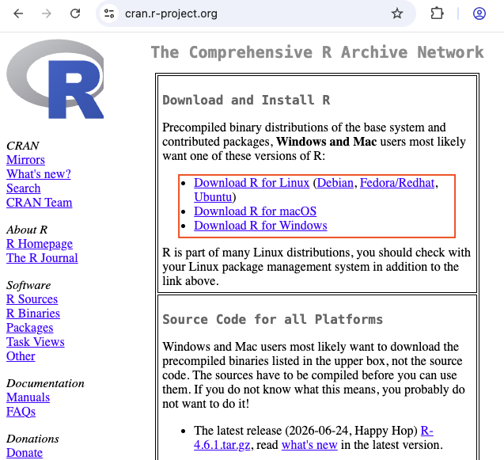
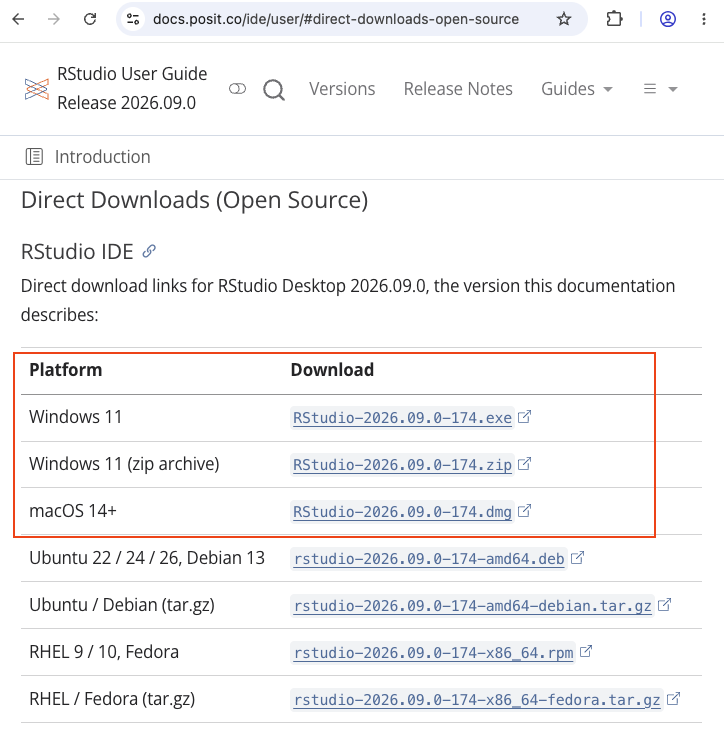
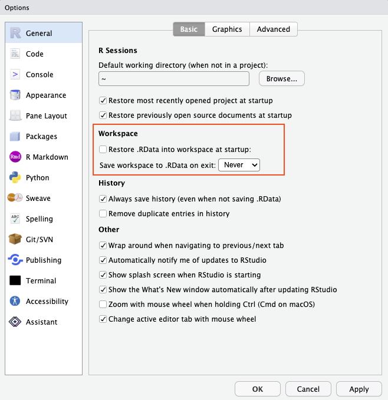
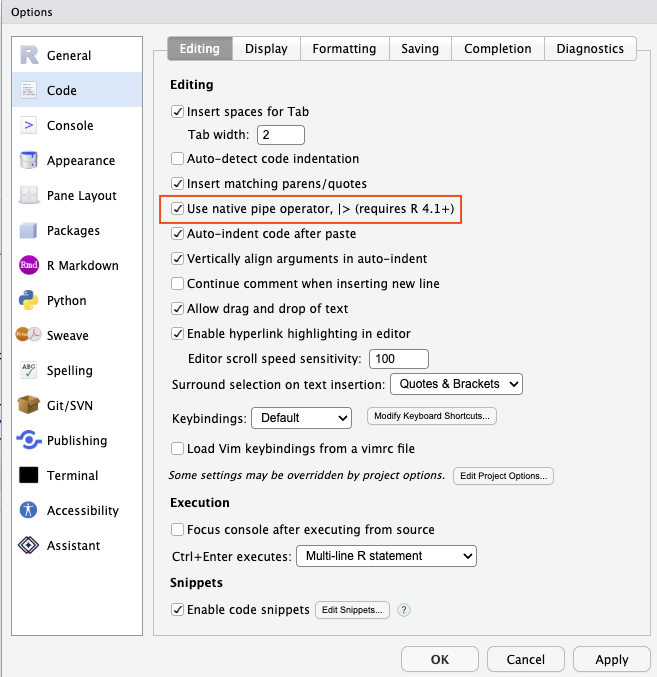

# R onboarding {#sec-onboarding}

::: {.callout-note appearance="simple"}
📽 [Slides for this module](slides/onboarding_slides.html){target="_blank" rel="noopener"} · [PDF handout](slides/onboarding_slides_handout.pdf){target="_blank" rel="noopener"} · 💻 [R code for this module](code/00-r-onboarding.R){download="00-r-onboarding.R"}
:::

::: {.callout-note appearance="simple"}
**Self-paced · about 2–3 hours · complete before the second session.** Work through this module at your own pace. If you get stuck, ask your AI assistant of choice (see @sec-onb-help for how to ask well) or post in the forum on Canvas. A short setup clinic at the start of the second session catches whatever is left.
:::

In this course, we analyze data with the statistical software **R**. This module gets you from zero to a working setup — and to the point where you can run a script, load a data set, and turn your analysis into a reproducible report. It deliberately covers only the *mechanics*; everything conceptual (what to compute, and why) is the job of the chapters.

::: {.callout-tip title="What you will have at the end of this module"}
- [ ] R and RStudio running on your computer — or a working Posit Cloud account
- [ ] A course folder set up as an **RStudio Project**, with subfolders for code, data, and graphics
- [ ] A script that loads the course data and runs without errors
- [ ] A short report rendered from R Markdown to **HTML** — the format in which you will submit your assignments

The **checkpoint** in @sec-onb-checkpoint lets you verify all four points in ten minutes.
:::

## Why R? {#sec-onb-why}

R is free, runs on every operating system, and is one of the standard tools of data analysis in research and industry. Its real advantage for this course, however, is **reproducibility**: an analysis written as code can be re-run, checked, corrected, and shared — by you next month, by a colleague, or by your instructors. A sequence of mouse clicks in a spreadsheet cannot.

There is a second, more recent reason. AI assistants now write R code quickly and cheaply. This does not make R skills obsolete — it shifts them: the scarce skill is no longer *typing* code, but *reading and checking* it. You need to recognize what a piece of code does, whether it does what you intended, and where it silently goes wrong. That is exactly what this module and the following chapters train.

## Setting up: two routes {#sec-onb-setup}

You can work with R in two ways. **Route A** (local installation) is recommended: it works offline, has no usage limits, and is what you will use after the course. **Route B** (Posit Cloud) runs in the browser and requires no installation — a good fallback if the installation fails or your computer is managed by an employer.

### Route A: install R and RStudio {#sec-onb-local}

You need two programs, installed **in this order**:

1.  **R** — the language itself. Download it from CRAN, the official R archive: <https://cran.r-project.org>. Choose your operating system and install the latest release with the default settings.
2.  **RStudio Desktop** — the program you actually work in. It is built on top of R: you can use R without RStudio, but not RStudio without R. Download it from <https://posit.co/download/rstudio-desktop/> and install it with the default settings.

{width=90%}

<br>

{width=90%}

::: {.callout-warning title="Known pitfalls — check these before you ask for help"}
- **Folders synced with OneDrive, iCloud, or Dropbox** can cause strange errors when R installs packages or writes files. Keep your course folder in a normal local folder (e.g., `Documents/marketing-analytics`).
- **Special characters in paths** (umlauts, spaces, non-Latin characters in your user name) occasionally break package installation on Windows. If you see errors mentioning a path with such characters, create the course folder directly under `C:/` (e.g., `C:/marketing-analytics`).
- **macOS:** some packages need Apple's *command line developer tools*. If an installation error mentions `xcrun` or a missing compiler, open the Terminal app and run `xcode-select --install`.
- **Old versions:** if you installed R years ago, update it. Many current packages require a recent R version.
:::

### Route B: Posit Cloud {#sec-onb-cloud}

Posit Cloud (<https://posit.cloud>) offers RStudio in your web browser. Create a free account, click *New Project → New RStudio Project*, and you are ready to go — the interface is the same as in the desktop version, so everything below applies. Note that free accounts come with usage limits; check the current conditions on the Posit Cloud website.

## RStudio in ten minutes {#sec-onb-rstudio}

When you open RStudio, you see four panes:

{width=90%}

| Pane | What it is for |
|---|---|
| **Script editor** (top left) | Where you *write* your code and keep it. A script is a plain text file ending in `.R`. |
| **Console** (bottom left) | Where R *executes* code and prints results. You can type here directly, but nothing is saved. |
| **Environment** (top right) | Lists the objects (data sets, values) that currently exist in your session. |
| **Files / Plots / Help** (bottom right) | Browse files, view plots, read help pages. |

: The four panes of RStudio {.striped}

**Always write your code in a script, not in the console.** To run a line of the script, put the cursor in it and press **Ctrl + Enter** (Windows) or **Cmd + Enter** (Mac). To run several lines, select them first. The result appears in the console.

## Work in an RStudio Project {#sec-onb-project}

An **RStudio Project** is a folder that RStudio treats as the home of one piece of work. Its main benefit: when you open the project, R automatically looks for files *in that folder*. This saves you from the most common beginner problem of all — R not finding your files.

1.  *File → New Project → New Directory → New Project*
2.  Name it (e.g., `marketing-analytics`) and choose a normal local folder as its location (see the pitfalls above).
3.  Create the subfolders described in @sec-onb-folders.

From now on, start every work session by opening the project (double-click the `.Rproj` file, or *File → Open Project*).

::: {.callout-important title="One setting to change right now"}
By default, RStudio offers to save your *workspace* (all objects in memory) when you quit, and restores it at the next start. This sounds convenient but causes hard-to-find errors: yesterday's objects silently leak into today's analysis. Your script is the record of your work — not the workspace.

*Tools → Global Options → General*: set **"Save workspace to .RData on exit"** to **Never**, and untick **"Restore .RData into workspace at startup"**.
:::

{width=70%}

You may still come across `setwd("C:/Users/…")` in older tutorials — a command that sets the folder R works in by hard-coding a path. With RStudio Projects, you do not need it; and scripts containing such paths break as soon as they run on another computer.

### A tidy folder structure {#sec-onb-folders}

A project quickly accumulates files: scripts, data sets, charts, reports. Keeping them in separate subfolders from the start makes it easy to find things — and makes file paths predictable. We recommend this structure:

```
marketing-analytics/            <- the project folder
├── marketing-analytics.Rproj   <- double-click to open project
├── code/                       <- .R and .Rmd files
├── data/                       <- data files (.csv, .xlsx, ...)
└── graphics/                   <- saved charts (.png, .pdf)
```

Create the subfolders with the *New Folder* button in the Files pane. Inside the project, you then refer to files by their **relative path** — relative to the project folder — e.g., `read_csv2("data/music_data_fin.csv")` or `ggsave("graphics/genre_shares.png")`. Relative paths work on every computer that has a copy of the project; absolute paths such as `C:/Users/anna/Desktop/…` work only on yours.

{width=70%}

Two rules help to keep things clean: **never modify raw data files by hand** (all changes happen in code, so they can be reproduced), and **use file names without spaces or special characters** — `assignment-1.Rmd` rather than `Assignment 1 (final).Rmd`. Spaces and brackets in file names cause errors in several R tools.

## First steps in R {#sec-onb-first-steps}

::: {.callout-tip title="How to run the code in this module"}
Every grey box below contains R code; the output R produces is shown directly beneath it. Don't just read the code — **run it yourself**:

1.  Create a new script: *File → New File → R Script*, and save it as `code/first-steps.R`.
2.  **Type** (or copy) the code from a grey box into the script. Typing it yourself is slower, but you will remember it far better.
3.  Put the cursor in a line and press **Ctrl + Enter** (Windows) or **Cmd + Enter** (Mac) — or click the **Run** button at the top of the script editor. To run several lines, select them first; to run the whole script, press **Ctrl/Cmd + Shift + Enter**.
4.  Compare the result in the **console** with the output shown here.

Alternatively, download the complete [R code for this module](code/00-r-onboarding.R){download="00-r-onboarding.R"}, open it in RStudio, and run it line by line.
:::

### Objects and assignment

Anything you create in R is an **object**. You create objects with the assignment operator `<-` (shortcut: **Alt + -**, Mac: **Option + -**):

```{r}
streams <- 163608          # assign a number to the object 'streams'
streams                    # typing the name prints the value
streams * 2                # objects can be used in calculations
artist <- "Imagine Dragons"  # text must be put in quotation marks
```

Everything after a `#` is a **comment**: R ignores it, but your future self will thank you for it. R is **case-sensitive** — `streams` and `Streams` are two different objects. Object names may contain letters, numbers, `_` and `.`, and must start with a letter.

**Naming conventions.** There are several common styles for names that consist of more than one word:

| Style | Example |
|---|---|
| snake_case (lower case, underscores) | `music_data`, `mean_streams` |
| CamelCase | `MusicData`, `MeanStreams` |
| dot.case | `music.data`, `mean.streams` |

: Common naming styles {.striped}

All three work — what matters most is **consistency**: if one object is called `music_data` and the next `MeanStreams`, you will constantly mistype names (remember that R is case-sensitive), and your code becomes harder to read. In this course, we use **snake_case**, the convention of the tidyverse. Choose names that describe the content (`top_tracks` rather than `df2`), and avoid names of existing functions such as `mean` or `data`.

::: {.callout-important title="The console shows + instead of >"}
If the console shows a `+` instead of the usual `>`, R is waiting for you to finish a command — usually because of a missing closing bracket or quotation mark. Complete the command, or press **Esc** to abort.
:::

### Functions and arguments

Most of what you do in R, you do by calling **functions**. A function takes inputs (*arguments*) and returns a result:

```{r}
seq(from = 1, to = 10, by = 3)   # arguments named explicitly
seq(1, 10, 3)                     # same result, arguments in default order
round(3.14159, digits = 2)
```

If you name the arguments, their order does not matter; if you do not, you must follow the order the function expects. To find out which arguments a function takes, open its help page with `?seq` (or press **F1** with the cursor on the function name). When typing a function name, RStudio suggests completions — press **Tab** to see them.

### Vectors and data types

A **vector** is a sequence of values of the same type, created with `c()` ("combine"):

```{r}
top_streams <- c(163608, 126687, 120480, 110022, 108630)
top_genres  <- c("Dance", "Alternative", "Latino", "Dance", "Dance")
top_explicit <- c(FALSE, FALSE, FALSE, TRUE, FALSE)

mean(top_streams)   # many functions work on whole vectors
class(top_genres)   # class() tells you the type of an object
```

The most important data types are:

| Type | Example | Typical use |
|---|---|---|
| **numeric** | `163608`, `3.14` | Quantities: streams, prices, ratings on a numeric scale |
| **character** | `"Dance"` | Text: names, titles, free-text answers |
| **factor** | `factor(c("Pop", "Rock"))` | Categories with a fixed set of values: genres, conditions of an experiment |
| **logical** | `TRUE`, `FALSE` | Yes/no information; results of comparisons |
| **Date** | `as.Date("2026-10-12")` | Calendar dates |

: The most important data types in R {.striped}

Types can be converted with `as.numeric()`, `as.character()`, `as.factor()`, `as.Date()`, etc. Why the type matters — and why a number is not always a quantity — is a topic of @sec-describing.

### Data frames

A **data frame** is R's version of a table: each **column** is a variable (a vector), each **row** an observation. All columns have the same length but may have different types. Almost all data you will analyze in this course comes as a data frame.

```{r}
top_tracks <- data.frame(
  artist   = c("Axwell /\\ Ingrosso", "Imagine Dragons", "J. Balvin"),
  streams  = c(163608, 126687, 120480),
  explicit = c(FALSE, FALSE, FALSE)
)
top_tracks            # print the whole data frame
top_tracks$streams    # $ extracts one column as a vector
str(top_tracks)       # structure: number of rows, and type of each column
```

Use `View(top_tracks)` (capital V) to open a data frame in a spreadsheet-like viewer.

### Packages

R's functionality comes in **packages**. A few are included with R; thousands more can be installed from CRAN. The distinction to remember:

- `install.packages("tidyverse")` downloads and installs a package. You do this **once per computer**.
- `library(tidyverse)` loads an installed package so you can use its functions. You do this **in every session** — put it at the top of every script.

```{r}
#| eval: false
# Run once (then comment out or delete the line):
install.packages(c("tidyverse", "psych", "readxl", "haven", "rmarkdown"))
```

```{r}
#| message: false
library(tidyverse)   # loads dplyr, ggplot2, readr and more
```

If R reports `could not find function "…"`, you have most likely forgotten to load the package that contains the function. You can also call a function without loading its package by writing `package::function()` — e.g., `dplyr::filter()`.

### Three dialects of R — and why we use the tidyverse {#sec-onb-dialects}

R is an old and flexible language, and over time three "dialects" have emerged that do the same things with different syntax. You will meet all three in tutorials, on forums, and in AI-generated code — so it helps to recognize them. Here is the same task in each: *"keep the pop tracks and compute their average number of streams"*.

```{r}
#| eval: false
# Base R: built into R, no packages needed
pop <- music_data[music_data$genre == "Pop", ]
mean(pop$streams)

# tidyverse: readable pipelines of "verbs"
music_data |>
  filter(genre == "Pop") |>
  summarise(mean_streams = mean(streams))

# data.table: very fast for very large data sets
library(data.table)
music_dt <- as.data.table(music_data)
music_dt[genre == "Pop", mean(streams)]
```

| Dialect | Strengths | Drawbacks |
|---|---|---|
| **Base R** | Always available; stable for decades | Square brackets and `$` quickly become hard to read |
| **tidyverse** | Code reads like a sentence; consistent function names; `ggplot2` for charts; the largest learning resources (e.g., *R for Data Science*) | Requires packages; some functions change between versions |
| **data.table** | Extremely fast and memory-efficient | Compact syntax that is hard for beginners |

: Three dialects of R {.striped}

**In this course, we use the tidyverse** — most of all because its code is *readable*: a pipeline such as `filter() |> group_by() |> summarise()` can be read aloud as a sequence of steps, which makes it much easier to check what a piece of code does, whether you wrote it or an AI assistant did. That said, you should be able to *read* base R, because you will encounter it everywhere; @sec-describing contains a translation table for the most important operations.

The `|>` symbol in the tidyverse example is the **pipe**: it passes the result of one step on to the next ("and then"). You will also see the older pipe `%>%`, which does the same for our purposes. The pipe is introduced properly in @sec-describing.

::: {.callout-tip title="Set up your keyboard shortcuts"}
A handful of shortcuts save a lot of typing:

| Action | Windows | Mac |
|---|---|---|
| Run current line / selection | Ctrl + Enter | Cmd + Enter |
| Run the whole script | Ctrl + Shift + Enter | Cmd + Shift + Enter |
| Assignment operator `<-` | Alt + - | Option + - |
| Pipe operator \|> | Ctrl + Shift + M | Cmd + Shift + M |
| Insert a code chunk (R Markdown) | Ctrl + Alt + I | Cmd + Option + I |
| Knit the document | Ctrl + Shift + K | Cmd + Shift + K |
| Comment / uncomment lines | Ctrl + Shift + C | Cmd + Shift + C |
| Help for the function under the cursor | F1 | F1 |

By default, the pipe shortcut inserts the older `%>%`. To make it insert the native pipe `|>` used in this course, go to *Tools → Global Options → Code → Editing* and tick **"Use native pipe operator, |>"**. All shortcuts can be changed under *Tools → Modify Keyboard Shortcuts…* — search for a command by name and click into the *Shortcut* column to assign a new key combination.
:::

{width=70%}

## Loading the course data {#sec-onb-data}

The main data set of the next chapter contains streaming chart data for about 67,000 tracks. You can load it in two ways.

**Directly from the course repository on GitHub** — convenient, but requires an internet connection every time:

```{r}
#| message: false
music_url <- "https://raw.githubusercontent.com/wu-rds/MA2026/main/data/music_data_fin.csv"
music_data <- read_csv2(music_url)
dim(music_data)   # number of rows and columns
```

**From your project folder** — download the file once ([music_data_fin.csv](https://raw.githubusercontent.com/wu-rds/MA2026/main/data/music_data_fin.csv){download="music_data_fin.csv"}), (right-click → *Save link as…*), save it in your project's `data` folder, and read it by its relative path:

```{r}
#| eval: false
music_data <- read_csv2("data/music_data_fin.csv")
```

Don't worry about the details yet — why the function is `read_csv2()` and not `read_csv()` is one of the first lessons of @sec-describing. If the command fails, check your internet connection (first variant) or whether the file is really in the `data` folder of your project (second variant) — and that you have loaded the tidyverse.

## Your first reproducible report {#sec-onb-report}

Your assignments are submitted as **reproducible reports**: documents that combine text, R code, and the code's output, created with **R Markdown**. When you *knit* (render) an R Markdown file, R runs all code from top to bottom in a fresh session and assembles the result into an HTML file. A report that knits without errors is therefore proof that the analysis works — which is exactly why we ask for it.

1.  *File → New File → R Markdown…* → give it a title, choose **HTML** as the output format → *OK*. (If RStudio asks to install packages, confirm.)
2.  Save the file as `code/first-report.Rmd`.
3.  Click the **Knit** button. After a few seconds, an HTML document opens.

{width=95%}

An R Markdown file has three ingredients:

- The **header** between the two `---` lines at the top: title, author, output format.
- **Text**, formatted with simple Markdown: `**bold**`, `*italic*`, `# Heading`, `- bullet point`.
- **Code chunks**, which start with ```` ```{r} ```` and end with ```` ``` ````. Insert a new chunk with **Ctrl + Alt + I** (Mac: **Cmd + Option + I**) and run it with the green arrow.

::: {.callout-important title="Keep the chunk delimiters intact"}
Every code chunk must be enclosed by **three backticks** — ```` ```{r} ```` on the line where it starts and ```` ``` ```` on the line where it ends. The backtick (`` ` ``) is *not* an apostrophe (`'`); on German keyboards, it is next to the ß key (press it together with Shift, then the space bar). If you accidentally delete one of the backticks, or the closing line altogether, R Markdown no longer recognizes where the code ends — the document fails to knit, or code suddenly appears as plain text in the output. When a report that knitted before suddenly fails, check the chunk delimiters first. Inserting chunks with the shortcut (see above) avoids the problem altogether.
:::

Replace the template's example content with your own. A minimal report looks like this:

````markdown
---
title: "First report"
author: "Your name"
output: html_document
---

## Loading the data

```{{r}}
library(tidyverse)
# the report is saved in code/, the data in data/ -> go one folder up with ../
music_data <- read_csv2("../data/music_data_fin.csv")
```

The data set contains `r knitr::inline_expr("nrow(music_data)")` tracks.
````

The last line shows **inline code**: `` `r ` `` followed by an expression inserts its result directly into the text — so the number in your report is always the number in your data.

::: {.callout-important title="The golden rule of reports"}
A report knits in a *fresh* R session. Everything the report needs — `library()` calls, loading the data, every intermediate step — must therefore be *in the report*. If your code works in the console but the report fails to knit, you are almost certainly relying on something that exists only in your current session.
:::

::: {.callout-note title="File paths in reports"}
A report looks for files relative to *its own* location. If your report is saved in `code/` and the data in `data/`, the path from the report to the data is `"../data/music_data_fin.csv"` (`..` means "one folder up"). Alternatively, save your reports directly in the project folder, or load the data from the course website.
:::

::: {.callout-important title="macOS: \"Operation not permitted\""}
If you see **"Operation not permitted"** when knitting or reading files, RStudio lacks permission to access the folder. Open *System Settings → Privacy & Security → Files & Folders* (or *Full Disk Access*), allow RStudio access, and restart RStudio — or keep your course folder directly in your home folder (e.g., `~/marketing-analytics`).
:::

## Getting help — and working with AI assistants {#sec-onb-help}

Errors are part of working with R — for beginners and experts alike. They are not a sign that you are doing something wrong, but R's way of telling you where to look.

### Reading error messages

Read the message *before* you do anything else: it usually names the problem. The most common ones:

| Message | What it usually means |
|---|---|
| `could not find function "…"` | The package containing the function is not loaded — add `library(…)` — or the function name is misspelled. |
| `object '…' not found` | The object does not exist (yet): a typo, a wrong capitalization, or the line that creates it has not been run. |
| `cannot open file '…': No such file or directory` | R looks for the file in the wrong place, or the file name is misspelled. Are you working in your RStudio Project? |
| `unexpected symbol` / `unexpected ')'` | A syntax error: a missing comma, bracket, or quotation mark. |
| `there is no package called '…'` | The package is not installed yet — run `install.packages("…")` once. |
| `$ operator is invalid for atomic vectors` | You used `$` on something that is not a data frame. |

: Common error messages and what they mean {.striped}

### AI assistants: what they are good at

AI assistants are an endorsed study aid in this course (see the AI policy in the [Introduction](00-introduction.qmd)). There are two ways to use them:

- **Chat assistants** such as ChatGPT, Claude, Gemini, or Perplexity, which you use in the browser. You describe what you need, paste code or error messages, and get code and explanations back.
- **Assistants inside RStudio.** **GitHub Copilot** suggests code directly in the script editor as you type — it completes lines and turns comments into code. To activate it, go to *Tools → Global Options → Copilot* and sign in with a GitHub account; the [RStudio documentation on GitHub Copilot](https://docs.posit.co/ide/user/ide/guide/tools/copilot.html) explains the setup step by step. Verified students can get free access to Copilot through GitHub Education; check the current conditions on the GitHub website. R packages such as `gptstudio` connect RStudio to chat assistants as well.

{width=90%}

In our experience, AI assistants are **good at**:

- **Generating standard code**: data handling, loops, charts, simple models — especially boilerplate code you would otherwise look up.
- **Explaining**: what a function does, what an error message means, why a piece of code behaves as it does.
- **Debugging**: finding typos and syntax errors, and suggesting fixes.
- **Suggesting alternatives**: other functions, other ways to do the same thing, best practices.

They are **less reliable** at statistical reasoning and at interpreting results — they will answer fluently even when they are wrong, unless you provide very detailed context. Copilot, in addition, works best when you write clear comments or start a line of code yourself: its suggestions are based on what it sees in your script.

### Asking an AI assistant — well

How good the answer is depends on how good the question is:

- **Give context.** The assistant cannot see your data. Paste the output of `str(your_data)` (or at least the relevant columns), the code, and the *complete* error message.
- **Be specific about what you want.** "A scatter plot of valence against danceability with hollow pink circles, a red regression line, and the regression coefficient as a label" gets you much further than "make a nice plot".
- **Start small.** Begin with a simple request — a distribution, a basic plot, a simple model — and add complexity step by step.
- **Ask for an explanation, not just a fix.** "Why does this error occur, and what does the corrected line do differently?" teaches you something; "fix this" does not.

Here is an example of a good prompt:

````markdown
I am working in R with the following data frame:

> str(music_data)
'data.frame': 66796 obs. of 31 variables:
 $ isrc        : chr "BRRGE1603547" "USUM71808193" ...
 $ danceability: num 50.9 35.3 68.3 70.4 84.2 ...
 $ valence     : num 65.1 43.7 43.4 49.5 19 ...

Please provide the code for a publication-ready scatterplot between valence
and danceability with pink hollow circles and a red regression line, and
label the regression line with the linear regression coefficient.
````

{width=95%}

Assistants are just as useful when something goes wrong. Suppose you run the generated code after making a small change, and R reports:

```
Error in geom_pont(color = "pink", shape = 1, size = 2, alpha = 0.6) :
  could not find function "geom_pont"
```

Paste the code *and* the error message into the chat and ask how to resolve it. The assistant will point out the typo — the function is called `geom_point()`, not `geom_pont()` — and return the corrected code.

### Always verify: assistants can be confidently wrong

The most important rule: **check every answer — code and explanation — before you rely on it.** AI assistants produce plausible-looking output that is sometimes subtly wrong, and they rarely signal uncertainty. A real example: asked to explain how R computes percentiles, a chat assistant explained correctly how the calculation works — and then, in its own example, reported the median of the numbers 1, 2, and 10 as **2.5**. Running the code takes five seconds and shows the correct answer:

```{r}
x <- c(1, 2, 10)
quantile(x, c(0.25, 0.5, 0.75), type = 7)   # R's default method
```

The median is **2**, not 2.5. Only when the user asked where the 2.5 came from did the assistant acknowledge "a small typo". Note what saved the day: not a better prompt, but *running the code and checking the result*.

{width=95%}

::: {.callout-important title="Using AI assistants mindfully"}
- **Foundations first.** An assistant cannot replace understanding R fundamentals — you need to know what you are asking, and recognize a wrong answer.
- **Critical thinking.** Check outputs for correctness, efficiency, and reproducibility: run the code, look at the result, and ask whether it makes sense.
- **Accelerate, don't bypass, learning.** Use suggestions to learn faster — not to skip learning. If you could not explain the code to someone else, you are not done yet.
- **Transparency.** Disclose your AI use in the assignments, and make sure you understand and can explain every line you submit (see the AI policy in the [Introduction](00-introduction.qmd)).
:::

### Other sources of help

- **Help pages:** `?function_name` explains a function's arguments and shows examples at the bottom of the page.
- **The forum on Canvas:** choose the relevant chapter, check whether your question has been asked before, and include your code *and* the error message (as text or screenshot). If you have the question, so do five others.
- **Cheat sheets:** one-page summaries of the most important packages, available via *Help → Cheat Sheets* in RStudio.
- **R for Data Science** (<https://r4ds.hadley.nz>) — the free standard introduction to the tidyverse.

## Checkpoint {#sec-onb-checkpoint}

You are ready for the second session if you can do the following in about ten minutes:

1.  Open your RStudio Project (or Posit Cloud project) and check that it contains the subfolders `code`, `data`, and `graphics`.
2.  Download the course data into the `data` folder (see @sec-onb-data).
3.  Create a new R Markdown file, delete the template content below the header, and insert one code chunk that loads the tidyverse and the course data.
4.  Below the chunk, write one sentence that reports the number of tracks using inline code.
5.  Add a second chunk with `str(music_data)`.
6.  Knit the file to HTML.

If the HTML opens and shows the structure of the data, your setup works. If not, work through @sec-onb-help — and bring the problem to the setup clinic at the start of the second session.
