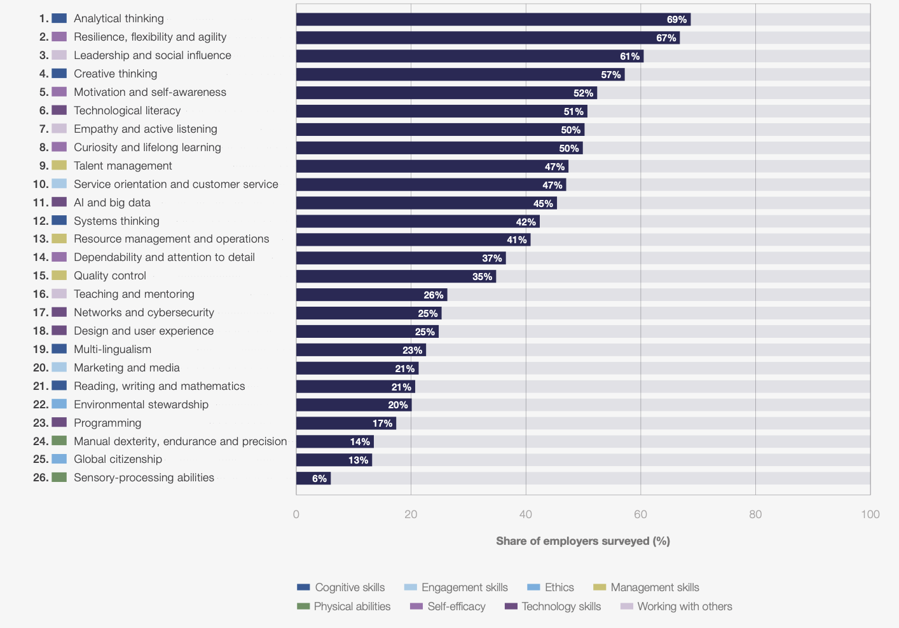
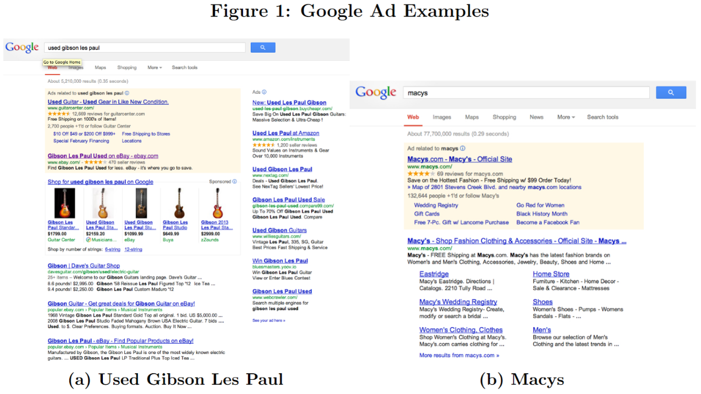
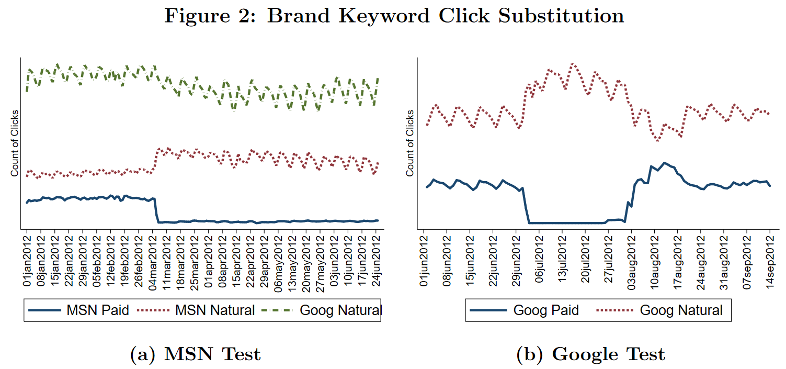
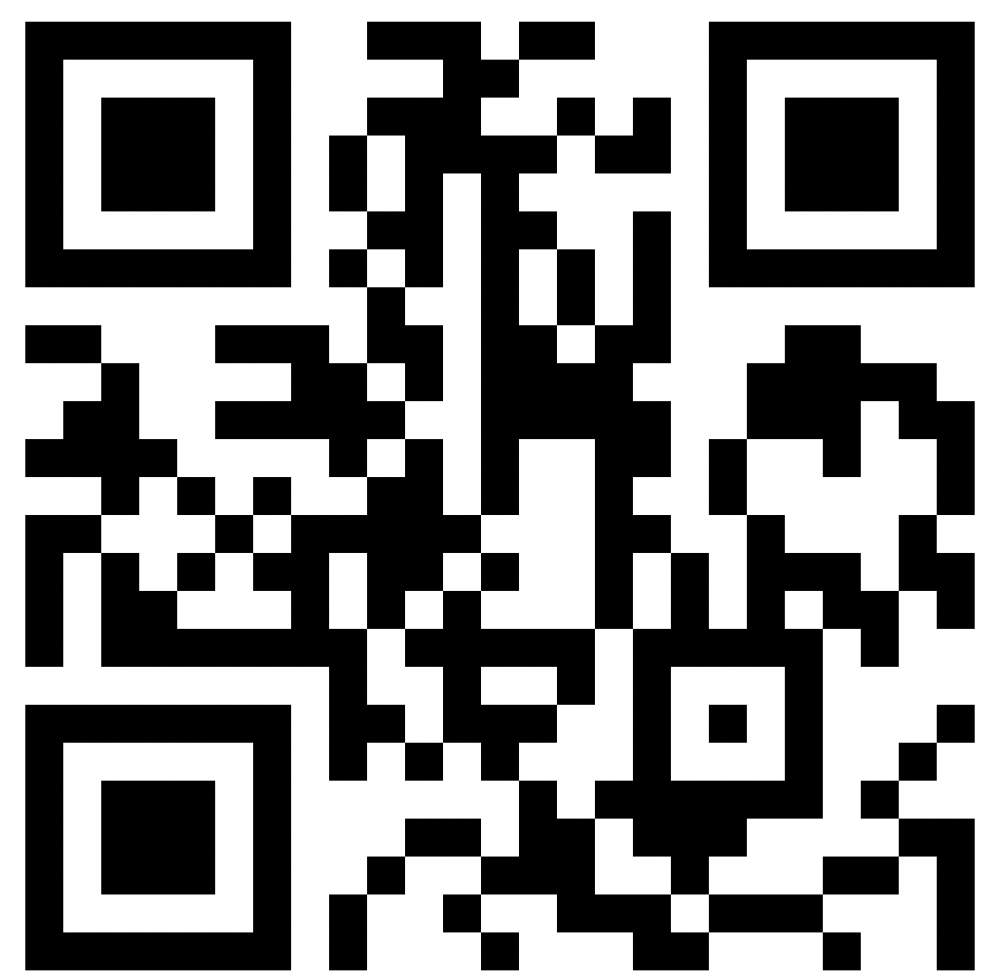

```{r setup}
source("../R/ch01-figures.R")
```


## Who I am… {.smaller}

::: {.columns style="align-items: center;"}
::: {.column width="30%"}
{width="100%" style="border-radius: 12px; margin: -3px; display: block;"}

::: {style="font-size: 0.78em; line-height: 1.45; margin-top: 0.6em;"}
**Contact**

Univ.Prof. Dr. Nils Wlömert\
Room D2.1.452\
[nils.wloemert@wu.ac.at](mailto:nils.wloemert@wu.ac.at)\
T +43 1 31336 4958\
[sites.google.com/view/nilswloemert](https://sites.google.com/view/nilswloemert){target="_blank"}
:::
:::

::: {.column width="70%"}
::: {.keybox style="margin-top: 10px; min-height: 400px;"}
-   **Professor** of Marketing, Vienna University of Economics and Business, Institute for Retailing & Data Science, since 2021
-   **Assistant Professor** of Marketing, Vienna University of Economics and Business, Institute for Interactive Marketing & Social Media, 2015--2020
-   **Ph.D.** in Marketing, University of Hamburg, 2010--2014
-   **Dissertation topic:** "Information Technology and Online Content Distribution"
-   **Universal Music Group:** Business Analyst & Digital Marketing Manager, 2008--2010
-   **Research interests:** multi-channel distribution, online content distribution, digital business models, marketing modeling, e-commerce policies, information goods, targeting & consumer privacy …
:::
:::
:::

## Institut für Retailing & Data Science

::: columns
::: {.column width="54%"}
{width="97%" style="border: 1px solid #ddd; border-radius: 8px; box-shadow: 0 3px 14px rgba(0,0,0,0.18);"}
:::

::: {.column width="46%"}
::: {style="display: flex; flex-direction: column; justify-content: center; align-items: center; text-align: center; min-height: 540px;"}
{width="260"}

[Follow us on LinkedIn!]{style="font-size: 1.25em; font-weight: 600; margin-top: 0.8em;"}

[linkedin.com/company/institut-für-retailing-data-science-rds](https://www.linkedin.com/company/institut-f%C3%BCr-retailing-data-science-rds/){target="_blank" style="font-size: 0.6em; margin-top: 0.5em;"}
:::
:::
:::

## Contacts {.smaller}

::: columns
::: {.column width="50%"}
::: {style="text-align: center;"}
{width="240" style="border-radius: 10px;"}

**Lecture & group project**

Univ.Prof. Dr. Nils Wlömert\
[nils.wloemert@wu.ac.at](mailto:nils.wloemert@wu.ac.at)
:::
:::

::: {.column width="50%"}
::: {style="text-align: center;"}
{style="width: 240px; height: 300px; object-fit: cover; border-radius: 10px;"}

**Assignments**

Anna Di Donato\
[anna.di.donato@wu.ac.at](mailto:anna.di.donato@wu.ac.at)\
Consultation hours:\ Fridays 3:00PM - 5:00PM (by appointment)
:::
:::
:::

::: keybox
**Before you write an email:** course site → AI tools / forum on Canvas → ask in class. If you have the question, so do five others.
:::

## Before we start: who are you?

::: columns
::: {.column width="50%"}
::: {style="margin-top: 1.5em;"}
Go to **menti.com**\
and enter code **[2171 2732]{style="color: #0f5da8;"}**

-   Your background & prior R experience
-   What you want to get out of this course
:::
:::

::: {.column width="50%"}
{width="320"} 
:::
:::


# Course organization {.divider background-color="#58585a"}

## How this course works {.smaller}

**Weekly sessions & self-study**

-   **Weekly in-person sessions** (see schedule) — concepts, live analysis, discussion, and lots of time for questions
-   **Self-study *after* each session:** the course book on the website consolidates the session — chapter text, commented code, and a learning check; slides, code & PDF handouts linked from every chapter
-   Each session opens with a short **paper quiz** on the previous chapter *(counts toward participation)*
-   **Before session 2:** complete the self-paced **R onboarding module** (install R/RStudio)

**Applying the knowledge**

-   **Three individual assignments** transfer the methods to new business settings — reproducible reports (.Rmd), submitted via Canvas, short in-class debrief *(details in a moment)*
-   **Group project:** design & conduct a real market research project — two coaching sessions, results submitted as a **pre-recorded video presentation**

**Getting help**

-   **Forum on Canvas** / **AI-Tools** first; then coaching sessions & in-person sessions

::: notes
Key change to state explicitly for students who know the old format from peers: reading comes AFTER class now — sessions are the first exposure, the book is the consolidation. No pre-recorded videos anymore; the chapters carry that role.
:::

## Schedule — Group A (Mondays) {.smaller}

| # | Date | Time | Room | Topic |
|:-:|--------|--------|------|-----------------|
| 1 | Mon, Oct 5 | 13:00–16:00 | TC.4.03 | Questions, decisions & data |
| 2 | Mon, Oct 12 | 13:00–17:00 | D3.0.233 | Describing data |
| 3 | Mon, Oct 19 | 13:00–17:00 | D3.0.233 | Uncertainty & Experiments I |
| 4 | Tue, Oct 27 | 13:00–16:00 | TC.5.05 | Experiments II |
| 5 | Mon, Nov 2 | 13:00–16:00 | TC.4.03 | Observational data I |
| 6 | Mon, Nov 9 | 13:00–16:00 | TC.4.03 | Observational data II |
| 7 | Mon, Nov 16 | 13:00–16:00 | TC.4.03 | Mechanisms & heterogeneity |
| 8 | Mon, Nov 23 | 13:00–16:00 | TC.4.03 | Survey design |

## Assignments — Group A (Mondays) {.smaller}

::: columns
::: {.column width="62%"}
| # | Topic | Hand-out | Submission | Debrief |
|---|------|----|---|----|
| A1 | Data handling & description in R | Mon, Oct 12 | Mon, Oct 26 | Tue, Oct 27 |
| A2 | Analyzing experiments | Tue, Oct 27 | Sun, Nov 8 | Mon, Nov 9 |
| A3 | Analyzing observational data | Mon, Nov 9 | Sun, Nov 22 | Mon, Nov 23 |

-   Submitted as a **reproducible report** (.Rmd → HTML) via Canvas — **deadline: the day before the debrief session**
-   Every student receives an **individual dataset** — results and conclusions differ **by design**
-   **Debrief** = 3 short paper questions about *your* results at the start of the next session — **report 7 + debrief 3 points**; your lowest debrief score is replaced by the average of the other two
:::

::: {.column width="38%"}
{width="88%" style="border-radius: 6px; margin-top: 0.5em;"}
:::
:::

::: notes
The assignments run as a relay: exactly one is open at any time, each with about two weeks of working time. A1's deadline falls on the national holiday (Oct 26) — intentional, it is the day before the Tuesday session.
:::

## Schedule — Group B (Thursdays) {.smaller}

| # | Date | Time | Room | Topic |
|:-:|--------|--------|------|-----------------|
| 1 | Thu, Oct 8 | 13:00–16:00 | TC.5.03 | Questions, decisions & data |
| 2 | Thu, Oct 15 | 13:30–17:30 | TC.3.03 | Describing data |
| 3 | Thu, Oct 22 | 13:00–17:00 | TC.5.15 | Uncertainty & Experiments I |
| 4 | Thu, Oct 29 | 13:00–16:00 | TC.5.03 | Experiments II |
| 5 | Thu, Nov 5 | 13:00–16:00 | TC.5.03 | Observational data I |
| 6 | Thu, Nov 12 | 13:00–16:00 | TC.5.03 | Observational data II |
| 7 | Thu, Nov 19 | 13:00–16:00 | TC.5.03 | Mechanisms & heterogeneity |
| 8 | Thu, Nov 26 | 13:30–16:30 | TC.3.03 | Survey design |

## Assignments — Group B (Thursdays) {.smaller}

::: columns
::: {.column width="62%"}
| # | Topic | Hand-out | Submission | Debrief |
|---|------|----|---|----|
| A1 | Data handling & description in R | Thu, Oct 15 | Wed, Oct 28 | Thu, Oct 29 |
| A2 | Analyzing experiments | Thu, Oct 29 | Wed, Nov 11 | Thu, Nov 12 |
| A3 | Analyzing observational data | Thu, Nov 12 | Wed, Nov 25 | Thu, Nov 26 |

-   Submitted as a **reproducible report** (.Rmd → HTML) via Canvas — **deadline: the day before the debrief session**
-   Every student receives an **individual dataset** — results and conclusions differ **by design**
-   **Debrief** = 3 short paper questions about *your* results at the start of the next session — **report 7 + debrief 3 points**; your lowest debrief score is replaced by the average of the other two
:::

::: {.column width="38%"}
{width="88%" style="border-radius: 6px; margin-top: 0.5em;"}
:::
:::

## Group project & final exam — key dates {.smaller}

| Milestone | Group A (Mondays) | Group B (Thursdays) |
|--------------------|------------|------------|
| Coaching I — questionnaire design *(online)* | Mon, Nov 30, 13:00–17:00 | Thu, Dec 3, 14:00–18:00 |
| Field your survey | December | December |
| Coaching II — data analysis *(online)* | Thu, Jan 7, 13:00–17:00 | Fri, Jan 8, 14:00–18:00 |
| Submission: video presentation | Wed, Jan 20 | Wed, Jan 20 |
| Submission: peer review of one other group's video | Mon, Jan 25 | Mon, Jan 25 |

::: {.keybox style="margin-top: 1em;"}
**Final exam (both groups):** Tue, **Dec 15**, 10:00–12:00, D5.0.001 — *paper & pencil, open book (slides), in person*
:::

## Our AI policy 

::: {.keybox style="margin-top: 1.2em;"}
**AI assistants are welcome in the assignments** — they may support your work at every step, but not do it for you: a submission without individual contribution earns no credit, disclosed or not. You must be able to **explain everything you submit** (that is what the debrief checks), and each report ends with a short **AI-use disclosure**. Honest disclosure is never penalized; concealing substantial AI use is. The final exam is the unassisted layer: paper & pencil, in person.
:::

<br>

::: {style="text-align: center; font-size: 1.15em; margin-top: 1em;"}
*"How much AI is allowed?" — As much as you like,\
provided you can stand here and explain what was done and why.*
:::

::: notes
This is the slide to slow down on. The italic line is the whole policy in one sentence — say it, let it sit.
:::

## Use it — but don't let it study for you

::: columns
::: {.column width="60%"}

{width="70%"}
:::

::: {.column width="40%"}
-   **26,811 Chinese students**, 30-month panel: AI adoption → homework **+18%**, time **−30%** — but exam scores **−20%**; entrance exams **−18/−24%** after two years
-   Driven by the **~80% who outsource**; students who used AI but spent **the same time** on homework: **no learning loss**

::: source
Sources: Strömberg, Lei & Wu (2026); Autor et al. (2026, NBER WP 35720); Bastani et al. (2025, PNAS); Kestin et al. (2025). Figures: Strömberg et al. (2026), Fig. 2 — red ×: AI adopters, blue ○: never-AI students.
:::
:::
:::


::: notes
The point is NOT "AI bad" — that would contradict the policy just shown. The point: outcomes depend on HOW you use it. Outsourcers lose; engaged users don't; professionals with foundations convert AI practice into skill. Our design mirrors this literature almost mechanically: assignments = your homework with AI allowed; debrief & exam = your closed-book layer; the course = building the foundations that make AI work FOR you. If asked about the second bullet: that's exactly why the debrief asks about YOUR results. One more for Q&A: MIT's "Your Brain on ChatGPT" (Kosmyna et al. 2025) — essay writers with AI recall their own arguments worse.
:::


## Grading {.midsize}

::: {style="width: 99%;"}
| Component | Weight |
|:--------|:--:|
| Market research **group project** (design → data collection → analysis → **video presentation**) | 30% |
| Individual **take-home assignments** (3 × reproducible report + **in-class debrief**; each 7 + 3 points) | 30% |
| **Final exam** (concepts & methods — no coding · **course slides may be used**, paper & pencil, in person) | 30% |
| **Class participation** (weekly quizzes · active contributions in class & forum) | 10% |
:::

::: {style="margin-top: 1em; margin-left: 0.8em;"}
-   Pass threshold I: **60%** weighted total
-   Pass threshold II: you need to be present **80%** of the in-class time
-   Group project: **peer assessment** + **contribution & AI-use statement** enter the individual grade
-   Participation = **quizzes** (up to 6 points, best 6 of 7) **+ active contributions** (up to 6 points, max. 1 per session, incl. forum) — **capped at 10**: strengths in one can compensate for the other
-   Assignment dates: see slides · all details on the course site
:::

## Grading scheme

::: columns
::: {.column width="55%"}
| Overall percentage | Grade |
|:---:|:---:|
| 90–100% | 1 (excellent) |
| 80–89% | 2 (good) |
| 70–79% | 3 (satisfactory) |
| 60–69% | 4 (sufficient) |
| < 60% | 5 (fail) |
:::

::: {.column width="45%"}
::: {.keybox style="margin-top: 2.5em;"}
To pass, your **weighted final grade** must reach at least **60%** — across all components combined; there is no minimum per component.
:::
:::
:::

## Course materials {.midsize}

-   **Main reference: the course website** — full chapters with explanations, commented R code, and learning checks; **slides & PDF handouts** linked from every chapter
-   Everything is **free & always current** — no textbook purchase required
-   **Optional further reading** linked on the site
-   **Canvas**: assignment hand-outs & submissions, forum, announcements
-   Example exams: provided on Canvas **before the exam**

::: notes
Message: the website IS the book — nothing to buy, nothing to print. Canvas = workflow, website = content.
:::


## The group project in one sentence

You will **design a survey containing a real randomized experiment**, field it, analyze the data, and present the results — everything this course teaches, built by you.

*(Details follow — and at the end of today's session you will see why "randomized" is the most important word in that sentence.)*

## The group project: two parts {.smaller}

::: columns
::: {.column width="45%"}
**Part 1 · Questionnaire design & data collection**

-   Pick a topic: **14 proposed topics** (with starter literature) — or suggest your own
-   Design a questionnaire (**≈ 30 questions**, ~5 per member) in **Qualtrics** — free account provided
-   Your design contains a **real experiment**: participants randomly assigned to conditions
-   **Coaching I:** present your draft (research problem, design, measurement, planned analyses) → feedback → revise
-   **Field it:** each member recruits **≈ 20 respondents** → **≈ 120 responses** per group
:::
::: {.column width="5%"}
:::
::: {.column width="45%"}
**Part 2 · Data analysis & presentation**

-   Import & clean your Qualtrics data in R
-   Analyze: descriptives → your **experimental comparison** → heterogeneity (for whom does it work?)
-   **Coaching II:** work through your analysis with us *(online)*
-   Submit a **.zip**: pre-recorded **video presentation** + data + reproducible R code + slides
-   Afterwards: **peer review** — each of you reviews **one** other group's video (structured form)
:::
:::

::: keybox
**Individual grades:** peer assessment within the group + a short **contribution & AI-use statement** + your **peer review** of one other video (2 of 30 points).
:::

## Group project: what makes it good {.midsize}

-   A **precise research question** with managerial relevance — and hypotheses stated *before* data collection
-   A clean **experimental manipulation**: everything constant except the treatment; randomizer placed correctly
-   **Keep it simple**: 2 conditions are sufficient (your sample size will be limited)
-   **Deliberate measurement:** a dependent variable with real variation (e.g., willingness to pay)
-   Incorporate **moderators** to analyse heterogeneous treatment responses 
-   Incorporate **mediators** to understand the process 
-   Analyses **matched to the design** — justified test choice, honest uncertainty, assumptions checked
-   A presentation that **tells the decision-maker what to do** — not a parade of charts

::: source
Full guidelines, topic list, Qualtrics templates & how-tos: **"Group project" section on the course site**.
:::

## Course goals {.midsize}

**After taking this course, you should…**

::: incremental
-   …know why analytical skills have become **career-defining** for marketers — and which skills stay scarce when AI does the mechanics
-   …know **what data can and cannot tell you** — and recognize which question you are actually asking: *describe, predict, explain, decide*
-   …know **when to use which method** — and which assumptions the answer rests on
-   …be able to **implement the methods in R** — with AI assistants as accelerators, not replacements
-   …be able to **judge analyses made by others** — a colleague's slide deck, a platform dashboard, an AI-generated report
-   …be able to **conduct your own research project** — from question to data to recommendation
-   …no longer be **afraid of numbers & statistics** (in case you were)
-   …feel the **desire to learn more** about analytics
:::

::: notes
Bridge to content: "Goal number two is where we start — right after one story about how the world's smartest analysts got it wrong."
:::

## Today's session {.midsize}

::: columns
::: {.column width="55%"}
**Part A — Why we are here**

1.1 Motivation: data and AI in marketing\
1.2 Case study: search advertising at eBay

**Part B — The framework of the course**

1.3 Types of research questions\
1.4 Correlation and causation\
1.5 Variables and their roles\
1.6 Randomization\
1.7 Quasi-experiments
:::

::: {.column width="45%"}
**Part C — Making it work**

1.8 From business problem to research design\
1.9 The analytics workflow

::: keybox
**One promise for today:** no R output, no tests, and just one simple formula. Concepts and pictures — the machinery follows in later sessions.
:::
:::
:::

# 1.1 Motivation: data and AI in marketing {.divider background-color="#0a3d6e"}

## "I don't know which half" {.midsize}

> "Half the money I spend on advertising is wasted; the trouble is I don't know which half."
>
> — John Wanamaker (1838–1922), department store pioneer, Philadelphia

. . .

::: discussion
More than 100 years later, **do we know** today which half of the advertising budget is wasted? What **data** would you need to find out?
:::

::: notes
Let students argue for 2–3 minutes. Typical answers to (1): "yes, with tracking/attribution/dashboards". Don't correct them yet — that confidence is exactly what the eBay case in 1.2 dismantles. For (2), push them towards: we would need to know what would have happened WITHOUT the ads (the counterfactual) — collect the word on the board if someone gets close and come back to it at the end of 1.2.
:::

## Marketing is reorganizing around AI and data

::: columns
::: {.column width="46%"}
::: incremental
-   AI already performs **about a quarter** of marketing activities — nearly **doubled** in two years
-   Generative AI alone: from 7.0% to 22.4% of activities (**+220%** in two years)
-   Marketing leaders expect **more than half** of marketing work to be performed by AI **within three years**
:::
:::

::: {.column width="54%"}
```{r ai-adoption, fig.width=6.4, fig.height=4.8}
fig_ai_adoption()
```
:::
:::

::: notes
Brisk — 3 min. Punchline: much of the job as traditionally practiced is being automated within their first years of employment. Which tasks lead adoption? Content creation (74%), personalization (65%), data analysis & reporting (46%), targeting (45%) — the mechanical layer.
:::

## … while budgets are flat: every euro must justify itself {.smaller}

::: columns
::: {.column width="33%"}
::: {.keybox style="text-align: center; min-height: 250px; display: flex; flex-direction: column; justify-content: center;"}
[1.7%]{style="font-size: 2.1em; font-weight: 700;"}

growth of total marketing spending — the **weakest since 2021**
:::
:::

::: {.column width="33%"}
::: {.keybox style="text-align: center; min-height: 250px; display: flex; flex-direction: column; justify-content: center;"}
[15.3%]{style="font-size: 2.1em; font-weight: 700;"}

of marketing budgets now go to **AI initiatives**
:::
:::

::: {.column width="33%"}
::: {.keybox style="text-align: center; min-height: 250px; display: flex; flex-direction: column; justify-content: center;"}
[78.2%]{style="font-size: 2.1em; font-weight: 700;"}

name **"higher ROI per marketing dollar"** as the #1 reason to build marketing capabilities
:::
:::
:::

<br>

. . .

> "CMOs are being asked to deliver growth, efficiency and transformation **without meaningful budget expansion**. Those who succeed will make deliberate, **data-driven trade-offs**."
>
> — Gartner CMO Spend Survey (2026)

::: source
Sources: The CMO Survey (2026); Gartner CMO Spend Survey (2026), n = 401 CMOs, North America & Europe.
:::

::: notes
Flat budgets + rising expectations = the environment where measurement wins arguments. Analytics is how a marketer defends a budget.
:::

## The scarce skill is judgment {.smaller}

::: columns
::: {.column width="40%"}
**The ambition–readiness gap (Gartner 2026):**

-   **70%** of CMOs: becoming an **AI leader** is a critical goal
-   … but only **30%** are ready to **scale** AI capabilities

<br>

**The labor market (WEF Future of Jobs 2025):**

-   **Analytical thinking = the #1 core skill** — 7 of 10 employers consider it essential
-   **AI & big data = the fastest-growing skill** for 2025–2030
:::

::: {.column width="2%"}
:::

::: {.column width="58%"}
::: {style="text-align: center;"}
{height="430" style="border: 1px solid #ddd; border-radius: 6px;"}
:::

::: source
Source: World Economic Forum, Future of Jobs Report 2025
:::
:::
:::

. . .

::: keybox
**The mechanical layer of marketing is being automated. What remains scarce is judgment:** knowing which analysis answers which managerial question, and whether the resulting number can be trusted.
:::

::: notes
This is the course thesis stated via industry data — it returns as the AI-workflow table in 1.9. The gap between 70% ambition and 30% readiness is the students' job market.
:::

## Who turns analytics into decisions? {.smaller}

```{r analytics-roles, fig.width=11.5, fig.height=5.2}
fig_analytics_roles()
```

::: keybox
The **translator** role — framing the business question, choosing the right analysis, judging what the result does and does not show — is exactly what this course trains.
:::

::: source
Own illustration; concept after Henke, Levine & McInerney (2018), "Analytics translator: The new must-have role", *McKinsey Quarterly* ([link](https://www.mckinsey.com/capabilities/quantumblack/our-insights/analytics-translator)).
:::

# 1.2 Case study: search advertising at eBay {.divider background-color="#0a3d6e"}

## eBay, 2012: Does paid search advertising pay off?

::: {style="text-align: center;"}
{height="480" style="border: 1px solid #ddd; border-radius: 6px;"}
:::

::: source
Blake, Nosko & Tadelis (2015), "Consumer Heterogeneity and Paid Search Effectiveness: A Large-Scale Field Experiment", *Econometrica*, 83(1), 155–174, Fig. 1 — Google results pages for the searches "used gibson les paul" and "macys".
:::

::: notes
Open by just looking at the exhibit: this is what the product "paid search" looks like. Left: a non-brand query — eBay's paid ad competes with Guitar Center's, and eBay also appears organically further down. Right: a brand query — Macy's pays for the top ad… and the first free result, one centimeter below, is Macy's itself. Point at that one-centimeter gap: the whole case lives in it. Then the question in the title: how would you find out whether the millions spent on these ads generate sales that would not have happened anyway? Don't answer yet — the next slide shows what the data seemed to say.
:::

## eBay, 2012: what the dashboards showed {.smaller}

eBay spent **~ \$50M per year** on paid search ads (Google, Bing, Yahoo). Here is how the return on this spending was measured:

::: columns
::: {.column width="47%"}
::: incremental
1.  A user types **"ebay guitar"** into Google and clicks eBay's **paid ad** at the top of the results page
2.  The **tracking parameter** in the URL logs her visit as *arrived via paid search* (with keyword & cost-per-click)
3.  All other visitors are logged with a different **referrer** (organic search, other sites, direct) — and serve as the **comparison group**
4.  Purchases within the **attribution window** are credited to the arrival channel → the picture on the right, and with it: **attributed revenue ÷ ad spend**, per keyword, updated daily
:::
:::

::: {.column width="53%"}
```{r ebay-naive, fig.width=5, fig.height=3.4}
fig_ebay_naive()
```
:::
:::

. . .

::: discussion
**Discuss (5 min):** As eBay's CMO, would you sign off on next year's \$50M based on this evidence? If yes — what convinces you? If not — **how would you measure the payoff instead?**
:::

::: notes
Keep a straight face through steps 1–4 — the slide presents the method as the industry standard it genuinely is; the figure is step 4's output. The discussion now has TWO jobs: critique (intent: channel of arrival is self-selected — the previous slide's screenshot has the free organic link one centimeter below the paid ad; and cannibalization: two doors into the same store, so even intent-identical groups miss what the money ADDS) and design (how instead?). Expect proposals: "compare over time" (seasonality/reverse causality — budgets follow demand), "adjust for customer characteristics" (intent is unobserved), "survey users" (recall/desirability), and eventually someone says "switch the ads off somewhere" — that's the bridge; if nobody does, ask "what would you do if you were allowed to break something?". In the simulation behind the figure the true ad effect is exactly zero — reveal this only AFTER the discussion.
:::

## What happened when the ads were switched off {.midsize}

::: {style="text-align: center;"}
{height="420" style="border: 1px solid #ddd; border-radius: 6px; background: white; padding: 6px;"}
:::

. . .

::: keybox
Paid clicks fell to zero — and **~99.5% of that traffic instantly reappeared via the free organic link**. Total visits to eBay: essentially unchanged.
:::

::: source
Blake, Nosko & Tadelis (2015), "Consumer Heterogeneity and Paid Search Effectiveness: A Large-Scale Field Experiment", *Econometrica*, 83(1), 155–174, Fig. 2 — brand-keyword ads halted on MSN (March 2012) and Google (July–August 2012); solid line: paid clicks, dotted: organic clicks.
:::

::: notes
Let the room read it before you speak — after the discussion, this figure is the answer sheet. Walk it: left panel, March 2012 — MSN paid clicks (solid) drop to zero; the MSN organic line (dotted red) jumps the same day, mirror-image; Google (green) unaffected = clean comparison. Right panel: same on Google itself, with the restoration in August — the effect switches off AND on, which kills "coincidence". The keybox lands on advance. Callback to the discussion: whoever said "people would have come anyway" — here is their hypothesis, drawn by eBay's own servers. And note what this is: exactly the "switch it off somewhere" design someone proposed.
:::

## Reading the fine print {.smaller}

**Brand keywords ("ebay", "ebay shoes") — the platform halts:**

-   The users clicking the ad were **already on their way to eBay** — the ad intercepted traffic the free organic link would have caught (**~99.5% substitution**)
-   Attributed revenue: almost entirely **re-labeled, not created** → true effect of brand ads ≈ **zero**

**Non-brand keywords ("used guitar") — the regional experiment:**

-   Ads suspended in a **randomly selected ~30% of US regions for 60 days**; **total sales** compared against the remaining regions — a *real* comparison group, created by design
-   Sales moved **only among new and infrequent users**; **frequent shoppers** — most of the clicks and most of the ad cost — were unmoved
-   **The customers most likely to click were the customers least influenced** → averaged over everyone, returns on the spending: **negative**

. . .

::: keybox
Smart people, huge data, careful computation — and a conclusion off by tens of millions of dollars. **The problem was not the math. It was the comparison.**
:::

::: source
Blake, Nosko & Tadelis (2015), *Econometrica* — details in the course book.
:::

::: notes
This slide converts the picture into the three lessons: (1) substitution/cannibalization — the two-doors point from the discussion, now with its number; (2) the geo experiment — point out it measures TOTAL sales, all doors combined, which is exactly what the channel comparison structurally couldn't see; (3) heterogeneity — the targeting paradox worth one beat of silence: clicks concentrate where influence doesn't. If asked for the exact negative-return figures: they're estimate-dependent, the paper's headline is "average returns negative for the marginal spending" — pull precise numbers from the paper if you want them on record.
:::

## Why the dashboard and the experiment disagree {.midsize}

```{r dag-naive, fig.width=7, fig.height=4.1, fig.align="center"}
dgm_ebay_naive_view()
```

::: {.keybox style="visibility: hidden;"}
**Purchase intent drives both** who sees the ads *and* who buys. The dashboard's correlation mixes the ad effect with the intent difference — and in this case, intent was nearly the whole story.
:::

## Why the dashboard and the experiment disagree {.midsize}

```{r dag-conf, fig.width=7, fig.height=4.1, fig.align="center"}
dgm_ebay_confounded()
```

::: keybox
**Purchase intent drives both** who sees the ads *and* who buys. The dashboard's correlation mixes the ad effect with the intent difference — and in this case, intent was nearly the whole story.
:::

::: notes
Click 1: the red box drops in — everything else stays put. Click 2: the keybox. Vocabulary plant: the red box is a CONFOUNDER — formal introduction in 1.5, same diagram shape. The dashed arrow is the claim in question; in the eBay data it turned out to be ~zero for brand keywords.
:::

## The comparison that matters {.midsize}

**The causal question:** *What would eBay's sales have been **without** the ads — everything else unchanged?*

::: {style="width: 98%;"}
| | What eBay **observed** | What the decision **needs** |
|:-------------------------|:---------------------------|:--------------------------|
| Group A | Users arriving via **paid search** | The same users, **with** ads |
| Group B | Users arriving via **other channels** | **The same users, without ads** |
| The difference measures… | Ad effect **+ intent difference** | The ad effect. **Nothing else** |
:::

. . .

::: keybox
The needed Group B is a **counterfactual** — a world we can never observe. All of causal inference is about **constructing a credible stand-in for it** — and how well a stand-in can be constructed depends on **how the data came into being**. This one idea organizes the entire course.
:::

# 1.3 Types of research questions {.divider background-color="#0a3d6e"}

## Every analytics task answers one of four questions {.midsize}

| # | Question | Type | Marketing examples |
|---|----------------------------|-------------|----------------------------------------|
| 1 | **What is going on?** | Descriptive | Segment sizes, churn rate, funnel drop-off, satisfaction tracking |
| 2 | **What will happen?** | Predictive | Which customers will churn next quarter? Demand next month? |
| 3 | **What happens if we act?** | Causal | Does the discount *cause* extra sales? Did the campaign work? |
| 4 | **What should we do?** | Prescriptive | Set the price; allocate budget across channels |

. . .

::: keybox
**Prescription requires causation.** To choose an action you must know what each action would *cause* — i.e., compare counterfactuals. Prediction alone is not enough… and confusing 2 with 3 was eBay's mistake.
:::

::: notes
Anchor each row with a quick show of hands: "who has seen a dashboard like this?" The table returns as the orientation slide of every future session.
:::

## Four types of questions, four kinds of analytics 

::: {style="font-size: 0.72em;"}
|  | **Description** | **Prediction** | **Causal inference** | **Prescription** |
|:------|:---------------|:---------------|:---------------|:---------------|
| **Typical question** | How can our customers be grouped into segments based on their characteristics? | Which of last year's visitors will purchase from our store next month? | Does behavioral targeting *increase* the probability of purchase — and by how much? | Which customers should we target, at what budget, to maximize profit? |
| **What the data must contain** | *Features:* user characteristics (age, location, …), products viewed, … | *Inputs* (features) and the *output* to be predicted (purchase next month) | *Outcome*, *treatment*, and — without an experiment — the relevant *confounders* | Causal effect estimates *plus* costs, margins, and constraints |
| **Typical analytics** | Cluster analysis, descriptive statistics, visualization | Regression, trees, random forests, neural networks | Randomized experiments; regression, diff-in-diff, IV, RDD | Targeting & uplift models, optimization, simulation |
:::

::: source
Based on the classification of data-science tasks in Hernán, Hsu & Healy (2019), *Chance* — prescription column added.
:::

::: notes
Walk it COLUMN-wise with the running example (same online store in every column — that's the design of the original): description finds structure, prediction forecasts under business-as-usual, causal inference asks what changes IF WE ACT, prescription turns effects into decisions. Three teaching beats: (1) same store, same data warehouse — four different questions, four different data REQUIREMENTS: the confounder row is where the eBay case just lived. (2) Prediction ≠ causal: the best purchase predictor may be "visited the checkout page" — useless for deciding whether to advertise. Predicting WHO buys is not knowing WHY. (3) Prescription consumes causal answers: you cannot optimize targeting on correlations — eBay's dashboard was, implicitly, a prescriptive claim ("keep spending") built on a broken causal one. This course: description (M2) as the entry, causal inference (M4–5) as the core, prediction acknowledged but referred to ISL, prescription woven into how we interpret results and the project.
:::

## Prediction ≠ causation: same data, different questions

**"Customers who see our newsletter churn 40% less."**

::: columns
::: {.column width="50%"}
**As a predictive statement ✓**

Newsletter readership *predicts* retention — useful for **targeting**: flag non-readers as churn risks.

*Valid even if the newsletter does nothing.*
:::

::: {.column width="50%"}
**As a causal statement ✗ (so far)**

"Send more newsletters → churn drops"?\
Only if readership *causes* retention — but engaged customers **both** read newsletters **and** stay.

*Requires a counterfactual comparison.*
:::
:::

. . .

::: discussion
**Classify these (2 min, neighbor discussion):** (a) "Which ad creative will get the highest CTR?" (b) "How large is our Gen-Z segment?" (c) "Should we raise the price by 5%?"
:::

# 1.4 Correlation and causation {.divider background-color="#0a3d6e"}

## Did Internet Explorer prevent murders? {.midsize}

```{r spurious-ie, fig.width=9, fig.height=4.6, fig.align="center"}
fig_spurious_ie()
```

. . .

::: keybox
A **spurious correlation**: two variables move together **without any causal link** — here simply because both **trend in the same direction over time**. Correlation is cheap; causation is not.
:::

::: source
Data: FBI Uniform Crime Reports; StatCounter (approx.). Hundreds more at [tylervigen.com/spurious-correlations](https://www.tylervigen.com/spurious-correlations){target="_blank" rel="noopener"} — chart style after the internet classic.
:::

::: notes
Let them laugh, then work it: what would the mechanism BE? Extract: any two trending variables correlate — the "third variable" is time itself. Vocabulary: SPURIOUS correlation. Contrast with eBay: there the correlation had a real driver (intent) yet was equally non-causal — spuriousness has flavors (shared trends, brute-force coincidence à la Vigen, confounding). SECOND teaching beat, unique to this redrawn version: point at the two y-axes — I chose both ranges so the series would overlap. Dual axes let you manufacture this picture for almost ANY two declining series; this chart is a small visualization crime, committed deliberately. That thought returns in Module 2 (honest visualization). If asked about r ≈ 0.98: yes, really — computed on these six annual observations.
:::

## Two pictures of "X relates to Y" {.midsize}

```{r two-pictures, fig.width=11, fig.height=4.5}
fig_two_pictures()
```

::: keybox
Same newsletter, same chart — **and the true effect is +3 in both worlds.** Panel (a) recovers it; panel (b) reports **+11**, because customers who subscribe differ from those who don't *before* any newsletter arrives. Which panel is which is **invisible in the plot**: it lies in **how the data came to be** (the *data-generating process*).
:::

::: notes
The scenario, stated cleanly: (a) is an EMAIL HOLDOUT TEST — the firm randomly withholds the newsletter from part of its subscriber list; industry-standard for measuring email/CRM incrementality, and the same logic as eBay switching ads off in random regions. (b) is what the analytics warehouse gives you for free: people who get the newsletter (they subscribed) vs. people who don't (they didn't). Both simulated with the SAME true effect +3; the +8 surplus in (b) is pure selection. Fine print, only if a strong student probes: (a) estimates the effect AMONG subscribers — the only people you can hold out on — while (b) compares different populations; that distinction gets its full treatment in Module 4/5. If someone asks "couldn't we randomize the invitation to subscribe?": yes — encouragement design, instrumental variables, Module 5 — good instincts, hold the thought.
:::

## What generates panel (b) {.midsize}

```{r dag-newsletter, fig.width=7, fig.height=4.1, fig.align="center"}
dgm_newsletter()
```

::: keybox
The confounder is the customer's **underlying brand interest**: it makes people **subscribe** *and* it makes them **buy**. Randomizing delivery — panel (a) — cuts its left arrow, and only the **+3** remains (more on this later).
:::

::: notes
Second DAG of the day — point out it's the eBay triangle with the red box renamed: purchase intent then, brand interest now; students should start seeing the SHAPE, not the example. What's new vs. eBay: there the direct arrow was ~zero (dashed, the claim in question); here it's REAL (+3, solid) — confounding doesn't mean "no effect," it means the observed number mixes effect with selection: +11 = +3 + ~8, the bottom line does the arithmetic. And the keybox sentence is the first mechanical definition of what randomization DOES: it deletes the confounder→treatment arrow. That sentence is the bridge into §1.5 (formal cast: this red box gets its name) and §1.6 (the balance figure shows the deleted arrow in data form). In the simulation code, brand interest is literally the `intent` variable — worth showing in the chapter, where the code is visible.
:::

## Four ways to get the same scatter plot {.smaller}

```{r four-scatters, fig.width=12.8, fig.height=3.6}
fig_four_scatters()
```

-   All four panels show a similar positive correlation — **the data alone cannot distinguish them**
-   **Panel 2 — confounded:** a third variable creates the relationship (color = customer segment: loyal customers get more newsletters *and* spend more) — **within each segment, it vanishes**
-   **Panel 3 — spurious:** any two trending series correlate — *Internet Explorer vs. murders*; time is the ultimate confounder
-   **Panel 4 — Simpson's paradox:** confounding at full strength — *price vs. units across product tiers:* pooled, the slope is positive; **within every tier, it's negative.** Aggregation can *reverse* the truth, not just inflate it

## The four data-generating processes

```{r four-dgps, fig.width=12.8, fig.height=3.4}
fig_four_dgps()
```

::: keybox
Four similar scatter plots — four different worlds. The plot shows the **correlation**; only the **DGP** says what X does to Y — and thus what happens if you **act on X**.
:::

::: notes
Same order as the previous slide — flip back and forth once so the pairing registers. Read each: (1) the arrow is real; (2) Segment manufactures the correlation, the dashed X→Y is ≈0 — the eBay/newsletter triangle; (3) Time drives both and there is NO link — the IE-murders chart; note 2 and 3 have the SAME SHAPE: "time is the ultimate confounder" is literal; (4) Tier pushes both up while X→Y is genuinely negative — the only panel where acting on X does the OPPOSITE of what the pooled plot suggests. Decision framing lands it: raise price (X) in each world — world 1 sales rise, worlds 2 and 3 nothing, world 4 sales FALL. Same scatter, four different consequences of the same action: that is why the DGP, not the correlation, is the object of study.
:::

## Reverse causality: who is causing whom?

**Observed:** regions with higher ad spend show higher sales.

::: columns
::: {.column width="50%"}
```{r reverse-1, fig.width=5.6, fig.height=2.2}
dgm_reverse("forward")
```

*Story 1:* advertising drives sales.
:::

::: {.column width="50%"}
```{r reverse-2, fig.width=5.6, fig.height=2.2}
dgm_reverse("backward")
```

*Story 2:* budgets are **set as a % of sales** — sales drive ad spend.
:::
:::

::: keybox
Both stories produce identical data. Marketing budget rules make reverse causality a **routine** hazard in marketing data, not an exotic one.
:::

## The classical conditions for causality {.midsize}

For X to be accepted as a **cause** of Y, three conditions must hold:

::: incremental
1.  **Concomitant variation** — X and Y vary together as the hypothesis predicts. *The data establish this directly — all four scatter panels satisfy it. It is the cheap condition.*
2.  **Temporal order** — the cause precedes the effect. *Sometimes checkable in data — but last slide's ad-budget example shows how it fails: sales also drive spending.*
3.  **Absence of other possible causal factors** — no alternative explanation accounts for the association. *No dataset can certify this on its own: intent, segments, time, tiers…*
:::

. . .

::: keybox
The entire difficulty of causal inference is **condition 3** — and this course teaches **strategies for making it plausible**.
:::

::: source
Classical formulation after Field, Miles & Field (2012) — see the course book, §1.4.
:::

::: notes
This slide names what the section demonstrated: condition 1 held in every example we saw — eBay's dashboard, the newsletter gap, IE-and-murders, all four panels — which is precisely why it proves nothing. Condition 2: reverse causality is its violation; often fixable by design (measure exposure before outcome), but note the meme chart satisfied conditions 1 AND 2 and was still nonsense. Condition 3 gets its villain's name on the next slide: the confounder. Exam note for students: these three conditions are a standard exam frame — "which condition does this analysis fail?" is a question worth practicing on every example from today.
:::

# 1.5 Variables and their roles {.divider background-color="#0a3d6e"}

## The two lead roles {.midsize}

```{r dv-iv, fig.width=10, fig.height=2.4, fig.align='center'}
dgm_dv_iv()
```

-   **Dependent variable (DV)** — the *outcome*: the quantity the manager cares about (purchases, churn, willingness to pay)
-   **Independent variable (IV)** — the *presumed cause*: the variable whose influence we want to establish (discount, ad exposure, price)
-   In **experiments**, the independent variable under the researcher's control is called the **treatment**; its values define the *experimental conditions* (treatment vs. control group)

::: keybox
Defining these two precisely — *whose* purchases, over *what horizon*, *which* discount — is half of research design (§1.8).
:::

::: notes
Terminology discipline, stated once: IV/DV are the GENERAL terms — they apply to observational data too, where nobody manipulates anything. "Treatment" is the experiment-specific name for the IV (medical heritage: treated vs. untreated patients), and it earns that name only when WE set it — the newsletter holdout had a treatment; the self-selected panel had merely an IV. Warn about the classic confusion: in econometrics "IV" also abbreviates *instrumental variable* — in this course IV always means independent variable, and we'll say "instrument" in full when Module 5 needs it.
:::

## The villain: the confounder {.midsize}

::: columns
::: {.column width="52%"}
```{r confounder, fig.width=6.2, fig.height=4}
dgm_confounder()
```
:::

::: {.column width="48%"}
-   Causes **both** treatment and outcome
-   Creates correlation **without** causation — panel 2 of our gallery
-   **The eBay confounder:** purchase intent → people search for "eBay" → see the ad → and buy anyway
-   The *Observational data* sessions build the toolkit for dealing with confounders
:::
:::

. . .

::: keybox
When the confounding arises because units **choose their own exposure** — customers pick the channel, subscribe to the newsletter, install the app, join the loyalty program — the resulting distortion is called **selection bias**. In marketing data, it is the default, not the exception: *almost everything customers do, they chose to do.*
:::

::: notes
The term earns its keep by renaming what we've already seen: eBay (§1.2) — selection into arrival channel; the newsletter panel (b) — selection into subscribing; and next section's balance figure literally labels its left panel "self-selected exposure", and the website's interactive widget has a "selection strength" slider — same word, same thing. One precision beat, spoken not slides: today's selection bias is selection INTO THE TREATMENT. There is a second species — selection into the SAMPLE (who ends up in your data at all: non-response, churned customers missing from the database, survivorship). That one returns with force when the groups design their surveys (who answers a survey is itself a choice!) and in the observational sessions. If a strong student asks whether selection bias and confounding are the same thing: in this course's usage, selection bias IS confounding with a choice mechanism — the confounder is whatever drives the choice.
:::

## Supporting roles: mediator and moderator {.smaller}

::: columns
::: {.column width="50%"}
```{r mediator, fig.width=6, fig.height=3.4}
dgm_mediator()
```

**Mediator — the *how***

Lies **on the path**: the mechanism through which X works.\
It tells you **what to optimize** (creative that builds awareness).
:::

::: {.column width="50%"}
```{r moderator, fig.width=6, fig.height=3.4}
dgm_moderator()
```

**Moderator — the *for whom / when***

Points **at the arrow**: changes the **strength** of the effect.\
"The discount works for new customers, not loyal ones."
:::
:::

. . .

::: keybox
Today: **recognize** the roles. Chapter 6 teaches how to **handle** each one — and shows that mishandling them (e.g., "controlling" for a mediator) can change the conclusions from an analysis.
:::

## The full cast around one causal question

```{r full-cast, fig.width=10.5, fig.height=4.8, fig.align='center'}
dgm_full_cast()
```

::: notes
This figure is the recurring visual anchor — it reappears verbatim in Module 5 (observational data) and Module 6 (mechanisms & heterogeneity). Blue = your question; red = threatens it; green = explains it; orange = qualifies it.
:::

# 1.6 Randomization {.divider background-color="#0a3d6e"}

## Randomization cuts every arrow into the treatment {.smaller}

::: columns
::: {.column width="50%"}
```{r random-dag, fig.width=6, fig.height=3.8}
dgm_randomization()
```
:::

::: {.column width="50%"}
::: incremental
-   Assignment depends **only on the coin** — not on intent, engagement, income, mood, …
-   **Systematic variation** — differences in the outcome created **by the treatment**: this is what we want to measure
-   **Unsystematic variation** — differences from everything else (age, mood, time of day, …): randomization spreads it **evenly across groups**
-   So group differences = **treatment effect + noise**. No bias — and the noise is quantified in Module 3
:::
:::
:::

. . .

::: keybox
Randomization does **not remove** other influences on the outcome — it makes them **unsystematic**: noise instead of bias. Noise averages out; bias does not.
:::

::: notes
The two terms from the classic texts map exactly onto the DAG: systematic variation = the X→Y arrow; would-be systematic differences BETWEEN groups = the confounder arrows we just cut; what remains of everything else is unsystematic — present, but equally so in both groups. The keybox carries the subtle point students miss: randomization doesn't make people identical, it makes their differences UNINFORMATIVE about group membership. "Noise averages out, bias does not" is also the bridge to Module 3 (why n matters) and the OJS widget (crank n: noise shrinks, the biased estimate's error doesn't). Counterfactual + balance points continue on the next slides as before.
:::

## "Balanced — even on what we never measured" {.midsize}

```{r balance, fig.width=10, fig.height=4}
fig_balance()
```

::: keybox
Left: the groups differ systematically — including on **intent**, which we (realistically) never observe. Right: one coin flip balances everything at once, **without knowing what needs balancing**. 
:::

## Two ways to randomize {.midsize}

::: columns
::: {.column width="50%"}
**Between-subjects**

{width="100%"}

Each person is randomly assigned to **one** condition — we compare **different people**.
:::

::: {.column width="50%"}
**Within-subjects**

{width="100%"}

Each person experiences **all** conditions, in random order — we compare **the same people**.
:::
:::

::: notes
Point at what is randomized: on the left, WHO gets which condition; on the right, the ORDER of the conditions — everyone sees both. The colored figures make the key difference visible: on the right, the same six people appear in both treatment and control; on the left, each person appears only once. Next slide: when to use which.
:::

## Between vs. within subjects: pros and cons {.smaller}

|  | **Between-subjects** | **Within-subjects** |
|:------------|:--------------------------|:--------------------------|
| Design | Each person sees **one** condition | Each person sees **all** conditions (repeated measures) |
| Example | Group A: targeted ad · Group B: generic ad | Everyone rates ad no. 1, then ad no. 2 |
| Comparison | **Across people:** mean(A) vs. mean(B) | **Within person:** condition 1 vs. condition 2 |
| Pros | No order or carryover effects · **realistic:** customers usually see only one version | Each person is their **own control** → can require **fewer participants**, *if* responses are correlated and carryover is limited |
| Cons | **More participants** needed · groups differ by chance → more noise | **Carryover:** the first condition can change the response to the second (learning, anchoring, a purchase already made) — counterbalancing helps, but cannot undo it |

. . .

::: keybox
**Rule of thumb:** within-subjects for **judgments** that do not change the person (rating ads, tasting products). Between-subjects for **behavior** (purchases, clicks) — or whenever the first exposure could change the response to the second. Online A/B tests keep each user in **one** condition.
:::

::: notes
Keep it to three minutes — the deep dive is Module 4. Walk through the checkout example to make carryover concrete: someone who completed checkout A already knows the process when they meet B; someone who bought under A no longer needs to buy under B; many visitors never return, and comparing only returners brings back selection; and alternating interfaces is itself a different experience from consistently seeing one version. Counterbalancing (half A→B, half B→A) balances which condition comes first, but it cannot make someone forget an ad, undo a purchase, or unlearn a process. Connect to the group project: YOUR questionnaire experiment will be between-subjects (the Qualtrics randomizer assigns each respondent one condition). The "own control" idea is the closest real design to the impossible "same users, without ads" comparison from the eBay table.
:::

## Why the industry runs on experiments {.midsize}

<br>

> *"Our success at Amazon is a function of how many experiments we do per year, per month, per week, per day."*
>
> — Jeff Bezos

<br>

> *"At any given point in time, there isn't just one version of Facebook running, there are probably 10,000."*
>
> — Mark Zuckerberg

<br>

::: keybox
**A/B test** = industry name for a between-subjects randomized experiment, run continuously and at scale.
:::

::: notes
The rhetorical job: causal inference is not academic hygiene — it's how the most valuable firms allocate resources; the vocabulary students just learned (between-subjects, treatment, control) is the daily operating language of these companies. The keybox stitches the industry term to the design taxonomy from two slides ago. If eBay comes up: yes — the same industry that ran the broken dashboard also built the experimentation culture; the lesson of 2012 was learned at scale.
:::

## Guidelines for field experiments {.midsize}

::: incremental
1.  **Choose the unit of randomization.** Finer units (users rather than regions) → more statistical power — but weigh against logistics and spillovers. In digital environments, user-level A/B tests make fine granularity cheap
2.  **Watch for spillovers & crossover.** *Spillover*: Treated units can affect untreated ones (product adoption spreads to friends; a tipping prompt changes driver behavior for *all* riders — Uber, Chandar et al. 2019). If spillovers loom, randomize at a **higher level** (households, cities). *Crossover*: a unit meant for control gets treated anyway (multiple devices, shared accounts)
3.  **Complete vs. stratified randomization.** Pure coin flips can leave small samples imbalanced by chance. **Stratify**: split units into homogeneous subgroups first, randomize within each — worth it when a covariate strongly predicts the outcome
:::

::: source
Lambrecht & Tucker (2016); Chandar, Gneezy, List & Muir (2019).
:::

::: notes
Note the callback in guideline 1: eBay's geo experiment randomized REGIONS, not users — coarse unit, and now students know why that was a choice, not a limitation: you can't user-level-randomize search-ad exposure (the logging discussion), and regional switching sidesteps it. Spillover ties to the same case: one user's ad exposure doesn't spill much, but a whole region's does inform the design. Guideline 3 foreshadows the Strömberg paper's reweighting and the project's Qualtrics setup (their randomizer does complete randomization — fine at their n). This slide doubles as the project checklist when groups design their survey experiment — say so.
:::

## The price of observational data {.midsize}

::: columns
::: {.column width="50%"}
**Experimental research**

> *"To find out what happens when you change something, it is necessary to change it."*
>
> — Box, Hunter & Hunter (1978)
:::

::: {.column width="50%"}
**Observational research**

> *"Behind any causal conclusion there must be some causal assumption, untested in observational studies."*
>
> — Pearl (2009)
:::
:::

. . .

::: keybox
That untested assumption has a name: **no unobserved confounders** — every variable driving both treatment and outcome has been measured and correctly adjusted for.
:::

::: incremental
-   **Untestable in principle**: you cannot check balance on variables you did not observe
-   Experiments **buy** the assumption *by design*; observational studies must **argue** for it — with domain knowledge, not statistics
:::

::: notes
If one idea survives from today, it is this slide — refer back to it whenever anyone says "we controlled for everything". The quotes divide the labor: Box states what experiments do (change the thing); Pearl states the debt observational studies carry (an assumption the data cannot test). The keybox NAMES the debt, and the Pearl quote is why the keybox is not pessimism but bookkeeping. From the old slide, absorbed verbally if useful: observational = observing without interfering, prospective or retrospective; the experiment mechanics (manipulate, randomly assign) are the last four slides. "This asymmetry determines what your data can and cannot claim" — say it, slowly. Bridge out: sometimes you can't change the thing (price of the flagship product, a competitor's entry, a policy) — is there anything between the poles? Next section.
:::


## In-class reading: does personalization pay? {.midsize}

::: columns
::: {.column width="45%"}
::: {style="border: 2px solid #0f5da8; border-radius: 10px; padding: 1.2em 1.4em; margin-top: 0.5em;"}
[Harvard Business Review · December 2021]{style="font-size: 0.75em; color: #58585a; text-transform: uppercase; letter-spacing: 0.05em;"}

**Does Personalized Advertising Work as Well as Tech Companies Claim?**

*Bart de Langhe & Stefano Puntoni*

[→ https://hbr.org/2021/12/does-personalized-advertising-work-as-well-as-tech-companies-claim](https://hbr.org/2021/12/does-personalized-advertising-work-as-well-as-tech-companies-claim){target="_blank"}

{width="140px" style="margin-top: 0.6em;"}
:::

**Take ~10 minutes** to read the article.
:::

::: {.column width="55%"}
::: discussion
**Then discuss:**

1.  According to its **objective**, what type of research question is being asked here — descriptive, predictive, causal, or prescriptive?
2.  What exactly makes it **difficult to measure** the effect of personalized ads on sales?
:::
:::
:::

::: source
de Langhe & Puntoni (2021), "Does Personalized Advertising Work as Well as Tech Companies Claim?", *Harvard Business Review*, December 16.
:::

::: notes
Give students 10 minutes to read, then 5 minutes in pairs for the two questions. (1) The objective is causal: do personalized ads CHANGE sales? What platforms report is descriptive/predictive — who clicked, who converted. (2) The targeting algorithm shows the ads to people who are already interested and would often buy anyway — selection bias, machine-made. The better the targeting, the more the reported lift overstates the causal effect. This sets up the next two slides (targeting DAG, divergent delivery).
:::

## Threats to causal inference: who sees a personalized ad? {.midsize}

```{r dag-targeting, fig.width=7, fig.height=4.1, fig.align="center"}
dgm_targeting()
```

::: keybox
**Selection bias, machine-made:** the targeting algorithm shows the ad *to people already interested in the category* — the platform **optimizes** for finding exactly the users who would buy anyway. Nobody chose anything; the selection happened inside the algorithm.
:::

::: notes
Third appearance of the triangle — students should now name it before you do: intent (eBay), brand interest (newsletter), category interest (here); same red box, third costume. The new twist earns the slide: in §1.5 selection bias = customers choosing their own exposure; here the ALGORITHM does the choosing, better than any customer could — machine learning is an intent-detection machine, so the more effective the targeting, the more severe the selection. That inversion (better targeting → worse measurement) is the sentence to leave hanging before the next slide, where it breaks even the A/B fix.
:::

## Even A/B tests can break: divergent delivery {.smaller}

::: columns
::: {.column width="48%"}
```{r divergent-delivery, fig.width=6.4, fig.height=4.2}
fig_divergent_delivery()
```
:::

::: {.column width="52%"}
-   **Divergent delivery:** ad platforms' algorithms deliver different ads to **systematically different mixes of users — even during A/B tests**, confounding the effect of ad *content* with *targeting* effects
-   **Consequence for inference:** the lack of balance can distort both the **magnitude and the sign** of estimated ad differences
-   **Managerial implication:** platform A/B tools are useful for picking the better-performing ad **within the same platform** — they cannot reveal the true causal effect of ad content **across contexts, platforms, or audiences**
:::
:::

::: source
Braun & Schwartz (2025), "Where A/B Testing Goes Wrong: How Divergent Delivery Affects What Online Experiments Cannot (and Can) Tell You About How Customers Respond to Advertising", *Journal of Marketing*, 89(2), doi:10.1177/00222429241275886. Illustration: own, stylized.
:::

::: notes
Walk through the picture: the randomizer did its job — both arms are balanced (left). But the platform then decides who within each arm actually gets an impression, and optimizes separately per ad: ad A ends up shown mostly to sports fans, ad B mostly to music fans (right). If ad A "wins", is it the creative or the audience? The comparison is confounded again — selection bias re-enters after randomization. Bridge to the book: geo experiments (randomizing regions instead of users) avoid this, at the price of fewer, more heterogeneous units.
:::


# 1.7 Quasi-experiments {.divider background-color="#0a3d6e"}

## Between the poles: quasi-experiments {.midsize}

> *"Quasi-experimental tools mimic the random assignment that is inherent in lab experiments and that is often referred to as the 'gold standard' for identifying causal relationships."*
>
> — Goldfarb & Tucker (2014)

::: incremental
-   The "randomization" comes from an **exogenous shock** — a market entry, a policy change, a staggered rollout — **not controlled by the researcher**
-   Units still **self-select** into treatment and control → the challenge is to argue that the shock **credibly proxies for random assignment**
-   Often **fewer external-validity concerns** than lab experiments: real people, real markets, real money
-   Workhorse estimator: **difference-in-differences (DiD)**
:::

::: notes
Frame with the spectrum from 1.6: experiments BUY the no-confounder assumption, observational studies ARGUE for it — quasi-experiments sit in between: nobody flipped a coin, but the timing or location of treatment was set by something outside the units' own choices. The key word is "proxies": a quasi-experiment is only as good as the story for why treated and untreated units are comparable. External validity: that is the trade — less control than the lab, more reality.
:::

## A spectrum of designs {.midsize}

| | Experiment | Quasi-experiment | Observational |
|---|---|---|---|
| Who assigns treatment? | The researcher (coin flip) | External event / rule | The units themselves |
| Example | A/B test of a discount | Platform launches in some countries first | Newsletter readers vs. non-readers |
| Key requirement | Correct execution | "As-good-as-random" timing/rule | **No unobserved confounders** |

::: notes
Quick recap slide — 60 seconds. The middle column is the rest of this section.
:::

## Example: does streaming cannibalize music sales? {.smaller}

::: columns
::: {.column width="60%"}
-   **Wlömert & Papies (2016):** effect of music streaming on (1) demand in **other channels** (downloads, CDs) and (2) **total** music industry revenues
-   A typical **multi-channel distribution** problem in marketing
-   **Spotify's market entry** = quasi-experiment
-   Observation: Spotify users spend **more** on music in other channels than non-users

**What the press concluded:**

::: {style="display: flex; gap: 0.8em; margin-top: 0.3em;"}
::: {style="flex: 1; border-left: 4px solid #0f5da8; background: #f3f6fa; padding: 0.5em 0.8em; font-size: 0.85em;"}
*"Netflix Isn't Killing Movie Theaters, Study Shows"*\
[— Variety, 2018](https://variety.com/2018/film/news/streaming-netflix-movie-theaters-1203090899/){style="color: #58585a;"}
:::

::: {style="flex: 1; border-left: 4px solid #0f5da8; background: #f3f6fa; padding: 0.5em 0.8em; font-size: 0.85em;"}
*"Spotify Users Are Twice as Likely to Purchase a Download…"*\
[— Digital Music News, 2012]{style="color: #58585a;"}
:::
:::
:::

::: {.column width="40%"}
```{r spotify-cross-section-1, fig.width=5, fig.height=3.8, out.height="340px"}
fig_spotify_cross_section()
```
:::
:::

. . .

::: discussion
**Is this evidence of a causal effect?** Would you conclude that streaming *boosts* CD and download sales?
:::

::: source
Wlömert & Papies (2016), *International Journal of Research in Marketing*, 33(2), 314–327. Press headlines: Variety (2018); Digital Music News (2012).
:::

::: notes
Let the room vote before revealing anything. The press headlines are the point: this exact comparison ("users of X spend more on Y") is how industry and journalists routinely argue that a new channel does NOT cannibalize — Netflix and cinemas, Spotify and downloads. Fish for the answer they now own from 1.4–1.5: who adopts Spotify first? Music enthusiasts — who already spent more on music before Spotify existed. Selection, third costume of the triangle (intent, brand interest, music enthusiasm). Don't resolve it yet — the next two slides build the tool that does.
:::

## Snapshots vs. following people over time {.midsize}

```{r design-timeline, fig.width=11, fig.height=4.4, fig.align="center"}
fig_design_timeline()
```

::: keybox
A **longitudinal (panel) design** observes the **same units** repeatedly — so we can see how each group **changes** over time, not just where it stands.
:::

::: notes
The Spotify figure on the last slide is the top row: one snapshot. The study's data are the bottom row — the same consumers surveyed before and after. Why this matters: enthusiasts' high spending is a STABLE trait; a snapshot cannot separate it from a Spotify effect, but a change over time differences it out. That sentence is DiD — next slide makes it precise.
:::

## Difference-in-differences: the logic {.smaller}

::: columns
::: {.column width="52%"}
```{r did-stylized, fig.width=6.6, fig.height=4.4}
fig_did_stylized()
```
:::

::: {.column width="48%"}
| Period | Treated | Control | Counterfactual |
|---|---|---|---|
| Before | $Y_{t,\text{pre}}$ | $Y_{c,\text{pre}}$ | $Y_{t,\text{pre}}$ |
| After | $Y_{t,\text{post}}$ | $Y_{c,\text{post}}$ | $Y_{t,\text{pre}} + (Y_{c,\text{post}} - Y_{c,\text{pre}})$ |

<br>

**Effect of the treatment on the treated (Δ):**

$$
\Delta = (Y_{t,\text{post}} - Y_{t,\text{pre}}) - (Y_{c,\text{post}} - Y_{c,\text{pre}})
$$
:::
:::

. . .

::: keybox
**Key assumption — parallel trends:** without the treatment, the treated group would have changed **by the same amount** as the control group. 
:::

::: source
Adapted from Varian (2016), "Causal inference in economics and marketing", *PNAS*, 113(27), 7310–7315.
:::

::: notes
Read the figure left to right: two groups at different LEVELS (that's the selection problem — tolerated!). The control group's change tells us what would have happened to the treated group anyway — borrow it, get the dashed counterfactual line, and Δ is the gap between what happened and what would have happened. Two differences: first difference removes stable group differences (enthusiasm), second removes common shocks over time (the whole market moving). The keybox is the price tag — the assumption DiD needs instead of "no unobserved confounders". It's weaker, but it's still an assumption: plausible if pre-trends run parallel. With more than two periods, one can check whether the pre-trends really run parallel.
:::

## DiD in action: the Spotify example {.smaller}

::: columns
::: {.column width="50%"}
```{r spotify-did, fig.width=6.4, fig.height=4.4}
fig_spotify_did()
```
:::

::: {.column width="50%"}
| Period | Treated | Control | Counterfactual |
|---|---|---|---|
| Before | 10.40€ | 4.60€ | 10.40€ |
| After | 7.90€ | 4.60€ | 10.40€ + (4.60€ − 4.60€) |

<br>

**Effect of the treatment on the treated (Δ):**

(7.90€ − 10.40€) − (4.60€ − 4.60€) = [**−2.50€**]{style="color: #b03a2e;"}
:::
:::

. . .

::: keybox
**Same data, opposite conclusion:** the snapshot says Spotify users spend **+3.30€ more**; following the same people over time says Spotify **reduces** their spending by **2.50€** per month. The snapshot measured *who adopts*, not *what adoption does*.
:::

::: source
Wlömert & Papies (2016), *International Journal of Research in Marketing*, 33(2), 314–327. Stylized figures.
:::

::: notes
The reveal the section was built for: the sign flips. Adopters were already heavy spenders at T1 (10.40€ vs. 4.60€) — that gap is selection; after adoption their spending fell 24% while non-adopters' was flat. Walk the table once, slowly — same cells as the previous slide, now with numbers. Then the keybox: the press clippings answered a descriptive question and claimed a causal one (callback to 1.3). Keep the caveat honest: the −2.50€ rests on parallel trends — would enthusiasts' CD spending have stayed flat without Spotify, given downloads and CDs were declining generally? The control group's flat line is what licenses the claim. 
:::

# 1.8 From business problem to research design {.divider background-color="#0a3d6e"}

## The translation template {.smaller}

**Manager:** *"I want to know whether our loyalty program is worth the money."*

| Design element | Your translation |
|---|---|
| **Outcome (DV)** | Customer contribution margin, 12 months |
| **Treatment (IV)** | Loyalty program membership |
| **Unit of analysis** | Customer |
| **Question type** | Causal (→ prescriptive decision) |
| **Likely confounders** | Purchase frequency & engagement *before* joining |
| **Feasible design?** | Randomize invitations? Staggered regional rollout? Observational + adjustment? |

::: keybox
A precise, falsifiable formulation ("membership increases 12-month margin") beats a vague aspiration ("the program creates value") — it dictates data, design, and analysis.
:::

## Your turn (pairs, 10 min)

::: discussion
**Translate one of these into the template:**

1.  "Should we invest more in influencer marketing?"
2.  "Is our app driving retention, or do loyal customers just download the app?"
3.  "Did last spring's rebranding damage sales in Germany?"

For each: DV, IV, unit, question type, two plausible confounders, and the **best feasible design** (experiment / quasi-experiment / observational).
:::

::: notes
Debrief: #2 is reverse causality on a silver platter; #3 has no possible experiment (one-shot event) → motivates quasi-experimental thinking with comparison markets.
:::

# 1.9 The analytics workflow {.divider background-color="#0a3d6e"}

## Where AI helps — and where it cannot replace you {.smaller}

| Workflow step | Nature of the work | AI assistant… |
|---|---|---|
| Formulate the question | **Judgment** | can challenge you — cannot know your business |
| Choose design & method | **Judgment** | suggests options — *you* own the assumptions |
| Write & debug R code | Mechanical | **excellent** — use it freely, including in this course |
| Interpret results | **Judgment** | drafts text — but cannot verify the causal claim |
| Communicate to stakeholders | Mixed | strong support, needs your framing |

. . .

::: keybox
**Course policy in one line:** use AI to *accelerate* your learning of the judgment steps, not to *skip* them. Assessments in this course are designed so that the judgment steps are what earns the points.
:::

::: notes
Be explicit and non-moralizing. Demo (2 min): a lazy prompt ("analyze this data") vs. a good prompt (states DV, IV, design, asks for assumptions) — same tool, different learning.
:::

## One map for the whole course {.smaller}

| Module | Sessions | Driving question |
|---|---|---|
| 1 · Questions, decisions & data | 1 *(today)* | Which question am I really asking? |
| 2 · Describing data | 2 | What is going on? |
| 3 · Uncertainty | 3 | How sure can I be? |
| 4 · Learning from experiments | 3 / 4 | Did it work? |
| 5 · Learning from observational data | 5 / 6 | What if we cannot randomize? |
| 6 · Mechanisms & heterogeneity | 7 | Why — and for whom — does it work? |
| Survey design | 8 | How do I build a study that can answer my question? |
| Group project coaching | 2 online sessions | Your own experiment, end to end |
| Final exam (in person) | Tue, Dec 15 | — |

## Learning check — can you spot the reasoning? {.smaller}

1.  An analyst reports: *"App users have 2× the lifetime value of non-users — the app clearly pays off."* Which question type is being **answered**, which is being **claimed**? Name the most plausible confounder.
2.  A platform's advertising dashboard compares purchases of users who clicked an ad vs. users who saw it and didn't click. Is this an experiment? What role does "interest in the product" play?
3.  Your CMO ran a 4-week price promotion **in Vienna only**. Weekly sales in Vienna rose from **200k€ to 230k€**; in Graz (no promotion) from **150k€ to 160k€** over the same weeks. What is the **difference-in-differences** estimate? What must you **assume** for it to be causal?
4.  Confounder, mediator, or moderator? (a) The newsletter increases purchases *because it increases site visits*. (b) The discount works much better *for students*. (c) Customers who buy our cereal also buy more of our toys — *households with more children* buy more of both.

::: notes
Answers. (1) Answered: descriptive/predictive (app users ARE more valuable); claimed: causal (the app MAKES them more valuable). Confounder: prior engagement/loyalty — loyal customers download the app and would spend more anyway. (2) Not an experiment: clicking is self-selected. "Interest in the product" is a confounder — it drives both clicking and buying (the eBay triangle again). (3) DiD = (230 − 200) − (160 − 150) = 30 − 10 = +20k€ per week. Assumption: parallel trends — without the promotion, Vienna's sales would have risen by the same 10k€ as Graz's. Push once: why might that fail? Vienna may have been chosen BECAUSE it was already growing, or city-specific events (tourism season) hit only Vienna — selection into the pilot is the quasi-experimental version of the confounder. Bonus: randomizing which cities get the pilot would buy the assumption instead of arguing for it. (4) (a) mediator, (b) moderator, (c) confounder (number of children drives both purchases).
:::

## Learning check — true or false? {.smaller}

::: incremental
1.  A sufficiently large dataset removes the need for the no-unobserved-confounders assumption.
2.  Randomization balances treatment groups even on characteristics that were never measured.
3.  A variable can be an excellent predictor of an outcome without having any causal effect on it.
4.  Two time series that both trend upward will be correlated — even if they are completely unrelated.
5.  If Spotify users spent more on music than non-users *before* adopting Spotify, difference-in-differences cannot be used.
6.  In a platform A/B test, randomizing users into ad A vs. ad B guarantees that both ads reach comparable audiences.
:::

::: keybox
**Preview:** the paper quiz at the start of each session looks like this — short, conceptual, no R.
:::

::: notes
Answers: (1) False — more data shrinks noise, not bias; a confounded comparison stays confounded at any n. (2) True — the core of §1.6. (3) True — prediction ≠ causation (§1.3; the app-user example). (4) True — spurious correlation, Internet Explorer vs. murders; time is the confounder. (5) False — level differences are fine; DiD needs parallel TRENDS, not equal levels (§1.7). (6) False — divergent delivery: the platform's algorithm decides who within each arm actually sees the ad (Braun & Schwartz). Run it as a show of hands per statement; a quick majority-wrong answer is worth 30 seconds of discussion. Statements 1 and 5 are the ones students most often get wrong.
:::

## Next session

**Module 2 · Describing data** — *What is going on?*

-   Getting data into R, cleaning it, and not trusting it too early
-   Summary statistics and the visualizations that earn their place
-   **Before the session:** complete the R onboarding module — link on the course site. 

<br>

::: source
Course book chapter 1 (consolidation reading for today) is online — including all simulated examples from these slides, with their code.
:::
