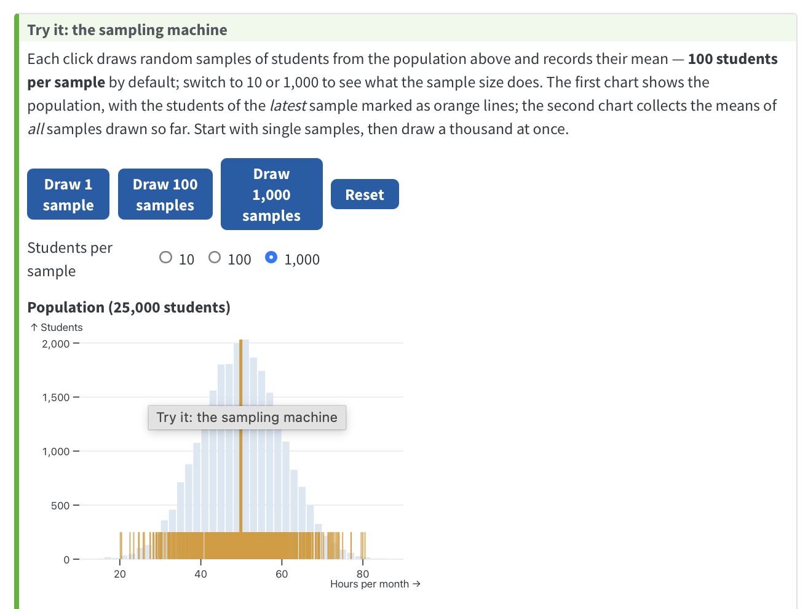
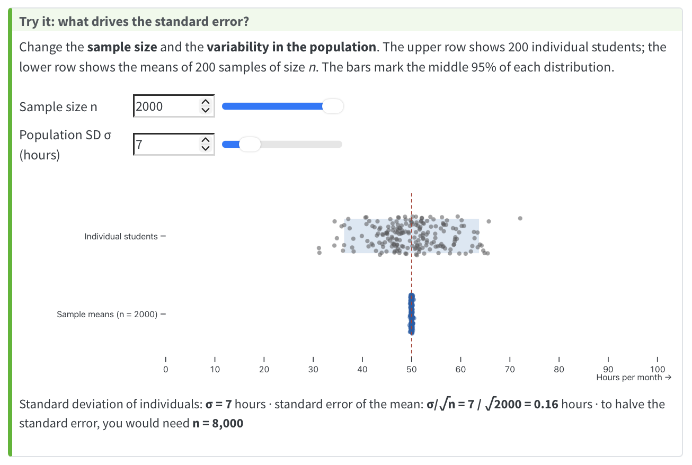
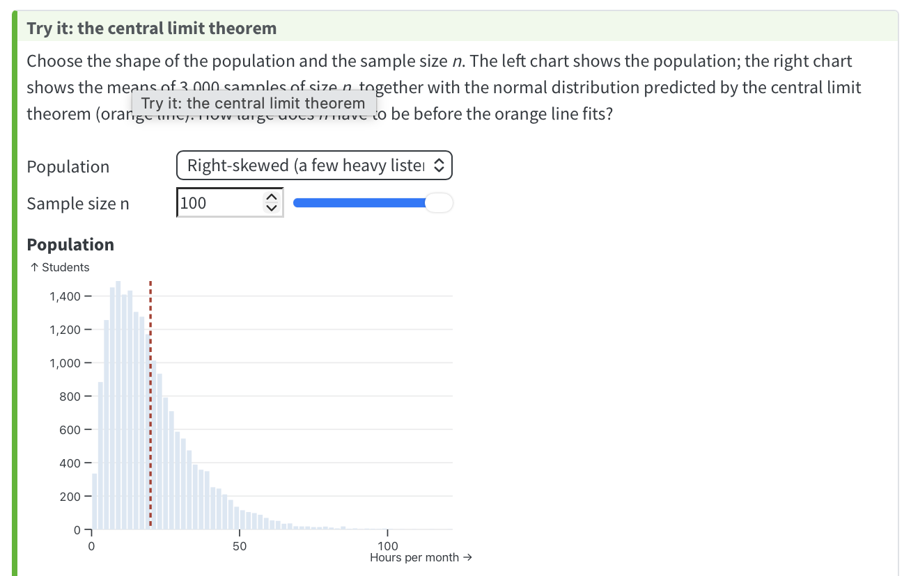
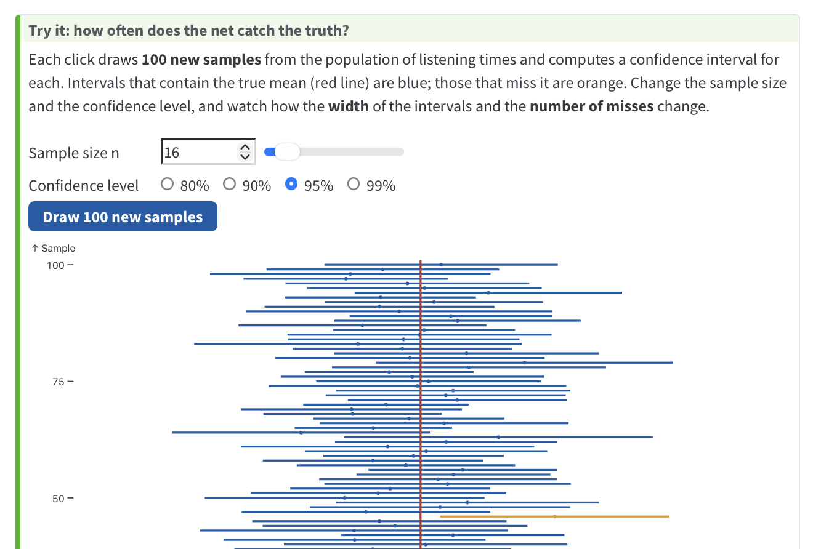

```{r setup}
library(tidyverse)
source("../R/ch03-figures.R")
options(scipen = 999, width = 90)
pop <- pop_normal()
set.seed(6789)
x_sample <- sample(pop, 100)
book_url <- "https://wu-rds.github.io/MA2026/03-uncertainty.html"
ab_test <- ab_data()

# Two thought experiments with exactly the same group means:
# (a) ten times as many users; (b) the same users, but half as dispersed
ab_means <- ab_test |> group_by(group) |> summarise(m = mean(hours))
set.seed(32)
ab_large <- tibble(
  group = factor(rep(c("Control", "Smart Mix"), each = 2000), levels = c("Smart Mix", "Control")),
  hours = c(rgamma(2000, shape = 2, scale = 10), rgamma(2000, shape = 2, scale = 11.5))
) |>
  group_by(group) |> mutate(hours = hours * ab_means$m[match(group, ab_means$group)] / mean(hours)) |> ungroup()
ab_similar <- ab_test |>
  group_by(group) |> mutate(hours = mean(hours) + 0.5 * (hours - mean(hours))) |> ungroup()

```

## Before we start {.midsize}

::: columns
::: {.column width="50%"}
**Paper quiz on Chapter 2** *(10 min)*

-   Individual, closed book
-   Counts toward participation
:::

::: {.column width="50%"}
**Assignment 1** is running

-   Deadline: Group A Mon, Oct 26 · Group B Wed, Oct 28
-   Debrief at the start of next session
-   Questions? → forum on Canvas
:::
:::

## Today's session {.midsize}

::: columns
::: {.column width="50%"}
**Part A — Uncertainty** *(this deck)*

3.1 Is the difference real?\
3.2 Populations and samples\
3.3 Sampling variation\
3.4 The standard error\
3.5 The central limit theorem\
3.6 Confidence intervals\
3.7 Shares and the margin of error\
3.8 Uncertainty in R
:::

::: {.column width="50%"}
**Part B — Experiments I** *(next deck)*

Comparing two groups: is the difference larger than sampling variation alone would produce?

::: keybox
**Driving question:** *How sure can I be?* Every number from a sample is an estimate — today we learn to say **how good** an estimate it is.
:::
:::
:::

# 3.1 Is the difference real? {.divider background-color="#0a3d6e"}

## An A/B test at a streaming service {.smaller}

::: columns
::: {.column width="55%"}
-   New feature **Smart Mix**: a personalized daily mix on the home screen
-   **400 randomly selected users**, randomly split: 200 see Smart Mix, 200 the usual home screen
-   Outcome: **listening hours** in the four weeks after the start
-   The dashboard shows the two group means →

::: discussion
**Would you roll it out?** What would you want to know before deciding?
:::
:::

::: {.column width="45%"}
```{r ab-bars, fig.width=5, fig.height=3.6, out.width="100%"}
fig_ab_bars(base_size = 12)
```
:::
:::

::: notes
Simulated data (the code is in the book, folded). Show of hands on the bar chart alone: who would roll out Smart Mix? Then ask what is missing: how many users? how spread out are they? is the difference driven by a few heavy listeners? Two point estimates cannot answer any of this — a bar chart hides everything except the means.
:::

## Look at the data {.smaller}

```{r ab-points, fig.width=11, fig.height=3.2}
fig_ab_points(base_size = 12)
```

::: columns
::: {.column width="50%"}
-   **200 users per group**, each dot one user
-   The two clouds **overlap almost completely**
-   A few **heavy listeners** on the right pull each mean up — the medians (16.4 vs. 19.2) sit below the means
:::

::: {.column width="50%"}
::: keybox
Same 3.2-hour difference — but now we see **how many** users, **how dispersed** they are, and that the means are **pulled by outliers**. Would you still roll it out? Could 3.2 hours be the luck of the draw?
:::
:::
:::

::: notes
Second show of hands. The data already answer three of the questions from the previous slide (n, dispersion, outliers); the fourth — could it be chance? — is what the chapter is about. Mean vs. median: Chapter 2.
:::

## Real effect — or luck of the draw? {.smaller}

```{r ab-ttest, echo=TRUE}
t.test(hours ~ group, data = ab_test)
```

::: discussion
With **another 400 users**, would the difference be the same? Could Smart Mix do **nothing at all**? What do *t*, the *p*-value, and the "95 percent confidence interval" tell us?
:::

::: notes
Don't explain the output yet. Promise: by the end of today, the confidence interval; by the end of Experiments I, the rest. Keep this slide in mind — we come back to it twice in the next few minutes, and again in Chapter 4.
:::

## Why statistical inference? {.midsize}

::: columns
::: {.column width="50%"}
-   The team observed **400 users** — the decision concerns **all users** (millions)
-   400 users = **sample**; all users = **population**
-   The group means — and their difference — are **estimates**: another random sample, another number
:::

::: {.column width="50%"}
::: keybox
**Randomization** makes the comparison **fair** (§1.6).

**Statistical inference** tells us whether it is **precise enough** to tell a real effect from the noise of sampling.
:::
:::
:::

## Thought experiment 1: what if the sample were larger? {.smaller}

::: columns
::: {.column width="50%"}
**2,000 users per group** instead of 200 — with *exactly* the same group means:

```{r ab-large-fig, fig.width=6, fig.height=2.6}
fig_ab_test(ab = ab_large, base_size = 11)
```
:::

::: {.column width="50%"}
```{r ab-large-ttest, echo=TRUE}
t.test(hours ~ group, data = ab_large)
```
:::
:::

::: keybox
Same difference of 3.2 hours — but *t* = 6.8 instead of 2.2, *p* = 0.00000000001 instead of 0.03, and the interval shrinks from [0.3; 6.2] to [2.3; 4.2]. **More users → less uncertainty about the same difference.**
:::

::: notes
The data are the same gamma distributions, ten times as many users, rescaled so that the means match the original to the decimal. Point out that only the uncertainty changed, not the estimate. Ask: why would 10x the data make the same number more trustworthy?
:::

## Thought experiment 2: what if users were more similar? {.smaller}

::: columns
::: {.column width="50%"}
**The same 400 users**, each pulled halfway toward their group mean — means unchanged, spread halved:

```{r ab-similar-fig, fig.width=6, fig.height=2.6}
fig_ab_test(ab = ab_similar, base_size = 11)
```
:::

::: {.column width="50%"}
```{r ab-similar-ttest, echo=TRUE}
t.test(hours ~ group, data = ab_similar)
```
:::
:::

::: keybox
Same means, same *n* — but *t* = 4.3, *p* = 0.00002, interval [1.8; 4.7]. **Less spread within the groups → less uncertainty about the same difference.**
:::

::: notes
Construction: hours_new = group mean + 0.5 x (hours − group mean). SD halves (16.2 → 8.1, 13.7 → 6.8), means identical. Intuition: if everyone in a group listens about the same amount, the group mean is a much more reliable number.
:::

## Two ingredients of uncertainty {.midsize}

::: columns
::: {.column width="50%"}
| | Users per group | Spread (SD) | *t* | *p* |
|---|:-:|:-:|:-:|:-:|
| Original test | 200 | 16 / 14 | 2.2 | 0.03 |
| Larger sample | 2,000 | 16 / 14 | 6.8 | < 0.001 |
| More similar users | 200 | 8 / 7 | 4.3 | < 0.001 |
:::

::: {.column width="50%"}
::: keybox
The difference was **3.2 hours** in all three cases. What changed is **how sure** we can be about it — and that depends on only two things: **how many** users, and **how different** they are from each other.
:::
:::
:::

. . .

::: keybox
Today's chapter shows where this comes from: the **standard error**, $\sigma / \sqrt{n}$ — spread divided by the square root of the sample size (§3.4).
:::

## The plan for this chapter {.midsize}

::: columns
::: {.column width="50%"}
**The A/B test stays with us.** Its outcome is **continuous** → the uncertainty of a **mean**:

-   3.3 How much does a sample mean vary?
-   3.4 Measuring it: the **standard error**
-   3.5 Why the normal distribution keeps showing up
-   3.6 From an estimate to a **confidence interval**
:::

::: {.column width="50%"}
**Then the same question for shares** (converted / not, voted for / not):

-   3.7 The margin of error of an **election poll**
-   3.8 Everything in R — and the A/B test output stops being a mystery

::: keybox
One question throughout: **if we had drawn a different sample, how different could our number have been — and how far could it be from the truth?**
:::
:::
:::

# 3.2 Populations and samples {.divider background-color="#0a3d6e"}

## From the sample to the population {.smaller}

::: columns
::: {.column width="50%"}
-   **Population:** the whole group we want to learn about (all voters, all customers, all WU students)
-   **Census:** data from *every* member — rare, expensive, often impossible
-   **Sample:** a subgroup we actually observe
-   **Statistical inference:** generalizing from the sample to the population
:::

::: {.column width="50%"}
| | Sample (statistic) | Population (parameter) |
|---|:-:|:-:|
| Size | $n$ | $N$ |
| Mean | $\bar{x}$ | $\mu$ |
| Standard deviation | $s$ | $\sigma$ |
| Share | $\hat{p}$ | $p$ |

::: keybox
Parameters: what we want to know. Statistics: what we can compute.
:::
:::
:::

## How the sample is drawn matters {.smaller}

| | Probability sampling | Non-probability sampling |
|---|---|---|
| **Principle** | Known chance of selection; **random** | Convenience or researcher's judgment |
| **Techniques** | Simple random · stratified · cluster · systematic | Convenience · quota · judgmental · snowball |
| **Uncertainty** | Can be **quantified** | Cannot be quantified reliably |

. . .

**Typical sources of selection bias:** *under-coverage* (not in the sampling frame) · *non-response* (non-respondents differ) · *voluntary response* (only the strongly opinionated answer)

::: keybox
**Your group project** uses a convenience sample — fine for learning, but be honest about it. The good news: your **experiment** is still fair, because conditions are randomized *within* the sample (§1.6).
:::

## Two kinds of error {.smaller}

::: columns
::: {.column width="45%"}
```{r bias-var, fig.width=4.6, fig.height=4.6}
fig_bias_variance()
```
:::

::: {.column width="55%"}
**Random error** (sampling variation)

-   Each sample is a slightly different mix of people
-   **Quantifiable** — and **shrinks** with larger samples
-   The margin of error is about this kind

**Systematic error** (bias)

-   The sample differs from the population *systematically*
-   A larger sample **does not help** — "more confidently wrong" (§1.6)

*Under-coverage, non-response, voluntary response → **systematic** error. In the A/B test, randomization rules out bias in the comparison — random error remains.*
:::
:::

::: notes
Each dot = the estimate from one sample, the cross = the truth. Today is about the left column: how to quantify random error. The right column is the villain of Chapters 1 and 2 (self-selection, chart-only data); the famous case is the 2016 polling miss, which comes up in 3.7 — and it returns at the end as the limit of every confidence interval.
:::

# 3.3 Sampling variation {.divider background-color="#0a3d6e"}

## A world in which we know the truth {.midsize}

```{r pop, fig.width=10, fig.height=4.2}
fig_population()
```

::: keybox
Monthly listening time of all **25,000 WU students** — simulated, so we know the true values. In reality we never do: that is why we sample.
:::

## One sample, then another {.midsize}

```{r four, fig.width=12.5, fig.height=3.8}
fig_four_samples()
```

::: keybox
**Sampling variation:** each random sample of 100 students gives a slightly different mean. Not a mistake — the unavoidable price of looking at a part instead of the whole. The question is only: **how large** is it?
:::

## Live demo: the sampling machine {.midsize}

::: columns
::: {.column width="55%"}
Course book, §3.3 — **draw 1, then 100, then 1,000 samples** and watch the means pile up.

`r paste0("[", book_url, "#sec-unc-sampling](", book_url, "#sec-unc-sampling)")`

{width="80%"}
:::

::: {.column width="45%"}
::: discussion
Before clicking "1,000 samples": where will the sample means pile up — and how far from the true mean will the most extreme ones be?
:::
:::
:::

## The sampling distribution {.smaller}

::: columns
::: {.column width="55%"}
```{r sampdist, fig.width=6.5, fig.height=3.4}
fig_sampling_distribution()
```
:::

::: {.column width="45%"}
The means of *many* samples:

1.  **Centered on the truth** — no over- or underestimation on average
2.  **A known width** — the *standard error*
3.  **A known shape** — normal (even for non-normal data, §3.5)

::: keybox
We only ever have **one** sample — but these three properties tell us how much to trust it.
:::
:::
:::

# 3.4 The standard error {.divider background-color="#0a3d6e"}

## How precise is a sample mean? {.smaller}

::: columns
::: {.column width="45%"}
The width of the sampling distribution:

$$
\sigma_{\bar{x}} = \frac{\sigma}{\sqrt{n}}
$$

-   $\sigma$: variability in the population
-   $n$: sample size

Our example: `r round(sd(pop), 1)` / $\sqrt{100}$ = **`r format(round(sd(pop) / 10, 2), nsmall = 2)`** hours

::: keybox
**Square-root law:** four times the sample, half the standard error — **diminishing returns**. This is why polls survey ~1,000 people, not 10,000.
:::
:::

::: {.column width="55%"}
```{r se-n, fig.width=6.3, fig.height=4.6}
fig_se_by_n()
```
:::
:::

## What drives the standard error {.smaller}

```{r se-panels, fig.width=11, fig.height=2.2}
fig_se_panels_n()
```

```{r se-sigma, fig.width=11, fig.height=2.2}
fig_se_panels_sigma()
```

::: keybox
**Larger samples** → sample means cluster more tightly. **More variable populations** → sample means scatter more.
:::

## Live demo: what drives the standard error? {.midsize}

::: columns
::: {.column width="55%"}
Course book, §3.4 — move the sliders for **n** and **σ**.

`r paste0("[", book_url, "#sec-unc-se](", book_url, "#sec-unc-se)")`

{width="100%"}
:::

::: {.column width="45%"}
::: discussion
Your sample of **100 students** gives a standard error of **1 hour** per month. Your boss wants **half an hour**. How many students do you need?
:::
:::

::: notes
Answer: 400 — four times as many. Ask what that means for the budget: precision is expensive.
:::

## Standard deviation vs. standard error {.midsize}

```{r sdse, fig.width=11, fig.height=3.6}
fig_sd_vs_se()
```

::: columns
::: {.column width="50%"}
::: keybox
**SD:** how much **individuals** differ. A property of the data — does *not* shrink with more data.
:::
:::

::: {.column width="50%"}
::: keybox
**SE:** how much **sample means** would differ. The precision of the estimate — shrinks with $\sqrt{n}$.
:::
:::
:::

## In practice: estimate σ with s {.midsize}

We never know $\sigma$ — so we use the sample standard deviation $s$:

$$
SE_{\bar{x}} = \frac{s}{\sqrt{n}}
$$

Our first sample: $s$ = `r round(sd(x_sample), 2)` → $SE$ = `r round(sd(x_sample) / 10, 2)` hours (true value: `r format(round(sd(pop) / 10, 2), nsmall = 2)`).

::: keybox
**Which one to report?** Describe how customers differ → **SD**. Describe how precisely you estimated the mean → **SE** or a **confidence interval**. Error bars in charts must say which one they show.
:::

::: notes
Why n − 1 in the SD: deviations from the sample mean are slightly too small on average (Bessel's correction) — collapsible box in the book; mention only if asked.
:::

# 3.5 The central limit theorem {.divider background-color="#0a3d6e"}

## What if the data are not normal? {.midsize}

```{r skewpop, fig.width=10, fig.height=4.2}
fig_population(pop_skewed(), title = "A right-skewed population of listening times")
```

::: keybox
Marketing data are rarely normal: sales, visits, streams, revenue — **most customers a little, a few a lot**.
:::

## Sample means become normal anyway {.midsize}

```{r clt, fig.width=12.5, fig.height=3.8}
fig_clt()
```

::: keybox
**Central limit theorem:** whatever the shape of the population, the **means** of samples become normally distributed as $n$ grows — centered on $\mu$, with width $\sigma / \sqrt{n}$.
:::

## Live demo: the central limit theorem {.midsize}

::: columns
::: {.column width="55%"}
Course book, §3.5 — choose a population shape, increase **n** step by step.

`r paste0("[", book_url, "#sec-unc-clt](", book_url, "#sec-unc-clt)")`

{width="100%"}

:::

::: {.column width="45%"}
::: keybox
**Why it matters:** we do not need normal *data* — we need a normal *sampling distribution*. "n ≥ 30" is a rule of thumb, not a law: for extremely skewed data (streams!) you need much more.
:::
:::
:::

::: notes
Best demo: "Two groups" population, n = 1 → 2 → 5 → 10 → 30. No student is "average", yet the means become a bell. Then "Right-skewed": n = 1 vs. 30.
:::

# 3.6 Confidence intervals {.divider background-color="#0a3d6e"}

## From a point to an interval {.midsize}

::: columns
::: {.column width="55%"}
**Point estimate:** "the average listening time is 49.2 hours"

**Interval estimate:** "… between 47.2 and 51.3 hours"
:::

::: {.column width="45%"}
::: keybox
**Casting a net:** we cannot see the true mean — but we can throw a net around our estimate that catches it most of the time.
:::
:::
:::

$$
\text{CI} = \text{estimate} \pm \underbrace{\text{critical value}}_{\text{how sure we want to be}} \times \underbrace{\text{standard error}}_{\text{how much the estimate wobbles}}
$$

::: source
Net metaphor after Radziwill (2015), *Statistics (The Easier Way) with R*.
:::

## Constructing a 95% confidence interval {.midsize}

-   Sample means are normal around $\mu$ with SD = SE → 95% lie within **± 1.96 SE**
-   Turned around: $\bar{x} \pm 1.96 \times SE$ catches $\mu$ in 95% of all samples

. . .

**Our sample:** `r round(mean(x_sample), 2)` ± 1.96 × `r round(sd(x_sample) / 10, 2)` = **[`r round(mean(x_sample) - 1.96 * sd(x_sample) / 10, 2)`; `r round(mean(x_sample) + 1.96 * sd(x_sample) / 10, 2)`]** hours

. . .

::: keybox
True mean: `r round(mean(pop), 2)` — inside. This time.
:::

## What "95% confidence" means {.midsize}

::: columns
::: {.column width="48%"}
```{r ci100, fig.width=5.6, fig.height=5.3}
fig_ci_100()
```
:::

::: {.column width="52%"}
The confidence refers to the **method**: of all intervals constructed this way, **~95% contain** the true mean.

::: keybox
**Not quite right:** "95% probability that μ is in *this* interval" — a specific interval either contains μ or not. **Fine in practice:** "we are 95% confident that …" — remembering that ~1 in 20 such intervals is wrong.
:::
:::
:::

::: notes
Field et al.'s formulation: if we collected 100 samples and computed an interval for each, about 95 would contain the true mean. Also point out: values in the middle of an interval are not "more true" than values near the edges.
:::

## Live demo: how often does the net catch the truth? {.smaller}

::: columns
::: {.column width="55%"}
Course book, §3.6 — draw batches of 100 intervals; change **n** and the **confidence level**.

`r paste0("[", book_url, "#sec-unc-ci](", book_url, "#sec-unc-ci)")`

{width="100%"}
:::

::: {.column width="45%"}
::: discussion
What happens to the **width** and to the **number of misses** when you (a) increase *n*, (b) switch from 95% to 99%?
:::
:::
:::

::: notes
(a) Larger n: narrower intervals, the SAME miss rate (~5%). (b) 99%: wider intervals, fewer misses. Only a larger sample buys narrow AND reliable.
:::

## Confidence level vs. width {.midsize}

```{r cilevels, fig.width=10, fig.height=3.3}
fig_ci_levels()
```

::: columns
::: {.column width="50%"}
-   More confidence → **wider** net (99%: 2.58 instead of 1.96)
-   Narrow **and** reliable → only via **larger n**
:::

::: {.column width="50%"}
| *n* | 10 | 30 | 100 | ∞ |
|---|:-:|:-:|:-:|:-:|
| *t* value (95%) | 2.26 | 2.05 | 1.98 | 1.96 |

Small samples: *t*-distribution — R does it automatically
:::
:::

# 3.7 Shares and the margin of error {.divider background-color="#0a3d6e"}

## "Plus or minus 3.1 percentage points" {.midsize}

::: columns
::: {.column width="55%"}
> "The poll was conducted Sept. 13–17 and surveyed 1,000 registered voters nationally. The margin of error is plus or minus 3.1 percentage points."
>
> — NBC News, September 2024

::: discussion
The same question for a **share**: more than 150 million people voted. How can **1,000** respondents tell us anything? Where does **± 3.1** come from — and why not survey 10,000?
:::
:::

::: {.column width="45%"}
```{r poll-result, fig.width=5.5, fig.height=3.2, out.width="100%"}
fig_poll_result(base_size = 12)
```
:::
:::

::: notes
Let them guess before answering — most students have never thought about where the ± number comes from. The next slides answer them — with the tools of 3.3–3.6, now applied to a share.
:::

## Many polls, one truth {.midsize}

```{r poll-variation, fig.width=11, fig.height=4.4}
fig_poll_variation(base_size = 12)
```

::: keybox
Polls taken in the **same week** come to **different results** — each one is a different random sample. Most of them stay within **± 3 points** of the truth. That is what the margin of error describes.
:::

::: notes
Simulated, so we know the truth (the lines) — the sampling machine of 3.3, now for a share. Ask: if you only saw one of these polls, how much would you trust it? Then: why do the dots scatter less than you might fear? (n ≈ 1,000.) Ask: how wide should we expect the scatter to be — and why 1,000 respondents? The next slide computes it.
:::

## And then the polls were wrong {.smaller}


-   2016: state polls in several Midwestern states **underestimated Trump's support by more than their margins of error**
-   Post-election analyses: late deciders; **voters without a college degree underrepresented** and not corrected for
-   The margin of error did not warn — because it only covers **random** error, not the **systematic** error of 3.2

::: source
Kennedy et al. (2018), "An Evaluation of the 2016 Election Polls in the United States", *Public Opinion Quarterly*, 82(1), 1–33.
:::

## Decoding "± 3.1 percentage points" {.midsize}

::: columns
::: {.column width="50%"}
Standard error of a share:

$$
SE_{\hat{p}} = \sqrt{\frac{\hat{p}\,(1-\hat{p})}{n}}
$$

Margin of error = $1.96 \times SE_{\hat{p}}$, largest at $\hat{p}$ = 50%:

$$
1.96 \times \sqrt{\tfrac{0.5 \times 0.5}{1{,}000}} = \mathbf{0.031}
$$
:::

::: {.column width="50%"}
```{r poll, fig.width=6, fig.height=3.3}
fig_poll(base_size = 12)
```

::: keybox
The margin of error of the **lead** is roughly **twice** as large: even the 5-point lead in this poll is not a safe lead.
:::
:::
:::

::: notes
Why twice: an error in one candidate's share usually comes with an error in the opposite direction in the other's. Here: SE of the difference ≈ 3 points → margin ≈ ± 6. Same logic applies to marketing: conversion rate, CTR, share of promoters — each arm of an A/B test has its own margin of error.
:::

## How many respondents do you need? {.midsize}

::: columns
::: {.column width="55%"}
```{r moe, fig.width=6.5, fig.height=4.3}
fig_moe_by_n(base_size = 12)
```
:::

::: {.column width="45%"}
::: keybox
**Your group project** (~120 respondents): a share of ~50% comes with **± 9 points**. Think twice before interpreting a 5-point difference.
:::

Live calculator: course book, §3.7

`r paste0("[", book_url, "#sec-unc-proportions](", book_url, "#sec-unc-proportions)")`
:::
:::

# 3.8 Uncertainty in R {.divider background-color="#0a3d6e"}

## A confidence interval for a mean {.smaller}

```{r r-setup, echo=TRUE}
set.seed(6789)
population <- rgamma(25000, shape = 2, scale = 10)      # the "unknown" population
listening  <- tibble(hours = sample(population, size = 100))
```

::: columns
::: {.column width="55%"}
```{r r-manual, echo=TRUE}
n    <- nrow(listening)
xbar <- mean(listening$hours)
se   <- sd(listening$hours) / sqrt(n)
crit <- qt(0.975, df = n - 1)
c(mean = xbar, lower = xbar - crit * se, upper = xbar + crit * se)
```
:::

::: {.column width="45%"}
```{r r-ttest, echo=TRUE}
t.test(listening$hours)$conf.int
```

::: keybox
`qt(0.975, …)`: 2.5% in each tail. `t.test()` does it all in one line.
:::
:::
:::

## Back to the A/B test: intervals per group {.smaller}

::: columns
::: {.column width="55%"}
```{r r-ab, echo=TRUE}
ab_test |>
  group_by(group) |>
  summarise(n = n(), mean = mean(hours), se = sd(hours) / sqrt(n),
            lower = mean - qt(0.975, n - 1) * se,
            upper = mean + qt(0.975, n - 1) * se)
```
:::

::: {.column width="45%"}
```{r ab-bars-ci, fig.width=5, fig.height=3.6, out.width="100%"}
fig_ab_bars(ci = TRUE, base_size = 12)
```
:::
:::

::: keybox
The bar chart from the start of the session — now **with intervals**. The two intervals **overlap** — no effect? Not necessarily: the decision depends on the uncertainty of the **difference**, which has its own standard error. The interval `t.test()` reported (0.29 to 6.20 hours) is exactly that → **Experiments I**.
:::

## A confidence interval for a share {.smaller}

::: columns
::: {.column width="55%"}
**Back to the poll: 1,000 voters, 49% Harris, 44% Trump**

```{r r-prop, echo=TRUE}
n_poll <- 1000
p_hat  <- c(Harris = 0.49, Trump = 0.44)
se_p   <- sqrt(p_hat * (1 - p_hat) / n_poll)
cbind(share = p_hat,
      lower = p_hat - 1.96 * se_p,
      upper = p_hat + 1.96 * se_p)
```

**The same with `prop.test()`:**

```{r r-proptest, echo=TRUE}
prop.test(x = 490, n = 1000)$conf.int
```
:::

::: {.column width="45%"}
```{r poll-bars-ci, fig.width=5, fig.height=3.6, out.width="100%"}
fig_poll_bars(ci = TRUE, base_size = 12)
```
:::
:::

::: keybox
Each share ± about 3 points — the "± 3.1" from the news report, now computed. `prop.test()` takes the number of "successes" and the sample size; its interval differs slightly from the hand calculation (it uses the **Wilson score interval**, more reliable for small samples and shares near 0 or 1). **Sample size planning** follows in Chapter 4.
:::

::: notes
Close the loop with 3.1: this is where the ± 3.1 in the news report comes from — and 490 of 1,000 is all prop.test() needs. The intervals overlap; whether the lead is "real" is a question about the DIFFERENCE, which has its own standard error (Chapter 4).
:::

# What confidence intervals do not tell you {.divider background-color="#0a3d6e"}

## Three limits {.midsize}

::: incremental
1.  **Random error only.** A biased sample gives a precise but wrong estimate — a larger biased sample, a more precise and equally wrong one (2016 polls; §1.6; §2.5)
2.  **Precision, not spread.** A narrow interval for the *average* does not mean customers are alike
3.  **A statement about a procedure.** ~1 in 20 intervals misses — compute many, and some will
:::

. . .

::: keybox
**Next:** back to Smart Mix — **+3.2 hours**: larger than sampling variation alone would produce? The difference has its own standard error — **the logic of today carries over one to one**, and we read the complete *t*-test output.
:::

## Learning check {.smaller}

1.  Smart Mix users listened about 3 hours more. Why does this difference alone not show that Smart Mix increases listening among **all** users?
2.  A poll of 1,000 voters reports ± 3.1 points. How is this number calculated? Name one error it does **not** cover.
3.  You double your survey from 400 to 800 respondents. By what factor does the standard error change?
4.  Random sample of 180 users: mean listening time 7.34 hours/week, SD 6.87. Compute the 95% CI (critical value 1.96).
5.  Your website survey (anyone can answer) has 20,000 responses and a very narrow CI. Why might it still mislead?

::: notes
(1) The 400 users are a sample; another sample would give another difference — we need its uncertainty (standard error / confidence interval of the difference). (2) 1.96 × sqrt(0.25/1000) = 0.031; not covered: non-response, under-coverage, late deciders — any systematic error. (3) Factor 1/sqrt(2) ≈ 0.71, i.e., −29%. (4) SE = 6.87/sqrt(180) = 0.512; 7.34 ± 1.00 → [6.34; 8.34]. (5) Voluntary response bias: respondents select themselves — precise, but possibly precisely wrong.
:::
