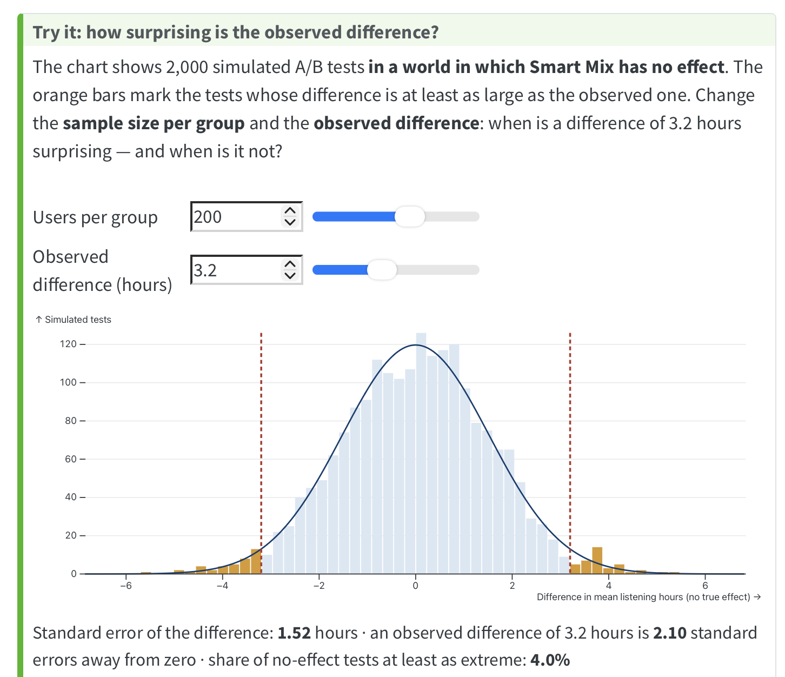
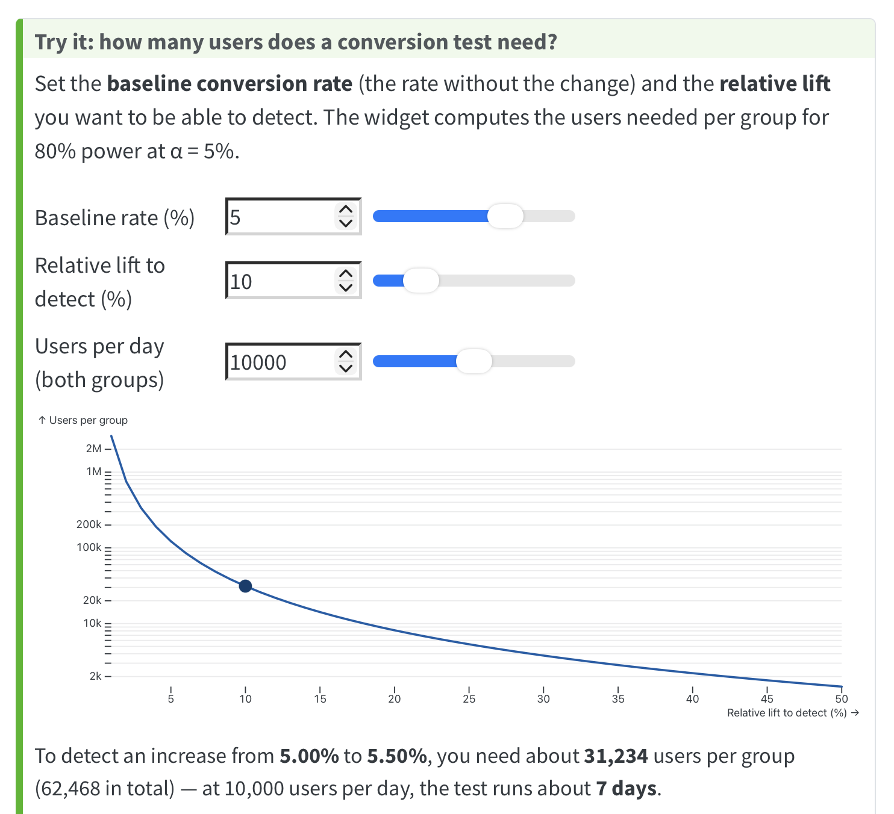
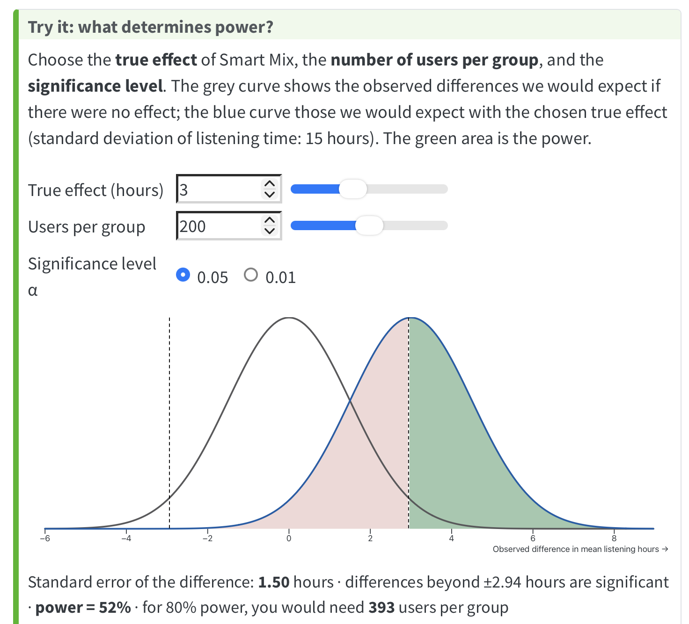
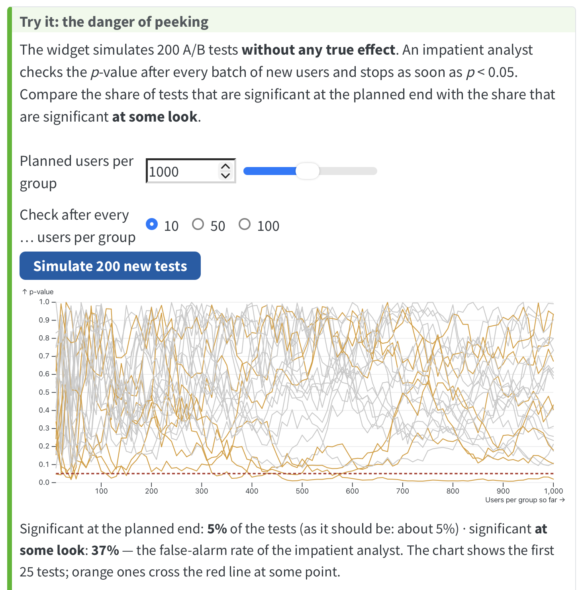
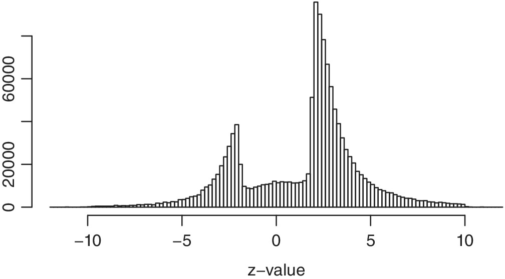

```{r setup}
library(tidyverse)
source("../R/ch03-figures.R")
source("../R/ch04-figures.R")
options(scipen = 5, digits = 4, width = 90)
ab_test   <- ab_data()
mix_test  <- mix3_data()
newsletter <- readr::read_csv("../data/newsletter_test.csv", show_col_types = FALSE)
price_page <- readr::read_csv("../data/price_page.csv", show_col_types = FALSE)
book_url  <- "https://wu-rds.github.io/MA2026/04-experiments.html"
```

# Part 1 · Experiments I {.divider background-color="#0a3d6e"}

## Today, part B {.midsize}

::: columns
::: {.column width="50%"}
**Experiments I** *(session 3)*

4.1 Back to the A/B test\
4.2 The difference between two means\
4.3 Testing a hypothesis\
4.4 Same people, both conditions: the paired *t*-test\
4.5 How large is the effect?\
4.6 Reporting the result
:::

::: {.column width="50%"}
**Experiments II** *(session 4)*

4.7 The difference between two shares\
4.8 How many users do we need?\
4.9 More than two groups and other tests\
4.10 Using *p*-values responsibly

::: keybox
**Driving question:** *Did it work?*
:::
:::
:::

# 4.1 Back to the A/B test {.divider background-color="#0a3d6e"}

## Smart Mix: +3.2 hours {.smaller}

::: columns
::: {.column width="42%"}
```{r ab-fig, fig.width=5, fig.height=3.8, out.width="100%"}
fig_ab_bars(ci = TRUE, base_size = 12)
```
:::

::: {.column width="58%"}
```{r ab-ttest, echo=TRUE}
t.test(hours ~ group, data = ab_test)
```
:::
:::

::: keybox
Where Chapter 3 ended: two means with their **intervals** — and a test output with numbers we have not decoded yet.
:::

## Before any test: look at the data {.smaller}

::: columns
::: {.column width="55%"}
```{r ab-box, fig.width=6, fig.height=4, out.width="100%"}
ggplot(ab_test, aes(x = group, y = hours)) +
  geom_boxplot(fill = "#dbe7f3", outlier.shape = NA) +
  geom_jitter(width = 0.15, height = 0, alpha = 0.3) +
  stat_summary(fun = mean, geom = "point", color = "#b03a2e", size = 3) +
  labs(x = NULL, y = "Listening hours (four weeks)") +
  theme_minimal(base_size = 13)
```
:::

::: {.column width="45%"}
**Boxplot + the actual users** (jitter): the first chart in any analysis.

-   **How many?** 200 dots per group
-   **How spread out?** Boxes (middle 50%) overlap almost completely
-   **Outliers?** A few heavy listeners on the right in both groups; the mean (red) sits above the median (box line)
-   **Comparable groups?** Same shape, similar spread → the *t*-test's assumptions look fine

```r
ggplot(ab_test, aes(x = group, y = hours)) +
  geom_boxplot(outlier.shape = NA) +
  geom_jitter(width = 0.15, alpha = 0.3)
```
:::
:::

::: notes
Three lines of code, and you learn more than from any test output: sample size, spread, skew, outliers, whether the groups look comparable. The bar chart with intervals (previous slide) is the report chart; this is the analyst's chart. In the R script this is "Step 1" of every analysis.
:::

## Three questions for the product team {.midsize}

::: incremental
1.  **Could the difference be chance?** Two random groups never have exactly the same mean — is 3.2 hours more than chance typically produces?
2.  **How large is the effect — and does it matter?**
3.  **Was the experiment large enough?** How large should the next one be?
:::

. . .

::: keybox
The formulas stay minimal: we compute **one** standard error by hand to see what a test does. After that, R does the arithmetic — we do the interpretation.
:::

# 4.2 The difference between two means {.divider background-color="#0a3d6e"}

## Signal and noise {.smaller}

::: columns
::: {.column width="55%"}
Repeat the experiment many times → the **difference** varies too. Its sampling distribution is:

1.  **Centered** on the true effect
2.  **Approximately normal** (central limit theorem)
3.  As wide as the **standard error of the difference**:

$$
SE_{\bar{x}_1 - \bar{x}_2} = \sqrt{\frac{s_1^2}{n_1} + \frac{s_2^2}{n_2}}
$$
:::

::: {.column width="45%"}
**Smart Mix:**

$$
\sqrt{\frac{16.2^2}{200} + \frac{13.7^2}{200}} = 1.50 \text{ hours}
$$

::: keybox
Every test compares the **signal** (observed difference) with the **noise** (the standard error). This is the only SE we compute by hand today.
:::
:::
:::

## A world in which Smart Mix does nothing {.midsize}

```{r null-world, fig.width=11, fig.height=4.2}
fig_null_world(base_size = 12)
```

::: keybox
If Smart Mix had **no effect**, a difference of 3.2 hours or more would occur in only **~4%** of experiments. Either Smart Mix works — or the team saw a rare accident.
:::

## Live demo: how surprising is the difference? {.midsize}

::: columns
::: {.column width="55%"}
Course book, §4.2 — change the **users per group** and the **observed difference**.

`r paste0("[", book_url, "#sec-exp-difference](", book_url, "#sec-exp-difference)")`

{width="60%"}

:::

::: {.column width="45%"}
::: discussion
Is a difference of 3.2 hours surprising with **50** users per group? With **800**?
:::
:::
:::

::: notes
50 per group: SE ≈ 3 hours — 3.2 happens all the time. 800 per group: SE ≈ 0.76 — even 1.5 hours would be surprising. "Large" only makes sense relative to the standard error.
:::

# 4.3 Testing a hypothesis {.divider background-color="#0a3d6e"}

## Null hypothesis and test statistic {.midsize}

::: columns
::: {.column width="45%"}
-   $H_0$: no effect, $\mu_1 = \mu_2$
-   $H_1$: an effect, $\mu_1 \neq \mu_2$

**Test statistic** = signal / noise:

$$
t = \frac{3.24 - 0}{1.50} = 2.16
$$
:::

::: {.column width="55%"}
```{r tdist, fig.width=6.4, fig.height=3.8}
fig_t_test(base_size = 12)
```
:::
:::

::: keybox
If $H_0$ were true, 95% of all *t* values would lie between −1.97 and +1.97. Ours lies outside.
:::

## The *p*-value and the decision {.midsize}

**p-value:** the probability of a difference at least as extreme as the observed one — **if $H_0$ were true**.

. . .

-   Smart Mix: **p = 0.031** — in a no-effect world, ~3 in 100 experiments would show ≥ 3.2 hours
-   Decision rule with significance level $\alpha$ = 5% (chosen **in advance**):
    -   $p < \alpha$ → **statistically significant**, reject $H_0$
    -   $p \geq \alpha$ → **do not reject** $H_0$ — *not* "there is no effect"

. . .

::: keybox
Our simulation said ~4%, the *t*-test says 3.1% — the test formalizes the thought experiment.
:::

## The confidence interval of the difference {.midsize}

$$
(\bar{x}_1 - \bar{x}_2) \pm t_{0.975} \times SE_{\bar{x}_1 - \bar{x}_2} = 3.24 \pm 1.97 \times 1.50
$$

```{r cidiff, fig.width=11, fig.height=2.2}
fig_ci_diff(base_size = 12)
```

::: columns
::: {.column width="50%"}
::: keybox
**CI excludes 0 ⇔ p < 0.05.** Test and interval always agree.
:::
:::

::: {.column width="50%"}
::: keybox
The interval tells more: the effect could be **a quarter of an hour — or six hours**.
:::
:::
:::

## Reading the output {.smaller}

| Output | Meaning |
|---|---|
| `Welch Two Sample t-test` | Two independent groups; equal variances **not** assumed (R's safe default) |
| `t = 2.1617` | Observed difference = 2.16 standard errors away from zero |
| `df = 386.96` | Degrees of freedom — shape of the *t*-distribution; irrelevant for large samples |
| `p-value = 0.03125` | With no effect, ≥ this difference in 3.1% of experiments |
| `alternative hypothesis: …` | Two-sided: a difference in **either** direction |
| `95 percent confidence interval: 0.29 6.20` | Effects compatible with the data |
| `mean in group …` | Group means; their difference = the estimated effect |

::: notes
One-sided tests: only if decided before seeing the data, and only if a negative effect truly would not matter — rarely the case in business. Assumptions: independence (randomization), CLT for the means, metric outcome; equal variances not needed (Welch). Details in the book, collapsible boxes.
:::

## Degrees of freedom — intuitively {.smaller}

::: columns
::: {.column width="50%"}
**An information budget.** Each observation is one piece of information. Every quantity we **estimate** from the data uses one up. What is left — $n$ minus the number of estimated parameters — is the information available for judging the **noise**.

| Situation | Estimated | df |
|---|---|:-:|
| One sample, SD of $n$ values | 1 mean | $n - 1$ |
| Two groups (*t*-test) | 2 means | $n_1 + n_2 - 2$ |
| ANOVA with 3 groups | 3 means | $N - 3$ |
| Regression with $k$ predictors | $k + 1$ coefficients | $n - k - 1$ |
:::

::: {.column width="50%"}
**Why "free to vary"?** Budget of 100 € for three presents, all spent: choose present 1 (30 €) and 2 (50 €) freely — present 3 is **fixed** (20 €). Three values, one constraint → **2 degrees of freedom**. Same with deviations from a mean: once the mean is known, the last deviation is determined.

::: keybox
Fewer df → less information about the noise → the standard error is itself uncertain → **fatter tails**, larger critical values. Smart Mix: ~398 df → practically the normal distribution. Welch's 386.96: a weighted version of the same idea.
:::
:::
:::

## Your turn (5 min) {.midsize}

::: discussion
Run the test again with only the **first 50 users per group**:

```r
t.test(hours ~ group,
       data = ab_test |> group_by(group) |> slice_head(n = 50))
```

How do the **difference**, the **confidence interval**, and the ***p*-value** change? Explain with the standard error.
:::

::: notes
Code for the data is in the book / R script (section 4.1). With n = 50 the SE roughly doubles (√4 = 2): wider CI that includes 0, larger p — whatever the point estimate happens to be. Let one pair report and explain.
:::

# 4.4 The same people in both conditions: the paired *t*-test {.divider background-color="#0a3d6e"}

## Two designs, two tests {.midsize}

| Design (§1.6) | Who is compared | Data | Test |
|---|---|---|---|
| **Between-subjects** | Different people in each condition | One row per person + a group variable | **Welch *t*-test**: `t.test(y ~ group)` |
| **Within-subjects** | The same people in every condition | One row per person, one column per condition | **Paired *t*-test**: `t.test(x1, x2, paired = TRUE)` |

::: keybox
Smart Mix was **between-subjects** (each user saw one home screen) → Welch test. The question does not change with the design — but the **data come in pairs**, and the test must use that.
:::

## Same people, both conditions: the design {.smaller}

::: columns
::: {.column width="50%"}
**The question:** does the new search design let users find songs faster?

**Within-subjects design:** the **same 60 users** search for songs with the **old** design and with the **new** one, in **random order** (half old → new, half new → old). Outcome: seconds to find a song.

```{r paired-data, echo=TRUE}
search_test <- search_data()
head(search_test, 4)
```
:::

::: {.column width="50%"}
-   Each user appears **twice** → the two columns are **not independent**: a fast user is fast with both designs
-   What varies *between* users (skill, familiarity) is huge; what we care about is the difference *within* each user
-   So the test looks at **one number per user**: new − old

```{r paired-diff, echo=TRUE}
head(search_test$new_design - search_test$old_design, 8)
```
:::
:::

::: notes
This is the design most group projects could use if they let every respondent see both versions — remind them of the carryover caveat from Chapter 1. Other paired situations: matched pairs (two similar stores, one gets the promotion), before/after measurements on the same customers (but: without a control group, before/after is not an experiment — anything else that changed in between is confounded with the treatment).
:::

## Same people, both conditions: the test {.smaller}

::: columns
::: {.column width="55%"}
```{r paired, echo=TRUE}
t.test(search_test$new_design, search_test$old_design, paired = TRUE)
```
:::

::: {.column width="45%"}
::: keybox
`paired = TRUE` tests whether the **mean of the within-user differences** is zero: the new design saves **2.1 seconds** (95% CI 1.0–3.2). Each user is **their own control** — the differences between users drop out.
:::

```{r paired-lines, fig.width=5, fig.height=3.2, out.width="100%"}
fig_paired_lines(base_size = 10)
```
:::
:::

::: notes
The chart: almost every line slopes down (most users faster with the new design, each by a little), while the vertical spread — the differences between users — is huge. The paired test only looks at the slopes. Non-parametric counterpart: Wilcoxon signed-rank (book box).
:::

## The same data as a between-subjects comparison {.smaller}

::: columns
::: {.column width="55%"}
```{r paired-wrong, echo=TRUE}
t.test(search_test$new_design, search_test$old_design)   # ignores the pairing
```
:::

::: {.column width="45%"}
::: keybox
Same data, same means, same 2 seconds — but ***p* = 0.14** and the interval includes 0. The independent-groups test judges the difference against the spread of **all** search times (users differ: SD ≈ 8 s); the paired test against the spread of the **within-user differences** (SD ≈ 4 s). Comparing *different* people adds uncertainty — the within-subjects design removes it.
:::
:::
:::

::: keybox
**When to use which:** between-subjects data → Welch test (nothing to pair). Within-subjects data, matched pairs, before/after on the same people → paired test. Price of within-subjects: **carryover and order effects** (§1.6) — the paired test cannot fix those.
:::

::: notes
Before/after without a control group is not an experiment: anything else that changed in between is confounded with the treatment. Your turn (if time): run t.test(new − old) as a one-sample test against zero — identical output; a paired t-test IS a one-sample t-test of the differences.
:::

## Your turn: QuickBite (15 min) {.smaller}

::: columns
::: {.column width="50%"}
**A food-delivery app — two experiments, two data sets** (`04-experiments.R`, section "Your turn"):

**(1) The free-delivery voucher.** 300 new customers, randomly split: 150 got a voucher for their first four weeks, 150 did not. Outcome: order value in euros.

-   Look at the data (boxplot + jitter)
-   Summarise the groups and draw the chart with intervals
-   Run the **appropriate** *t*-test
-   Report the result in one sentence: effect, uncertainty, test
:::

::: {.column width="50%"}
**(2) The routing app.** 40 couriers delivered with the old app **and** the new one (random order). Outcome: minutes per delivery.

-   Draw the chart that shows the within-courier comparison
-   Run the **appropriate** *t*-test and report the result
-   Run the test for a *between-subjects* design on the same two columns — what changes, and why?

::: keybox
First question for both: **which design is this** — and therefore which test?
:::
:::
:::

::: notes
(1) Between-subjects → Welch: 74.5 vs. 63.7 euros, +10.8 (95% CI 0.7–20.8), t(260) = 2.10, p = .036 — significant, but a wide interval. Data are right-skewed with a few big orders; n = 150 per group is fine for the t-test. (2) Within-subjects → paired: new app saves 1.2 min (CI 0.7–1.7), t(39) = −4.49, p < .001. Independent test on the same columns: p = 0.25 — courier speed (SD ≈ 5 min) dominates; the paired test uses the within-courier differences (SD ≈ 2 min). Solutions: 04-your-turn-solutions.R.
:::

# 4.5 How large is the effect? {.divider background-color="#0a3d6e"}

## Significant ≠ large ≠ important {.smaller}

::: columns
::: {.column width="55%"}
-   **Original unit:** +3.2 hours in four weeks
-   **Relative:** +16% vs. control (20.0 hours)
-   **Standardized:** Cohen's $d$ — the difference in units of the spread of **individuals**

$$
d = \frac{\bar{x}_1 - \bar{x}_2}{s_{\text{pooled}}}, \qquad
s_{\text{pooled}} = \sqrt{\frac{s_1^2 + s_2^2}{2}}
$$

Smart Mix: $s_{\text{pooled}}$ = √((16.2² + 13.7²)/2) = 15.0 hours → $d$ = 3.2 / 15.0 = **0.22**

```{r cohen, echo=TRUE}
psych::cohen.d(ab_test$hours, ab_test$group)$cohen.d
```

*(Sign = order of the groups; size ≈ 0.22. For unequal group sizes, R weights the two variances by group size — still no √n anywhere.)*
:::

::: {.column width="45%"}
::: keybox
**$t$ vs. $d$ — same numerator, different denominator.** $t$ divides by the **standard error** $s_{\text{pooled}}\sqrt{2/n}$, which shrinks with √n → $t$ grows with the sample. $d$ divides by $s_{\text{pooled}}$ itself → the same at 400 or 40,000 users. *t* says how *detectable* the effect is; *d* how *large*.
:::

**Conventions** (Cohen, 1992): 0.2 small · 0.5 medium · 0.8 large — a starting point, not a verdict: +16% listening time can be worth a lot.
:::
:::

# 4.6 Reporting the result {.divider background-color="#0a3d6e"}

## Effect first, uncertainty second, test last {.smaller}

::: columns
::: {.column width="55%"}
> Users with Smart Mix listened on average 23.2 hours in four weeks, compared with 20.0 hours in the control group — an increase of 3.2 hours (+16%, 95% CI [0.3; 6.2] hours). The difference is statistically significant (Welch *t*-test: *t*(387) = 2.16, *p* = .031) but small in standardized terms (*d* = 0.22). The confidence interval is wide: the true effect could be anywhere between a few minutes and six hours.

::: keybox
The last sentence is the most important one: it tells the reader **how much the conclusion is worth**.
:::
:::

::: {.column width="45%"}
```{r report-bars, fig.width=5.5, fig.height=4.2, out.width="100%"}
fig_report_bars(base_size = 11)
```

The chart that goes with the paragraph: means, their intervals, and the test result on the bracket.
:::
:::

# Part 2 · Experiments II {.divider background-color="#0a3d6e"}

## Before we start {.midsize}

::: columns
::: {.column width="50%"}
**Debrief A1 + quiz Chapter 3** *(15 min, one sheet)*

-   Page 1: debrief of **Assignment 1** (3 assignment points)
-   Page 2: quiz on **Chapter 3** (participation)
-   Closed book, no laptop

**Assignment 2** is handed out today (end of session).
:::

::: {.column width="50%"}
**New: devices only when we code**

-   **Input blocks:** laptops closed, phones away — follow the slides and the live examples
-   **Coding blocks** (2 × 25 min): laptops open, work **alone or with your neighbor**
-   At the end of each block, **one group presents its results**

::: keybox
Today: shares → sample size → **coding block 1** → ANOVA → **coding block 2** → non-parametric tests → *p*-values.
:::
:::
:::

# 4.7 The difference between two shares {.divider background-color="#0a3d6e"}

## A Premium trial offer {.smaller}

::: columns
::: {.column width="45%"}
-   New Premium page with a **one-month free trial** vs. standard page
-   2,000 free users per group, randomized
-   Outcome: **upgrade within two weeks** (yes/no)

```{r conv, fig.width=5, fig.height=2.5}
fig_conversion(base_size = 12)
```
:::

::: {.column width="55%"}
```{r proptest, echo=TRUE}
prop.test(x = c(131, 104), n = c(2000, 2000))
```
:::
:::

## Same logic as for means {.midsize}

$$
SE_{\hat{p}_1 - \hat{p}_2} = \sqrt{\frac{\hat{p}_1 (1 - \hat{p}_1)}{n_1} + \frac{\hat{p}_2 (1 - \hat{p}_2)}{n_2}}
\qquad
\text{CI: } (\hat{p}_1 - \hat{p}_2) \pm 1.96 \times SE
$$

::: columns
::: {.column width="50%"}
-   $\hat{p}(1 - \hat{p})$ takes the place of $s^2$: it **is** the variance of a yes/no variable
-   Largest at 50/50, small when (almost) everyone or no one converts
:::

::: {.column width="50%"}
::: keybox
Same intuition as for means: **more variation within the groups and smaller groups → more uncertain difference.** Premium test: 1.35 ± 1.96 × 0.74 points.
:::
:::
:::

## "Not significant" — so it does not work? {.midsize}

::: incremental
-   +1.35 percentage points (+26% relative) — but **p = 0.08**
-   95% CI of the difference: **−0.16 to +2.86** points
-   Compatible with no effect — **and** with a substantial one
:::

. . .

::: keybox
The right conclusion: **"this experiment was too small to tell"** — not "the trial offer does not work". (`prop.test()` = chi-square test for a 2 × 2 table; `chisq.test()` for more groups or categories.)
:::

## Your turn (5 min) {.midsize}

::: discussion
Two sales agents each talk to **300 customers**. Jon gets **200** to buy, Mark **100**.

1.  Is Jon's conversion rate significantly higher? Use `prop.test()` and report the difference with its 95% CI.
2.  Does this show that Jon is the **better salesperson**?
:::

::: source
Example after McDonnell Feit & McCullough, *Business Experiments*.
:::

::: notes
prop.test(c(200, 100), c(300, 300)): 66.7% vs 33.3%, difference 33.3 points, CI roughly [25; 42], p < .001. Part 2 is the real lesson: who assigned the customers? If Jon got the warm leads, this is a confounded comparison (§1.4) — significance says nothing about causality without randomization.
:::

# 4.8 How many users do we need? {.divider background-color="#0a3d6e"}

## Sample size: decide before you start {.smaller}

::: columns
::: {.column width="50%"}
**Means** — Smart Mix, $d$ = 0.22, 80% power:

```{r pw-t, echo=TRUE}
power.t.test(delta = 0.22, sd = 1, power = 0.80)$n
```

**Shares** — Premium test, 5% → 6%:

```{r pw-p, echo=TRUE}
power.prop.test(p1 = 0.05, p2 = 0.06, power = 0.80)$n
```
:::

::: {.column width="50%"}
::: keybox
Start from the **smallest effect that would still matter** for the decision — not from the effect you hope for.
:::

-   Smart Mix: ~330 per group (not 200)
-   Premium test: **> 8,000** per group (not 2,000)
-   Omit `power` and give `n` instead → the power of the test you ran
:::
:::

## Why online advertising needs huge experiments {.smaller}

::: columns
::: {.column width="55%"}
```{r nreq, fig.width=6.5, fig.height=3.8}
fig_n_required(base_size = 12)
```
:::

::: {.column width="45%"}
-   CTR 0.50% → 0.55% (+10%): **> 300,000 users per group**
-   Lewis & Rao (2015), *The Unfavorable Economics of Measuring the Returns to Advertising*: even experiments with **millions** of users are often too imprecise to tell whether ads pay off
-   Remember eBay (§1.2): the whole US market

::: keybox
Low baseline rates + small lifts = **enormous samples**.
:::
:::
:::

::: source
Lewis & Rao (2015), "The Unfavorable Economics of Measuring the Returns to Advertising", *Quarterly Journal of Economics*, 130(4), 1941–1973.
:::

## What the 80% means: two ways to be wrong {.smaller}

|  | **No effect in reality** ($H_0$ true) | **Effect in reality** ($H_0$ false) |
|---|---|---|
| **Significant** | **Type I error** — false alarm ($\alpha$) | ✓ effect detected (**power** = $1 - \beta$) |
| **Not significant** | ✓ | **Type II error** — effect missed ($\beta$) |

. . .

-   $\alpha$ = 5% (`sig.level`): one in twenty tests of a useless feature is "significant" anyway
-   **Power** = probability of detecting a real effect of the assumed size (`power = 0.80`): one in five real effects of that size is still missed
-   Fewer errors of **both** kinds → only with **larger samples** — which is exactly what `power.t.test()` / `power.prop.test()` compute

::: notes
Interactive visualization for discussion: rpsychologist.com/d3/NHST/ (optional).
:::

## Live demo: how many users does a conversion test need? {.midsize}

::: columns
::: {.column width="55%"}
Course book, §4.8 — baseline rate, lift, and traffic per day.

`r paste0("[", book_url, "#sec-exp-power](", book_url, "#sec-exp-power)")`

{width="50%"}

:::

::: {.column width="45%"}
::: keybox
**Your group project:** ~60 per condition → only $d \gtrsim 0.5$ detectable with 80% power (small effects: < 20% power). **Make your manipulation strong.**
:::
:::
:::

## Your turn (5 min) {.midsize}

::: discussion
A newsletter has a click-through rate of **2%**. A new subject line should be tested.

1.  How many recipients per version for detecting **+10%** (2.0% → 2.2%) with 80% power?
2.  And if only **+25%** matters?

Use `power.prop.test()`.
:::

::: notes
(1) power.prop.test(p1 = 0.02, p2 = 0.022, power = 0.8): ~80,700 per version. (2) p2 = 0.025: ~13,800 per version. 2.5x the lift → ~6x fewer recipients.
:::

## Type I and II errors in everyday life {.smaller}

| Situation | Type I error (false alarm) | Type II error (missed effect) |
|---|---|---|
| Pregnancy test | "Pregnant" — but she is not | "Not pregnant" — but she is |
| Smoke detector | Alarm because of burnt toast | Real fire, no alarm |
| Court trial | Innocent person convicted | Guilty person acquitted |
| A/B test | Useless feature rolled out | Valuable feature dropped |

::: keybox
**The court trial is a test:** $H_0$ = "innocent" is kept unless the evidence is strong. "Not guilty" does not prove innocence — just as "not significant" does not prove "no effect".
:::

## What determines power {.midsize}

```{r power, fig.width=11, fig.height=4}
fig_power(base_size = 12)
```

::: keybox
Effect size · sample size · variability. With a true effect of 3 hours, Smart Mix had only **~55% power** — the team was somewhat lucky.
:::

## Live demo: what determines power? {.midsize}

::: columns
::: {.column width="55%"}
Course book, §4.8 — change the **true effect**, the **users per group**, and **α**.

`r paste0("[", book_url, "#sec-exp-power](", book_url, "#sec-exp-power)")`

{width="50%"}
:::

::: {.column width="45%"}
::: discussion
Halve the true effect. How many more users do you need for the same power?
:::
:::
:::

::: notes
About four times as many (square-root law, §3.4). Also show: true effect = 0 → "power" equals α.
:::

## Where does the true effect come from? {.midsize}

::: columns
::: {.column width="50%"}
In the widget, you **set** the true effect — in practice, you never know it (otherwise: no experiment needed). Power analysis uses an **assumed** effect:

-   the **smallest effect that would still matter** for the decision
-   evidence from **earlier experiments** (with caution)
:::

::: {.column width="50%"}
::: keybox
**No "post-hoc power":** computing power *after* the experiment with the *observed* effect adds nothing — it is just a transformation of the *p*-value. Power belongs to the **planning** stage; afterwards, look at the **confidence interval**.
:::
:::
:::

## Coding block 1: a newsletter A/B test (25 min) {.smaller}

::: columns
::: {.column width="50%"}
**The case.** A streaming service tests a new **subject line** for its weekly newsletter: 8,000 subscribers, randomly split — 4,000 get the old subject line, 4,000 the new one. Outcome: did the subscriber **click** (1) or not (0)?

Data: `newsletter_test.csv` — section "Coding block 1" in `04-experiments.R`

**Laptops open — alone or with your neighbor.**
:::

::: {.column width="50%"}
**Tasks** *(same steps as the Premium example)*

1.  Compute the **click rate** per version with its 95% confidence interval, and draw the **bar chart with intervals**
2.  Run `prop.test()`: is the difference significant? Report it in one sentence — effect, uncertainty, test
3.  **Sample size:** with the old click rate as the baseline, how many subscribers per version would a follow-up test need to detect a **10% relative** increase with 80% power?

::: keybox
At the end: one group presents its numbers.
:::
:::
:::

::: notes
Solutions (04-your-turn-solutions.R): old 4.25% [3.6; 4.9], new 5.38% [4.7; 6.1]; +1.1 points (+26%), 95% CI [0.2; 2.1] points, X² = 5.28, p = .022 (prop.test with counts 215 vs. 170 of 4,000). Sample size for 4.25% → 4.675%: about 37,000 per version — the current test could only detect much larger lifts.
:::

# 4.9 More than two groups and other tests {.divider background-color="#0a3d6e"}

## More than two groups: the setup {.midsize}

::: columns
::: {.column width="55%"}
**Three versions of Smart Mix**, tested at once:

-   **No mix** (control) · **Weekly mix** (updated once a week) · **Daily mix** (updated every day)
-   **450 users**, randomly assigned: **150 per version** → a **between-subjects** design with three groups
-   Outcome: **listening hours** in four weeks
:::

::: {.column width="45%"}
::: discussion
The product team asks: does the **update frequency** matter — and if so, **which** version is better than which?
:::
:::
:::

::: notes
Same data structure as the A/B test (one row per user, a group variable), only with three groups instead of two. The question has two parts — that is exactly the two-step logic of the ANOVA.
:::

## Before any test: look at the data {.smaller}

::: columns
::: {.column width="55%"}
```{r three-points, fig.width=6, fig.height=4, out.width="100%"}
fig_three_groups_points(base_size = 12)
```
:::

::: {.column width="45%"}
-   **150 users** per version
-   Large overlap; the **means** (red) rise from no mix to daily mix
-   Right-skewed in all groups, a few heavy listeners; similar spread
-   Same three lines of code as for two groups:

```r
ggplot(mix_test, aes(x = version, y = hours)) +
  geom_boxplot(outlier.shape = NA) +
  geom_jitter(width = 0.15, alpha = 0.3)
```
:::
:::

## More than two groups: why not several *t*-tests? {.midsize}

::: columns
::: {.column width="45%"}
```{r three, fig.width=5.2, fig.height=3.4}
fig_three_groups_bars(base_size = 11)
```
:::

::: {.column width="55%"}
Three versions → three pairwise tests, each with a 5% false-alarm risk:

$$
\text{family-wise error rate} = 1 - (1 - \alpha)^k
$$

-   3 tests: **14%** · 10 tests (5 groups): **40%**

::: keybox
**Two steps:** (1) Is there **any** difference? → ANOVA. (2) **Which** groups differ? → **corrected** pairwise comparisons.
:::
:::
:::

## Where the *F* comes from: three sums of squares {.smaller}

::: columns
::: {.column width="100%"}
```{r ss, fig.width=12, fig.height=3.5, out.width="100%"}
fig_sum_of_squares(base_size = 11)
```
:::
:::

::: columns
::: {.column width="50%"}
**Total** = **model** + **residual**: $SS_T = SS_M + SS_R$

135,122 = 3,367 + 131,755
:::

::: {.column width="50%"}
::: keybox
$F = \dfrac{SS_M / (k - 1)}{SS_R / (N - k)} = \dfrac{3{,}367 / 2}{131{,}755 / 447} = 5.71$ · $\eta^2 = SS_M / SS_T$ = **2.5%**
:::
:::
:::

::: notes
Left: how far each user is from the overall (grand) mean — the total variation. Middle: how far the group means are from the grand mean — the part the version explains (signal). Right: how far each user is from their own group mean — what the version does not explain (noise). The chart shows 20 users per version for readability; the sums are over all 450 users. Degrees of freedom: 3 − 1 = 2 for the model (three means, one constraint), 450 − 3 = 447 for the residual (one mean estimated per group).
:::

## Step 1: the ANOVA {.smaller}

::: columns
::: {.column width="50%"}
-   $H_0$: $\mu_1 = \mu_2 = \mu_3$ · $H_1$: at least one mean differs
-   Signal / noise again:

$$
F = \frac{\text{variation between groups (per df)}}{\text{variation within groups (per df)}}
$$

-   No effect → $F \approx 1$
-   Effect size $\eta^2$ = share of variation explained
:::

::: {.column width="50%"}
```{r aov, echo=TRUE}
mix_aov <- aov(hours ~ version, data = mix_test)
summary(mix_aov)
ss <- summary(mix_aov)[[1]]$`Sum Sq`
ss[1] / sum(ss)   # eta squared
```
:::
:::

::: keybox
$F(2, 447)$ = 5.71, *p* = .004 — at least one version differs; but the versions explain only **2.5%** of the variation.
:::

## Step 2: corrected pairwise comparisons {.smaller}

::: columns
::: {.column width="50%"}
**Uncorrected** (each test at 5%):

```{r posthoc-raw, echo=TRUE}
pairwise.t.test(mix_test$hours, mix_test$version,
                p.adjust.method = "none")$p.value
```

**Bonferroni-corrected:**

```{r posthoc, echo=TRUE}
pairwise.t.test(mix_test$hours, mix_test$version,
                p.adjust.method = "bonferroni")$p.value
```
:::

::: {.column width="50%"}
**Bonferroni, step by step:** 3 comparisons, family-wise $\alpha$ = 5%

-   Test each comparison at $\alpha / k$ = 0.05 / 3 = **0.0167** …
-   … or, equivalently, multiply each *p* by $k$ = 3 and compare with **0.05** (R does this)
-   Daily vs. weekly: raw *p* = 0.042 → × 3 = **0.125** — not significant any more

::: keybox
Only **daily vs. no mix** differs (*p* = .003). Alternatives: **Holm** (R's default, equally safe, more powerful), **Tukey's HSD** (`TukeyHSD(mix_aov)`).
:::
:::
:::

::: notes
Why divide by k: three tests at 0.0167 each give a family-wise error rate of at most 3 × 0.0167 = 5%. Conservative — it errs on the side of missing effects. Unequal variances → Welch ANOVA: oneway.test(). Regression and multiple comparisons: the overall F test in lm() is a single joint test — no inflation; the individual coefficient tests are NOT corrected.
:::

## Reporting an ANOVA {.smaller}

::: columns
::: {.column width="55%"}
> Mean listening time differed between the three versions of Smart Mix (no mix: 19.1 hours, weekly mix: 21.7, daily mix: 25.7; one-way ANOVA: *F*(2, 447) = 5.71, *p* = .004, $\eta^2$ = .025). Bonferroni-corrected pairwise comparisons showed that users with the daily mix listened 6.6 hours more than users without a mix (*p* = .003); the weekly mix did not differ significantly from either of the other versions (both *p* > .12).

::: keybox
Means first, then the overall test with **df**, *p* and **effect size**, then **which** groups differ (corrected).
:::
:::

::: {.column width="45%"}
```{r anova-bars, fig.width=5, fig.height=3.8, out.width="100%"}
fig_three_groups_bars(base_size = 11)
```
:::
:::

## Coding block 2: three versions of a price page (25 min) {.smaller}

::: columns
::: {.column width="50%"}
**The case.** An online shop tests three versions of its checkout page: **Standard**, **Discount banner**, **Bundle offer**. 360 customers, randomly assigned (120 per version). Outcome: **order value** in euros.

Data: `price_page.csv` — section "Coding block 2" in `04-experiments.R`

**Laptops open — alone or with your neighbor.**
:::

::: {.column width="50%"}
**Tasks** *(same steps as the Smart Mix example)*

1.  **Look at the data:** boxplot with jitter
2.  Summarise the versions (n, mean, SD, 95% CI) and draw the **bar chart with intervals**
3.  Run the **ANOVA**: do the versions differ at all?
4.  **Bonferroni** pairwise comparisons: which versions differ?
5.  Report the result in two sentences

::: keybox
At the end: one group presents its numbers.
:::
:::
:::

::: notes
Solutions (04-your-turn-solutions.R): means 42.3 / 46.8 / 54.0 euros; F(2, 357) = 5.53, p = .004, eta² = .030. Bonferroni: bundle vs. standard p = .003; discount vs. standard p = .63; bundle vs. discount p = .127 (raw p = .042 — the Bonferroni lesson again). Kruskal–Wallis as a robustness check (skewed order values): p = .014.
:::

## Non-parametric tests: ranks instead of values {.smaller}

::: columns
::: {.column width="45%"}
-   Sort all values, use their **ranks** → extremes cannot dominate
-   For **ordinal** outcomes, or **strong skew / outliers in small samples**
-   Ask about the **typical** observation, not the average
-   Slightly less power when *t*-test assumptions hold
:::

::: {.column width="55%"}
| Design | Parametric | Non-parametric |
|---|---|---|
| 2 groups | Welch *t*-test | Wilcoxon rank-sum |
| Same people | Paired *t*-test | Wilcoxon signed-rank |
| 3+ groups | ANOVA | Kruskal–Wallis |

```{r nonpar, echo=TRUE}
wilcox.test(hours ~ group, data = ab_test)$p.value
```
:::
:::

::: keybox
Smart Mix: *t*-test *p* = .031, Wilcoxon *p* = .073 — **different questions**: average (pulled up by heavy listeners) vs. typical user. Code for all three tests: "Under the hood" boxes in the book.
:::

## Choosing a test {.smaller}

| Outcome | Groups | Design | Test | R |
|---|---|---|---|---|
| Metric | 2 | different people | Welch *t*-test | `t.test(y ~ group)` |
| Yes/no | 2+ | different people | proportions / chi-square | `prop.test()`, `chisq.test()` |
| Metric | 2 | same people | paired *t*-test | `t.test(x1, x2, paired = TRUE)` |
| Metric | 3+ | different people | ANOVA + corrected post-hoc | `aov()`, `pairwise.t.test()` |
| Ordinal / extreme skew, small *n* | 2 | different people | Wilcoxon rank-sum | `wilcox.test(y ~ group)` |
| Ordinal / extreme skew, small *n* | 2 | same people | Wilcoxon signed-rank | `wilcox.test(x1, x2, paired = TRUE)` |
| Ordinal / extreme skew, small *n* | 3+ | different people | Kruskal–Wallis | `kruskal.test(y ~ group)` |

::: notes
Wilcoxon on Smart Mix gives p = 0.07: it asks about the typical user (ranks), the t-test about the average — heavy listeners pull the mean up. Which matters depends on the business case (total listening time → mean). Placeholder for a decision-tree graphic in the book: img/ch04/test_selection.png.
:::

## Choosing a test: a decision tree {.smaller}

```{mermaid}
%%| fig-width: 10
flowchart LR
  A["Outcome?"] -->|Metric| Q["Assumptions<br/>in doubt?"]
  A -->|Yes/no| C["prop.test()<br/>chisq.test()"]
  A -->|Ordinal| N["Groups?"]
  Q -->|No| B["Groups?"]
  Q -->|"Yes (small n, extreme<br/>skew / outliers)"| N
  B -->|Two| D["Same people?"]
  B -->|3+| E["ANOVA +<br/>post-hoc"]
  D -->|No| F["Welch t-test"]
  D -->|Yes| G["Paired t-test"]
  N -->|"Two, different people"| H["Wilcoxon<br/>rank-sum"]
  N -->|"Two, same people"| I["Wilcoxon<br/>signed-rank"]
  N -->|3+| J["Kruskal–Wallis"]
```

::: keybox
A starting point, not a recipe: the right analysis follows from the **research question and the design** — not from walking down a tree.
:::


# 4.10 Using *p*-values responsibly {.divider background-color="#0a3d6e"}

## What a *p*-value is — and what it is not {.midsize}

::: columns
::: {.column width="50%"}
**p = P(data | $H_0$)**

"If there were no effect, how likely would data like ours be?"

**Not:** P($H_0$ | data)

*P(runny nose | cold) ≠ P(cold | runny nose)*
:::

::: {.column width="50%"}
::: discussion
*p* = 0.031. True or false?

1.  3.1% probability that Smart Mix has no effect
2.  96.9% probability that Smart Mix works
3.  The effect is important
:::
:::
:::

::: notes
All three are false. Correct: if Smart Mix had no effect, a difference at least this large would occur in 3.1% of experiments of this size. ASA statement (Wasserstein & Lazar, 2016) as further reading.
:::

## Significant ≠ important · not significant ≠ no effect {.smaller}

::: columns
::: {.column width="50%"}
-   **Significance depends on n:** with millions of users, almost everything is "significant"
-   **Absence of evidence ≠ evidence of absence:** the Premium test was not significant, but compatible with +3 points
:::

::: {.column width="50%"}
| Everyday comparison | *d* | *n* per group (80%) |
|---|:-:|:-:|
| Men taller than women | 1.85 | 6 |
| Spicy-food fans like Indian food more | 0.80 | 26 |
| Men weigh more than women | 0.59 | 46 |
| Science fans name more planets | 0.07 | 3,669 |
:::
:::

::: keybox
Nothing special happens at *p* = 0.05: 0.049 is no stronger evidence than 0.051. **Report the exact *p*, the effect size, and the CI** — as leading journals (e.g., *JM*, *JMR*) now ask authors to do.
:::

::: source
Simmons, Nelson & Simonsohn (2013), survey of 697 US participants; Wasserstein & Lazar (2016), "The ASA Statement on p-Values", *The American Statistician*.
:::

## Peeking destroys the *p*-value {.midsize}

```{r peek, fig.width=11, fig.height=3.9}
fig_optional_stopping(base_size = 12)
```

::: keybox
Checking the dashboard every day and stopping at *p* < 0.05 turns a 5% false-alarm rate into **30–40%**. **Fix the sample size in advance; evaluate once** — or use sequential testing.
:::

## Live demo: the danger of peeking {.midsize}

::: columns
::: {.column width="55%"}
Course book, §4.10 — 200 A/B tests **without** any effect; the analyst stops at the first *p* < 0.05.

`r paste0("[", book_url, "#sec-exp-nhst](", book_url, "#sec-exp-nhst)")`

{width="50%"}

:::

::: {.column width="45%"}
::: discussion
What happens to the false-alarm rate if the analyst checks **more often**, or lets the test run **longer**?
:::
:::
:::

::: notes
More looks and longer tests → higher false-alarm rate; with unlimited peeking it approaches 100% (old slide: "a guarantee for a false positive").
:::

## Many metrics, many segments, many tests {.smaller}

::: columns
::: {.column width="55%"}
-   20 metrics or segments, no true effect anywhere: $1 - 0.95^{20}$ = **64%** chance of at least one "significant" result
-   Reporting only the hits = **p-hacking**
-   Paying attention only to "successes" = **publication bias**
-   Remedy: **pre-registration** — hypotheses, outcome, *n*, and analysis recorded *before* data collection (AsPredicted, OSF); now common practice in science, incl. marketing
:::

::: {.column width="45%"}
{width="100%"}

[van Zwet & Cator (2021), *Statistica Neerlandica*, CC BY-NC-ND 4.0]{style="font-size: 0.55em; color: #58585a;"}
:::
:::

## Good practice for experiments {.midsize}

::: incremental
1.  **Before:** outcome, hypothesis, smallest relevant effect, sample size — written down (*pre-registration*)
2.  **During:** no early stopping because the result looks good (or bad)
3.  **After:** effect size + confidence interval + exact *p* — planned outcome first, everything else labeled exploratory
4.  **Decide** with more than the *p*-value: size, uncertainty, costs, benefits
:::

## Assignment 2: analyzing experiments {.midsize}

::: columns
::: {.column width="55%"}
-   Your **personal** experiment data (based on your student ID): an A/B test of a new onboarding flow + a three-version follow-up test
-   Tasks: describe · *t*-test · effect size · shares · sample size · ANOVA
-   **Deadline:** Group A Sun, Nov 8 · Group B Wed, Nov 11
-   **Debrief** at the start of the following session
:::

::: {.column width="45%"}
::: keybox
**10 points:** report 7 + debrief 3. Report effect sizes and confidence intervals — not just *p*-values. Your results may well be **non-significant** — interpret them correctly.
:::
:::
:::

## Learning check {.smaller}

1.  A checkout test: +2.40 €, 95% CI [−0.30 €; 5.10 €], *p* = 0.08. Significant? One correct sentence for the head of e-commerce?
2.  A new ad creative on 5 million users: CTR 0.410% → 0.415%, *p* < 0.001. Roll it out?
3.  A colleague stops the test on the first day with *p* < 0.05. What is wrong?
4.  Which test? (a) Conversion rates of three newsletter versions (b) Ratings (1–7) of the same 40 customers for two prototypes (c) Basket size, discount banner vs. none, 3,000 customers per group

::: notes
(1) Not significant at 5%; "The new page increased the average order value by 2.40 € in our test, but the data are also compatible with no effect or a slight decrease (95% CI −0.30 € to 5.10 €)." (2) Significant but tiny: +0.005 points (1% relative) — depends on costs of the creative; significance comes from n. (3) Optional stopping inflates false alarms; fix n in advance with a power analysis. (4) (a) chi-square / prop.test (b) paired t-test (or Wilcoxon signed-rank for ordinal) (c) Welch t-test.
:::

## Next session

**Module 5 · Observational data I** — *What if we cannot randomize?*

-   Confounding, revisited — with data
-   Regression as adjustment
-   From correlation to (careful) causal claims
