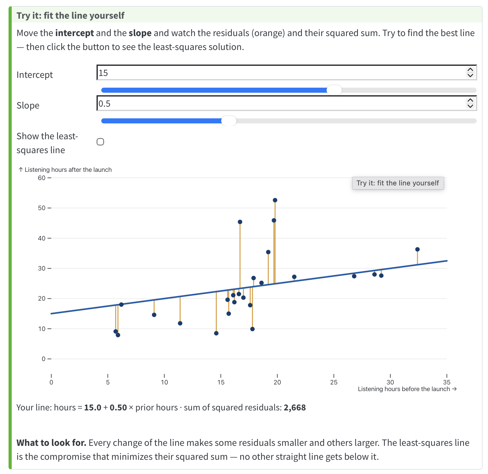
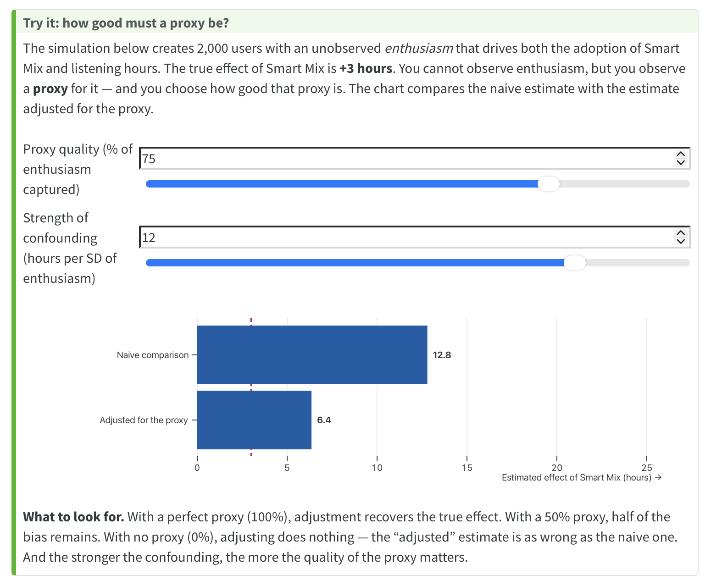
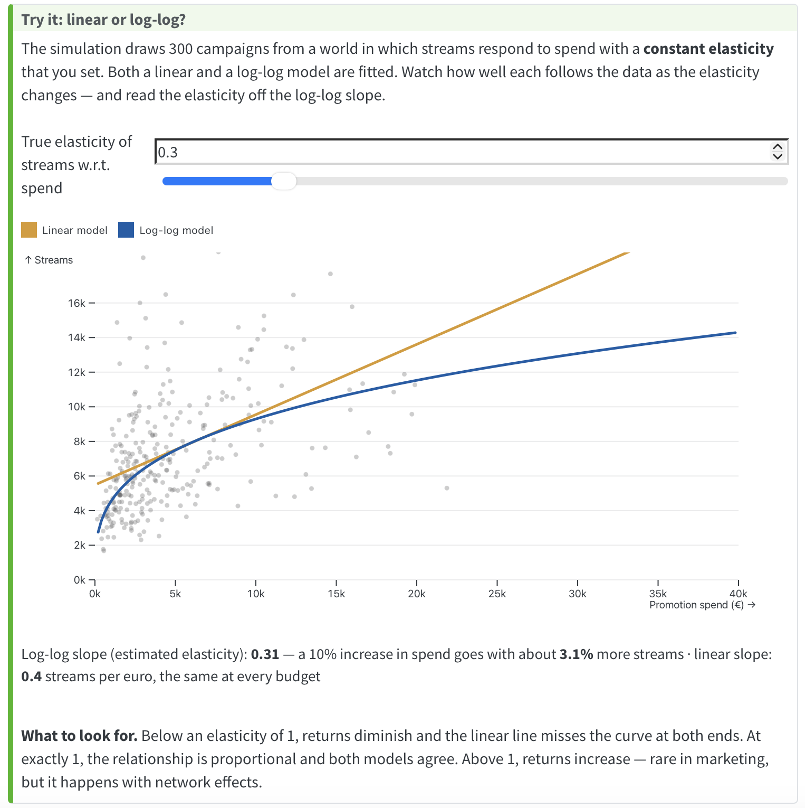

```{r setup}
library(tidyverse)
data_dir <- "../data"
source("../R/ch05-figures.R")
options(scipen = 5, digits = 4, width = 90)
smartmix_obs <- load_smartmix()
campaigns    <- load_campaigns()
playlist     <- load_playlist()
free_users   <- filter(smartmix_obs, premium == 0)
book_url <- "https://wu-rds.github.io/MA2026/05-observational-data.html"
```

# Part 1 · Observational data I {.divider background-color="#0a3d6e"}

## Before we start {.midsize}

::: columns
::: {.column width="50%"}
**Paper quiz on Chapter 4** *(10 min)*

-   Individual, closed book, counts toward participation
-   Afterwards: a few leftovers from Chapter 4 and a look at the quiz questions

**Assignment 2** is running: deadline Group A Sun, Nov 8 · Group B Wed, Nov 11; debrief at the start of next session.
:::

::: {.column width="50%"}
**Devices only when we code**

-   **Input blocks:** laptops closed, phones away
-   **Coding block** (40 min, at the end): laptops open, alone or with your neighbor; results via Menti, then two tables present

::: keybox
Today: correlation and the regression line → reading a regression → adjustment and exogeneity → categorical predictors → prediction vs. explanation → **one coding block with two cases** at the end.
:::
:::
:::

## Today's session {.midsize}

::: columns
::: {.column width="50%"}
**Observational data I** *(today)*

5.1 Smart Mix without randomization\
5.2 Correlation, the line, and least squares\
5.3 Reading a regression\
5.4 Adjusting for confounders — and exogeneity\
5.5 Categorical predictors\
5.6 Prediction vs. explanation
:::

::: {.column width="50%"}
**Observational data II** *(next session)*

5.7 Functional form and elasticities\
5.8 Logistic regression\
5.9 Diagnostics that change decisions\
5.10 Difference-in-differences

::: keybox
**Driving question:** *What if we cannot randomize?*
:::
:::
:::

# 5.1 Smart Mix without randomization {.divider background-color="#0a3d6e"}

## A different history {.midsize}

::: columns
::: {.column width="50%"}
-   Chapter 4: A/B test, 400 users → **+3.2 hours**
-   Now: no experiment. Smart Mix launched as an **opt-in** feature
-   Four weeks later: data of **2,000 users**, `r sum(smartmix_obs$smart_mix)` adopters

```{r obs-naive, fig.width=6.5, fig.height=3}
fig_obs_naive(base_size = 12)
```
:::

::: {.column width="50%"}
::: discussion
The dashboard says: adopters listen **9.3 hours more** — three times the experimental effect. Would you report this number to management?
:::
:::
:::

::: notes
Let them articulate the problem before showing the next slide: who switches on a new music feature? The same intuition as the newsletter and the eBay ads in Chapter 1.
:::

## Adopters were different before Smart Mix existed {.midsize}

::: columns
::: {.column width="58%"}
```{r prior, fig.width=7, fig.height=3.6}
fig_prior_by_adoption(base_size = 12)
```
:::

::: {.column width="42%"}
```{r dag, fig.width=5, fig.height=2.6}
fig_adoption_dag(base_size = 12)
```

::: keybox
Same costume, new villain: **music enthusiasm** drives adoption *and* listening. Without a coin flip, we have one tool left: **adjustment**.
:::
:::
:::

# 5.2 From correlation to a line {.divider background-color="#0a3d6e"}

## The correlation coefficient {.smaller}

::: columns
::: {.column width="55%"}
```{r corr-panels, fig.width=7, fig.height=4}
fig_correlation_panels(base_size = 11)
```
:::

::: {.column width="45%"}
$$
r = \frac{\sum_i (x_i - \bar{x})(y_i - \bar{y})}{\sqrt{\sum_i (x_i - \bar{x})^2}\sqrt{\sum_i (y_i - \bar{y})^2}}
$$

-   Standardized covariance → always between **−1 and +1**, no units
-   **Sign** = direction · **size** = how tightly the cloud hugs a straight line
-   Rules of thumb: 0.1 small · 0.3 medium · 0.5 large
-   Smart Mix: `cor(prior_hours, hours)` = **0.64**
:::
:::

::: keybox
Two caveats: *r* measures **linear** association only (a U-shape can have *r* ≈ 0) — and it is **symmetric**: nothing about which variable causes which.
:::

## Correlation vs. regression {.smaller}

| | Correlation | Regression |
|---|---|---|
| **Estimated coefficient** | r, bounded between −1 and +1, no units | β₁, a priori not bounded, in units of y per unit of x |
| **Interpretation** | Linear association between two variables; **bidirectional** (r of x and y = r of y and x) | (Linear) relation of one or more predictors to an outcome; **directional** (x explains y) |
| **Role of theory** | Neither required nor testable | Required (which variable is the outcome, which predictors belong in the model) — and testable |

::: keybox
Correlation: *that* and *how tightly* two variables move together. Regression: *how much* y changes with x — which presupposes a direction, and that is where theory and this chapter's assumptions come in.
:::

## Two variables, one line {.midsize}

::: columns
::: {.column width="55%"}
```{r scatter, fig.width=6.5, fig.height=4.2}
fig_scatter_prior(base_size = 12)
```
:::

::: {.column width="45%"}
$$
\text{hours}_i = \beta_0 + \beta_1 \, \text{prior hours}_i + \varepsilon_i
$$

-   $i$ = one user · $\beta_0$ **intercept** · $\beta_1$ **slope** · $\varepsilon_i$ **error term**
-   Correlation: *that* they move together · regression: *how much*

```{r lm1, echo=TRUE}
coef(lm(hours ~ prior_hours, data = smartmix_obs))
```

::: keybox
Each extra hour before the launch **goes with** 0.73 hours after it — *goes with*, not *causes*.
:::
:::
:::

## Which line? Least squares {.smaller}

::: columns
::: {.column width="45%"}
```{r ls, fig.width=5, fig.height=4.6, out.width="90%"}
fig_least_squares(base_size = 11)
```
:::

::: {.column width="55%"}
-   Residual = observed − predicted (orange segments)
-   **OLS** = the line that **minimizes the sum of squared residuals**:

$$
\min_{\hat{\beta}_0, \hat{\beta}_1} \sum_{i=1}^{n} \left( y_i - \hat{\beta}_0 - \hat{\beta}_1 x_i \right)^2
$$

-   Squaring: big misses count a lot; above and below alike · `lm()` does exactly this

**Live demo:** fit the line yourself — course book, §5.2

`r paste0("[", book_url, "#sec-obs-line](", book_url, "#sec-obs-line)")`

{width="25%"}
:::
:::

# 5.3 Reading a regression {.divider background-color="#0a3d6e"}

## The full output {.smaller}

```{r lm-naive, echo=TRUE}
model_naive <- lm(hours ~ smart_mix, data = smartmix_obs)
summary(model_naive)
```

## Reading the coefficients {.midsize}

::: columns
::: {.column width="50%"}
::: keybox
**`(Intercept)` = 17.5**: the predicted hours when all predictors are 0 — here the mean of the **non-adopters**.

**`smart_mix` = 9.3**: the change in hours for a **one-unit increase** in the predictor. For a 0/1 variable that is the step from 0 to 1: **adopters − non-adopters**.
:::
:::

::: {.column width="50%"}
::: keybox
**Continuous predictor** (previous section): `prior_hours` = 0.73 → one more hour before the launch goes with **0.73 more hours** after it.

**Several predictors** (next section): every coefficient is read **"holding the other variables constant"**.
:::
:::
:::

::: keybox
The general rule: a coefficient is the change in $y$ when its predictor increases by **one unit** and nothing else changes. Whether that change is *causal* is the question of §5.4.
:::

## Line by line {.smaller}

| Output | Meaning |
|---|---|
| `Estimate` | Intercept = mean of non-adopters (18.4); `smart_mix` = difference adopters − non-adopters (9.3) |
| `Std. Error` | Uncertainty of each coefficient (Chapter 3) |
| `t value`, `Pr(>|t|)` | *t*-test of each coefficient against zero (Chapter 4): signal / noise |
| `Residual standard error` | Typical distance of a user from the line, in hours |
| `Multiple R-squared` | Share of the variation in hours explained by the model (14%) |
| `F-statistic` | The whole model against "no predictors" |

::: keybox
With one 0/1 predictor, the regression **is** the comparison of two means — and its *t*-test is the two-sample *t*-test. `confint(model_naive)` gives the confidence intervals.
:::

::: notes
The F-test and standardized coefficients are in an "Under the hood" box in the book. R² gets its own slide next.
:::

## R²: the share of explained variation {.smaller}

```{r r2-panels, fig.width=12, fig.height=3.1}
fig_r2_panels(base_size = 11)
```

::: columns
::: {.column width="50%"}
-   Same idea as $\eta^2$ in the ANOVA: $R^2 = SS_M / SS_T$ — the share of the variation in $y$ that the line explains
-   Smart Mix dummy: 0.14 · prior listening: 0.41
:::

::: {.column width="50%"}
::: keybox
R² says how well the line **fits** — nothing about whether the slope is **causal**, and a small R² does not make an effect unimportant (14% explained, but 9 hours).
:::
:::
:::

# 5.4 Adjusting for confounders {.divider background-color="#0a3d6e"}

## Holding prior listening constant {.smaller}

```{r lm-prior, echo=TRUE}
model_prior <- lm(hours ~ smart_mix + prior_hours, data = smartmix_obs)
round(coef(summary(model_prior)), 3)
```

. . .

::: keybox
The Smart Mix coefficient drops from **9.3** to **4.9**: now the difference between adopters and non-adopters **with the same prior listening**. Part of the naive gap belonged to prior listening — and is now attributed to it.
:::

## More variables, same logic {.smaller}

```{r lm-full, echo=TRUE}
model_full <- lm(hours ~ smart_mix + prior_hours + tenure + premium + device, data = smartmix_obs)
round(coef(summary(model_full)), 3)
```

::: keybox
**Reading the table, one line each, "holding the other variables constant":** `smart_mix` 4.5 = adopters listen 4.5 h more than non-adopters with the same prior listening, tenure, plan and device · `prior_hours` 0.61 = one more hour before the launch goes with 0.61 h more after it · `tenure` 0.04 = each month of tenure, +0.04 h · `premium` 2.9 = Premium users listen 2.9 h more than free users · `deviceAndroid` / `deviceDesktop` = difference to **iOS** (the reference). Tenure, Premium and device change little for Smart Mix: ≈ **4.5 hours**.
:::

## Naive, adjusted — and the truth {.midsize}

```{r est, fig.width=10, fig.height=4}
fig_estimates(base_size = 12)
```

::: keybox
Adjustment removed ~75% of the bias — **not all of it**. We adjusted for a *proxy* of enthusiasm, not for enthusiasm. Regression removes exactly the confounding your variables capture.
:::

## Live demo: how good must a proxy be? {.midsize}

::: columns
::: {.column width="55%"}
Course book, §5.4 — set the **quality of the proxy** and the **strength of confounding**.

`r paste0("[", book_url, "#sec-obs-adjust](", book_url, "#sec-obs-adjust)")`

{width="50%"}
:::

::: {.column width="45%"}
::: discussion
With a 50% proxy, how much of the bias is left? And what happens at 0%?
:::
:::
:::

::: notes
50%: half the bias remains. 0%: the "adjusted" estimate equals the naive one — adjusting for noise does nothing. Point out the deeper message: no data set can tell you whether you have adjusted for enough.
:::

## Two warnings {.smaller}

::: columns
::: {.column width="55%"}
```{r med-dag, fig.width=7, fig.height=2.6, out.width="100%"}
fig_mediator_dag(base_size = 10)
```

::: keybox
**Adjusting for the wrong variable makes it worse.** A **mediator** lies on the causal path: if Smart Mix works by making users discover new artists, adjusting for `new_artists` **blocks the indirect part** and the coefficient shows only the direct part. Only **confounders** — determined *before* the treatment, affecting treatment *and* outcome — belong in the model.
:::
:::

::: {.column width="45%"}
::: keybox
**"Enough" is untestable.** The assumption of no unobserved confounders cannot be checked in the data. Report *what* you adjusted for — and what you plausibly could not.
:::
:::
:::

::: notes
Left panel: both paths open, the coefficient of smart_mix is the total effect. Right panel: holding new_artists constant compares adopters and non-adopters who discovered the same number of artists — the part of the effect that runs through discovery is gone. Chapter 6 uses exactly this to measure the indirect part on purpose (mediation analysis). Collinearity (VIF) is in the book's box: it makes coefficients imprecise, not biased.
:::

## Where the unobserved variable goes {.smaller}

::: columns
::: {.column width="55%"}
**The true model** (price and sales; weather raises both):

$$
\text{Sales}_i = \beta_0 + \beta_1 \, \text{Price}_i + \beta_2 \, \text{Weather}_i + \phi_i
$$

**Weather is not in the data** — so we estimate:

$$
\text{Sales}_i = \beta_0 + \beta_1 \, \text{Price}_i + \underbrace{\varepsilon_i}_{= \, \beta_2 \text{Weather}_i + \phi_i}
$$

-   The omitted variable does not disappear — it moves **into the error term**
-   Weather also drives price → the error term is **correlated with the regressor**
-   OLS attributes the weather effect to price: $\hat{\beta}_1$ is **biased**, and more data do not help
:::

::: {.column width="45%"}
```{r conf-dag, fig.width=5, fig.height=2.6, out.width="100%"}
fig_confounder_dag(base_size = 11)
```

::: keybox
Smart Mix: replace price by **adoption**, weather by **enthusiasm**. Enthusiasm is in $\varepsilon_i$ and drives adoption → 9.3 h instead of 3.
:::
:::
:::

::: notes
This is the omitted-variable bias of Chapter 1 written as an equation. Remedies: include the uncontrolled factor (or a proxy for it — prior_hours), randomize (Chapter 4), or instrumental variables (not covered).
:::

## Variation has two components {.smaller}

```{r var-comp, fig.width=11, fig.height=4.6}
fig_variation_components(base_size = 10)
```

::: keybox
The observed price variation mixes **exogenous** variation (price moves for its own reasons → the causal effect, downward) with **endogenous** variation (weather moves price *and* demand → upward). OLS on the mix gives a slope that is neither. Adjustment and experiments are ways to isolate the exogenous part.
:::

## Exogeneity {.smaller}

::: columns
::: {.column width="55%"}
$$
y_i = \beta_0 + \beta_1 x_i + \varepsilon_i
$$

-   The most important assumption when the goal is the **effect** of $x$ on $y$
-   The error term must not be related to $x$: $\text{Cov}(x_i, \varepsilon_i) = 0$ — $x$ is **exogenous**
-   If $\text{Cov}(x_i, \varepsilon_i) \neq 0$: $x$ is **endogenous**, the estimate is **biased** (and stays biased with more data), and $\beta_1$ cannot be read as causal
-   Randomization **guarantees** exogeneity. Opt-in **violates** it. Each adjustment variable moves a piece of $\varepsilon_i$ into the model: `prior_hours` took most of the enthusiasm out (9.3 → 4.5); what is left still correlates with adoption (4.5 > 3)
:::

::: {.column width="45%"}
::: keybox
**Exogeneity cannot be tested.** The residuals of a fitted regression are uncorrelated with the predictors *by construction* — the data always "look" exogenous. The argument has to come from outside: theory, and how the data came to be (who chose the treatment, and why).
:::
:::
:::

::: notes
This is the regression version of "no unobserved confounders" from Chapter 1. Ask: what else could be in the error term that drives adoption? Remedies: include the factor or a proxy; randomize; (instrumental variables: not covered).
:::

## Your turn (5 min) {.midsize}

::: discussion
Add **`age`** to the full model. Does the Smart Mix coefficient change? Why (not)?

```r
model_age <- lm(hours ~ smart_mix + prior_hours + tenure + premium + device + age,
                data = smartmix_obs)
round(coef(summary(model_age)), 3)
```

Then: which variable in the data set should you **never** adjust for when estimating the effect of Smart Mix on listening — and why?
:::

::: notes
Age barely changes anything: it is not related to adoption in these data, so it is not a confounder. The variable NOT to adjust for: churn — it is determined after listening (and partly by it); adjusting for a consequence of the outcome is "bad control". Let one pair report.
:::

# 5.5 Categorical predictors {.divider background-color="#0a3d6e"}

## Dummies and the reference category {.smaller}

```{r cat, echo=TRUE}
coef(model_full)[c("premium", "deviceAndroid", "deviceDesktop")]
```

::: columns
::: {.column width="50%"}
-   **0/1 variable** (`premium`): coefficient = difference between the two groups, other variables held constant
-   **Several categories** (`device`): R picks a **reference** (first level: iOS) and creates one **dummy** per other category
-   Each dummy = difference to the **reference**
:::

::: {.column width="50%"}
::: keybox
Android users: **1.5 hours less** than iOS users; Desktop: **2.5 hours less** — holding everything else constant. *p*-values compare each category with the reference; "does device matter at all?" → `anova(model_without, model_full)` (the ANOVA of Chapter 4).
:::
:::
:::

::: notes
Reference category is convenience, not substance: relevel(device, ref = "Android") changes the comparisons, not the model. Reminder from Chapter 2: set factor levels yourself, otherwise alphabetical.
:::

# 5.6 Prediction vs. explanation {.divider background-color="#0a3d6e"}

## Predicting listening time for new users {.smaller}

::: columns
::: {.column width="50%"}
```{r pred-code, echo=TRUE}
set.seed(42)
train_ids <- sample(nrow(smartmix_obs), 1500)
train <- smartmix_obs[train_ids, ]
test  <- smartmix_obs[-train_ids, ]
model_pred <- lm(hours ~ prior_hours + tenure + premium +
                   device + smart_mix, data = train)
test$predicted <- predict(model_pred, newdata = test)
sqrt(mean((test$hours - test$predicted)^2))   # RMSE
```
:::

::: {.column width="50%"}
```{r pred-fig, fig.width=5.5, fig.height=3.8}
fig_prediction(base_size = 11)
```
:::
:::

::: keybox
For **prediction**, it does not matter *why* a variable is associated with the outcome — only how well the predictions hold up on **data the model has not seen**.
:::

## Two questions, two rules {.midsize}

::: columns
::: {.column width="50%"}
::: keybox
**Explanation** (causal question): include confounders, exclude mediators, state what is unobserved. The **coefficient** matters; R² is secondary.
:::
:::

::: {.column width="50%"}
::: keybox
**Prediction**: include whatever predicts; judge by **out-of-sample errors**. Coefficients are not interpreted; the **predictions** matter.
:::
:::
:::

. . .

::: discussion
A model can be a **good predictor and a bad explainer** at the same time. Where in your company would each mistake — reading causal effects off a prediction model, or judging a causal model by its R² — cost money?
:::

::: notes
Overfitting, adjusted R² and AIC: book box. The mistake in practice: "our churn model has R² = 0.6, so the variables in it are the drivers of churn" — no.
:::

## Coding block: two cases (40 min) {.smaller}

::: columns
::: {.column width="50%"}
**Case 1: podcast promotion** — `podcast_promo.csv`, 400 episodes: promotion spend, host followers, downloads.

1.  Scatter plot of downloads against spend; the **correlation**; one sentence
2.  `lm()` + `summary()`: interpret the **slope**; read off **R²**
3.  Is the slope **causal**? What would you need to argue?

**Laptops open — alone or with your neighbor.** Section "Coding block" in `05-observational-data.R`.
:::

::: {.column width="50%"}
**Case 2: a loyalty program** — `loyalty_program.csv`, 1,500 customers, membership is **opt-in**.

1.  **Naive:** `spending ~ member` — interpret; why not causal?
2.  **Adjust** for `spend_prev`, `tenure`, `device`: how does the coefficient change, what does it mean now? With 95% CI
3.  Interpret the coefficient of `device`
4.  Is membership **exogenous** after adjustment? Argue from the data-generating process

::: keybox
At the end: one table presents case 1, another table case 2 — Menti first: enter your slope (case 1) and your adjusted coefficient (case 2).
:::
:::
:::

::: notes
Case 1: r = 0.39; slope 3.6 downloads per euro, R² = 0.15; diminishing returns visible (session 6 comes back to it). Causal only if spend is exogenous — budgets go to episodes expected to do well; host followers not in the model. Case 2: naive +151 euros; adjusted +81 (CI 66–96); Mobile −26 vs. Desktop; true effect in the simulation +40 — previous-year spending captures only part of the "shop affinity". Solutions: 05-your-turn-solutions.R (released after the session).
:::

## Learning check (Part I) {.smaller}

1.  Slope of hours on prior hours = 0.73. Interpret — and why is it not causal?
2.  Adding a variable can increase, decrease, or leave the Smart Mix coefficient unchanged. When does each happen?
3.  `planFamily` = 4.2 with reference "Free". Interpret. How do you test whether the plan matters at all?
4.  R² = 0.71 for predicting next month's spending with 25 predictors on 300 customers. What do you ask?

::: notes
(1) Users with one more hour before the launch listen 0.73 more hours after it, on average; both are driven by the same enthusiasm — association, not effect. (2) Decrease: the variable is a confounder associated with adoption and hours in the same direction; unchanged: unrelated to adoption; increase: associated in opposite directions (suppression). (3) Family-plan users listen 4.2 hours more than Free users, other variables constant; anova() with and without plan. (4) Out-of-sample performance (test set); 25 predictors for 300 cases invites overfitting.
:::

## Next session {.midsize}

**Observational data II** — beyond the straight line, and a quasi-experiment

-   Functional form: when a line is wrong — **elasticities**
-   Yes/no outcomes: logistic regression
-   The three diagnostics that change decisions
-   **Difference-in-differences** with real playlist data

::: keybox
Before next session: work through §5.1–5.6 on the course site. **Debrief of Assignment 2** at the start of the session.
:::

# Part 2 · Observational data II {.divider background-color="#0a3d6e"}

## Before we start {.midsize}

::: columns
::: {.column width="50%"}
**Debrief A2 + quiz Chapter 5, Part I** *(15 min, one sheet)*

-   Page 1: debrief of **Assignment 2** (3 assignment points)
-   Page 2: quiz on **Chapter 5, §5.1–5.6** (participation)
-   Closed book, no laptop

**Assignment 3** is handed out today (end of session).
:::

::: {.column width="50%"}
**Devices only when we code** — as last time

::: keybox
Today: functional form and elasticities → logistic regression → diagnostics → difference-in-differences → **one coding block with two cases** → A3.
:::
:::
:::

# 5.7 Functional form: when the line is wrong {.divider background-color="#0a3d6e"}

## Diminishing returns {.smaller}

```{r fits, fig.width=11.5, fig.height=4.2}
fig_campaign_fits(base_size = 12)
```

::: keybox
500 promotion campaigns: the first euros buy many streams, later euros fewer. A straight line cannot bend — on **log scales**, the cloud becomes a line again.
:::

## The multiplicative model — and why logs make it linear {.smaller}

::: columns
::: {.column width="55%"}
**Multiplicative:** each predictor *scales* the outcome

$$
\text{streams}_i = e^{\beta_0} \cdot \text{spend}_i^{\,\beta_1} \cdot \text{followers}_i^{\,\beta_2} \cdot e^{\varepsilon_i}
$$

**Take logs on both sides** → additive again, a job for `lm()`:

$$
\log(\text{streams}_i) = \beta_0 + \beta_1 \log(\text{spend}_i) + \beta_2 \log(\text{followers}_i) + \varepsilon_i
$$
:::

::: {.column width="45%"}
::: keybox
**Three log rules do the work:**
$\log(a \cdot b) = \log a + \log b$
$\log(a^b) = b \log a$
$\log(e^x) = x$

Additive model: each euro adds $\beta_1$ streams, always. Multiplicative model: each euro adds a **percentage** of the current streams — diminishing returns built in.
:::
:::
:::

## The log-log model: elasticities {.smaller}

```{r loglog, echo=TRUE}
model_loglog <- lm(log(streams) ~ log(spend) + log(followers) + placements + genre, data = campaigns)
round(coef(summary(model_loglog)), 3)
```

::: keybox
`log(spend)` = **0.33**: a 1% increase in spend goes with 0.33% more streams; +10% spend → **+3.3% streams** — the same *percentage* at every budget. Elasticities have no units and are **comparable**: followers (0.51) matter more than the budget.
:::

::: keybox
This is a **marketing mix model** in miniature: sales on the marketing inputs, log-log form → an **elasticity per channel** → reallocate the budget toward the channels where a euro buys the largest percentage gain. Real MMMs add carryover (adstock) and saturation — and share this chapter's problem: budgets are not set at random, so spend is **endogenous**. Companies therefore calibrate MMMs with experiments.
:::

## Four ways to combine levels and logs {.smaller}

```{r forms, fig.width=11, fig.height=2.6}
fig_functional_forms(base_size = 11)
```

| Model | Equation | Reading $\beta_1$ |
|---|---|---|
| Level-level | $y = \beta_0 + \beta_1 x$ | +1 unit $x$ → $\beta_1$ units of $y$ |
| Log-level | $\log y = \beta_0 + \beta_1 x$ | +1 unit $x$ → ≈ $100\beta_1$% of $y$ (exact: $100(e^{\beta_1}-1)$%) |
| Level-log | $y = \beta_0 + \beta_1 \log x$ | +1% $x$ → ≈ $\beta_1/100$ units of $y$ |
| Log-log | $\log y = \beta_0 + \beta_1 \log x$ | +1% $x$ → ≈ $\beta_1$% of $y$ (**elasticity**) |

::: notes
In our model, `placements` is a log-level term: 0.12 → about 12% more streams per placement (exact: 12.8%). For coefficients up to ~0.1 the approximation is fine; beyond that use exp(β) − 1 (β = 0.5 → 65%, not 50%). Zeros: log(x + 1) — book box.
:::

## Your turn (5 min) {.midsize}

::: discussion
From the log-log model:

1.  `genreHipHop/Rap` = 0.20. By what percentage do HipHop/Rap campaigns differ from Pop campaigns (the reference) — approximately and exactly?
2.  A marketing manager proposes to double the promotion budget of every campaign. By roughly what percentage would streams increase, according to the model? Is this a causal claim?
:::

::: notes
(1) ≈ 20%; exact: exp(0.20) − 1 = 22%. (2) Doubling = +100%; with constant elasticity: 2^0.33 − 1 ≈ 26% (the rule of thumb 0.33 × 100 = 33% overshoots for such a large change — a good moment to show that the % rule is a local approximation). Causal? Only if spend is not confounded with unobserved campaign quality — probably it is (bigger budgets go to more promising releases).
:::

## Live demo: linear or log-log? {.midsize}

::: columns
::: {.column width="55%"}
Course book, §5.7 — move the **true elasticity**.

`r paste0("[", book_url, "#sec-obs-form](", book_url, "#sec-obs-form)")`

{width="50%"}
:::

::: {.column width="45%"}
::: keybox
Elasticity **< 1**: diminishing returns, the line misses at both ends. **= 1**: proportional. **> 1**: increasing returns (rare — network effects).
:::
:::
:::

# 5.8 Yes/no outcomes: logistic regression {.divider background-color="#0a3d6e"}

## Why not a straight line? {.midsize}

::: columns
::: {.column width="55%"}
```{r logit-fig, fig.width=6.5, fig.height=4.2}
fig_logistic_upgrade(base_size = 12)
```
:::

::: {.column width="45%"}
-   Outcome: **upgraded to Premium** within 3 months — free users, `r round(100 * mean(free_users$upgraded))`% did
-   A line predicts probabilities **below 0** and **above 1** — and misses the shape
-   The share of upgrades rises slowly, then steeply, then flattens near 100%: an **S-curve**
:::
:::

::: keybox
We need a function that only takes values between 0 and 1.
:::

## The logistic function {.smaller}

::: columns
::: {.column width="50%"}
$$
P(y_i = 1) = \frac{1}{1 + e^{-(\beta_0 + \beta_1 x_i)}}
$$

-   Very negative $\beta_0 + \beta_1 x_i$ → $P \approx 0$ · very positive → $P \approx 1$
-   Derived from the **log-odds**: odds = $P / (1 - P)$ ("1 to 4" = 0.25)

$$
\log\left(\frac{P(y_i = 1)}{1 - P(y_i = 1)}\right) = \beta_0 + \beta_1 x_i
$$

-   Exponentiate → the odds: $\dfrac{P(y_i = 1)}{1 - P(y_i = 1)} = e^{\beta_0 + \beta_1 x_i}$
:::

::: {.column width="50%"}
```{r glm1, echo=TRUE}
free_users <- filter(smartmix_obs, premium == 0)
model_upgrade <- glm(upgraded ~ hours, family = binomial,
                     data = free_users)
round(coef(summary(model_upgrade)), 3)
```

::: keybox
`glm()` = *generalized* linear model: the same predictors, a different link to the outcome. Estimated by **maximum likelihood**, not least squares (no line, no residuals to square): the coefficients under which the observed 0/1 data are most likely.
:::
:::
:::

::: notes
MLE in one sentence: for given coefficients, each user gets a probability P_i; the likelihood of the data is the product of P_i for upgraders and (1 − P_i) for non-upgraders; glm() iterates to find the coefficients that maximize it ("Fisher Scoring iterations" in the output). Book box.
:::

## Reading the coefficients: odds ratios {.smaller}

::: columns
::: {.column width="50%"}
```{r glm-or, echo=TRUE}
exp(coef(model_upgrade))
exp(confint(model_upgrade))
```

-   Coefficient 0.163 = change in the **log-odds** per hour — no intuition
-   $e^{0.163}$ = **1.18**: each hour multiplies the **odds** of an upgrade by 1.18 (+18%) — the same factor everywhere
-   Read **sign** and **significance** directly from the output
:::

::: {.column width="50%"}
::: keybox
**Odds ratio ≠ probability ratio.** "Odds +18%" is not "18% more likely" — unless the event is rare. For managers, translate into **probabilities**.
:::
:::
:::

## Reading the coefficients: probabilities at x and x + 1 {.smaller}

::: columns
::: {.column width="50%"}
```{r glm-pred, echo=TRUE}
predict(model_upgrade, type = "response",
        newdata = data.frame(hours = c(10, 11, 20, 21, 30, 31, 40, 41)))
```

-   10 → 11 hours: **+0.9** points · 20 → 21: **+2.9** · 30 → 31: **+3.9** · 40 → 41: **+1.6**
-   Same coefficient, same odds ratio — a **different change in probability**, largest around 50%
:::

::: {.column width="50%"}
```{r logit-steps, fig.width=6, fig.height=4, out.width="100%"}
fig_logistic_steps(base_size = 11)
```
:::
:::

::: keybox
Report effects as **predicted probabilities at chosen values** (10 vs. 30 hours: 5% vs. 59%) or as the **average change** across all users — "the effect of one more hour" has no single answer in percentage points.
:::

## Several predictors: churn {.smaller}

```{r glm2, echo=TRUE}
model_churn <- glm(churn ~ hours + premium + tenure + smart_mix, family = binomial, data = smartmix_obs)
round(coef(summary(model_churn)), 3)
```

::: columns
::: {.column width="50%"}
```{r glm-ame, echo=TRUE}
p_free    <- predict(model_churn, newdata = mutate(smartmix_obs, premium = 0), type = "response")
p_premium <- predict(model_churn, newdata = mutate(smartmix_obs, premium = 1), type = "response")
mean(p_premium - p_free)
```
:::

::: {.column width="50%"}
::: keybox
Same logic as multiple regression: each coefficient holds the others constant. Premium subscribers: about **9 percentage points** less likely to churn than otherwise identical free users. Causal? Exogeneity, again.
:::
:::
:::

# 5.9 The diagnostics that change decisions {.divider background-color="#0a3d6e"}

## Three checks worth doing every time {.smaller}

::: columns
::: {.column width="33%"}
```{r diag-a, fig.width=4.2, fig.height=3.2, out.width="100%"}
fig_residuals_form(base_size = 9) + plot_layout(ncol = 2)
```

**1. Is the line the right shape?** Curved residuals → change the functional form (log) or add a predictor.
:::

::: {.column width="33%"}
```{r diag-b, fig.width=4.2, fig.height=3.2, out.width="100%"}
fig_influence(base_size = 9)
```

**2. Does one observation drive the result?** `plot(model, which = 5)`; refit without it — if the conclusion changes, say so.
:::

::: {.column width="34%"}
```{r diag-c, fig.width=4.2, fig.height=3.2, out.width="100%"}
fig_heteroskedasticity(base_size = 9) + labs(subtitle = NULL)
```

**3. Is the uncertainty right?** A funnel → **robust standard errors**: `coeftest(model, vcov = vcovHC(model))`.
:::
:::

::: notes
Not on the list: normality of residuals (CLT; glance at the Q-Q plot for extreme outliers only) and multicollinearity (precision, not validity). Both in the book's box.
:::

# 5.10 A quasi-experiment: difference-in-differences {.divider background-color="#0a3d6e"}

## Playlist listings as a natural experiment {.smaller}

::: columns
::: {.column width="60%"}
```{r did-trends, fig.width=7.5, fig.height=4}
fig_did_trends(base_size = 11)
```
:::

::: {.column width="40%"}
-   **Real data:** `r n_distinct(playlist$song_id)` songs × 21 weeks
-   March 19, 2018: **`r n_distinct(playlist$song_id[playlist$treated == 1])` songs** added to a major playlist; `r n_distinct(playlist$song_id[playlist$treated == 0])` control songs
-   Treated songs start **higher** → levels not comparable
-   Before the listing: both groups move in **parallel**
-   At the listing: the treated group **jumps**
:::
:::

::: source
Data: WU-RDS research project (github.com/WU-RDS/did).
:::

## Two differences, one estimate {.midsize}

::: columns
::: {.column width="50%"}
```{r did-four, fig.width=5.5, fig.height=3.8}
fig_did_four(base_size = 11)
```
:::

::: {.column width="50%"}
$$
\text{DiD} = (\bar{y}_{T,\text{after}} - \bar{y}_{T,\text{before}}) - (\bar{y}_{C,\text{after}} - \bar{y}_{C,\text{before}})
$$

(10.09 − 9.85) − (9.72 − 9.76) = **0.28** log points

::: keybox
The control group's change estimates what would have happened to the treated songs **without** the listing — the counterfactual (dotted).
:::
:::
:::

## The DiD regression {.smaller}

```{r did-lm, echo=TRUE}
did_data <- playlist |>
  filter(week != as.Date("2018-03-19")) |>          # drop the listing week
  mutate(log_streams = log(streams + 1))
model_did <- lm(log_streams ~ treated * post, data = did_data)
round(coef(summary(model_did)), 3)
```

| Coefficient | Meaning |
|---|---|
| `(Intercept)` 9.76 | Control, before: baseline |
| `treated` 0.09 | Treated, before: the **level difference** |
| `post` −0.05 | Control, after − before: the **common time trend** |
| `treated:post` **0.28** | The extra change of the treated songs: the **DiD effect** → ≈ **+32% streams** |

::: notes
`treated * post` = treated + post + treated:post. Advantages over the four means: standard errors, and easy extensions (controls, fixed effects — book box). The interaction term in its general role: Chapter 6.
:::

## The assumption: parallel trends {.smaller}

::: columns
::: {.column width="55%"}
```{r placebo, echo=TRUE}
placebo_data <- did_data |>
  filter(post == 0) |>
  mutate(fake_post = ifelse(week >= as.Date("2018-02-12"), 1, 0))
round(coef(summary(lm(log_streams ~ treated * fake_post,
                      data = placebo_data)))["treated:fake_post", ], 3)
```
:::

::: {.column width="45%"}
::: keybox
Without the listing, the treated songs would have followed the **same trend** as the controls. **Untestable** — but the pre-period makes it plausible: a fake listing in the pre-period shows **no effect**.
:::

Live demo: course book, §5.10

`r paste0("[", book_url, "#sec-obs-did](", book_url, "#sec-obs-did)")`
:::
:::

::: notes
Failure case: the editors picked songs that were already taking off — a rising pre-trend would be attributed to the listing. Show in the widget: a differential trend produces a biased estimate, and the pre-period lines diverge.
:::

## Your turn (5 min) {.midsize}

::: discussion
Add `major_label` as a control variable to the DiD regression:

```r
summary(lm(log_streams ~ treated * post + major_label, data = did_data))
```

Does the effect change? Then: name one situation in which the parallel-trends assumption would **fail** for playlist listings.
:::

::: notes
Effect essentially unchanged — a control variable can improve precision but does not change the DiD logic. Failure: editors select songs with upward momentum; or treated songs get simultaneous radio/marketing pushes that controls don't.
:::

## Coding block: two cases (40 min) {.smaller}

::: columns
::: {.column width="50%"}
**Case 3: podcast promotion, revisited** — `podcast_promo.csv` again.

1.  Scatter plot with **both axes logged**: what has changed?
2.  **Log-log model** on spend and host followers; interpret both **elasticities**: what does +10% spend do?
3.  Compare **R²** with the linear model; which model for the budget advice?

**Laptops open — alone or with your neighbor.** Section "Coding block" in `05-observational-data.R`.
:::

::: {.column width="50%"}
**Case 4: winning back users** — `app_reinstall.csv`, 1,200 users, **randomized** discount 0–60%, reinstalled (1/0), prior sessions.

1.  **Share of reinstalls per discount level**, plotted: describe the shape
2.  **Logistic regression** of `reinstalled` on `discount` and `prior_use`: sign and **odds ratio** of the discount
3.  Predicted probabilities for 10 prior sessions at **10, 11, 40, 41%**: points per extra point of discount — why do the two answers differ?

::: keybox
At the end: one table presents case 3, another case 4 — Menti first: your spend elasticity (case 3) and your odds ratio (case 4).
:::
:::
:::

::: notes
Case 3: elasticities 0.31 (spend), 0.47 (followers): +10% spend → +3.1% downloads; R² 0.65 vs. 0.15 (different outcomes, not strictly comparable). Case 4: S-curve from about 3% to 95%; odds ratio 1.11 per point of discount; 10 → 11%: +1.2 points (12.6 → 13.8%); 40 → 41%: +1.8 points (76.6 → 78.4%); largest step near 50%. The discount was randomized, so this effect is causal. Solutions: 05-your-turn-solutions.R.
:::

# What observational data can and cannot tell you {.divider background-color="#0a3d6e"}

## Two strategies, one honest report {.midsize}

::: incremental
-   **Adjustment** handles confounders you can **measure** — only as good as your proxies; "enough" is untestable
-   **Difference-in-differences** handles confounders **constant over time** — needs parallel trends, plausible but never proven
-   **Prediction** needs no causal assumptions — a good predictor is valuable even if no coefficient is an effect
:::

. . .

::: keybox
Report effect + uncertainty + **assumptions**: "Adjusting for prior listening, tenure, Premium and device, adopters listen ≈ 4.5 hours more (95% CI 3.6–5.3), assuming no further differences affect listening — the experiment (3.2) suggests this is not fully met."
:::

## Assignment 3: analyzing observational data {.midsize}

::: columns
::: {.column width="55%"}
-   Your **personal** data (based on your student ID): an opt-in feature, promotion campaigns, and a small panel with a listing
-   Tasks: naive vs. adjusted · categorical predictor · elasticity · logistic regression · DiD
-   **Deadline:** Group A Sun, Nov 22 · Group B Wed, Nov 25
-   **Debrief** at the start of the following session
:::

::: {.column width="45%"}
::: keybox
**10 points:** report 7 + debrief 3. State your **assumptions** — the best answers say what the data *cannot* show.
:::
:::
:::

## Learning check (Part II) {.smaller}

1.  Log-log coefficient of ad spend = 0.15. Interpret. The level model says 0.8 sales per euro — why might the two disagree about doubling the budget?
2.  Log-level model, dummy "promotion week" = 0.35. Percentage difference in sales — approximate and exact?
3.  Residual plot shows a funnel. Consequence for coefficients, for *p*-values — and the simplest fix?
4.  A DiD of a price promotion in treated stores: which assumption, and how can the pre-period help?

::: notes
(1) +1% spend → +0.15% sales; doubling: 2^0.15 − 1 ≈ 11%, while the linear model extrapolates constant returns. (2) ≈ 35%; exact 42%. (3) Coefficients unbiased, SEs/p-values wrong; robust SEs. (4) Parallel trends; placebo test / visual pre-trends.
:::

## Next session

**Module 6 · Mechanisms & heterogeneity** — *Why, and for whom, does it work?*

-   Interaction effects: when the effect differs between groups (moderation)
-   Mediation: through which mechanism an effect works
-   In experiments and observational data — and in your group project
