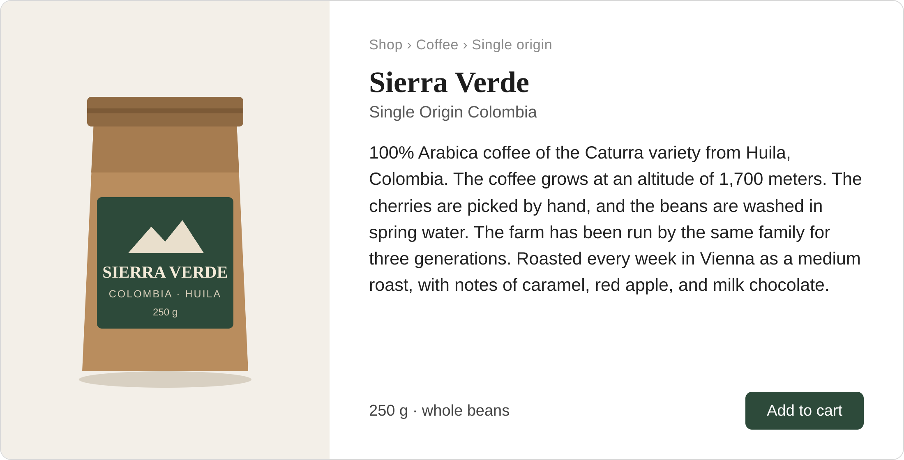
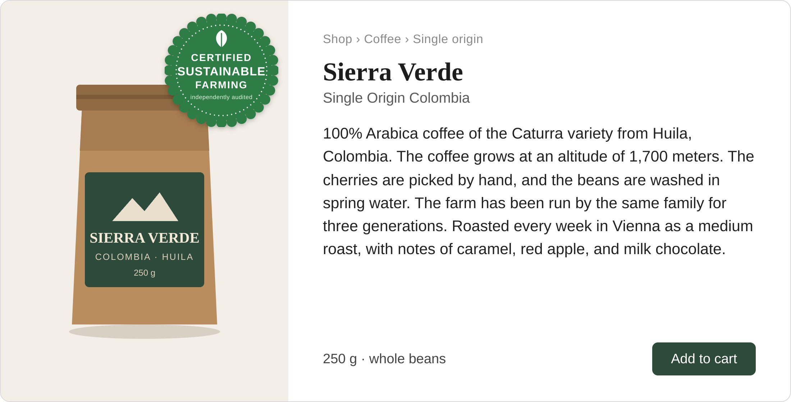
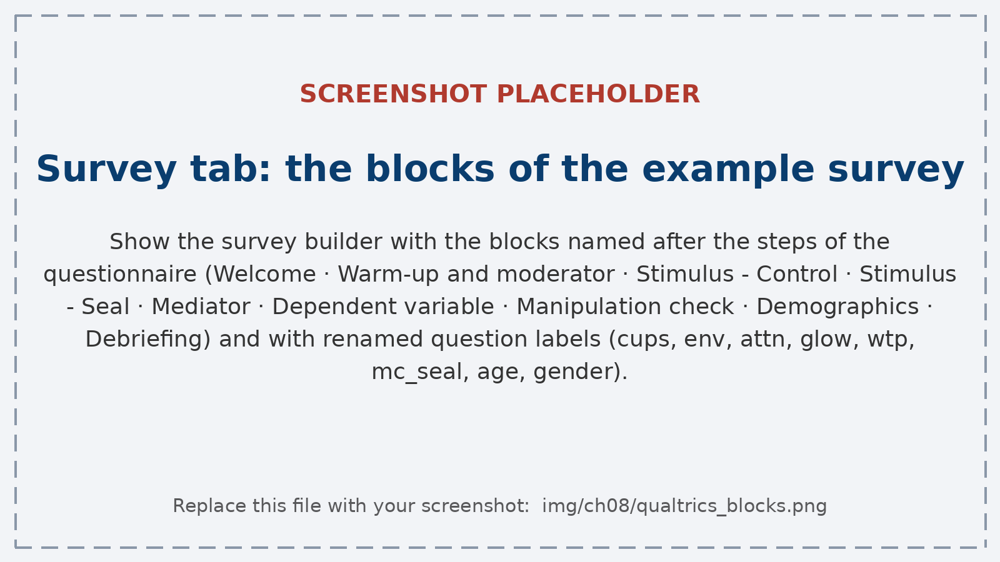
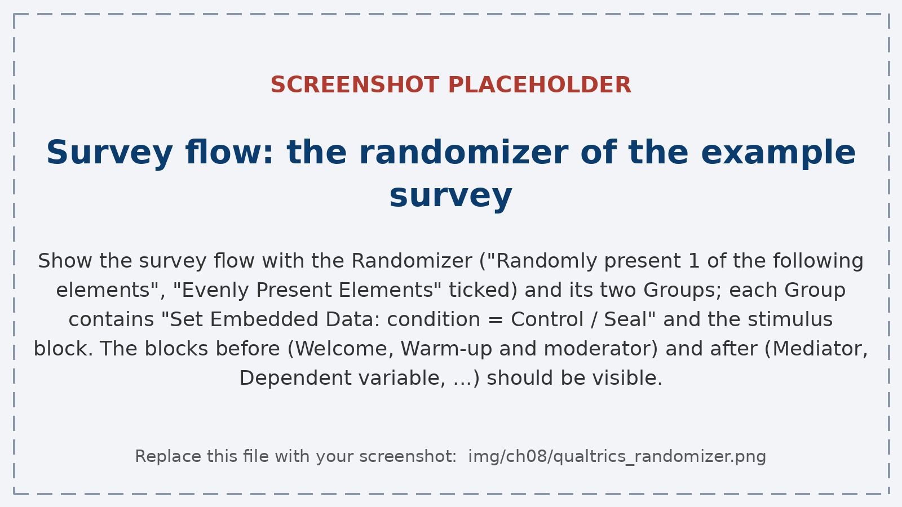
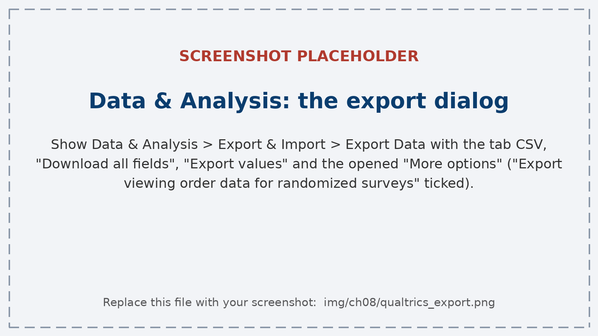

```{r setup}
library(tidyverse)
library(emmeans)
data_dir <- "../data"
source("../R/ch08-figures.R")
options(scipen = 5, digits = 4, width = 95)
file   <- "../data/coffee_seal_qualtrics.csv"
raw    <- load_coffee_raw()
coffee <- clean_coffee(raw)
# last week's coding block (Chapter 6): the tidy file of the storytelling study
coffee_story <- read_csv("../data/coffee_story.csv", show_col_types = FALSE)
tt6 <- t.test(wtp ~ version, data = coffee_story)
f2  <- function(x) sub("-", "&minus;", sprintf("%.2f", x))    # two decimals, proper minus sign
pv  <- function(p) sub("^0", "", sprintf("%.3f", p))          # p-values without the leading zero
book_url <- "https://wu-rds.github.io/MA2026/survey-design.html"
```

## Before we start {.midsize}

::: columns
::: {.column width="50%"}
::: {style="padding-right: 1.4em;"}
**Debrief A3 + quiz Chapter 6** *(15 min, one sheet)*

-   Page 1: debrief of **Assignment 3** (3 assignment points)
-   Page 2: quiz on **Chapter 6** (participation)
-   Closed book, no laptop
:::
:::

::: {.column width="50%"}
**Devices only when we code**

-   **Input blocks:** laptops closed, phones away
-   **Coding block** (25 min, at the end): laptops open, alone or with your neighbor

::: keybox
Today: seven steps from your research question to your data — with **two working phases for your own project** and one coding block.
:::
:::
:::

## Today's session {.midsize}

::: columns
::: {.column width="52%"}
Step 1 · **Plan**: start from the end\
Step 2 · **Manipulate**: two versions, one difference\
Step 3 · **Measure**: from constructs to questions\
Step 4 · **Order**: the questionnaire follows the causal diagram\
Step 5 · **Build**: blocks, survey flow, and the **randomizer**\
Step 6 · **Field**: pretest, launch, collect\
Step 7 · **Analyze**: from Qualtrics to R\
**Your project**: blueprint (15 min) and survey flow (10 min)\
**Coding block**: work with a raw Qualtrics export (25 min)
:::

::: {.column width="48%"}
::: keybox
**Driving question:** *How do you turn a causal question into a questionnaire that can answer it?*

A wrong line of code is fixed in a minute. A wrong questionnaire cannot be fixed after 120 people have answered.
:::
:::
:::

## Where we are in the group project {.smaller}

| Milestone | Group A (Mondays) | Group B (Thursdays) |
|:----------------------------------------------|:------------------|:------------------|
| **Today:** survey design | Mon, Nov 23 | Thu, Nov 26 |
| Upload the draft questionnaire (PDF) and slides | Sun, Nov 29 | Wed, Dec 2 |
| **Coaching I** — questionnaire design *(online)* | Mon, Nov 30, 13:00–17:00 | Thu, Dec 3, 14:00–18:00 |
| Pretest, revise, and field your survey | December | December |
| **Coaching II** — data analysis *(online)* | Thu, Jan 7 | Fri, Jan 8 |
| Submission: video, slides, data, code | Wed, Jan 20 | Wed, Jan 20 |

::: keybox
**Every project:** two randomly assigned conditions · a manipulation check · an outcome with real variation · **one moderator** (measured before the stimulus) · **one mediator** (measured after it) · hypotheses stated in advance · about 120 respondents.
:::

# Step 1 · Plan: start from the end {.divider background-color="#0a3d6e"}

## Last week's data: where did the columns come from? {.midsize}

::: columns
::: {.column width="50%"}
```{r head-coffee, echo=TRUE}
head(coffee_story) |> as.data.frame()
```
:::

::: {.column width="50%"}
::: discussion
*The story behind the coffee* — the survey experiment of last week's coding block (320 respondents). For each column:

1.  Which question(s) of the questionnaire produced it?
2.  Was it asked **before or after** the stimulus — and why?
3.  Who or what filled in `version`?
:::
:::
:::

. . .

::: keybox
**Every column in your data is a decision in your questionnaire** — taken before the first respondent clicks on the link. *Today: the next study of the same roaster — from the first idea to the raw Qualtrics export.*
:::

::: notes
involvement: asked BEFORE the stimulus (it must not be affected by the version). authenticity: the mean of three items, AFTER the stimulus (the mediator: on the causal path). wtp: one open question, after the mediator. version: nobody answered it - the randomizer wrote it into the data (embedded data). respondent: a running number. Today's example is a new study of the same roaster (a sustainability seal on the product page), at the size of a group project: 144 recorded responses, 120 in the analysis; its treatment column is called condition (the name of the embedded data field). Last week's storytelling stimuli come back in Step 2.
:::

## Design backwards, build forwards {.smaller}

| The question | The model (coffee study) | Columns it needs | Where they come from |
|:--------------|:--------------------------------|:----------------|:------------------------|
| **Does it work?** | `lm(wtp ~ condition)` | `condition`, `wtp` | the randomizer; the outcome question |
| **For whom?** | `lm(wtp ~ condition * concern)` | \+ `concern` | a scale asked **before** the stimulus |
| **Why?** | `lm(warm_glow ~ condition)`, `lm(wtp ~ condition + warm_glow)` | \+ `warm_glow` | a scale asked **after** the stimulus |
| Did they notice? | `t.test(mc_seal ~ condition)` | `mc_seal` | the manipulation check |
| Who answered? | descriptives by condition | `age`, `gender`, `cups` | warm-up, demographics |

::: keybox
You already know your three analyses (Chapters 4 and 6). **Plan** from the analysis back to the questions — then **build** the questionnaire in the order in which respondents go through it.
:::

## Every project has the same causal diagram {.midsize}

::: columns
::: {.column width="58%"}
```{r diagram, fig.width=7.2, fig.height=3.5}
fig_study_diagram(base_size = 13)
```
:::

::: {.column width="42%"}
-   **X** is randomized → no confounder to worry about
-   **M** lies on the path: it is changed by X — *after* the stimulus
-   **W** points at the arrow: it must not be changed by X — *before* the stimulus

::: keybox
**The coffee study:** should an online roaster have its coffee certified and show a *sustainability seal* on the product page?
:::
:::
:::

## Why would the seal work? The mediator is a choice {.smaller}

| Mechanism | "Customers pay more because …" | Then the roaster should … |
|:------------------|:---------------------------------------|:---------------------------------------|
| **Warm glow**<br>*(measured in the coffee study)* | … buying the coffee makes them feel good: they contribute to something good | make the contribution **tangible** — say what a purchase achieves |
| **Expected taste and quality** | … they expect a certified coffee to be the better coffee — a halo effect | use the seal as a **quality cue**, next to origin and tasting notes |
| **Credibility** | … an independent audit makes the claims of the brand believable | invest in an **independent, well-known** certification — and say who audits |

::: keybox
The mediator turns "it works" into **"what to do next"**. The coffee study measures **one** mechanism, warm glow — the others remain untested. **For your project:** take the mechanism of your starter paper, measure it well, and know which alternatives you did *not* measure.
:::

::: source
Hartmann & Apaolaza-Ibáñez (2012), *JBR*; Sörqvist et al. (2013), *PLoS ONE*; Chen (2010), *JBE*.
:::

::: notes
Each mechanism is a different managerial story, and a study of this size can measure one of them properly. Warm glow: the good feeling of contributing to something good (Hartmann & Apaolaza-Ibanez 2012 measure it as a psychological benefit of green brands). Taste and quality: in a tasting study, people preferred the taste of a coffee that was called "eco-friendly" and were willing to pay more for it, although both cups contained the same coffee - at least people with positive attitudes toward sustainable consumption (Sorqvist et al. 2013; this is also the reason for the direction of H2). Credibility: trust in a brand's environmental claims ("green trust", Chen 2010). In the coaching: ask each group which alternative mechanism it did not measure.
:::

## The blueprint: one page before you open Qualtrics {.smaller}

| Element | The coffee study |
|:-----------------|:-------------------------------------------------------------|
| **Decision** | Should the roaster have its coffee certified and show the sustainability seal on its product pages? |
| **Treatment (X)** | The product page **without** vs. **with** the seal — same product, same picture, same text: one difference |
| **Outcome (Y)** | Willingness to pay for a 250 g pack, in euros |
| **Moderator (W)** | Environmental concern, 3 items, **before** the stimulus — expected: *larger* effect with higher concern |
| **Mediator (M)** | Anticipated warm glow, 3 items, **after** the stimulus |
| **Hypotheses** | H1: WTP higher with the seal · H2: difference increases with concern · H3: mediated by warm glow |
| **Analyses, exclusions** | *t*-test and `lm()` · interaction model · mediation with bootstrap · previews, unfinished, failed attention check, speeders |

::: keybox
Use the **starter paper as a quarry** (manipulation, scales) · state the **direction** of the moderation · fix hypotheses, main analysis, and exclusion rules **before you see data**.
:::

## Your turn: the blueprint of your project (15 min) {.midsize}

::: columns
::: {.column width="54%"}
::: discussion
In your project group, on one sheet:

1.  The **decision** a manager has to take
2.  The **two conditions**: what exactly differs?
3.  The **outcome** — and its unit
4.  One **moderator** — with the direction you expect, and why
5.  One **mediator**
6.  **H1, H2, H3** in one sentence each
:::
:::

::: {.column width="46%"}
::: {style="padding-left: 0.8em;"}
-   Describe the difference between your two conditions in **one short sentence**
-   "X moderates the effect" is not a hypothesis — "the effect is **larger** for …, because …" is one
-   Two groups present their blueprint

::: keybox
This sheet is the first slide of your Coaching I presentation. If you cannot agree on a row, you have found this week's agenda.
:::
:::
:::
:::

# Step 2 · Manipulate: two versions, one difference {.divider background-color="#0a3d6e"}

## Two versions, one difference {.midsize}

::: columns
::: {.column width="50%"}
**Condition "Control"**

{width="100%"}
:::

::: {.column width="50%"}
**Condition "Seal"**

{width="100%"}
:::
:::

::: keybox
What respondents see — **one** of the two pages. The difference in one sentence: *the page shows a seal for certified sustainable farming — or not.* Everything else is identical, pixel by pixel. Brand and seal are fictitious; no price is shown (willingness to pay is the outcome).
:::

## What makes a good manipulation {.midsize}

::: columns
::: {.column width="50%"}
::: {style="padding-right: 1.2em;"}
-   **One difference.** Add, remove, or exchange **one element** of an otherwise identical stimulus. One short sentence describes it; if you need the word "and", the manipulation is confounded
-   **Strong enough to be seen.** 60 respondents per condition detect about *d* = 0.5 (Chapter 4) — and one element is easily overlooked: make it impossible to miss
-   **Realistic.** It looks like a real product page, ad, or post; a fictitious brand keeps prior opinions out
-   **One version per respondent**, on its own page
:::
:::

::: {.column width="50%"}
::: discussion
**What is wrong here?**

1.  Version A: a photo of a backpack, no label. Version B: an AI-generated picture of *another* backpack, labeled "Made with AI"
2.  The Seal version also shows a photo of the farmer and a paragraph about the farm's environmental program
3.  The "sustainable" version adds the word "recycled" in the fifth line of the description
:::
:::
:::

::: notes
(1) Two differences: the label AND the product/picture - use the same picture in both versions, with and without the label. (2) Three differences: seal, photo, additional text - a "seal effect" could be a photo effect or an effect of length and information. (3) One difference, but too weak: most respondents will not notice it; with 60 per group the result will be "not significant" whatever the truth is.
:::

## Last week's study: one difference? {.midsize}

::: {style="font-size: 0.86em;"}
::: columns
::: {.column width="50%"}
::: {style="padding-right: 1.4em;"}
**Facts**

100% Arabica coffee of the Caturra variety from Huila, Colombia. The coffee grows at an altitude of 1,700 meters. The cherries are picked by hand, and the beans are washed in spring water. The farm has been run by the same family for three generations. Roasted every week in Vienna as a medium roast, with notes of caramel, red apple, and milk chocolate.
:::
:::

::: {.column width="50%"}
**Story**

Every morning at five, Rosa Medina climbs the steep slopes of her family's farm in Huila, Colombia, 1,700 meters above the valley. Her grandfather planted the first Caturra trees here; today, Rosa and her two sons pick every cherry by hand and wash the beans in spring water. We roast her Arabica harvest every week in Vienna — a medium roast that brings out caramel, red apple, and milk chocolate.
:::
:::
:::

::: discussion
The two versions of *The story behind the coffee*. **Describe the difference in one sentence — then look again: what else differs?**
:::

::: fragment
::: keybox
A named person and her routine · new details (two sons, the grandfather) · a personal voice ("*we* roast *her* harvest") · 6 more words. Last week's +`r sprintf("%.2f", diff(tt6$estimate))` euros are the effect of this **bundle**: you cannot say which ingredient did it. **Randomization makes the respondents comparable — not the stimuli.**
:::
:::

::: notes
The experiment of last week is still valid: the difference was caused by the version of the page. But "the version" is everything in which the two pages differ, and a manager who wants to use the result does not know which ingredient to copy. A story cannot be told without a protagonist and a sequence of events - some treatments are bundles by nature (a story, a tone of voice, a virtual instead of a human influencer, an ad with a different person). If a group has such a topic: (a) hold constant what can be held constant - the same facts (the Facts version could name the farmer, too), the same length, the same picture; (b) say what the bundle consists of and interpret the effect as the effect of the bundle; (c) check both sides - a manipulation check for the intended difference and a second item for a difference that should not exist (e.g., "easy to understand"). Where there is a choice: one element, as in today's study.
:::

## The manipulation check {.midsize}

::: columns
::: {.column width="54%"}
::: {style="padding-right: 1.2em;"}
*"The coffee on the product page carried a seal for sustainable farming."* (1 = strongly disagree … 7 = strongly agree)

1.  **Check the manipulation, not the hypothesis**: what you *varied* (the seal) — not what you hope it does (a good feeling = the mediator)
2.  **Ask it after the outcome**: the check draws attention to what you varied and can change the answers that follow
3.  **Report it — never exclude on it**: who passes depends on the condition, so dropping "failures" breaks the randomization
:::
:::

::: {.column width="46%"}
::: keybox
It protects you when the result is "no difference": was the **idea** wrong (respondents saw the seal, but it did not matter) or was the **execution** too weak (they did not see it)?
:::

Invented information — a brand or a seal that does not exist, an ad that no AI made? Say so on the last page (**debriefing**).
:::
:::

::: source
Hauser, Ellsworth & Gonzalez (2018), *Frontiers in Psychology*; Aronow, Baron & Pinson (2019), *Political Analysis*.
:::

# Step 3 · Measure: from constructs to questions {.divider background-color="#0a3d6e"}

## The measurement plan {.smaller}

| Role | Construct | Question(s) | Answer format | Column |
|:--------------|:-----------|:-------------------------------------------|:--------------|:---------|
| Control | Coffee consumption | "How many cups of coffee do you drink on a typical day?" | number | `cups` |
| **Moderator (W)** | Environmental concern | "Humans are severely abusing the environment." (and two more) | 3 statements, 7 points | `env_1`–`env_3` |
| **Treatment (X)** | Sustainability seal | *stimulus: the page without or with the seal* | set by the randomizer | `condition` |
| **Mediator (M)** | Anticipated warm glow | "With this coffee, I can feel good because I help to protect the environment." (and two more) | 3 statements, 7 points | `glow_1`–`glow_3` |
| **Outcome (Y)** | Willingness to pay | "What is the most you would be willing to pay for a 250 g pack?" | euros | `wtp` |
| Manip. check | Seal noticed | "The coffee on the product page carried a seal for sustainable farming." | 7 points | `mc_seal` |

::: keybox
Respondents answer **questions**, not constructs: **single questions** for facts and concrete judgments, **three-item scales** from the literature for abstract constructs. In total 12 questions — yours: about 30.
:::

## The dependent variable needs real variation {.midsize}

::: columns
::: {.column width="46%"}
**Good:** many possible values

-   **Willingness to pay** in euros
-   **Likelihood** from 0 to 100
-   A **multi-item scale** (mean of three ratings)

**Weak:** a single yes/no question; a single rating question

::: keybox
Same true effect (*d* = 0.5), same 120 respondents: a coarse or noisy measure is like **throwing respondents away**.
:::
:::

::: {.column width="54%"}
```{r measure-power, fig.width=6.6, fig.height=4.3}
fig_measure_power(base_size = 12)
```
:::
:::

::: notes
Simulation: 60 per condition, true effect d = 0.5 on the underlying attitude, each question = attitude + noise (single-question reliability about 0.6; three questions give alpha of about 0.8). Stated WTP overstates real WTP, but both groups overstate in the same way - the difference is what we interpret (Miller et al. 2011, JMR). If respondents cannot know typical prices: give a reference price, identical in both conditions.
:::

## Scales for the mediator and the moderator {.smaller}

**Likert scale** — agreement with statements. The **mediator**, anticipated warm glow (Hartmann & Apaolaza-Ibáñez 2012):

| Imagine you bought this coffee. With this coffee, … | Strongly disagree | | | | | | Strongly agree |
|:----------------------------------------------|:-:|:-:|:-:|:-:|:-:|:-:|:-:|
| … I can feel good because I help to protect the environment. | ○ | ○ | ○ | ○ | ○ | ○ | ○ |
| … I can feel better because I do not harm the environment. | ○ | ○ | ○ | ○ | ○ | ○ | ○ |
| … I have the feeling of contributing to the well-being of humanity and nature. | ○ | ○ | ○ | ○ | ○ | ○ | ○ |

The **moderator**, environmental concern, in the same format (revised NEP scale, Dunlap et al. 2000):

-   "Humans are severely abusing the environment."
-   "The so-called 'ecological crisis' facing humankind has been greatly exaggerated." — **reverse-scored**
-   "If things continue on their present course, we will soon experience a major ecological catastrophe."

**Semantic differential** — between two opposite adjectives, for evaluations: "This coffee is …   bad ○ ○ ○ ○ ○ ○ ○ good"

::: discussion
**Three statements for one construct — why not simply one question?**
:::

::: notes
Both scales of the coffee study are Likert scales. The NEP items were developed with five scale points; the coffee study uses seven for both scales, so that respondents answer in one format. The second NEP statement is worded in the opposite direction: agreement means LOW concern - it has to be recoded before the items are averaged (Step 7). The semantic differential is not part of the coffee study; groups need it for attitudes toward a product, a brand, or an ad (bad - good, unpleasant - pleasant, unfavorable - favorable).
:::

## Every answer contains error: reliability and validity {.midsize}

::: columns
::: {.column width="50%"}
::: {style="padding-right: 1.2em;"}
$$X_O = X_T + X_S + X_R$$

observed answer = **true value** + **systematic error** + **random error**

-   **Systematic error** pushes the answers in one direction: a leading question, an unbalanced scale, the wish to look good
-   **Random error** differs from answer to answer: a word understood differently, a distraction, the mood of the moment
-   **Reliability** (consistency): little random error
-   **Validity** (truthfulness): the measure captures what it should — no systematic *and* no random error
:::
:::

::: {.column width="50%"}
```{r relval, fig.width=6.4, fig.height=2.9}
fig_reliability_validity(base_size = 12)
```

::: keybox
Reliability is **necessary, but not sufficient** for validity. Validity is decided by *what* you ask. Reliability can be **built in** — with several questions — and **checked** with your data.
:::
:::
:::

::: source
Malhotra (2020), *Marketing Research: An Applied Orientation*, ch. 9.
:::

## One question or several? {.smaller}

A **construct** is an abstract concept that cannot be observed directly — it is *latent*. An **item** is one question or statement. A **multi-item scale** combines several items into one score.

| | Single item | Multi-item scale |
|:--------------|:---------------------------------------|:---------------------------------------|
| **Suited for** | Concrete facts and judgments that everybody understands in the same way | Abstract constructs with several facets |
| **Coffee study** | Cups per day · willingness to pay · manipulation check · age | Environmental concern · anticipated warm glow |
| **Advantages** | Short and direct · room for more variables · simple analysis | Random errors cancel out: **more reliable** · several facets are covered · the reliability can be **checked** |
| **Disadvantages** | Reliability cannot be checked · one misunderstood word distorts the measure · facets may be missing | Longer questionnaire · the items must fit the construct · reflective or formative? |

::: keybox
**For your project:** single questions for facts and concrete judgments — **three items each** for the mediator and the moderator.
:::

::: source
Bergkvist & Rossiter (2007), *JMR*; Diamantopoulos et al. (2012), *JAMS*; Kamakura (2015) and Bergkvist (2015), *Marketing Letters*.
:::

## One question instead of three: what would the coffee study lose? {.midsize}

```{r one-vs-three-calc}
ovt <- single_vs_scale(coffee)
r_rest <- cor(coffee$glow_1, (coffee$glow_2 + coffee$glow_3) / 2)
```

::: columns
::: {.column width="40%"}
```{r item-rest, fig.width=5.2, fig.height=4.5}
fig_item_vs_rest(coffee, base_size = 12)
```
:::

::: {.column width="60%"}
::: {style="font-size: 0.82em;"}
```{r one-vs-three-tab}
bold <- function(x, i) { x[i] <- paste0("**", x[i], "**"); x }
ovt |>
  transmute(`Warm glow measured with` = c("statement 1", "statement 2", "statement 3", "all three") |> bold(4),
            `Effect of the seal (*d*)` = sprintf("%.2f", d) |> bold(4),
            `Correlation with WTP` = sub("^0", "", sprintf("%.2f", r_wtp)) |> bold(4),
            `Indirect effect (euros)` = sprintf("%.2f", indirect) |> bold(4),
            `Share mediated` = sprintf("%.0f%%", 100 * share) |> bold(4)) |>
  knitr::kable(align = "lcccc")
```
:::

::: keybox
Same respondents, same construct, same minute — and one statement agrees with the other two only at *r* = `r pv(r_rest) |> substr(1, 3)`. This noise **weakens every relationship** of the variable: with one item, the indirect effect is `r round(100 * (1 - max(ovt$indirect[1:3]) / ovt$indirect[4]))` to `r round(100 * (1 - min(ovt$indirect[1:3]) / ovt$indirect[4]))`% smaller.
:::
:::
:::

::: notes
The scatter replaces last year's comparison of a single-item and a multi-item measure of statistical ability (N = 67, r = .59): here one warm glow statement against the mean of the other two. Table: every row uses the same 120 respondents; only the measure of the mediator changes. Effect of the seal = standardized difference between the conditions; indirect effect = a x b with environmental concern as a control, as in H3 (Step 7). Why: random error in the mediator attenuates path b; what the noisy mediator cannot carry appears as a "direct" effect. Even the three-item scale is not free of error (alpha = .77) - the true share is, if anything, larger.
:::

## Reflective or formative? {.midsize}

```{r models, fig.width=10.5, fig.height=3.7}
fig_measurement_models("drunkenness", base_size = 13)
```

::: columns
::: {.column width="50%"}
::: {style="padding-right: 1.2em;"}
**Formative:** the items need not correlate, and none can be dropped. More items → more **validity**.
:::
:::

::: {.column width="50%"}
**Reflective:** the items are interchangeable and must correlate. More items → more **reliability**.
:::
:::

## Reflective or formative: which is which? {.midsize}

::: columns
::: {.column width="59%"}
::: {.discussion style="font-size: 0.93em;"}
1.  "Humans are severely abusing the environment." / "… we will soon experience a major ecological catastrophe." *(environmental concern)*
2.  "How many cups of coffee do you drink on a typical day … at home / at work or university / in cafés?" *(coffee consumption)*
3.  "With this coffee, I can feel good because I help to protect the environment / … I do not harm the environment." *(warm glow)*
4.  "How satisfied are you with … the coffee / the service / the atmosphere / the prices of this café?" *(satisfaction with a café)*
:::

::: fragment
**1** and **3**: reflective **scales** · **2** and **4**: formative **indices**
:::
:::

::: {.column width="41%"}
::: {style="padding-left: 0.8em;"}
**Three questions decide:**

-   Do the items **express** the construct — or **make it up**?
-   Could you **drop** an item without changing what is measured?
-   Do you expect the items to **correlate**?

::: keybox
Reflective **scale** → check its reliability with **Cronbach's alpha**. Formative **index** → no alpha; check that no component is missing.
:::
:::
:::
:::

::: source
Jarvis, MacKenzie & Podsakoff (2003), *JCR*; Diamantopoulos & Winklhofer (2001), *JMR*.
:::

::: notes
(1) Reflective: the statements express one underlying attitude, the conviction that an ecological crisis is under way (all three come from the same facet of the NEP scale). (2) Formative: the cups add up; somebody who drinks all their coffee at work is not measured badly, and without "at work" the index no longer measures total consumption. (3) Reflective. (4) Formative: the facets make up the overall satisfaction. The reflective version: "All in all, I am satisfied with this cafe", "The cafe meets my expectations", "The cafe comes close to my ideal cafe". Mediators and moderators in the projects (attitudes, perceptions) are almost always reflective; formative indices appear for behavior and knowledge, e.g., the use of AI tools (chatbots, image generators, AI features in apps). This slide replaces last year's two batteries from the survey on statistical ability.
:::

## Cronbach's alpha: the reliability of a reflective scale {.midsize}

```{r alpha-calc}
env_items  <- select(coffee, env_1, env_2r, env_3)
glow_items <- select(coffee, glow_1, glow_2, glow_3)
mean_r <- function(x) { r <- cor(x); mean(r[lower.tri(r)]) }
```

::: columns
::: {.column width="52%"}
::: {style="padding-right: 1.2em;"}
$$\alpha = \frac{k \cdot \bar{r}}{1 + (k - 1) \cdot \bar{r}}$$

$k$ = number of items, $\bar{r}$ = mean correlation between the items

-   The share of the variance of the scale score that is **not random error**
-   **0.7 or more** is acceptable, **0.8** good; above 0.95 the items repeat each other
-   Rises with the correlations **and** with the number of items
:::
:::

::: {.column width="48%"}
```{r alpha-tab}
tab <- outer(c(0.3, 0.5, 0.7), c(2, 3, 4, 6), function(r, k) alpha_from_r(k, r))
tab <- data.frame(c("0.3", "0.5", "0.7"), apply(tab, 2, function(x) sprintf("%.2f", x)))
knitr::kable(tab, col.names = c("Mean correlation", "2 items", "3 items", "4 items", "6 items"), align = "lcccc")
```

::: keybox
**Coffee study:** environmental concern — mean correlation `r f2(mean_r(env_items))`, three items: **α = `r f2(cronbach_alpha(env_items))`** · warm glow — `r f2(mean_r(glow_items))`: **α = `r f2(cronbach_alpha(glow_items))`**. In R: `psych::alpha()` (Step 7).
:::
:::
:::

**Limits:** alpha says that the items measure the *same* thing, not the *right* thing (validity) · only for reflective scales · recode reversed items first

::: source
Cronbach (1951), *Psychometrika*.
:::

::: notes
The formula is the standardized alpha (based on correlations); psych::alpha() also reports raw_alpha, based on the covariances of the items as they are. For items of one rating scale the two hardly differ (environmental concern .82 / .82, warm glow .78 / .77). Conventions: .7 acceptable, .8 good (Nunnally); Malhotra: .6 or less is unsatisfactory. Alpha measures internal consistency: that the items measure the SAME thing, not that they measure the RIGHT thing. Twelve mediocre items reach an alpha that three good items do not - see the table.
:::

## Where the items come from — and six decisions {.smaller}

::: columns
::: {.column width="42%"}
**Where do the items come from?**

-   From the **literature**: the measures section or the appendix of your starter paper, the papers it cites, the *Marketing Scales Handbook*
-   **Adapt** the wording to your product, **keep** the answer format, **cite** the source
-   Established scales have been tested for reliability and validity — do not invent your own

**How many?** Three items each for the mediator and the moderator: enough for a reliable scale, short enough for a phone.
:::

::: {.column width="58%"}
| Decision | Recommendation |
|:------------------|:------------------------------------------|
| Number of points | **Seven** (five are acceptable) |
| Labels | Both end points; same labels and direction within a scale |
| Midpoint | Odd number: a neutral answer is possible |
| "Don't know" | Only if respondents may really not know |
| Reversed items | Avoid "not"/"un-"; keep reversed items of validated scales — and **recode** them |
| On a phone | At most five statements per table |
:::
:::

::: source
Bruner (2019), *Marketing Scales Handbook*.
:::

## Wording: what is wrong with these questions? {.midsize}

::: columns
::: {.column width="50%"}
::: discussion
1.  "How satisfied are you with the taste and the price of this coffee?"
2.  "Do you drink coffee regularly?"
3.  "How much do you like this fairly traded, sustainable coffee?"
4.  "Which coffee brand do you use?"
5.  "Your age: 18–25 / 25–35 / 35–50"
:::
:::

::: {.column width="50%"}
::: {style="padding-left: 0.8em;"}
::: incremental
1.  **One question, one issue** — ask taste and price separately
2.  **Numbers, not vague frequencies** — "How many cups on a typical day?"
3.  **Do not lead** — "How much do you like this coffee?"
4.  **Who, what, when, where** — "… did you personally buy most often for your home in the last three months?"
5.  **Complete, non-overlapping categories** — 18–24 / 25–34 / 35–49 / 50 or older
:::
:::
:::
:::

::: keybox
Also: everyday words instead of jargon · questions respondents can actually answer · sensitive topics (income) in categories, at the end, with "prefer not to say".
:::

# Step 4 · Order: the questionnaire follows the causal diagram {.divider background-color="#0a3d6e"}

## The questionnaire follows the causal diagram {.midsize}

```{r order, fig.width=11.5, fig.height=3.9}
fig_questionnaire_order(base_size = 13)
```

::: keybox
**Everything that is asked after the stimulus can be changed by it.** What you compare across, adjust for, or exclude on → **before** the randomizer. What the stimulus should change → **after** it, in causal order.
:::

## Where to ask what — and why {.smaller}

| Block | What is in it | Why here |
|:---------------------|:-------------------------------|:---------------------------------------------|
| **1 Welcome** | Topic, duration, voluntary, anonymous, contact | Names the topic ("coffee") — not the hypothesis |
| **2 Warm-up** | Easy questions about behavior in the category | Gets respondents going; describes the sample; controls |
| **3 Moderator, controls, attention check** | What you compare across, adjust for, or exclude on | Before the randomizer: cannot depend on the condition |
| **4 Stimulus** | One of the two versions, on its own page | The randomizer sits here — nowhere else |
| **5 Mediator** | The mechanism, three items | After the stimulus, in causal order, kept short |
| **6 Outcome** | The dependent variable(s) | The question the study exists for |
| **7 Manipulation check** | Did respondents notice the difference? | After the outcome, so that it cannot influence it |
| **8 Demographics** | Age, gender, sensitive or boring questions | Cannot be changed by the stimulus; little is lost if someone quits |
| **9 Thank you** | Thanks and debriefing | Honesty towards your respondents |

## Three questions that come up every year {.midsize}

::: columns
::: {.column width="34%"}
::: {style="padding-right: 1.2em;"}
**"Can we ask the moderator at the end, so that it does not influence respondents?"**

No — then the stimulus can change it. And the worry is small: measuring a moderator first rarely changes the treatment effect.

*Stable facts (age, gender) may stay at the end.*
:::
:::

::: {.column width="33%"}
::: {style="padding-right: 1.2em;"}
**"Demographics first, as in every form?"**

No — they are the least interesting questions, and the first minute decides whether a respondent stays.
:::
:::

::: {.column width="33%"}
**"The manipulation check directly after the stimulus?"**

No — it would tell respondents what the study is about, just before the questions that matter.
:::
:::

::: keybox
**Mediator before or after the outcome?** Here: before — it follows the causal order — and short. You will find both orders in the literature: check your starter paper, decide in advance, same order for everyone.
:::

::: source
Sheagley & Clifford (2025), *AJPS*; Blackwell et al. (2025), *Political Analysis*; Montgomery, Nyhan & Torres (2018), *AJPS*.
:::

## The first page, the last page, and the length {.midsize}

::: columns
::: {.column width="56%"}
> **Welcome!** This survey is part of a student project in the course *Marketing Analytics* at WU Vienna. It is about coffee and takes about five minutes. Your participation is voluntary, and you can stop at any time. Your answers are anonymous and will be used for this course project only. If you have any questions, please contact … Thank you for your support!

The **topic** (coffee) — not the two versions, not the expected result.
:::

::: {.column width="44%"}
**Last page:** thanks — and what was not real ("The brand Sierra Verde and the seal do not exist …")

**Length:** about 30 questions, under 10 minutes

-   Most respondents use a **phone**: short pages, no large tables
-   Not in the blueprint and not describing your sample? Delete it

::: keybox
The stimulus gets a page of its own. The back button stays off.
:::
:::
:::

# Step 5 · Build: blocks, survey flow, and the randomizer {.divider background-color="#0a3d6e"}

## One block per step — and names that become columns {.midsize}

::: columns
::: {.column width="56%"}
{width="100%"}
:::

::: {.column width="44%"}
-   One **block** for each box of the order — and **two** for the stimulus, one per version
-   **Question labels** become column names: `wtp` instead of `Q17`; a table labeled `glow` arrives as `glow_1`, `glow_2`, `glow_3`
-   **Force response** for all key variables
-   **Number validation** (minimum, maximum) for euros, age, counts

::: keybox
The stimulus blocks contain **only the stimulus**. All questions live in blocks that everybody sees.
:::
:::
:::

## Question types and settings {.smaller}

| What you need | Question type in Qualtrics | Settings |
|:--------------------------|:---------------------------|:-------------------------------------------|
| Welcome, stimulus, debriefing | Text / Graphic | Stimulus: one block per version, the image inserted as a graphic |
| Likert scale (mediator, moderator) | Matrix table, type *Likert* | Seven scale points with labels; force response |
| Semantic differential (e.g., attitudes) | Matrix table, type *Bipolar* | Seven points; force response |
| Willingness to pay, age, cups | Text entry, single line | Force response; validation: content type *Number*, minimum and maximum |
| Likelihood from 0 to 100 | Slider | Minimum 0, maximum 100, value displayed |
| Attention check, gender | Multiple choice, single answer | Force response; "prefer not to say" where appropriate |

::: keybox
**Prevention beats cleaning:** with number validation, a willingness to pay arrives as `8.5` — not as "ca. 8,50 €" or `85`. The coffee study forgot it for one question; Step 7 shows the consequences.
:::

## How the randomizer works {.midsize}

::: columns
::: {.column width="52%"}
-   The **survey flow** is the list of elements that Qualtrics runs through from top to bottom — for every respondent
-   A **randomizer** is a container in this list: for each respondent it **draws** some of the elements placed **directly inside it**, runs them, and skips the others
-   Two elements inside, one drawn = a **coin flip**
:::

::: {.column width="48%"}
::: keybox
1.  **Each element inside the randomizer must be one complete condition** — its label in the data *and* its stimulus, bundled in a **Group**
2.  **Everything that all respondents should see must be outside** — before or after the randomizer
:::
:::
:::

::: discussion
**Think first:** What does a respondent see if the randomizer draws **two** of its two elements? And what happens if it contains **four** elements — two labels and two stimulus blocks — and draws one?
:::

::: notes
Two of two: every respondent sees both versions, in random order - no between-subjects comparison left. One of four: each respondent gets either a label without a stimulus or a stimulus without a label - half of the sample sees no stimulus at all. These are mistakes A and B two slides further on.
:::

## The recipe: a randomizer in five steps {.smaller}

::: columns
::: {.column width="63%"}
```{r flow, fig.width=7, fig.height=5}
fig_survey_flow(base_size = 14, label_x = 2.6)
```
:::

::: {.column width="37%"}
1.  Add a **Randomizer** below the last block that comes before the stimulus
2.  Inside it: one **Group** per condition
3.  In each group: **Embedded Data** — field `condition`, value `Control` or `Seal`
4.  **Move** each stimulus block into its group
5.  Number **1**, tick ***Evenly Present Elements***, then *Apply*

::: keybox
**Check:** exactly **two** elements directly inside the randomizer — the two groups. Every other block is outside, and every block appears **once**.
:::
:::
:::

## The randomizer in Qualtrics {.midsize .nostretch}

{width="66%" fig-align="center"}

*Survey* tab → *Survey flow* → *Add Below* → *Randomizer* · *Add a New Element Here* → *Group* · *Embedded Data*: *Create New Field or Choose From Dropdown* → *Set A Value Now*

## What the randomizer writes into your data {.midsize}

::: columns
::: {.column width="42%"}
```{r count-condition, echo=TRUE}
count(raw, condition)
```
:::

::: {.column width="58%"}
-   The **embedded data field is your treatment variable** — the *X* of all your regressions. Without it, the export does not say who saw which version
-   Field name and values are **case-sensitive**: type them once, carefully
-   ***Evenly Present Elements*** keeps the groups balanced. With pure coin flips, a split of 54 : 66 or worse occurs in `r round(100 * 2 * pbinom(54, 120, 0.5))`% of all studies with 120 respondents
-   The final groups are still not exactly equal: some respondents leave **after** the randomizer (here: `NA` = left before it)
:::
:::

::: keybox
One survey, **one link**. The randomizer assigns the versions — not you, and not the respondent.
:::

## Four ways to get it wrong {.smaller}

```{r mistakes, fig.width=11.5, fig.height=5.25}
fig_flow_mistakes(base_size = 12.5, label_x = 2.6)
```

## … and four more that the flow does not show {.smaller}

| | Mistake | How you notice it | The fix |
|:-:|:---------------------------|:-------------------------------|:-------------------------------|
| **E** | No embedded data field | The export has no column with the condition | Add the field; rescue: export the *viewing order data* |
| **F** | A block in the wrong place — typically one created later, which Qualtrics appends at the end | Compare the flow with the order of Step 4 | Move it; check the flow after every new block |
| **G** | Two surveys, or two links, one per version | — | One survey, one link |
| **H** | The changes were not published | Respondents get an older version than your preview: `condition` is filled in your tests, but empty in the real data | *Publish* — and test once more with the real link |

::: keybox
**G is not a technical mistake but a causal one:** if each of you sends "your" version to your friends, who sees which version depends on who knows whom — a confounder, built in by hand.
:::

## Your turn: the survey flow of your project (10 min) {.midsize}

::: columns
::: {.column width="54%"}
::: discussion
In your project group, on the back of your blueprint:

1.  List the **blocks** of your questionnaire in order. Where are the moderator, the mediator, the outcome, and the manipulation check?
2.  Draw the **randomizer**: which elements are directly inside it — and what does it write into your data?
3.  Swap sheets with the group next to you and check each other's flow
:::
:::

::: {.column width="46%"}
::: {style="padding-left: 0.8em;"}
**Check with the two rules:**

1.  Each element inside the randomizer is **one complete condition**: a group with the label and the stimulus
2.  Everything that all respondents see is **outside**

Number **1** · *Evenly Present Elements* · every block appears **once**

::: keybox
This sketch — later as a screenshot of your real survey flow — belongs on the slides for Coaching I.
:::
:::
:::
:::

## Test before you launch {.midsize}

::: columns
::: {.column width="54%"}
1.  **Preview** the whole survey until you have seen **both** versions — and once in the mobile view
2.  **Generate test responses** (*Tools*), export them, and check in R:
    -   Is there a column `condition`? Two groups of about equal size?
    -   Answers to every question in both conditions?
    -   Scale points coded 1 to 7?
3.  **Clean up:** delete the test data, reset the randomizer counts (*Edit Count*), and **publish**
:::

::: {.column width="46%"}
::: keybox
**Settings checklist**

-   Labels, force response, number validation
-   Progress bar on; checked on a phone
-   Back button off
-   *Anonymize responses* on
-   *Prevent multiple submissions* on
-   Published
:::
:::
:::

# Step 6 · Field: pretest, launch, collect {.divider background-color="#0a3d6e"}

## Pretest with people — then one link for everyone {.midsize}

::: columns
::: {.column width="50%"}
**Pretest**

-   **Three to five people** who are not in your group, on a **phone**, thinking aloud
-   Note where they hesitate, how long they need — and what they think the study was about
-   Revise, test again, and delete the pretest responses
:::

::: {.column width="50%"}
**Launch**

-   Publish; distribute **one anonymous link** with a neutral invitation (topic and duration — not the hypothesis)
-   Aim for about 140 started questionnaires to end with 120
-   **Fix the end in advance** — a date or a number. No looking at the results while the survey runs (peeking, Chapter 4)
-   No changes to stimulus, questions, or order after the launch
:::
:::

::: keybox
Real people, one answer each: you do not fill in your own survey, and no response comes from a script or an AI. Fabricated data mean a failed project.
:::

## Friends and family: what a convenience sample threatens {.midsize}

::: columns
::: {.column width="50%"}
**Not threatened: the causal comparison**

-   Whoever answers is assigned by the randomizer
-   The two groups are comparable — however unusual your respondents are

*This is internal validity, and randomization delivers it.*
:::

::: {.column width="50%"}
**Limited: what the result says about the market**

-   You estimate the effect **among people like your respondents**
-   All 23-year-old business students? Then your moderator hardly varies — and there is no heterogeneity to analyze

*This is external validity, and only recruiting broadly helps.*
:::
:::

::: keybox
Recruit across age groups and backgrounds — and describe in your report who answered.
:::

# Step 7 · Analyze: from Qualtrics to R {.divider background-color="#0a3d6e"}

## Export — and the three header rows {.midsize}

::: columns
::: {.column width="52%"}
{width="100%"}
:::

::: {.column width="48%"}
**Today's file:** the raw export of the coffee study — `coffee_seal_qualtrics.csv`

*Data & Analysis → Export & Import → Export Data*

-   **CSV**, *Download all fields*
-   **Export values** — the codes 1 to 7, not the answer texts
-   *More options*: export the **viewing order data** as a backup
-   Straight into R — not via Excel

::: keybox
A Qualtrics CSV has **three header rows**: variable names · question texts · import IDs. The data start in **row 4**.
:::
:::
:::

## Import and a first look {.midsize}

::: {style="font-size: 0.82em;"}
| The file, as exported | Column 3 | Column 26 | Column 30 |
|:-----------------|:-------------|:--------------------------------|:---------------|
| **Row 1** · names | `Status` | `wtp` | `condition` |
| **Row 2** · question texts | Response Type | What is the most you would be willing to pay for a 250 g pack of this coffee? (in euros) | condition |
| **Row 3** · import IDs | `{"ImportId":"status"}` | `{"ImportId":"QID9_TEXT"}` | `{"ImportId":"condition"}` |
| **Row 4** · the first response | `1` | `1` | `Control` |
:::

```{r import-show, echo=TRUE, eval=FALSE}
col_names <- names(read_csv(file, n_max = 0))             # row 1: the names
raw <- read_csv(file, skip = 3, col_names = col_names)    # row 4 onwards: the data
```

::: columns
::: {.column width="37%"}
```{r look1, echo=TRUE}
count(raw, Status, DistributionChannel)
```
:::

::: {.column width="22%"}
```{r look2, echo=TRUE}
count(raw, Finished)
```
:::

::: {.column width="41%"}
::: keybox
`r nrow(raw)` rows, `r ncol(raw)` columns. `Status` 1 = a **preview** of our own (3) · `Finished` 0 = left before the end (`r sum(raw$Status == 0 & raw$Finished == 0)`; 4 of them before the randomizer: no condition).
:::
:::
:::

## Exclusions: rules that were fixed in advance {.midsize}

::: columns
::: {.column width="58%"}
```{r exclusions, fig.width=7.6, fig.height=4}
fig_exclusions(raw, base_size = 11)
```
:::

::: {.column width="42%"}
```{r excl-code, echo=TRUE, eval=FALSE}
d <- raw |>
  rename(duration = `Duration (in seconds)`) |>
  filter(Status == 0, Finished == 1) |>
  filter(attn == 2) |>
  filter(duration >= median(duration) / 3)
```

-   Report **how many** responses each rule removed
-   The attention check was asked **before** the stimulus
-   **Never:** the manipulation check, or the outcome
:::
:::

```{r build-d}
d <- raw |>
  rename(duration = `Duration (in seconds)`) |>
  filter(Status == 0, Finished == 1) |>
  filter(attn == 2) |>
  filter(duration >= median(duration) / 3)
```

## Cleaning: what respondents typed {.midsize}

```{r messy, echo=TRUE}
d |> filter(!str_detect(wtp, "^[0-9]+(\\.[0-9]+)?$")) |> pull(wtp)
```

```{r clean-wtp, echo=TRUE}
d <- d |>
  mutate(wtp_text = wtp,                                   # keep what was typed
         wtp = wtp_text |> str_extract("[0-9]+([.,][0-9]+)?") |>
           str_replace(",", ".") |> as.numeric())
d |> filter(wtp > 30) |> select(wtp_text, wtp) |> as.data.frame()
```

::: keybox
85 euros for 250 g of coffee — perhaps 8.5 was meant, but you cannot know: an **impossible** value (Chapter 2), set to missing; the response leaves the analysis. Number validation in Qualtrics (0 to 30) would have prevented the stray symbols *and* the 85.
:::

```{r clean-rest}
d <- d |>
  mutate(wtp = if_else(wtp > 30, NA_real_, wtp),
         condition = factor(condition, levels = c("Control", "Seal")),
         gender = factor(gender, levels = 1:4, labels = c("female", "male", "non-binary / other", "prefer not to say"))) |>
  filter(!is.na(wtp))
```

## From items to scales {.midsize}

::: columns
::: {.column width="58%"}
```{r scales, echo=TRUE}
d <- d |> mutate(env_2r = 8 - env_2)       # reverse the second item
d |> select(env_1, env_2r, env_3) |> cor() |> round(2)
psych::alpha(select(d, env_1, env_2r, env_3))$total$raw_alpha
```

```{r scales2, echo=TRUE}
d <- d |>
  mutate(concern   = rowMeans(pick(env_1, env_2r, env_3)),
         warm_glow = rowMeans(pick(glow_1, glow_2, glow_3)))
```
:::

::: {.column width="42%"}
-   A reversed item on a 1–7 scale: **8 minus the answer** ("… has been greatly exaggerated" runs the other way)
-   **Cronbach's alpha** (Step 3) for each reflective scale: concern `r f2(cronbach_alpha(select(d, env_1, env_2r, env_3)))`, warm glow `r f2(cronbach_alpha(select(d, glow_1, glow_2, glow_3)))` — both above 0.7
-   The **scale** is the mean of its items
-   Analysis sample: ***n* = `r nrow(d)`**

::: keybox
Forgot to reverse the second item? Then alpha is **`r f2(cronbach_alpha(select(d, env_1, env_2, env_3)))`** instead of `r f2(cronbach_alpha(select(d, env_1, env_2r, env_3)))` — the check finds the mistake for you.
:::
:::
:::

## Checks before the results {.midsize}

::: columns
::: {.column width="56%"}
**Did the randomizer work?**

```{r balance, echo=TRUE}
d |> group_by(condition) |>
  summarise(n = n(), concern = mean(concern),
            cups = mean(cups), age = mean(age),
            female = mean(gender == "female")) |>
  as.data.frame()
```
:::

::: {.column width="44%"}
**Did respondents notice the manipulation?**

```{r mcheck, echo=TRUE}
d |> group_by(condition) |>
  summarise(check = mean(mc_seal)) |>
  as.data.frame()
```
:::
:::

::: keybox
The groups are **similar, not identical**: randomization balances on average, not in every sample of 60. And respondents saw the difference: "the coffee carried a seal" is rated `r sprintf("%.1f", mean(d$mc_seal[d$condition == "Seal"]))` with the seal and `r sprintf("%.1f", mean(d$mc_seal[d$condition == "Control"]))` without it, on the 7-point scale.
:::

## H1: does it work? {.midsize}

```{r h1-calc}
tt <- t.test(wtp ~ condition, data = d)
dd <- psych::cohen.d(d$wtp, d$condition)$cohen.d[2]
```

::: columns
::: {.column width="52%"}
```{r h1-fig, fig.width=6.4, fig.height=4.4}
fig_wtp_by_condition(d, base_size = 12)
```
:::

::: {.column width="48%"}
```{r h1-code, echo=TRUE, eval=FALSE}
t.test(wtp ~ condition, data = d)
psych::cohen.d(d$wtp, d$condition)
```

::: keybox
Respondents who saw the seal were willing to pay **`r sprintf("%.2f", tt$estimate[2])` euros**, compared with `r sprintf("%.2f", tt$estimate[1])` euros without it: **+`r sprintf("%.2f", diff(tt$estimate))` euros** (+`r round(100 * diff(tt$estimate) / tt$estimate[1])`%, 95% CI [`r sprintf("%.2f", -tt$conf.int[2])`; `r sprintf("%.2f", -tt$conf.int[1])`]; *t*(`r round(tt$parameter)`) = `r sprintf("%.2f", abs(tt$statistic))`, *p* `r if (tt$p.value < 0.0005) "< .001" else paste("=", pv(tt$p.value))`; *d* = `r sprintf("%.2f", dd)`).
:::

Effect first, uncertainty second, test last (Chapter 4).

The interval is wide: with 60 respondents per group, the premium for the seal could be `r sprintf("%.1f", -tt$conf.int[2])` euros — or `r sprintf("%.1f", -tt$conf.int[1])`.
:::
:::

## H2: for whom? {.midsize}

```{r h2-calc}
d <- d |> mutate(seal = as.numeric(condition == "Seal"))
model_h2 <- lm(wtp ~ seal * concern, data = d)
em  <- as.data.frame(summary(emtrends(model_h2, ~ concern, var = "seal", at = list(concern = c(3, 6))), infer = TRUE))
ci2 <- confint(model_h2)["seal:concern", ]
b2  <- coef(summary(model_h2))["seal:concern", ]
f2  <- function(x) sub("-", "&minus;", sprintf("%.2f", x))
pv  <- function(p) sub("^0", "", sprintf("%.3f", p))
```

::: columns
::: {.column width="52%"}
```{r h2-fig, fig.width=6.4, fig.height=4.2}
fig_seal_by_concern(d, base_size = 12)
```
:::

::: {.column width="48%"}
```{r h2-code, echo=TRUE, eval=FALSE}
model_h2 <- lm(wtp ~ seal * concern, data = d)
emtrends(model_h2, ~ concern, var = "seal",
         at = list(concern = c(3, 4.5, 6)))
```

::: keybox
The estimated effect of the seal grows with environmental concern: from `r f2(em$seal.trend[1])` euros at a concern of 3 to `r f2(em$seal.trend[2])` euros at 6. Interaction: *b* = `r f2(b2[1])`, 95% CI [`r f2(ci2[1])`; `r f2(ci2[2])`], *p* = `r pv(b2[4])` — **in line with H2, but not established** with `r nrow(d)` respondents.
:::

Possible only because the moderator was measured **before** the stimulus, with a scale that varies.
:::
:::

## H3: why? {.midsize}

```{r h3-calc}
model_m <- lm(warm_glow ~ condition + concern, data = d)
model_y <- lm(wtp ~ condition + warm_glow + concern, data = d)
a <- coef(model_m)["conditionSeal"]; b <- coef(model_y)["warm_glow"]
ind <- unname(a * b); dir <- unname(coef(model_y)["conditionSeal"])
set.seed(1)
boot_indirect <- replicate(2000, {
  d_boot <- d[sample(nrow(d), replace = TRUE), ]
  a_boot <- coef(lm(warm_glow ~ condition + concern, data = d_boot))["conditionSeal"]
  b_boot <- coef(lm(wtp ~ condition + warm_glow + concern, data = d_boot))["warm_glow"]
  a_boot * b_boot
})
bci <- quantile(boot_indirect, c(0.025, 0.975))
```

::: columns
::: {.column width="52%"}
```{r h3-fig, fig.width=6.6, fig.height=3.3}
fig_coffee_mediation(d, base_size = 12)
```

```{r h3-code, echo=TRUE, eval=FALSE}
model_m <- lm(warm_glow ~ condition + concern, data = d)
model_y <- lm(wtp ~ condition + warm_glow + concern, data = d)
```
:::

::: {.column width="48%"}
::: keybox
Of the total effect of `r f2(ind + dir)` euros, **`r f2(ind)` euros** (bootstrap 95% CI [`r f2(bci[1])`; `r f2(bci[2])`], about `r round(100 * ind / (ind + dir))`%) ran through the anticipated warm glow; the direct effect of `r f2(dir)` euros cannot be distinguished from zero.
:::

-   `concern` is a control in both models: measured before the stimulus, and a likely confounder of warm glow and willingness to pay
-   The split assumes **no unobserved confounder** of mediator and outcome (Chapter 6)
-   Support for the mechanism that was **measured** — expected taste and credibility (Step 1) are not ruled out
:::
:::

## Coding block: work with the raw export (25 min) {.midsize}

::: columns
::: {.column width="56%"}
`coffee_seal_qualtrics.csv` — the raw export of the coffee study; script `08-survey-design.R`, section "Coding block".

1.  **Attrition.** How many respondents left before the end — before and after the randomizer? Did more drop out in one condition, and why would that be a problem?
2.  **Precision.** Add `concern` and `cups` as controls to the H1 regression. What happens to the estimate and its standard error? Why are these controls allowed — and `warm_glow` not?
3.  **What not to do.** Re-run H1 without the respondents who "failed" the manipulation check (Seal: `mc_seal` ≤ 4; Control: ≥ 4). What changes — and why is this exclusion not allowed?
4.  **Report** H1, H2, and H3 in one sentence each.
:::

::: {.column width="44%"}
**Laptops open — alone or with your neighbor.**

::: keybox
First run the script from the top: import → exclusions → cleaning → scales → checks → H1, H2, H3. It is the **template for your own project**: replace the file and the variable names.
:::

At the end: two tables present tasks 2 and 3.

**Bonus** (task 5 in the script): H3 with *one* warm glow item instead of the scale — what happens to the share mediated?
:::
:::

::: notes
(1) 12 of 141 left (8.5%): 4 before the randomizer (no condition; harmless for the comparison), 8 after it - 3 of 68 in Control (4.4%), 5 of 69 in Seal (7.2%); Fisher p = .72. Differential attrition matters because randomization makes the groups comparable at the randomizer, not at the end. (2) Estimate 1.27 -> 1.12, SE 0.372 -> 0.300 (-19%), R-squared .09 -> .43: no confounding to remove, but less noise; the estimate moves a little because the groups differ slightly, by chance, in cups (1.85 vs. 2.08). Both were measured before the stimulus; warm_glow is a mediator - controlling for it leaves the direct effect (0.25). (3) 22 "failures" (11 per condition); the effect "improves" from 1.27 to 1.53. But in the Seal condition the less concerned respondents fail more often: after the exclusion the Seal group is more concerned (4.52 vs. 4.27; before 4.40 vs. 4.42) - the exclusion has undone the randomization. The attention check was asked before the randomizer. (5) With glow_1 alone: b 1.11 -> 0.72, indirect effect 1.03 -> 0.70, share mediated 80% -> 55%: random error in the mediator attenuates path b. Solutions: 08-your-turn-solutions.R (released after the session).
:::

# Wrap-up {.divider background-color="#0a3d6e"}

## Checklist for Coaching I {.midsize}

::: columns
::: {.column width="50%"}
-   **Blueprint:** one decision, two conditions, H1–H3 with the direction of the moderation
-   **Manipulation:** exactly one difference, unmistakable; the check asks about what was varied
-   **Outcome:** euros, 0–100, or a multi-item scale — not a single yes/no question
-   **Moderator and mediator:** reflective scales with three items each, from a cited source, seven points
-   **Order:** moderator, controls, attention check **before** the randomizer; mediator, outcome, manipulation check **after** it; demographics last
:::

::: {.column width="50%"}
-   **Randomizer:** two groups, each with `condition` and its stimulus block; "1 of the following elements"; *Evenly Present Elements*
-   **Tested:** both versions seen in the preview; test responses checked in R
-   **Respondents:** welcome page without the hypothesis; about 30 questions; under ten minutes; readable on a phone; debriefing

::: keybox
**Upload** the PDF print of the questionnaire (*Tools → Import/Export → Print survey*) and 8–10 slides — with a **screenshot of your survey flow**: the print does not show it. Group A: Sun, Nov 29 · Group B: Wed, Dec 2.
:::
:::
:::

## Learning check {.midsize}

1.  A group wants to ask its moderator ("How important is sustainability to you?") *after* the stimulus, "so that respondents are not influenced". What is the problem?
2.  The randomizer contains two groups and is set to "Randomly present 2 of the following elements". What do respondents see — and what is left of the experiment?
3.  25 of 62 respondents in the treatment condition "failed" the manipulation check. The group wants to drop them. Why not — and which exclusions are legitimate?
4.  "Our respondents are only friends and family, so the experiment cannot show a causal effect." Do you agree?
5.  A group measures *AI use* with three questions (chatbots, image generators, AI features in apps) and finds α = 0.35. Should it drop the "worst" item? What would be different for three statements about *trust in the brand*?

::: notes
(1) The stimulus can change the answer (post-treatment): the moderator is no longer a pre-existing characteristic, and the comparison across its levels is broken. Measure it before; priming effects of measuring first are small (Sheagley & Clifford 2025). (2) Both versions, in random order: no between-subjects comparison; set the number to 1. (3) Who passes depends on the condition: the remaining groups are not comparable (Aronow et al. 2019). Legitimate: rules fixed in advance that do not depend on the condition - previews, unfinished, an attention check asked before the stimulus, speeders. (4) No: randomization makes the two groups comparable whoever the respondents are (internal validity). What suffers is generalization (external validity) and the chance to study heterogeneity. (5) No: AI use is a formative index - the three uses make up the construct and need not correlate; dropping one changes what is measured, and alpha says nothing about its quality. Trust statements are reflective: they must correlate; with alpha = .35 look at the correlations (a reversed item that was not recoded? an item that was misunderstood?).
:::

## What comes next {.midsize}

::: columns
::: {.column width="55%"}
**Coaching I — questionnaire design** *(online)*

-   Group A: Mon, Nov 30, 13:00–17:00 · upload by Sun, Nov 29
-   Group B: Thu, Dec 3, 14:00–18:00 · upload by Wed, Dec 2
-   About 10 minutes per group: blueprint, stimuli, questionnaire structure and survey flow, measures, planned analyses

**Final exam:** Tue, Dec 15, 10:00–12:00, D5.0.001
:::

::: {.column width="45%"}
::: keybox
**This week in your group:** finish the blueprint → build the two stimuli → collect the scales from your starter paper → build blocks and the randomizer → test with previews and test responses.
:::

Website: *Group project → Survey design* — all seven steps, the R script, and the example study to download: the **survey** (to import into Qualtrics), the **raw data**, and the **final presentation**.
:::
:::
