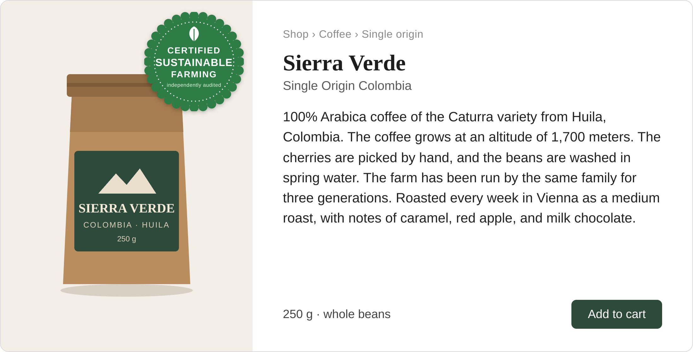
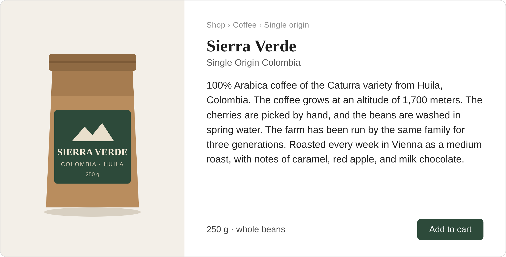

```{r setup}
# The example presentation of the coffee study (Module 8). Every number and every chart is computed
# from the raw Qualtrics export, with the same steps as in code/08-survey-design.R.
library(tidyverse)
library(emmeans)
data_dir <- "../data"
source("../R/ch08-figures.R")
options(scipen = 5, digits = 4)
raw <- load_coffee_raw()
d   <- clean_coffee(raw)                       # exclusions, cleaning, scales: the analysis sample

f1  <- function(x) sub("-", "&minus;", sprintf("%.1f", x))
f2  <- function(x) sub("-", "&minus;", sprintf("%.2f", x))
pv  <- function(p) ifelse(p < 0.0005, "<&nbsp;.001", sub("^0", "", sprintf("%.3f", p)))   # for tables
pe  <- function(p) ifelse(p < 0.0005, "*p* < .001", paste0("*p* = ", sub("^0", "", sprintf("%.3f", p))))
ci  <- function(lo, hi) paste0("[", f2(lo), ";&nbsp;", f2(hi), "]")     # does not break across lines
pct <- function(x) paste0(round(100 * x), "%")

# --- the sample ---------------------------------------------------------------------------------
real  <- filter(raw, Status == 0)
n_rec <- nrow(raw); n_prev <- sum(raw$Status == 1); n_unf <- sum(real$Finished == 0)
fin   <- real |> filter(Finished == 1) |> rename(duration = `Duration (in seconds)`)
n_att <- sum(fin$attn != 2)
n_spd <- nrow(filter(fin, attn == 2)) - nrow(filter(fin, attn == 2, duration >= median(duration) / 3))
n_imp <- nrow(filter(fin, attn == 2, duration >= median(duration) / 3)) - nrow(d)
dates <- range(as.Date(substr(real$StartDate, 1, 10)))
bal <- d |> group_by(condition) |>
  summarise(n = n(), age = mean(age), women = mean(gender == "female"), cups = mean(cups),
            concern = mean(concern), check = mean(mc_seal))
mc <- t.test(mc_seal ~ condition, data = d)

# --- scales ---------------------------------------------------------------------------------------
env_items  <- c("env_1", "env_2r", "env_3"); glow_items <- c("glow_1", "glow_2", "glow_3")
alpha_env  <- cronbach_alpha(d[env_items]);  alpha_glow <- cronbach_alpha(d[glow_items])

# --- H1 -------------------------------------------------------------------------------------------
tt <- t.test(wtp ~ condition, data = d)
dd <- psych::cohen.d(d$wtp, d$condition)$cohen.d[2]
m1 <- lm(wtp ~ condition, data = d)

# --- H2 -------------------------------------------------------------------------------------------
m2  <- lm(wtp ~ seal * concern, data = d)
em  <- as.data.frame(summary(emtrends(m2, ~ concern, var = "seal", at = list(concern = c(3, 4.5, 6))), infer = TRUE))
b3  <- coef(summary(m2))["seal:concern", ]; ci3 <- confint(m2)["seal:concern", ]

# --- H3 -------------------------------------------------------------------------------------------
mm <- lm(warm_glow ~ condition + concern, data = d)               # path a
my <- lm(wtp ~ condition + warm_glow + concern, data = d)         # paths b and c'
a  <- unname(coef(mm)["conditionSeal"]); b <- unname(coef(my)["warm_glow"])
ind <- a * b; dir <- unname(coef(my)["conditionSeal"]); ci_dir <- confint(my)["conditionSeal", ]
set.seed(1)
boot <- replicate(2000, {
  db <- d[sample(nrow(d), replace = TRUE), ]
  coef(lm(warm_glow ~ condition + concern, data = db))["conditionSeal"] *
    coef(lm(wtp ~ condition + warm_glow + concern, data = db))["warm_glow"]
})
bci <- quantile(boot, c(0.025, 0.975))

# --- robustness (appendix) ---------------------------------------------------------------------
wx <- wilcox.test(wtp ~ condition, data = d)
all_finished <- fin |>
  mutate(wtp = wtp |> str_extract("[0-9]+([.,][0-9]+)?") |> str_replace(",", ".") |> as.numeric(),
         wtp = if_else(wtp > 30, NA_real_, wtp),
         condition = factor(condition, levels = c("Control", "Seal"))) |>
  filter(!is.na(wtp))
tt_all <- t.test(wtp ~ condition, data = all_finished)

# regression table for the appendix: estimate, standard error, 95% CI, p-value
reg_table <- function(model, labels) {
  s <- coef(summary(model)); k <- confint(model)
  data.frame(Term = labels, Estimate = f2(s[, 1]), SE = f2(s[, 2]),
             CI = ci(k[, 1], k[, 2]), p = pv(s[, 4]), check.names = FALSE) |>
    knitr::kable(col.names = c("", "Estimate", "SE", "95% CI", "*p*"), align = "lcccc", row.names = FALSE)
}
```

## Should Sierra Verde pay for a sustainability seal? {.midsize}

::: columns
::: {.column width="56%"}
::: {style="padding-right: 1.2em;"}
-   **The company:** Sierra Verde, an online roaster of single-origin coffee
-   **The decision:** have the coffee certified for sustainable farming and show the seal on every product page — or not
-   **What it depends on:** the certification costs an audit and a fee for every pack. It pays off only if customers are willing to pay more for the coffee with the seal

::: keybox
**Research question:** Does a sustainability seal on the product page increase willingness to pay — **for whom**, and **why**?
:::
:::
:::

::: {.column width="44%"}
{width="100%"}

*The product page with the seal*
:::
:::

## Three hypotheses, fixed before the data collection {.midsize}

::: columns
::: {.column width="52%"}
```{r diagram, fig.width=7, fig.height=3.5}
fig_study_diagram(base_size = 13)
```
:::

::: {.column width="48%"}
-   **H1 · Does it work?** Willingness to pay is higher with the seal than without it
-   **H2 · For whom?** The difference increases with environmental concern: a seal means more to people who care about what it certifies (Sörqvist et al. 2013)
-   **H3 · Why?** The effect runs through the anticipated *warm glow* — the good feeling of contributing to something good (Hartmann & Apaolaza-Ibáñez 2012)
:::
:::

::: keybox
The hypotheses, the main analysis, and the exclusion rules were written down before the first response came in.
:::

## The design: one product page, without or with the seal {.midsize}

::: columns
::: {.column width="50%"}
**Control** (*n* = `r bal$n[1]`)

{width="100%"}
:::

::: {.column width="50%"}
**Seal** (*n* = `r bal$n[2]`)

{width="100%"}
:::
:::

::: keybox
**A between-subjects experiment in Qualtrics:** the randomizer showed each respondent one of the two pages. The seal is the only difference. Brand and seal are fictitious, and no price is shown.
:::

## What we measured {.smaller}

| Variable | Role | Measure | Asked |
|:----------------|:-------------|:-----------------------------------------------|:-------------|
| **Environmental concern** | Moderator | 3 statements of the revised NEP scale (Dunlap et al. 2000), 1–7 · α&nbsp;=&nbsp;`r f2(alpha_env)` | before the page |
| **Sustainability seal** | Treatment | the product page without or with the seal, assigned at random | — |
| **Anticipated warm glow** | Mediator | 3 statements adapted from Hartmann & Apaolaza-Ibáñez (2012), 1–7 · α&nbsp;=&nbsp;`r f2(alpha_glow)` | after the page |
| **Willingness to pay** | Outcome | "What is the most you would be willing to pay for a 250 g pack of this coffee?" (euros) | after the mediator |
| Seal noticed | Manipulation check | "The coffee on the product page carried a seal for sustainable farming." 1–7 | after the outcome |
| Cups per day, age, gender | Description | single questions | first and last page |

::: keybox
**An example (warm glow):** "With this coffee, I can feel good because I help to protect the environment." A scale value is the mean of its three statements; all items are in the appendix (A2).
:::

## The sample: `r nrow(d)` respondents in two comparable groups {.midsize}

::: columns
::: {.column width="50%"}
::: {style="padding-right: 1.2em;"}
-   **Who:** friends, family, and fellow students, `r month.name[as.integer(format(dates[1], "%m"))]` `r as.integer(format(dates[1], "%d"))` to `r as.integer(format(dates[2], "%d"))`, one anonymous link
-   **`r n_rec` recorded responses → `r nrow(d)` in the analysis.** Four rules fixed in advance removed `r n_prev` previews, `r n_unf` unfinished questionnaires, `r n_att` failed attention checks, and `r n_spd` speeders; `r n_imp` respondent entered an impossible value (85 euros)
-   Age `r min(d$age)` to `r max(d$age)` (median `r median(d$age)`) · `r sum(d$gender == "female")` women, `r sum(d$gender == "male")` men, `r sum(!d$gender %in% c("female", "male"))` other or not stated · `r f1(mean(d$cups))` cups of coffee per day
:::
:::

::: {.column width="50%"}
```{r balance}
tibble(` ` = c("Respondents", "Age (mean)", "Women", "Cups of coffee per day", "Environmental concern (1–7)",
               "**Seal noticed (1–7)**"),
       Control = c(bal$n[1], f1(bal$age[1]), pct(bal$women[1]), f1(bal$cups[1]), f1(bal$concern[1]),
                   paste0("**", f1(bal$check[1]), "**")),
       Seal    = c(bal$n[2], f1(bal$age[2]), pct(bal$women[2]), f1(bal$cups[2]), f1(bal$concern[2]),
                   paste0("**", f1(bal$check[2]), "**"))) |>
  knitr::kable(align = "lcc")
```
:::
:::

::: keybox
**Randomization produced similar groups, and respondents noticed the seal:** +`r f1(diff(mc$estimate))` scale points, 95% CI [`r f1(-mc$conf.int[2])`; `r f1(-mc$conf.int[1])`]. Nobody was excluded on the manipulation check.
:::

## Does it work? Willingness to pay rises by `r sprintf("%.2f", diff(tt$estimate))` euros {.midsize}

::: columns
::: {.column width="52%"}
```{r h1, fig.width=5.4, fig.height=3.75}
fig_wtp_by_condition(d, base_size = 12)
```

::: {style="font-size: 0.66em; color: #58585a;"}
Each dot is one respondent; boxes show the median and the quartiles. Blue: group means with 95% confidence intervals.
:::
:::

::: {.column width="48%"}
$$\text{WTP}_i = \beta_0 + \beta_1\,\text{Seal}_i + \varepsilon_i$$

-   With the seal: **`r sprintf("%.2f", tt$estimate[2])` euros** · without: `r sprintf("%.2f", tt$estimate[1])` euros
-   Difference: **+`r sprintf("%.2f", diff(tt$estimate))` euros** (+`r round(100 * diff(tt$estimate) / tt$estimate[1])`%), 95% CI [`r sprintf("%.2f", -tt$conf.int[2])`; `r sprintf("%.2f", -tt$conf.int[1])`]
-   *t*(`r round(tt$parameter)`) = `r sprintf("%.2f", abs(tt$statistic))`, `r pe(tt$p.value)`; effect size *d*&nbsp;=&nbsp;`r sprintf("%.2f", dd)`
-   Welch *t*-test: two independent groups, equal variances not assumed

::: keybox
**H1 is supported.** The interval is wide: the premium could be `r sprintf("%.1f", -tt$conf.int[2])` euros — or `r sprintf("%.1f", -tt$conf.int[1])`.
:::
:::
:::

## For whom? The effect tends to grow with environmental concern {.midsize}

::: columns
::: {.column width="52%"}
```{r h2, fig.width=5.4, fig.height=3.3}
fig_seal_by_concern(d, base_size = 12) + labs(x = "Environmental concern (1–7)", y = "Effect of the seal (euros)")
```

::: {style="font-size: 0.66em; color: #58585a;"}
*n* = `r nrow(d)` · band: 95% confidence interval · marks on the axis: the respondents
:::
:::

::: {.column width="48%"}
::: {style="font-size: 0.88em;"}
$$\begin{aligned}\text{WTP}_i = {} & \beta_0 + \beta_1\,\text{Seal}_i + \beta_2\,\text{Concern}_i \\ & + \beta_3\,(\text{Seal}_i \times \text{Concern}_i) + \varepsilon_i\end{aligned}$$
:::

```{r h2-tab}
tibble(`Environmental concern` = c("3 (low)", "4.5 (middle)", "6 (high)"),
       `Effect of the seal (euros)` = paste0("+", sprintf("%.2f", em$seal.trend)),
       `95% CI` = ci(em$lower.CL, em$upper.CL)) |>
  knitr::kable(align = "lcc")
```

:::
:::

::: keybox
**In line with H2, but not established:** the effect grows by β~3~ = `r f2(b3[1])` euros per scale point, 95% CI `r ci(ci3[1], ci3[2])`, `r pe(b3[4])`. With `r nrow(d)` respondents, we cannot rule out that the seal works equally well for everyone.
:::

## Why? About `r round(100 * ind / (ind + dir))`% of the effect runs through the warm glow {.midsize}

::: columns
::: {.column width="52%"}
```{r h3, fig.width=6.1, fig.height=3.2}
fig_coffee_mediation(d, base_size = 12)
```

::: {style="font-size: 0.66em; color: #58585a;"}
*n* = `r nrow(d)` · coefficients of the two regressions below
:::

::: {style="font-size: 0.78em;"}
$$\text{Glow}_i = \alpha_0 + a\,\text{Seal}_i + \alpha_2\,\text{Concern}_i + u_i$$

$$\text{WTP}_i = \beta_0 + c'\,\text{Seal}_i + b\,\text{Glow}_i + \beta_3\,\text{Concern}_i + \varepsilon_i$$
:::
:::

::: {.column width="48%"}
-   The seal raises the anticipated warm glow by **`r f2(a)` scale points** (path *a*)
-   One point more warm glow goes with **`r f2(b)` euros** more willingness to pay (path *b*)
-   **Indirect effect *a* × *b* = `r f2(ind)` euros**, bootstrap 95% CI `r ci(bci[1], bci[2])` — about `r round(100 * ind / (ind + dir))`% of the total effect of `r f2(ind + dir)` euros
-   Direct effect: `r f2(dir)` euros, 95% CI `r ci(ci_dir[1], ci_dir[2])`

::: keybox
**H3 is supported** — if nothing unobserved drives both the warm glow and the willingness to pay. Environmental concern is adjusted for.
:::
:::
:::

## What this study cannot tell {.midsize}

| | The limitation | What it means |
|:--|:-----------------------|:--------------------------------------------------------|
| **Sample** | `r nrow(d)` friends, family members, and fellow students | They are not Sierra Verde's customers: the effect holds among people like our respondents |
| **Outcome** | Stated willingness to pay — no purchase | Surveys overstate what people pay; what we interpret is the difference between the groups |
| **Stimulus** | One product page and a seal that does not exist | A real seal comes with a reputation — which can help or hurt |
| **Mechanism** | Warm glow was measured, not manipulated | Expected taste and trust in the brand were not measured and may play a role as well |
| **Moderator** | About 60 respondents per group | Too few for a firm answer to *for whom* |

## Recommendation: certify if the seal costs less than `r sprintf("%.2f", -tt$conf.int[2])` euros per pack {.midsize}

::: columns
::: {.column width="52%"}
::: {style="padding-right: 1.2em;"}
**Does the seal pay off?** That depends on what the certification costs per pack:

| Cost per pack | Our recommendation |
|:----------------|:----------------------------------------|
| below `r sprintf("%.2f", -tt$conf.int[2])` euros | **Certify.** Even at the lower end of our interval, the premium covers the cost |
| `r sprintf("%.2f", -tt$conf.int[2])` to `r sprintf("%.2f", diff(tt$estimate))` euros | **Start with a pilot:** certify one coffee and test the seal in the shop |
| above `r sprintf("%.2f", diff(tt$estimate))` euros | **Do not certify:** the cost exceeds the premium we estimate |
:::
:::

::: {.column width="48%"}
**How to use the seal**

-   **Show it where it cannot be missed** — on the product picture, as in our test
-   **Say what a purchase achieves:** the premium comes with the good feeling of doing something good
-   **Do not target yet:** the seal seems to matter most to environmentally concerned customers, but this is not established
:::
:::

::: keybox
**The next experiment** — in the shop, with real prices and purchases: the page of one certified coffee without the seal, with the seal, and with the seal plus one sentence on what a purchase achieves.
:::

# Appendix {.divider background-color="#0a3d6e"}

## A1 · From the export to the analysis sample {.midsize}

::: columns
::: {.column width="60%"}
```{r exclusions, fig.width=7.1, fig.height=4.1}
fig_exclusions(raw, base_size = 11)
```
:::

::: {.column width="40%"}
**Four rules, fixed before the data collection**

1.  No previews and tests
2.  Only finished questionnaires
3.  Attention check passed (asked *before* the product page)
4.  No speeders: at least one third of the median duration

**Not planned:** one respondent entered 85 euros for the pack — an impossible value, set to missing.

The manipulation check was **not** used to exclude respondents. Median duration: `r f1(median(d$duration) / 60)` minutes.
:::
:::

## A2 · The scales: items and reliability {.smaller}

```{r items}
item_stats <- function(items, texts) {
  x <- d[items]
  tibble(Statement = texts, Mean = f2(colMeans(x)), SD = f2(sapply(x, sd)),
         `Correlation with the other two` = sub("^0", "", sprintf("%.2f", sapply(items, function(i) cor(x[[i]], rowMeans(x[setdiff(items, i)]))))))
}
bind_rows(
  tibble(Statement = paste0("**Environmental concern** (moderator) · Cronbach's α = ", f2(alpha_env)), Mean = "", SD = "", `Correlation with the other two` = ""),
  item_stats(env_items, c("Humans are severely abusing the environment.",
                          "The so-called \"ecological crisis\" facing humankind has been greatly exaggerated. *(reverse-scored)*",
                          "If things continue on their present course, we will soon experience a major ecological catastrophe.")),
  tibble(Statement = paste0("**Anticipated warm glow** (mediator) · Cronbach's α = ", f2(alpha_glow)), Mean = "", SD = "", `Correlation with the other two` = ""),
  item_stats(glow_items, c("With this coffee, I can feel good because I help to protect the environment.",
                           "With this coffee, I can feel better because I do not harm the environment.",
                           "With this coffee, I have the feeling of contributing to the well-being of humanity and nature."))) |>
  knitr::kable(align = "lccc")
```

1 = strongly disagree … 7 = strongly agree; the reverse-scored statement was recoded (8 minus the answer). Sources: Dunlap et al. (2000); Hartmann & Apaolaza-Ibáñez (2012), adapted.

## A3 · Regression tables: H1 and H2 {.smaller}

::: columns
::: {.column width="50%"}
::: {style="padding-right: 1.2em;"}
**H1** · willingness to pay (euros)

```{r reg-h1}
reg_table(m1, c("Intercept", "Seal"))
```

*n* = `r nrow(d)`, *R*² = `r f2(summary(m1)$r.squared)`
:::
:::

::: {.column width="50%"}
**H2** · willingness to pay (euros)

```{r reg-h2}
reg_table(m2, c("Intercept", "Seal", "Concern", "Seal&nbsp;×&nbsp;Concern"))
```

*n* = `r nrow(d)`, *R*² = `r f2(summary(m2)$r.squared)`
:::
:::

::: keybox
Seal: 0 = control, 1 = seal. Concern: the mean of three statements (1–7). In the H2 model, the coefficient of *Seal* is the effect at a concern of 0, a value outside the scale — the effects at a concern of 3, 4.5, and 6 are on slide 8.
:::

## A4 · Regression tables: H3 (mediation) {.smaller}

::: columns
::: {.column width="50%"}
::: {style="padding-right: 1.2em;"}
**Mediator model** · warm glow (1–7)

```{r reg-m}
reg_table(mm, c("Intercept", "Seal&nbsp;(*a*)", "Concern"))
```

*n* = `r nrow(d)`, *R*² = `r f2(summary(mm)$r.squared)`
:::
:::

::: {.column width="50%"}
**Outcome model** · willingness to pay (euros)

```{r reg-y}
reg_table(my, c("Intercept", "Seal&nbsp;(*c′*)", "Warm&nbsp;glow&nbsp;(*b*)", "Concern"))
```

*n* = `r nrow(d)`, *R*² = `r f2(summary(my)$r.squared)`
:::
:::

::: keybox
Indirect effect *a* × *b* = `r f2(a)` × `r f2(b)` = **`r f2(ind)` euros**; percentile bootstrap with 2,000 resamples: 95% CI `r ci(bci[1], bci[2])`. Total effect = indirect + direct = `r f2(ind + dir)` euros.
:::

## A5 · Is the main result robust? {.midsize}

```{r robust}
tibble(Analysis = c("**Main analysis:** Welch *t*-test", "Wilcoxon rank-sum test (no assumption about the distribution)",
                    "All finished respondents — without the attention-check and the speeder rule"),
       n = c(nrow(d), nrow(d), nrow(all_finished)),
       `Difference (euros)` = c(paste0("+", sprintf("%.2f", diff(tt$estimate))), "—", paste0("+", sprintf("%.2f", diff(tt_all$estimate)))),
       `95% CI` = c(ci(-tt$conf.int[2], -tt$conf.int[1]), "—", ci(-tt_all$conf.int[2], -tt_all$conf.int[1])),
       p = c(pv(tt$p.value), pv(wx$p.value), pv(tt_all$p.value))) |>
  knitr::kable(col.names = c("Analysis", "*n*", "Difference (euros)", "95% CI", "*p*"), align = "lcccc")
```

-   **Unequal spread:** the standard deviation is `r f2(sd(d$wtp[d$condition == "Control"]))` euros without and `r f2(sd(d$wtp[d$condition == "Seal"]))` euros with the seal — the Welch test does not assume equal variances
-   **Not normally distributed?** With about 60 respondents per group, the test of the means does not depend on it; the rank-based test leads to the same conclusion
-   **The exclusion rules do not drive the result:** it is nearly the same for all finished respondents
-   Rows 2 and 3 were **not planned in advance**: they are robustness checks, not new tests of H1

## A6 · The questionnaire {.midsize}

```{r order, fig.width=11.5, fig.height=3.7}
fig_questionnaire_order(base_size = 13)
```

::: keybox
Twelve questions in Qualtrics. The randomizer contains two groups; each stores the condition in the data (`condition` = `Control` or `Seal`) and shows its product page. Everything else is identical for all respondents.
:::

## References {.midsize}

-   Dunlap, R. E., Van Liere, K. D., Mertig, A. G., & Jones, R. E. (2000). Measuring endorsement of the New Ecological Paradigm: A revised NEP scale. *Journal of Social Issues, 56*(3), 425–442.
-   Hartmann, P., & Apaolaza-Ibáñez, V. (2012). Consumer attitude and purchase intention toward green energy brands: The roles of psychological benefits and environmental concern. *Journal of Business Research, 65*(9), 1254–1263.
-   Sörqvist, P., Hedblom, D., Holmgren, M., Haga, A., Langeborg, L., Nöstl, A., & Kågström, J. (2013). Who needs cream and sugar when there is eco-labeling? Taste and willingness to pay for "eco-friendly" coffee. *PLoS ONE, 8*(12), e80719.

## About this example {.smaller}

::: columns
::: {.column width="46%"}
::: {style="padding-right: 1.2em;"}
| Slides | Point of the guidelines | Minutes |
|:-------|:------------------------------|:-------:|
| 1 | Title | 0:15 |
| 2–3 | 1 The problem and the question | 2:00 |
| 4–5 | 2 The design | 1:40 |
| 6 | 3 The sample · 4 The manipulation check | 1:00 |
| 7 | 5 The main result | 1:05 |
| 8 | 6 For whom | 1:10 |
| 9 | 7 Why | 1:05 |
| 10 | 8 Limitations | 0:45 |
| 11 | 9 Recommendations | 1:00 |
| | **Total** | **10:00** |
| 13–19 | Appendix (not presented) | — |
:::
:::

::: {.column width="54%"}
-   **Ten minutes, ten slides** after the title: about one minute per slide — a third of the time for the three results
-   **One message per slide.** The title says it; one chart or table shows it; the numbers a critical reader needs stand next to it: estimate, 95% confidence interval, test, effect size, *n*
-   **The appendix is for questions:** the exclusions, the item statistics, the regression tables, and the robustness checks
-   **Reproducible:** every number and chart is computed from the raw export `coffee_seal_qualtrics.csv`

::: keybox
A model for the structure and the level of detail — not a template to copy. The study, the brand, the seal, and the data are fictitious.
:::
:::
:::
