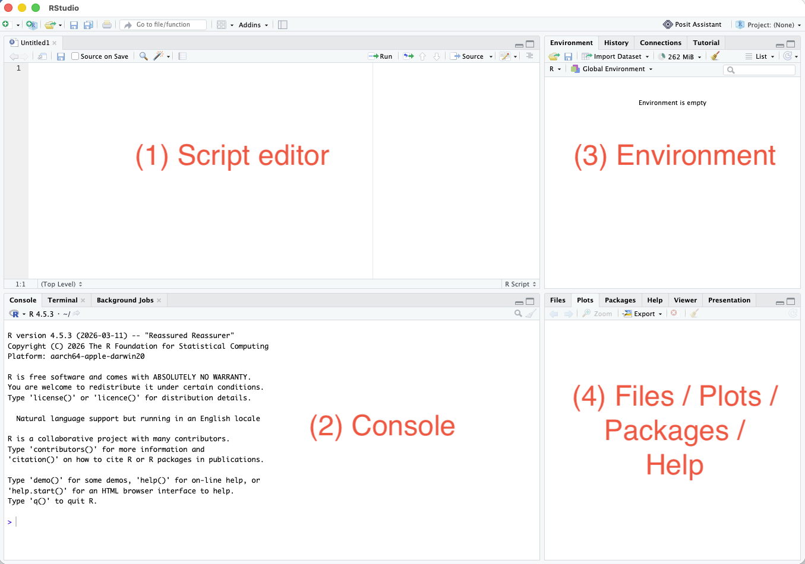
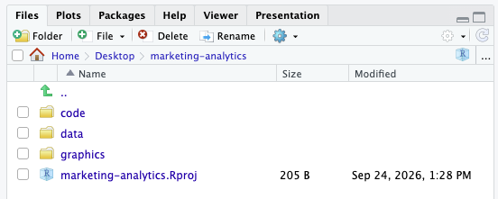
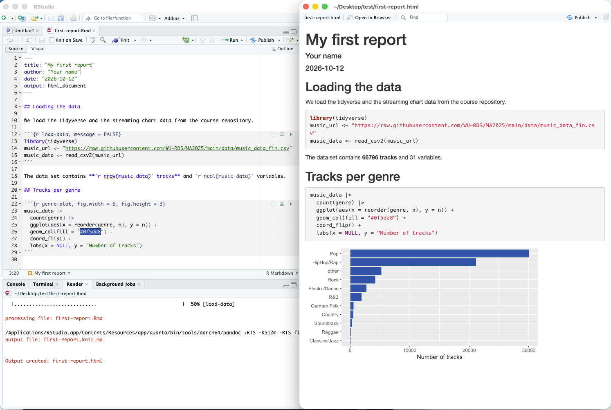
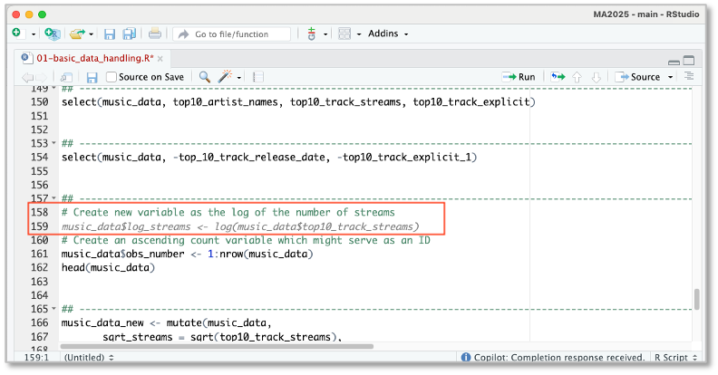
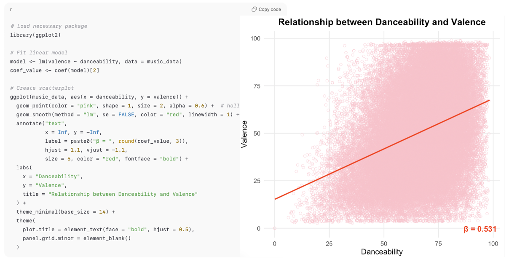
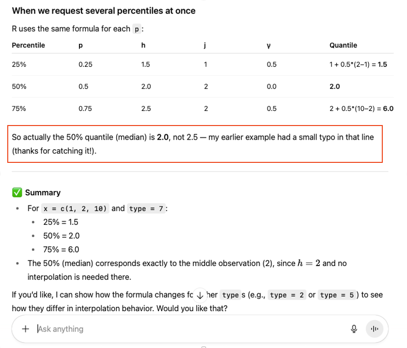

## What you will have at the end {.midsize}

::: columns
::: {.column width="55%"}
-   R and RStudio running — or a **Posit Cloud** account
-   A course folder set up as an **RStudio Project** with subfolders for code, data, and graphics
-   A script that **loads the course data** without errors
-   A short **report knitted to HTML** — the format of your assignments
:::

::: {.column width="45%"}
::: keybox
**Self-paced, about 2–3 hours, before session 2.** These slides summarize the onboarding module in the course book — the book has all details, screenshots, and the complete R code.
:::
:::
:::

## Why R? {.midsize}

::: columns
::: {.column width="50%"}
-   **Free**, runs on every operating system
-   A standard tool of data analysis in **research and industry**
-   **Reproducible**: code can be re-run, checked, corrected, and shared — mouse clicks in a spreadsheet cannot
:::

::: {.column width="50%"}
::: keybox
**AI writes R code cheaply** — that does not make R skills obsolete, it shifts them: the scarce skill is no longer *typing* code, but **reading and checking** it.
:::
:::
:::

# Setting up {.divider background-color="#0a3d6e"}

## Two routes to a working setup {.smaller}

::: columns
::: {.column width="50%"}
**Route A (recommended): local installation**

1.  **R** from CRAN: <https://cran.r-project.org>
2.  **RStudio Desktop**: <https://posit.co/download/rstudio-desktop/>

Install **in this order**, with the default settings. RStudio is built on top of R: R without RStudio works — RStudio without R does not.
:::

::: {.column width="50%"}
**Route B (fallback): Posit Cloud**

RStudio in the browser — no installation: <https://posit.cloud> → *New Project → New RStudio Project*.

Useful if the installation fails or your computer is managed by an employer. Free accounts have usage limits.
:::
:::

## Known pitfalls {.smaller}

::: columns
::: {.column width="50%"}
-   **Synced folders** (OneDrive, iCloud, Dropbox) cause strange errors → keep the course folder in a normal local folder
-   **Special characters in paths** (umlauts, spaces) can break package installation on Windows → e.g., `C:/marketing-analytics`
-   **macOS:** installation errors mentioning `xcrun` → run `xcode-select --install` in the Terminal app
-   **Old R versions:** update — many packages need a recent R
:::

::: {.column width="50%"}
::: keybox
**macOS: "Operation not permitted"** when knitting or reading files → RStudio lacks permission to access the folder.

*System Settings → Privacy & Security → Files & Folders* (or *Full Disk Access*): allow RStudio, then **restart RStudio** — or keep the course folder directly in your home folder (`~/marketing-analytics`).
:::
:::
:::

## RStudio in ten minutes {.smaller}

::: columns
::: {.column width="55%"}
{width="100%"}
:::

::: {.column width="45%"}
| Pane | Purpose |
|---|---|
| **Script editor** | *Write* and keep your code (`.R` file) |
| **Console** | R *executes* code and prints results |
| **Environment** | Objects in your current session |
| **Files / Plots / Help** | Files, charts, help pages |

::: keybox
**Always write code in a script.** Run a line with **Ctrl + Enter** (Mac: **Cmd + Enter**).
:::
:::
:::

## Work in an RStudio Project {.midsize}

::: columns
::: {.column width="50%"}
*File → New Project → New Directory → New Project*

-   R automatically looks for files **in the project folder** — no more "file not found"
-   Start every work session by **opening the project** (`.Rproj` file)
-   No `setwd("C:/Users/…")`: hard-coded paths break on every other computer
:::

::: {.column width="50%"}
::: keybox
**Change one setting now:** *Tools → Global Options → General*

-   "Save workspace to .RData on exit" → **Never**
-   Untick "Restore .RData into workspace at startup"

Your **script** is the record of your work — not the workspace.
:::
:::
:::

## A tidy folder structure {.midsize}

::: columns
::: {.column width="55%"}
```
marketing-analytics/            <- project folder
├── marketing-analytics.Rproj
├── code/                       <- .R and .Rmd files
├── data/                       <- .csv, .xlsx, .sav
└── graphics/                   <- saved charts
```

Refer to files by their **relative path**:

-   `read_csv2("data/music_data_fin.csv")`
-   `ggsave("graphics/genre_shares.png")`
:::

::: {.column width="45%"}
{width="100%"}

::: keybox
**Never edit raw data by hand** · **no spaces or brackets in file names**: `assignment-1.Rmd`, not `Assignment 1 (final).Rmd`
:::
:::
:::

# First steps in R {.divider background-color="#0a3d6e"}

## How to run code {.midsize}

1.  Create a script: *File → New File → R Script* → save as `code/first-steps.R`
2.  **Type** (or copy) the code into the script — typing it yourself helps you remember
3.  Cursor in the line → **Ctrl + Enter** (Mac: **Cmd + Enter**) or the **Run** button; select several lines to run them together; whole script: **Ctrl/Cmd + Shift + Enter**
4.  Compare the result in the **console** with the output in the book

. . .

::: keybox
**The console shows `+` instead of `>`?** R is waiting for you to finish a command — usually a missing closing bracket or quotation mark. Complete the command, or press **Esc** to abort.
:::

## Objects and assignment {.midsize}

```{r objects}
streams <- 163608            # assign a number to the object 'streams'
streams * 2                  # objects can be used in calculations
artist <- "Imagine Dragons"  # text in quotation marks
artist
```

::: keybox
`<-` assigns (shortcut **Alt + -**, Mac: **Option + -**) · `#` starts a comment · R is **case-sensitive**: `streams` ≠ `Streams` · names: lower case with underscores, e.g., `mean_streams`
:::

## Functions and arguments {.midsize}

```{r functions}
seq(from = 1, to = 10, by = 3)   # arguments named explicitly
seq(1, 10, 3)                    # same result, default order
round(3.14159, digits = 2)
```

::: keybox
Named arguments can come in any order · **help** for any function: `?seq` or **F1** on the function name · **Tab** shows completions while you type
:::

## Vectors and data types {.smaller}

::: columns
::: {.column width="52%"}
```{r vectors}
top_streams <- c(163608, 126687, 120480)
top_genres  <- c("Dance", "Alternative", "Latino")
mean(top_streams)
class(top_genres)
```
:::

::: {.column width="48%"}
| Type | Example |
|---|---|
| **numeric** | `163608`, `3.14` |
| **character** | `"Dance"` |
| **factor** | `factor(c("Pop", "Rock"))` |
| **logical** | `TRUE`, `FALSE` |
| **Date** | `as.Date("2026-10-12")` |

Convert with `as.numeric()`, `as.character()`, `as.factor()`, `as.Date()`
:::
:::

## Data frames: R's tables {.midsize}

```{r dataframes}
top_tracks <- data.frame(
  artist  = c("Ed Sheeran", "Imagine Dragons", "J. Balvin"),
  streams = c(163608, 126687, 120480)
)
top_tracks$streams     # $ extracts one column
str(top_tracks)        # structure: rows, columns, types
```

::: notes
Each column is a variable (a vector), each row an observation. View(top_tracks) opens the spreadsheet-like viewer.
:::

## Packages {.midsize}

::: columns
::: {.column width="50%"}
```{r packages-install, eval=FALSE}
# once per computer:
install.packages(c("tidyverse", "psych",
                   "readxl", "haven", "rmarkdown"))
```

```{r packages-load}
# in every session, at the top of every script:
library(tidyverse)
```
:::

::: {.column width="50%"}
::: keybox
**install** = once per computer · **library** = every session

`could not find function "…"`? → the package is probably not loaded. Without loading: `dplyr::filter()`
:::
:::
:::

## Three dialects of R {.smaller}

*"Keep the pop tracks and compute their average number of streams":*

```{r dialects, eval=FALSE}
pop <- music_data[music_data$genre == "Pop", ]         # base R
mean(pop$streams)

music_data |> filter(genre == "Pop") |>                # tidyverse
  summarise(mean_streams = mean(streams))

as.data.table(music_data)[genre == "Pop", mean(streams)] # data.table
```

::: columns
::: {.column width="55%"}
| Dialect | Strength | Drawback |
|---|---|---|
| **Base R** | always available | hard to read |
| **tidyverse** | reads like a sentence; `ggplot2` | needs packages |
| **data.table** | very fast | cryptic for beginners |
:::

::: {.column width="45%"}
::: keybox
**This course uses the tidyverse**: readable pipelines are easy to *check* — whether you or an AI wrote them. Be able to *read* base R.
:::
:::
:::

## Keyboard shortcuts worth learning {.smaller}

::: columns
::: {.column width="55%"}
| Action | Windows | Mac |
|---|---|---|
| Run line / selection | Ctrl + Enter | Cmd + Enter |
| Run whole script | Ctrl + Shift + Enter | Cmd + Shift + Enter |
| Assignment `<-` | Alt + - | Option + - |
| Pipe \|> | Ctrl + Shift + M | Cmd + Shift + M |
| Insert code chunk | Ctrl + Alt + I | Cmd + Option + I |
| Knit | Ctrl + Shift + K | Cmd + Shift + K |
| Comment lines | Ctrl + Shift + C | Cmd + Shift + C |
:::

::: {.column width="45%"}
::: keybox
**Native pipe:** *Tools → Global Options → Code → Editing* → tick **"Use native pipe operator, \|>"** — otherwise the shortcut inserts `%>%`.

**Own shortcuts:** *Tools → Modify Keyboard Shortcuts…*
:::
:::
:::

# Data and reports {.divider background-color="#0a3d6e"}

## Loading the course data {.midsize}

```{r load-url, eval=FALSE}
# directly from the course repository on GitHub (needs internet)
music_url <- "https://raw.githubusercontent.com/wu-rds/MA2026/main/data/music_data_fin.csv"
music_data <- read_csv2(music_url)

# or: download once into the project's data folder
music_data <- read_csv2("data/music_data_fin.csv")
```

```{r load-local, echo=FALSE}
music_data <- read_csv2("../data/music_data_fin.csv")
```

```{r load-dim}
dim(music_data)   # number of rows and columns
```

::: keybox
Why `read_csv2()` and not `read_csv()`? → first lesson of Chapter 2.
:::

## Your first reproducible report {.smaller}

::: columns
::: {.column width="45%"}
*File → New File → R Markdown…* → HTML → save as `code/first-report.Rmd` → **Knit**

Three ingredients:

-   **Header** between `---`: title, author, output
-   **Text** in Markdown: `**bold**`, `*italic*`, `# Heading`
-   **Code chunks** between ```` ```{r} ```` and ```` ``` ````
-   **Inline code**: `` `r knitr::inline_expr("nrow(music_data)")` `` puts results into the text
:::

::: {.column width="55%"}
{width="100%"}
:::
:::

## Two rules that save hours {.midsize}

::: columns
::: {.column width="50%"}
::: keybox
**The golden rule:** a report knits in a **fresh R session**. Everything it needs — `library()`, loading the data, every step — must be **in the report**. Works in the console but not when knitting? You rely on something that exists only in your session.
:::
:::

::: {.column width="50%"}
::: keybox
**Keep the chunk delimiters intact:** every chunk needs **three backticks** at the start (```` ```{r} ````) and at the end (```` ``` ````). One deleted backtick → the report no longer knits. Insert chunks with the shortcut.
:::
:::
:::

. . .

**File paths in reports:** a report in `code/` finds the data at `"../data/music_data_fin.csv"` (`..` = one folder up).

# Getting help — and working with AI {.divider background-color="#0a3d6e"}

## Reading error messages {.smaller}

| Message | What it usually means |
|---|---|
| `could not find function "…"` | Package not loaded — or function name misspelled |
| `object '…' not found` | Typo, wrong capitalization, or the creating line was not run |
| `cannot open file '…'` | Wrong place or wrong name — are you in your RStudio Project? |
| `unexpected symbol` / `unexpected ')'` | Missing comma, bracket, or quotation mark |
| `there is no package called '…'` | Not installed yet → `install.packages("…")` |

::: keybox
Errors are not a sign that you are doing something wrong — they are R's way of telling you **where to look**. Read the message first.
:::

## AI assistants: how they help {.midsize}

::: columns
::: {.column width="50%"}
**Chat assistants** — ChatGPT, Claude, Gemini, Perplexity

**Inside RStudio** — **GitHub Copilot** suggests code as you type: *Tools → Global Options → Copilot* (GitHub account; free for verified students via GitHub Education)
:::

::: {.column width="50%"}
{width="100%"}
:::
:::

. . .

::: columns
::: {.column width="50%"}
**Good at:** standard code (wrangling, charts, loops) · explaining functions and errors · debugging · suggesting alternatives
:::

::: {.column width="50%"}
**Less reliable at:** statistical reasoning and **interpreting results** — fluent even when wrong
:::
:::

## Asking well {.smaller}

::: columns
::: {.column width="55%"}
```
I am working in R with the following data frame:

> str(music_data)
'data.frame': 66796 obs. of 31 variables:
 $ isrc        : chr "BRRGE1603547" ...
 $ danceability: num 50.9 35.3 68.3 ...
 $ valence     : num 65.1 43.7 43.4 ...

Please provide the code for a publication-ready
scatterplot between valence and danceability with
pink hollow circles and a red regression line, and
label the line with the regression coefficient.
```
:::

::: {.column width="45%"}
-   **Give context:** `str()` output, code, the *complete* error message
-   **Be specific** about what you want
-   **Start small**, then add complexity
-   **Ask for explanations**, not just fixes
:::
:::

## Example: from prompt to chart {.midsize}

{width="100%"}

. . .

::: keybox
**Debugging works too:** `could not find function "geom_pont"` + your code → the assistant spots the typo (`geom_point()`) and returns the corrected code.
:::

## Always verify: assistants can be confidently wrong {.midsize}

::: columns
::: {.column width="50%"}
An assistant explained R's percentile calculation correctly — and then reported the **median of 1, 2, 10 as 2.5**. Five seconds in R:

```{r quantile}
x <- c(1, 2, 10)
quantile(x, c(0.25, 0.5, 0.75))
```
:::

::: {.column width="50%"}
{width="100%"}
:::
:::

::: keybox
What saved the day was not a better prompt, but **running the code and checking the result**.
:::

## Using AI assistants mindfully {.midsize}

::: incremental
-   **Foundations first** — you need to know what you are asking, and recognize a wrong answer
-   **Critical thinking** — check outputs for correctness, efficiency, and reproducibility
-   **Accelerate, don't bypass, learning** — if you could not explain the code to someone else, you are not done
-   **Transparency** — disclose AI use in your assignments; be able to explain every line you submit
:::

## Checkpoint: ready for session 2? {.midsize}

::: columns
::: {.column width="55%"}
1.  Open your RStudio Project — subfolders `code`, `data`, `graphics`
2.  Download the course data into `data/`
3.  New R Markdown file: one chunk that loads the tidyverse and the data
4.  One sentence with the number of tracks — via **inline code**
5.  A second chunk with `str(music_data)`
6.  **Knit** to HTML
:::

::: {.column width="45%"}
::: keybox
HTML opens and shows the structure of the data? **Your setup works.**

Stuck? Forum on Canvas, your AI assistant — and the **setup clinic** at the start of session 2.
:::
:::
:::
