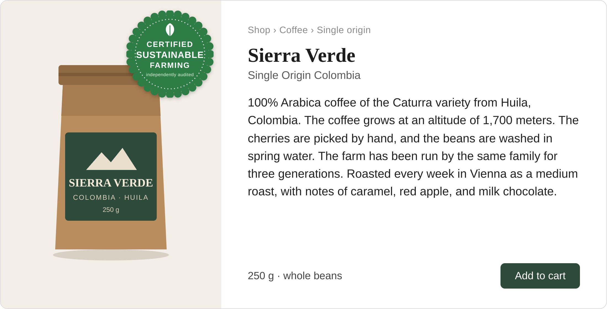
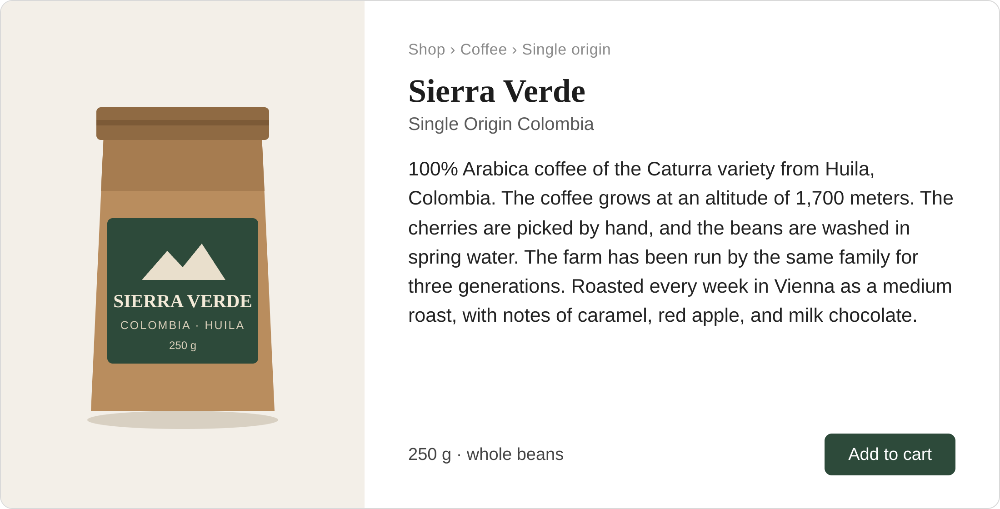
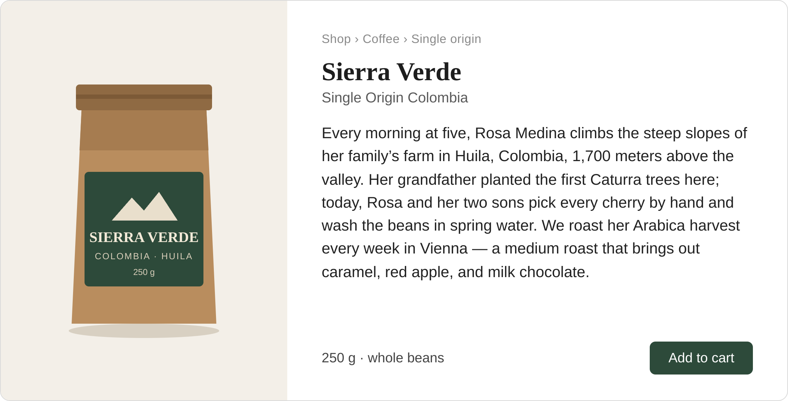
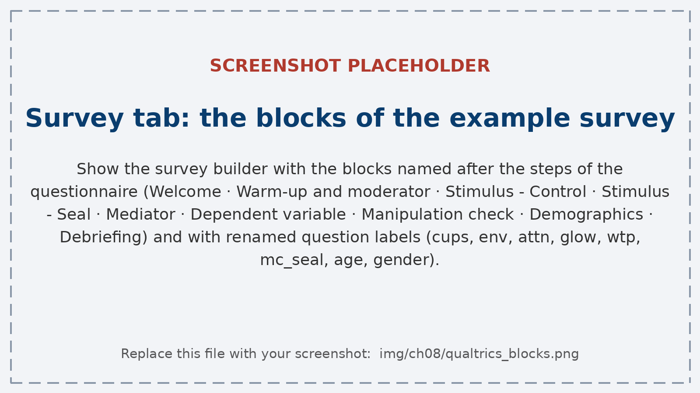
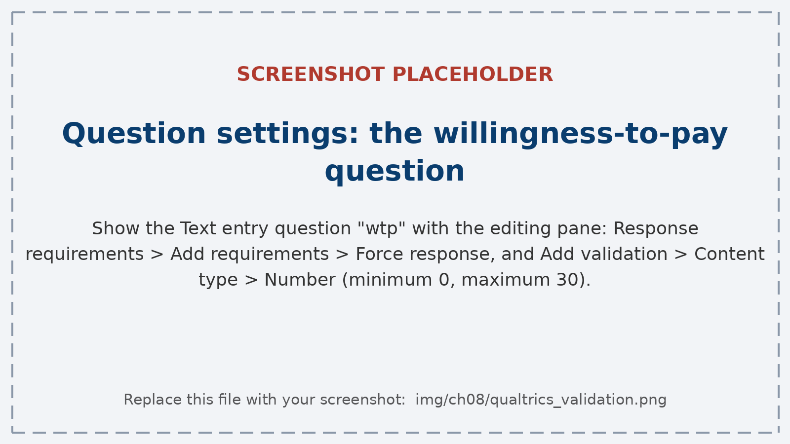
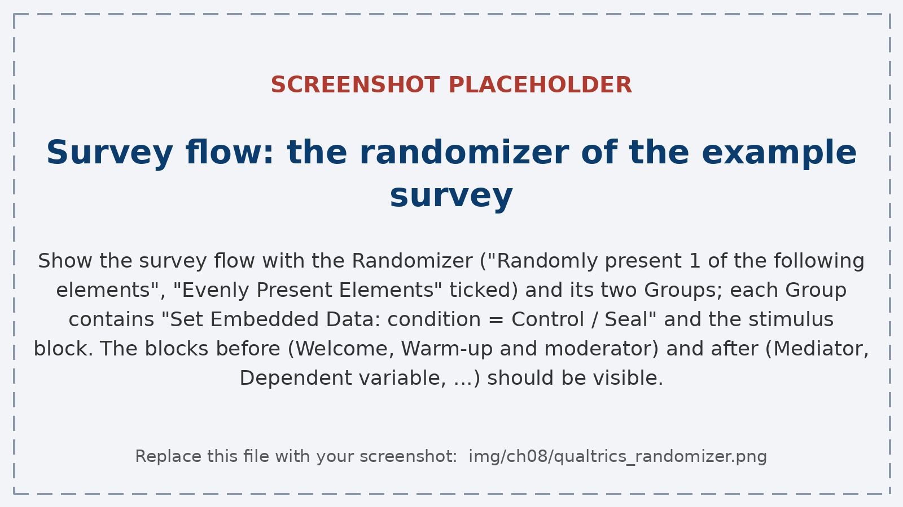
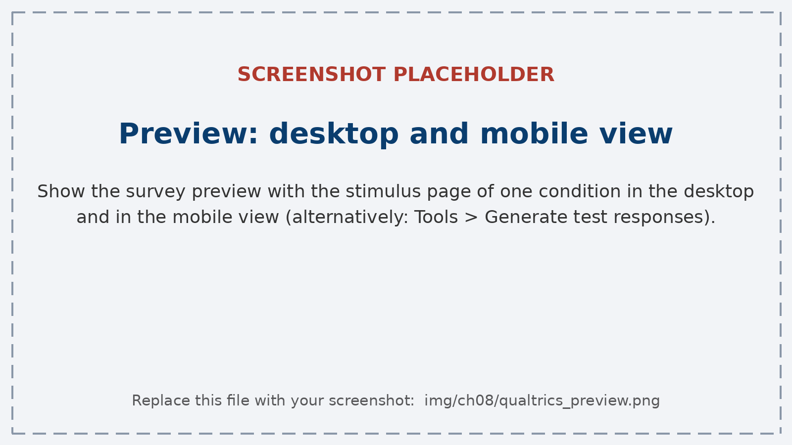
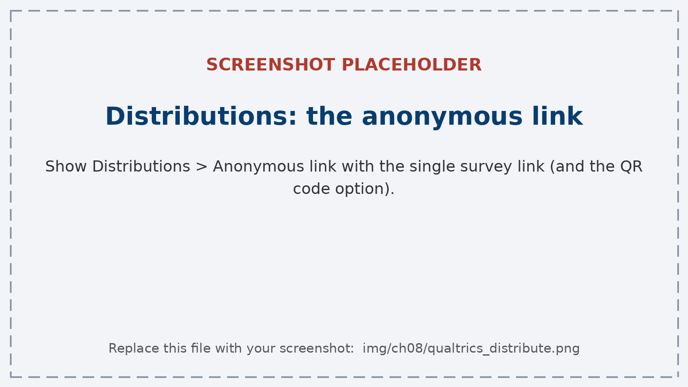
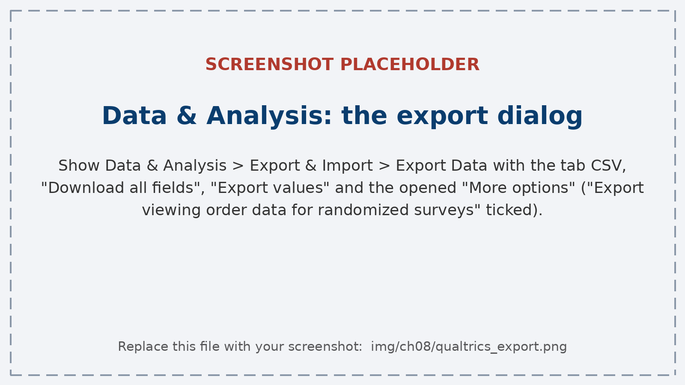

# Survey design {#sec-survey-design .unnumbered}

::: {.callout-note appearance="simple"}
📽 [Slides for this module](slides/chapter08_slides.html){target="_blank" rel="noopener"} · [PDF handout](slides/chapter08_slides_handout.pdf){target="_blank" rel="noopener"} · 💻 [R code](code/08-survey-design.R){download="08-survey-design.R"}

**The example study:** 📋 [the survey to import into Qualtrics (.qsf)](data/coffee_seal_survey.qsf){download="coffee_seal_survey.qsf"} · 📄 [the raw data (a Qualtrics export)](data/coffee_seal_qualtrics.csv){download="coffee_seal_qualtrics.csv"} · 🎤 [the final presentation (PDF)](slides/example_presentation_handout.pdf){target="_blank" rel="noopener"}
:::

```{r setup-ch08}
#| echo: false
#| warning: false
#| message: false
library(tidyverse)
library(emmeans)
source("R/ch08-figures.R")
options(scipen = 5, digits = 4, width = 74)
file <- "data/coffee_seal_qualtrics.csv"
coffee <- clean_coffee()
tt <- t.test(wtp ~ condition, data = coffee)
# the storytelling study (coding block of Chapter 6), for the closer look in Step 2
tt6 <- t.test(wtp ~ version, data = read_csv("data/coffee_story.csv", show_col_types = FALSE))
f2  <- function(x) sub("-", "&minus;", sprintf("%.2f", x))    # two decimals, proper minus sign
pv  <- function(p) sub("^0", "", sprintf("%.3f", p))          # p-values without the leading zero
# measurement block of Step 3: one item vs. the scale, inter-item correlations
ovt        <- single_vs_scale(coffee)
r_rest     <- cor(coffee$glow_1, (coffee$glow_2 + coffee$glow_3) / 2)
env_items  <- select(coffee, env_1, env_2r, env_3)
glow_items <- select(coffee, glow_1, glow_2, glow_3)
mean_r     <- function(x) { r <- cor(x); mean(r[lower.tri(r)]) }
```

*Driving question: **How do you turn a causal question into a questionnaire that can answer it?***

In Chapters 2 to 6, somebody else had collected the data: you received a file and analyzed it. In the group project, the direction is reversed — you *produce* the data. This changes the price of a mistake. A wrong line of R code is corrected in a minute. A moderator that was asked after the stimulus, a randomizer that showed both versions to everyone, or an outcome that hardly varies cannot be repaired once 120 people have answered. Analysis problems can be solved in January; design problems have to be solved now.

This page is the manual for Part 1 of the [group project](group-project.qmd): a between-subjects experiment with **two conditions, one moderator, and one mediator**, built into a questionnaire in Qualtrics. It is organized as seven steps (@tbl-sd-steps), and one example study runs through all of them: *A seal for the coffee*. The online roaster whose storytelling experiment you analyzed in the coding block of @sec-mechanisms has a new question: does a sustainability seal on the product page pay off? You follow the study from the first idea to the raw Qualtrics export of about 140 respondents, with everything that a real export contains: previews, unfinished questionnaires, and typos. (The data are simulated for this course; the file has the format of a real export.) The storytelling study returns once, in Step 2 — as an example of a manipulation that changes more than one thing.

| Step | What you decide | Builds on |
|:-------------|:-----------------------------------|:------------------------|
| [[1&nbsp;·&nbsp;Plan](#sec-sd-plan)]{style="white-space: nowrap;"} | The blueprint: question, hypotheses, and the role of every variable | @sec-design, @sec-mech-project |
| [[2&nbsp;·&nbsp;Manipulate](#sec-sd-manipulate)]{style="white-space: nowrap;"} | The two versions of the stimulus and the manipulation check | @sec-randomization, @sec-exp-power |
| [[3&nbsp;·&nbsp;Measure](#sec-sd-measure)]{style="white-space: nowrap;"} | The questions and scales for outcome, mediator, and moderator | @sec-desc-measurement |
| [[4&nbsp;·&nbsp;Order](#sec-sd-order)]{style="white-space: nowrap;"} | Which block is asked when | @sec-cast, @sec-mech-mediation |
| [[5&nbsp;·&nbsp;Build](#sec-sd-build)]{style="white-space: nowrap;"} | Blocks, survey flow, and the **randomizer** in Qualtrics | — |
| [[6&nbsp;·&nbsp;Field](#sec-sd-field)]{style="white-space: nowrap;"} | Pretest, launch, and data collection | @sec-unc-populations, @sec-exp-nhst |
| [[7&nbsp;·&nbsp;Analyze](#sec-sd-analyze)]{style="white-space: nowrap;"} | From the export to the three analyses | @sec-experiments, @sec-mechanisms |

: Seven steps from the question to the result {#tbl-sd-steps .striped tbl-colwidths="[21,37,42]"}

```{=html}
<!-- cross-references do not wrap by default; in the narrow last column of Table 1 they have to -->
<style>#tbl-sd-steps a.quarto-xref { white-space: normal; }</style>
```

After working through this page you will be able to:

- Translate a managerial question into a **blueprint** with two conditions, an outcome, a moderator, a mediator, and hypotheses stated in advance
- Design a **manipulation** in which the two versions differ in exactly one respect — and check whether respondents noticed it
- Choose **measures** with enough variation and reliability: a dependent variable in euros or on a wide scale, single questions for facts, and reflective multi-item scales from the literature for abstract constructs — and assess such a scale with Cronbach's alpha
- Put the blocks of a questionnaire into the **order** that the causal logic requires
- Set up the **randomizer** in the Qualtrics survey flow so that each respondent sees exactly one version and the condition is stored in the data — and recognize the typical mistakes
- **Pretest**, field, and export a survey, and turn the raw Qualtrics file into the data set for your analyses

Session 8 covers all seven steps. For the draft that you present in Coaching I you need Steps 1 to 5; Step 6 guides the data collection in December; Step 7 is the template for your analysis and for Coaching II, and it ends with an example of the final presentation.

## Step 1 · Plan: start from the end {#sec-sd-plan}

### Every column is a decision

The most common mistake happens before the first question is written: groups collect questions that "would be interesting to ask" and decide afterwards what to do with the answers. Work in the opposite direction. You already know the analyses you will run, because every project answers the same three questions: *Does it work? For whom? Why?* Each question corresponds to a model that you know from @sec-experiments and @sec-mechanisms; each model needs certain columns in the data; each column is produced by a question — or by the randomizer — at a particular place in the questionnaire (@tbl-sd-backwards).

| The question | The model (coffee study) | Columns it needs | Where they come from |
|:----------|:-----------------------|:-------------|:---------------------|
| **Does it work?** | `lm(wtp ~ condition)` | `condition`, `wtp` | the randomizer; the outcome question |
| **For whom?** (moderation) | `lm(wtp ~ condition * concern)` | + `concern` | a scale asked **before** the stimulus |
| **Why?** (mediation) | `lm(warm_glow ~ condition)` and `lm(wtp ~ condition + warm_glow)` | + `warm_glow` | a scale asked **after** the stimulus |
| Did respondents notice the manipulation? | `t.test(mc_seal ~ condition)` | `mc_seal` | the manipulation check |
| Who answered? Are the groups comparable? | descriptives by condition | `age`, `gender`, `cups` | warm-up questions and demographics |

: Design backwards: from the question to the model, to the columns, to the questionnaire {#tbl-sd-backwards .striped}

This is the data set that the coffee study delivers in the end — one row per respondent, and every column a decision that was made before the first respondent clicked on the link:

```{r}
#| echo: false
coffee |> select(condition, concern, warm_glow, wtp, mc_seal, cups, age, gender) |> head(5)
```

The file you analyzed in @sec-mechanisms had the same structure: a treatment column (there called `version`), a moderator, a mediator, and the outcome. Here the treatment column is called `condition` — a name that the team typed into the survey flow (Step 5).

**Design backwards, build forwards**: plan from the analysis back to the questions (this step), then build the questionnaire in the order in which respondents will go through it (Steps 2 to 5).

### The causal diagram of your study

Every project has the same causal diagram — the full cast of @sec-cast, without the confounder, because the randomizer takes care of it (@fig-sd-diagram). In the coffee study, the roaster Sierra Verde considers having its coffee certified. A certification costs money, so the roaster wants to know whether a **sustainability seal** on the product page (the treatment *X*) raises customers' **willingness to pay** (the outcome *Y*). The team expects the seal to work because buying a certified coffee promises a good feeling — the **warm glow** of doing something good (the mediator *M*) — and to work better for people who are concerned about the environment (**environmental concern**, the moderator *W*).

```{r}
#| label: fig-sd-diagram
#| echo: false
#| fig-width: 7.5
#| fig-height: 3.3
#| fig-cap: "The causal diagram of the coffee study. Every group project has this structure: a randomized treatment, an outcome, a mediator on the path between them, and a moderator that points at the arrow."
fig_study_diagram()
```

### The mediator is a choice — and it decides what the manager learns {#sec-sd-mechanisms}

A seal could raise willingness to pay for more than one reason, and each reason leads to a different decision (@tbl-sd-mechanisms).

| Mechanism | "Customers pay more because …" | If this is the reason, the roaster should … |
|:----------------|:--------------------------------|:--------------------------------|
| **Warm glow**<br>*(measured in the coffee study)* | … buying the coffee makes them feel good about themselves: they contribute to something good [@hartmann2012] | make the contribution tangible — say on the page and on the pack what a purchase achieves |
| **Expected taste and quality** | … they expect a certified coffee to be the better coffee, although the seal says nothing about taste — a halo effect [@sorqvist2013] | use the seal as a quality cue — show it where customers judge quality, next to the origin and the tasting notes |
| **Credibility** | … an independent audit makes the claims of the brand believable [trust in "green" claims: @chen2010] | invest in an independent, well-known certification instead of a seal of its own, and say who audits |

: Three candidate mechanisms for the effect of a sustainability seal. The coffee study measures the first one. {#tbl-sd-mechanisms .striped tbl-colwidths="[24,38,38]"}

The coffee study measures **one** of these mechanisms, warm glow: the team considers it the most plausible one, and a short published scale exists for it. This choice limits what the study can say. A large indirect effect through warm glow tells the roaster *how* to use the seal; whether expected quality or credibility play a role as well remains untested. The mediator turns "it works" into "what to do next" — which is why it deserves as much thought as the manipulation. For your own project, take the mechanism from your starter paper, measure one mediator well rather than three badly, and be prepared to say in the coaching which alternative explanations you did not measure.

### The blueprint

Before you write a single question, fill in a one-page blueprint (@tbl-sd-blueprint). It forces the decisions that are expensive to change later, and it is the first slide of your Coaching I presentation.

| Element | The coffee study |
|:--------------|:-----------------------------------------------------|
| **Decision** | Should Sierra Verde have its coffee certified and show the sustainability seal on its product pages? |
| **Research question** | Does a sustainability seal on the product page increase willingness to pay — for whom, and why? |
| **Treatment (*X*)** | The product page **without** vs. **with** a seal for certified sustainable farming (conditions `Control` and `Seal`). Same product, same picture, same text: the seal is the only difference |
| **Outcome (*Y*)** | Willingness to pay for a 250 g pack, in euros |
| **Moderator (*W*)** | Environmental concern (three items), measured **before** the stimulus. Expected: the effect is *larger* for respondents with higher concern |
| **Mediator (*M*)** | Anticipated warm glow (three items), measured **after** the stimulus and before the outcome |
| **Manipulation check** | "The coffee on the product page carried a seal for sustainable farming" (1–7), asked after the outcome |
| **Controls and descriptives** | Cups of coffee per day (before the stimulus); age and gender (at the end) |
| **Hypotheses** | **H1:** WTP is higher with the seal than without it. **H2:** The difference increases with environmental concern. **H3:** The effect is mediated by anticipated warm glow |
| **Planned analyses** | H1: *t*-test and `lm(wtp ~ condition)`; H2: interaction model and the effect at low, medium, and high concern; H3: the two mediation regressions and a bootstrap of the indirect effect |
| **Sample and exclusions** | About 120 completed responses; excluded: previews, unfinished responses, failed attention check, speeders (faster than one third of the median duration) |

: The blueprint of the coffee study {#tbl-sd-blueprint .striped}

Three remarks on filling it in:

- **Use the starter paper as a quarry.** The method section of your starter paper tells you how the authors manipulated the treatment; the measures section or the web appendix lists the items of their scales. You do not replicate the paper — but you should not invent a manipulation or a scale that somebody else has already developed and validated.
- **State the direction.** "Environmental concern moderates the effect" is not a hypothesis; "the effect is larger for respondents with higher environmental concern, because a seal means more to people who care about what it certifies" is one — a similar pattern has been found in a tasting study with "eco-friendly" coffee [@sorqvist2013], and you have seen it for the shipping label in the coding block of @sec-mechanisms. If you cannot say in which direction a moderator works and why, choose a different one.
- **Fix the plan before you see data.** Hypotheses, the main analysis, and the exclusion rules are written down now. Everything you discover later is welcome — as an *exploratory* finding, labeled as such (@sec-exp-nhst, @sec-mech-pitfalls).

::: {.callout-tip title="Your turn (15 min, in your project group)"}
Fill in the blueprint for your topic: the decision, the two conditions, the outcome and its unit, one moderator with the expected direction, one mediator, and H1 to H3 in one sentence each. If your group cannot agree on a row, you have found the first item on your agenda for this week.
:::

## Step 2 · Manipulate: two versions, one difference {#sec-sd-manipulate}

The manipulation is the only thing in your study that you control completely, and it defines what your result means. If the two versions differ in one respect, a difference in the outcome can be attributed to it. If they differ in two, you will never know which one was responsible. @fig-sd-stimuli shows the two versions of the coffee study: the same product page, without and with the seal.

::: {#fig-sd-stimuli layout-ncol="1"}
{#fig-sd-control}

{#fig-sd-seal}

The two versions of the stimulus. Outside the seal, the two pages are identical pixel by pixel. (The brand and the seal are fictitious.)
:::

### What makes a good manipulation

**One difference.** Describe the difference between your two versions in one short sentence: *the product page shows a seal for certified sustainable farming — or it does not.* If you need the word "and", the manipulation is confounded. The cleanest manipulations add, remove, or exchange **one element** of an otherwise identical stimulus: a seal, a label, a disclosure, a claim, the format of a number. Build one version, copy it, and change this one element. What would go wrong otherwise: a seal *and* a more attractive photo (then the "seal effect" may be a photo effect), a seal *and* an additional paragraph about the farm's environmental program (an effect of length and information), or a different coffee in each version (a product effect).

**Strong enough to be seen.** With 60 respondents per condition, you can only detect medium-to-large effects — a standardized difference of about *d* = 0.5 (@sec-exp-power). This is the price of a clean manipulation: a single element is easily overlooked. A small logo in a corner of the page will most likely end in "not significant", whatever the truth is. Make the one element impossible to miss — the seal of the coffee study is large, sits on the product picture, and says in words what it certifies — and check afterwards whether respondents noticed it.

**Realistic.** The stimulus should look like the real thing: a product page, an ad, a social-media post, a package. A slide, a mock-up tool, or an image generator is sufficient to build one — as long as everything except the manipulated element is identical in both versions. A **fictitious brand** — and here also a fictitious seal — keeps respondents from bringing their opinions about a real brand or a real certification into the study; this removes noise, at the price of some realism. If you describe a situation in words ("Imagine you are looking for …"), describe everything a respondent needs to answer the later questions — otherwise each respondent fills the gaps differently.

**One version per respondent.** The project uses a between-subjects design (@sec-randomization): the randomizer shows each respondent exactly one version. Respondents who see both versions compare them, guess what you are after, and answer accordingly.

**On one page, impossible to skip.** Put the stimulus on its own page, before any question about it. In Qualtrics, a *Timing* question on the same page records how long respondents stay on it and can hold back the "next" button for a few seconds.

### A closer look at the storytelling study: one difference? {#sec-sd-bundle}

In the coding block of @sec-mechanisms you analyzed a study by the same roaster: the product description either listed the facts about the coffee or told its story. @fig-sd-story-pair shows what the respondents of that study saw. Describe the difference between the two versions in one sentence — and then look again.

::: {#fig-sd-story-pair layout-ncol="1"}
{#fig-sd-facts}

{#fig-sd-story}

The two versions of the storytelling study.
:::

The two texts were written to carry the same information: origin, altitude, variety, harvest by hand, washing, a family farm, weekly roasting, tasting notes. But the Story version does more than change the form. It introduces a person with a name and a daily routine (Rosa Medina, every morning at five, the steep slopes). It adds details that the Facts version does not contain (two sons, a grandfather who planted the first trees). It speaks with a different voice ("we roast *her* harvest"). And it is six words longer (69 instead of 63). None of this is carelessness — a story cannot be told without a protagonist and a sequence of events. The manipulation is a **bundle**.

What follows? The experiment remains valid: the randomizer made the two groups of respondents comparable, so the difference of `r sprintf("%.2f", diff(tt6$estimate))` euros that you estimated there was caused by the version of the page. But "the version" is everything in which the two pages differ. The study cannot say whether the effect is due to the narrative form, the named farmer, the additional details, or the personal voice — and a manager who wants to apply the result does not know which of them to copy. **Randomization makes the respondents of the two groups comparable. It does nothing for the stimuli**; making those comparable is your job.

Some treatments are bundles by nature: a story, a tone of voice, a virtual instead of a human influencer, an ad that shows a different person. If your topic is of this kind, three things help:

- **Hold constant whatever can be held constant** — the same facts in both versions (the Facts version could name the farmer, too), the same length, the same picture, the same layout.
- **Say what the versions differ in**, and interpret the result as the effect of this bundle, not of one of its ingredients.
- **Check both sides**: a manipulation check for the difference you intended, and a second question for a difference that should *not* be there (for example "The description was easy to understand", which should be answered alike in both versions).

Where you have the choice, choose the manipulation with one element — as the coffee study of this page does.

### The manipulation check

A manipulation check measures whether respondents *perceived* the difference you built in: "The coffee on the product page carried a seal for sustainable farming" (1 = strongly disagree, 7 = strongly agree). It protects you in the worst case: if the outcome does not differ between the conditions, the check tells you whether the idea was wrong (respondents saw the seal, but it did not matter) or the execution was too weak (they did not see it). Three rules:

1. **Check the manipulation, not the hypothesis.** Ask whether respondents noticed *what you varied* (the seal), not whether it had the effect you hoped for (a good feeling — that is the mediator).
2. **Ask it after the outcome.** A manipulation check is itself a small intervention: it draws attention to what you varied and can strengthen or change its effect on the questions that follow [@hauser2018]. Placed after the dependent variable, it can no longer do that.
3. **Report it — do not use it to exclude respondents.** Dropping respondents who "failed" the check seems to clean the data, but it breaks the randomization: who passes the check depends on the condition, so the remaining groups are no longer comparable [@aronow2019]. The coding block of Step 7 shows this with the coffee data.

If your stimulus contains invented information — a brand or a seal that does not exist, an ad that was not made by an AI — say so on the last page of the questionnaire (a **debriefing**).

## Step 3 · Measure: from constructs to questions {#sec-sd-measure}

"Willingness to pay", "warm glow", and "environmental concern" are **constructs**: ideas in the heads of researchers. Respondents answer **questions**. Measurement is the translation from one to the other, and it decides whether your analysis can find what your design created. @tbl-sd-measures is the measurement plan of the coffee study: for each variable of the blueprint the question and its source, the answer format, and the name of the column in the data.

| Variable | Question(s) and source | Answer format | Column |
|:----------------|:--------------------------------------|:-------------|:---------|
| Warm-up, control<br>*Coffee consumption* | "How many cups of coffee do you drink on a typical day?" | number | `cups` |
| **Moderator (*W*)**<br>*Environmental concern* | "Humans are severely abusing the environment." / "The so-called 'ecological crisis' facing humankind has been greatly exaggerated." / "If things continue on their present course, we will soon experience a major ecological catastrophe." — three items of the revised NEP scale [@dunlap2000] | three statements, 7-point agreement | `env_1`–`env_3` |
| Attention check | "To show that you are reading the questions carefully, please select 'Tea'." | single choice | `attn` |
| **Treatment (*X*)**<br>*Sustainability seal* | The stimulus: the product page without or with the seal | set by the randomizer | `condition` |
| **Mediator (*M*)**<br>*Anticipated warm glow* | "With this coffee, I can feel good because I help to protect the environment." / "… I can feel better because I do not harm the environment." / "… I have the feeling of contributing to the well-being of humanity and nature." — adapted from the warm glow scale of @hartmann2012 | three statements, 7-point agreement | `glow_1`–`glow_3` |
| **Outcome (*Y*)**<br>*Willingness to pay* | "What is the most you would be willing to pay for a 250 g pack of this coffee?" — open-ended question [@miller2011] | number (euros) | `wtp` |
| Manipulation check<br>*Seal noticed* | "The coffee on the product page carried a seal for sustainable farming." — own item | 7-point agreement | `mc_seal` |
| Demographics | "How old are you?" / "What is your gender?" | number; single choice | `age`, `gender` |

: The measurement plan of the coffee study {#tbl-sd-measures .striped tbl-colwidths="[24,45,17,14]"}

These are twelve questions. Your questionnaire will have about 30: the additional ones describe your respondents and their behavior in the product category (what they buy, where, how often), which makes your report richer and gives you further control variables.

### The dependent variable needs real variation

The level of measurement you choose now decides which analyses are possible later (@sec-desc-measurement) — and how much your 120 respondents can tell you. Good dependent variables can take many values:

- **Willingness to pay in euros** — an open question with a numeric answer. It is a ratio scale, managers understand it immediately, and it connects to a pricing decision. Stated willingness to pay is usually higher than what people pay when real money is at stake; but both of your groups overstate in the same way, and what you interpret is the *difference* between them. In a comparison with real purchases, even the simple open question — although it overstated the level — could still lead to the right pricing decision [@miller2011].
- **A likelihood from 0 to 100** — "How likely are you to buy this product? (0 = certainly not, 100 = certainly)", as a slider or a number.
- **A multi-item scale** — e.g., three purchase-intention statements on a 7-point scale, averaged.

A **yes/no question** ("Would you buy this product?") and a **single rating question** are weak dependent variables for a study of this size. @fig-sd-measure-power shows why: the same true effect and the same 120 respondents, measured in four ways.

```{r}
#| label: fig-sd-measure-power
#| echo: false
#| fig-width: 8
#| fig-height: 4
#| fig-cap: "The measure decides what 120 respondents can show. Simulation: 60 respondents per condition, a true effect of d = 0.5 on the underlying attitude; each question measures the attitude with random noise (single-question reliability about 0.6)."
fig_measure_power()
```

With a yes/no question, the experiment detects the effect in fewer than half of all cases; with a scale built from three questions, in about two of three. A coarse or noisy measure is like throwing respondents away. If the managerial question is about a yes/no decision, ask the choice *in addition* to a finer measure, not instead of it.

Finally, give respondents what they need to answer. If they cannot be expected to know typical prices in the category, state a reference ("A 250 g pack of coffee in the supermarket costs about 5 to 7 euros") — in both conditions, in exactly the same words.

### Scales for the mediator and the moderator {#sec-sd-scales}

Attitudes and perceptions are measured with **itemized rating scales**. Two formats cover almost everything you need. A **Likert scale** asks for the agreement with statements; the coffee study uses it for the mediator and for the moderator (@tbl-sd-likert, @tbl-sd-likert-env). A **semantic differential** places the answer between two opposite adjectives; it is the usual format for evaluations of a product, a brand, or an ad (@tbl-sd-semdiff).

| Imagine you bought this coffee. How much do you agree? | Strongly disagree<br>1 | <br>2 | <br>3 | <br>4 | <br>5 | <br>6 | Strongly agree<br>7 |
|:--------------------------------------|:-:|:-:|:-:|:-:|:-:|:-:|:-:|
| With this coffee, I can feel good because I help to protect the environment. | ○ | ○ | ○ | ○ | ○ | ○ | ○ |
| With this coffee, I can feel better because I do not harm the environment. | ○ | ○ | ○ | ○ | ○ | ○ | ○ |
| With this coffee, I have the feeling of contributing to the well-being of humanity and nature. | ○ | ○ | ○ | ○ | ○ | ○ | ○ |

: A Likert scale: the mediator of the coffee study, anticipated warm glow (items adapted from @hartmann2012) {#tbl-sd-likert}

| How much do you agree with the following statements? | Strongly disagree<br>1 | <br>2 | <br>3 | <br>4 | <br>5 | <br>6 | Strongly agree<br>7 |
|:--------------------------------------|:-:|:-:|:-:|:-:|:-:|:-:|:-:|
| Humans are severely abusing the environment. | ○ | ○ | ○ | ○ | ○ | ○ | ○ |
| The so-called "ecological crisis" facing humankind has been greatly exaggerated. | ○ | ○ | ○ | ○ | ○ | ○ | ○ |
| If things continue on their present course, we will soon experience a major ecological catastrophe. | ○ | ○ | ○ | ○ | ○ | ○ | ○ |

: The moderator of the coffee study, environmental concern (three items of the revised NEP scale, @dunlap2000; the original uses five scale points). The second item is **reverse-scored**: agreement means *low* concern. {#tbl-sd-likert-env}

| This coffee is … | | | | | | | | |
|--------------------:|:-:|:-:|:-:|:-:|:-:|:-:|:-:|:--------------------|
| bad | ○ | ○ | ○ | ○ | ○ | ○ | ○ | good |
| unpleasant | ○ | ○ | ○ | ○ | ○ | ○ | ○ | pleasant |
| unfavorable | ○ | ○ | ○ | ○ | ○ | ○ | ○ | favorable |

: A semantic differential: a typical measure of the attitude toward a product (an example of the format; it is not part of the coffee study) {#tbl-sd-semdiff}

The measurement plan thus contains two kinds of measures: single questions for facts and concrete judgments (cups of coffee, willingness to pay, the manipulation check, age), and scales of three items for the two abstract constructs. Why three statements for one construct, and not one? The next four sections give the answer: what a single answer contains, when one question is enough, which kind of multi-item measure you are building, and how its reliability is assessed.

### Every answer contains error: reliability and validity {#sec-sd-relval}

No question measures a construct perfectly. In the classic model of measurement, every observed answer consists of three parts:

$$
X_O = X_T + X_S + X_R
$$

the **true value** $X_T$ of the characteristic you want to measure, a **systematic error** $X_S$ that pushes the answers in one direction — a leading question, an unbalanced answer scale, the wish to appear in a good light — and a **random error** $X_R$ that differs from answer to answer: a word understood differently, a distraction, the mood of the moment. Two quality criteria follow from this model [@malhotra2020, chap. 9]:

- **Reliability** is consistency: a reliable measure gives nearly the same result when it is repeated under the same conditions. There is little random error.
- **Validity** is truthfulness: a valid measure captures what it is supposed to capture, so that differences in the scores reflect true differences between respondents. There is neither systematic nor random error.

@fig-sd-relval shows the two criteria with the picture of a target. A measure can be reliable without being valid: a bathroom scale that is set two kilograms too high shows the same wrong weight every morning. The reverse is not possible — answers that scatter at random cannot be on target. Reliability is a necessary, but not a sufficient condition for validity.

```{r}
#| label: fig-sd-relval
#| echo: false
#| fig-width: 7
#| fig-height: 3.2
#| fig-cap: "Reliability and validity. Each dot is one measurement of the same true value, the center of the target."
fig_reliability_validity(base_size = 13)
```

In your project, the two criteria are secured in different ways. **Validity** is decided when you choose and word the questions: use established scales, check that every item really belongs to the construct, and avoid the wording problems described at the end of this step ([wording rules](#sec-sd-wording)). **Reliability** can be built into the questionnaire — by asking several questions about the same construct — and it can be checked with your data.

### One question or several? {#sec-sd-single-multi}

A **construct** is an abstract concept — environmental concern, warm glow, satisfaction — that cannot be observed directly; it is *latent*. What you observe are the answers to **items**: single questions or statements. A **multi-item scale** combines the answers to several items into one score, usually their mean.

Whether one item is enough depends on what you measure (@tbl-sd-single-multi). Facts and concrete judgments — age, the number of cups per day, a willingness to pay, "How much do you like this ad?" — are understood in the same way by everybody, and one good question captures them [@bergkvist2007]. Abstract constructs have several facets and no single natural wording. Here every single answer contains a good deal of random error, and scales with several items do better under most conditions [@diamantopoulos2012]. How far the use of single items should go is still debated [@kamakura2015; @bergkvist2015]. For your project the rule is simple: single questions for facts and concrete judgments, and **three items each** for the mediator and the moderator — a compromise between reliability and length.

| | Single item | Multi-item scale |
|:--------------|:------------------------------------|:------------------------------------|
| **Suited for** | Facts and concrete judgments that everybody understands in the same way | Abstract constructs with several facets |
| **In the coffee study** | Cups per day, willingness to pay, manipulation check, age | Environmental concern, anticipated warm glow |
| **Advantages** | Short and direct; room for more variables in the questionnaire; simple to analyze | Random errors cancel out, so the measure is more reliable; several facets are covered and condensed into one score; the reliability can be checked with the data |
| **Disadvantages** | The reliability cannot be checked; one misunderstood word distorts the whole measure; facets of the construct may be missing | A longer questionnaire; the items must fit the construct; you must know whether the measure is reflective or formative |

: Single-item and multi-item measures {#tbl-sd-single-multi .striped tbl-colwidths="[20,40,40]"}

**What would the coffee study lose with one question?** The study measures anticipated warm glow with three statements. Suppose it had asked only one of them. @fig-sd-item-rest plots the answers to the first statement against the mean of the other two: the same respondents, the same construct, the same minute — and a correlation of only *r* = `r substr(pv(r_rest), 1, 3)`. A large part of every single answer is noise.

```{r}
#| label: fig-sd-item-rest
#| echo: false
#| fig-width: 5.6
#| fig-height: 4.5
#| out-width: "72%"
#| fig-align: center
#| fig-cap: "One statement against the other two statements of the same scale. The size of a dot shows the number of respondents."
fig_item_vs_rest(coffee, base_size = 12)
```

The noise has consequences (@tbl-sd-one-vs-three). Averaging over three statements cancels a part of the random error — the logic by which the mean of many respondents is more precise than a single one (@sec-unc-se), applied to questions. With one statement instead of three, the seal seems to change the warm glow less (measured in standard deviations of the answers), warm glow is less closely related to willingness to pay, and the mediation analysis finds an indirect effect of only `r f2(min(ovt$indirect[1:3]))` to `r f2(max(ovt$indirect[1:3]))` euros instead of `r f2(ovt$indirect[4])`. Nothing about the respondents has changed, only the precision of the measurement. Random error in a variable weakens its relationships with all other variables; in a mediation analysis, an unreliable mediator makes the mechanism look weaker than it is.

```{r}
#| label: tbl-sd-one-vs-three
#| echo: false
#| tbl-cap: "The same analyses with one statement instead of three. Effect of the seal: standardized difference between the two conditions (Cohen's *d*). Indirect effect and share mediated: as in the mediation analysis of Step 7, with environmental concern as a control variable."
bold <- function(x, i) { x[i] <- paste0("**", x[i], "**"); x }
ovt |>
  transmute(`Warm glow measured with` = c("\"… feel good because I help to protect the environment\"",
                                          "\"… feel better because I do not harm the environment\"",
                                          "\"… the feeling of contributing to the well-being of humanity and nature\"",
                                          "the mean of the three statements") |> bold(4),
            `Effect of the seal (*d*)` = sprintf("%.2f", d) |> bold(4),
            `Correlation with WTP` = sub("^0", "", sprintf("%.2f", r_wtp)) |> bold(4),
            `Indirect effect (euros)` = sprintf("%.2f", indirect) |> bold(4),
            `Share mediated` = sprintf("%.0f%%", 100 * share) |> bold(4)) |>
  knitr::kable(align = "lcccc")
```

### Reflective or formative? {#sec-sd-reflective-formative}

Measures with several items come in two kinds. The difference lies in the direction of the arrow between the construct and its items, and the standard illustration is the degree of drunkenness (@fig-sd-models). You can measure it through its *causes* — the number of beers and spirits, the time since the last drink — or through its *effects*: unclear speech, a slow reaction, an unsteady walk.

```{r}
#| label: fig-sd-models
#| echo: false
#| fig-width: 8.6
#| fig-height: 3.7
#| fig-cap: "Formative and reflective measurement of the same construct. Formative items are causes of the construct; reflective items are its effects."
fig_measurement_models("drunkenness", base_size = 13)
```

- In a **reflective** measurement, the items are effects of the construct. Because buying the coffee promises a respondent a good feeling, she agrees that she can feel good because she helps to protect the environment, that she can feel better because she does not harm it, and that she has the feeling of contributing to the well-being of humanity and nature. The items are interchangeable expressions of the same thing: they must be correlated, and dropping one of them does not change what is measured. Additional items increase the **reliability**. The result is called a **scale**.
- In a **formative** measurement, the items are causes or components of the construct. The daily coffee consumption is made up of the cups at home, at work, and in cafés. The items are not interchangeable and need not be correlated — somebody who drinks all their coffee at work is not measured badly. Dropping an item changes the meaning of the construct. Additional items increase the **validity**, because they cover more of the construct. The result is called an **index**.

@fig-sd-models-coffee shows these two examples from the world of the coffee study, and @tbl-sd-refl-form summarizes how to tell the two kinds apart and what follows from the answer [@jarvis2003; @diamantopoulos2001].

```{r}
#| label: fig-sd-models-coffee
#| echo: false
#| fig-width: 8.6
#| fig-height: 3.2
#| fig-cap: "A formative index and a reflective scale: coffee consumption is made up of its components; the warm glow expresses itself in the answers."
fig_measurement_models("coffee", base_size = 13)
```

| | Reflective scale | Formative index |
|:----------------|:------------------------------------|:------------------------------------|
| **Direction** | Construct → items: the items *express* the construct | Items → construct: the items *make up* the construct |
| **Are the items interchangeable?** | Yes — all of them express the same thing | No — each one covers a different component |
| **Must the items be correlated?** | Yes | No |
| **Dropping an item …** | leaves the meaning unchanged | changes the meaning |
| **More items increase …** | the reliability | the validity (coverage of the construct) |
| **Quality check** | Cronbach's alpha | Completeness: is a relevant component missing? Alpha does not apply |
| **Examples** | Environmental concern; anticipated warm glow; trust in a brand | Coffee consumption (at home + at work + in cafés); satisfaction with a café, measured as satisfaction with the coffee, the service, the atmosphere, and the prices |

: Reflective scales and formative indices {#tbl-sd-refl-form .striped tbl-colwidths="[24,38,38]"}

The attitudes and perceptions that serve as mediators and moderators in your projects — warm glow, trust, authenticity, involvement, attitudes toward AI or toward sustainability — are reflective constructs, and the published scales for them are reflective scales. Formative indices typically describe behavior or knowledge: how intensively somebody uses AI tools (chatbots, image generators, AI features in apps), or how sustainably somebody lives (recycling, organic food, public transport). If you build such an index, list its components first, and do not expect — or require — them to be correlated. Treating a formative index like a reflective scale, for example by deleting the items that correlate weakly with the others, is a common mistake in marketing research [@jarvis2003].

### Cronbach's alpha: the reliability of a reflective scale {#sec-sd-alpha}

If the items of a reflective scale express the same construct, the answers to them must go together. **Cronbach's alpha** [@cronbach1951] turns this idea into a number. For a scale with $k$ items and a mean correlation of $\bar{r}$ between the items, it is

$$
\alpha = \frac{k \, \bar{r}}{1 + (k - 1) \, \bar{r}}
$$

For items that are positively correlated, alpha lies between 0 and 1. It estimates the share of the variance of the scale score that is *not* random error, and is thus a measure of reliability — more precisely, of the *internal consistency* of the items. (A negative alpha is a warning sign: an item is coded in the wrong direction.) Two things make it larger (@tbl-sd-alpha): stronger correlations between the items, and more items.

```{r}
#| label: tbl-sd-alpha
#| echo: false
#| tbl-cap: "Cronbach's alpha by the number of items and the mean correlation between them"
tab <- outer(c(0.3, 0.5, 0.7), c(2, 3, 4, 6), function(r, k) alpha_from_r(k, r))
tab <- data.frame(c("0.3", "0.5", "0.7"), apply(tab, 2, function(x) sprintf("%.2f", x)))
knitr::kable(tab, col.names = c("Mean correlation between the items", "2 items", "3 items", "4 items", "6 items"), align = "lcccc")
```

In the coffee study, the three items on environmental concern correlate with a mean of `r f2(mean_r(env_items))`, which gives an alpha of `r f2(cronbach_alpha(env_items))`; for warm glow, the mean correlation is `r f2(mean_r(glow_items))` and alpha is `r f2(cronbach_alpha(glow_items))`. Step 7 shows how to compute these numbers in R. How to read them:

- **Conventions.** By a widely used convention, values of about 0.7 or more are acceptable and values of 0.8 or more are good; @malhotra2020 [chap. 9] calls a value of 0.6 or less unsatisfactory. For a scale with three items, 0.7 is a realistic target.
- **Higher is not always better.** An alpha above 0.95 usually means that the items ask the same question in slightly different words.
- **Alpha depends on the number of items.** Six items that correlate at 0.3 reach about the same alpha as three items that correlate at 0.5 (@tbl-sd-alpha). Do not compare scales of different length by their alpha alone.
- **Alpha is not validity.** It tells you that the items measure the *same* thing, not that they measure the *right* thing.
- **Alpha is for reflective scales only.** The components of a formative index need not be correlated; a low alpha says nothing about its quality.
- **Recode reverse-scored items first.** Otherwise they correlate negatively with the other items, and alpha collapses (Step 7).

The formula uses correlations, that is, standardized items. `psych::alpha()` reports this value as `std.alpha` and, in addition, a `raw_alpha` that is computed from the covariances of the items as they are; for the items of one rating scale the two hardly differ.

### Where the items come from — and six decisions {#sec-sd-items}

**Where do the items come from?** From the literature, not from your imagination. Look in the measures section or the appendix of your starter paper, in the papers it cites, and in collections such as the *Marketing Scales Handbook* [@bruner2019]. Adapt the wording to your product, keep the answer format of the original, and cite the source on your slides. Scales that have been validated measure what they claim to measure — and nobody will ask you in the coaching why you worded an item the way you did.

**Decisions for every rating scale.** Use **seven points** (five are acceptable; more points give more variation). Label at least the two end points, and use the same labels and the same direction for all items of a scale. An **odd** number of points allows a neutral answer. Offer "don't know" only if respondents may really not know (e.g., a brand they have never heard of). Avoid negations ("not", "un-") in statements of your own; if a validated scale contains a **reverse-scored item** — like the second item on environmental concern — keep it, and remember to recode it before you compute the scale (Step 7). On a phone, a matrix with more than five statements becomes hard to read.

### Controls, attention check, demographics

- **Control variables** are measured *before* the stimulus. In a randomized experiment they are not needed against confounding, but they make the estimate more precise (@sec-mech-motivation), and they are the confounders of the mediator–outcome relationship that mediation analysis has to adjust for (@sec-mech-mediation). Good candidates predict the outcome: how often respondents buy the product, how much they usually pay, how much they know about the category.
- **One attention check**, also before the stimulus: a question with an obvious instructed answer. The rule for excluding respondents who fail it is part of your blueprint.
- **Demographics** come last: age as a number, gender with inclusive categories and "prefer not to say", and whatever else describes your sample (occupation, country). Ask for sensitive information such as income only if you need it — in categories, never as an exact number.

### Wording: eight rules {#sec-sd-wording}

| Rule | Instead of … | … ask |
|:-----------------------|:-----------------------------|:-----------------------------|
| **One question, one issue** (no double-barreled questions) | "How satisfied are you with the taste and the price of this coffee?" | two questions: one about taste, one about price |
| **Do not lead** | "How much do you like this fairly traded, sustainable coffee?" | "How much do you like this coffee?" |
| **Numbers instead of vague frequencies** | "Do you drink coffee regularly?" | "How many cups of coffee do you drink on a typical day?" |
| **Who, what, when, where** | "Which coffee brand do you use?" | "Which brand of coffee did you personally buy most often for your home in the last three months?" |
| **Everyday words** | "How do you evaluate the sustainability positioning of the brand?" | "This coffee is produced in an environmentally friendly way." (agreement) |
| **Answerable** | "How much did you spend on coffee last year?" | "… in a typical week?" — or categories, with "don't know" |
| **Sensitive topics in categories, at the end** | "What is your exact monthly income?" | income brackets, with "prefer not to say" |
| **Complete, non-overlapping categories** | "18–25 / 25–35 / 35–50" | "18–24 / 25–34 / 35–49 / 50 or older" |

: Eight rules for the wording of questions {#tbl-sd-wording .striped}

::: {.callout-note collapse="true" title="Under the hood: other question types"}
Qualtrics offers many more question types than this design needs. Three are useful for the *descriptive* part of your questionnaire. **Multiple choice with multiple answers** ("Which of these brands do you know?") gives one 0/1 column per option and is a good warm-up question. A **rank order** question ("Rank these five product features") yields ordinal data: you learn the order, not the distances. A **constant sum** question ("Distribute 100 points among these features") also gives the distances, at the cost of more effort for the respondent. Use them to describe your market — the experiment itself needs none of them. The textbook treatment of scaling techniques and questionnaire design is @malhotra2020 [Chapters 8 to 10].
:::

## Step 4 · Order: the questionnaire follows the causal diagram {#sec-sd-order}

Where a question stands decides what its answers can be used for. The principle fits in one sentence: **everything that is asked after the stimulus can be changed by it.** A variable that the stimulus may have changed cannot serve as a moderator, as a control variable, or as a criterion for excluding respondents — conditioning on such a variable breaks the comparison that the randomizer created [@montgomery2018]. A variable that the stimulus *should* change — the mediator, the outcome — must come after it. The causal diagram of @fig-sd-diagram therefore dictates the order of the questionnaire (@fig-sd-order).

```{r}
#| label: fig-sd-order
#| echo: false
#| column: page-right
#| fig-width: 11.5
#| fig-height: 4.1
#| fig-cap: "The questionnaire follows the causal diagram. The moderator and the controls are measured before the randomizer and cannot be affected by the condition; mediator and outcome follow the stimulus in causal order; the manipulation check and the demographics come last."
fig_questionnaire_order(base_size = 13)
```

| Block | What is in it | Why here |
|:----------------|:------------------------------|:-----------------------------------------|
| **1 Welcome** | Topic in general terms, duration, voluntary and anonymous participation, contact | Respondents decide whether to take part. It names the topic ("coffee"), not the hypothesis |
| **2 Warm-up** | Two or three easy questions about behavior in the category | They get respondents going, describe your sample, and serve as controls |
| **3 Moderator, controls, attention check** | The moderator scale and everything else you want to compare across or adjust for | Before the randomizer: these answers cannot depend on the condition |
| **4 Stimulus** | One of the two versions, on its own page | The randomizer sits here — nowhere else |
| **5 Mediator** | The mechanism, three items | After the stimulus, in causal order, while the impression is fresh |
| **6 Outcome** | The dependent variable(s) | The question the study exists for; it should not come late in a long questionnaire |
| **7 Manipulation check** | Did respondents notice the difference? | After the outcome, so that it cannot influence it |
| **8 Demographics** | Age, gender, and other sensitive or boring questions | They cost little attention, cannot be changed by the stimulus, and a respondent who quits here has already answered everything important |
| **9 Thank you and debriefing** | Thanks; what was fictitious | Honesty towards your respondents |

: The blocks of the questionnaire, in order {#tbl-sd-blocks .striped}

Three questions come up every year:

- *"Can we ask the moderator at the end, so that it does not influence how respondents see the stimulus?"* No — a moderator that is measured after the stimulus can be changed by it: after seeing a coffee with a sustainability seal, some respondents will express more concern for the environment. The worry behind the question is legitimate, but the evidence is reassuring (see the box below). Stable characteristics that a stimulus cannot change — age, gender — can stay at the end.
- *"Should the demographics not come first, as in every form?"* No — they are the least interesting questions of your survey, and the first minute decides whether a respondent stays.
- *"Why is the manipulation check not directly after the stimulus?"* Because it would tell respondents what the study is about, just before the questions that matter ([Step 2](#sec-sd-manipulate)).

::: {.callout-note collapse="true" title="Under the hood: three ordering questions that researchers debate"}
**Does a moderator that is asked first *prime* respondents?** Asking about environmental concern, attitudes, or identity directly before a stimulus might change how respondents react to it. Measuring the moderator afterwards avoids this, but risks that the stimulus changes the moderator — the trade-off between priming bias and post-treatment bias is analyzed formally by @blackwell2025. The empirical evidence favors measuring first: across six experiments, @sheagley2025 found little evidence that measuring a moderator changes the treatment effect, even when it is asked immediately before the experiment. A warm-up question or two between the moderator and the stimulus is cheap insurance.

**Do respondents guess the hypothesis and answer accordingly?** Such *demand effects* are a classic worry in survey experiments. @mummolo2019 informed respondents about the researchers' expectations — and even paid them to respond in line with these — without consistently changing the results. This is no license to announce your hypothesis on the welcome page, but a between-subjects design, in which nobody sees the other version, is quite robust.

**Mediator before or after the outcome?** In a single questionnaire, both are measured within a minute, and no order can *prove* that the warm glow causes the willingness to pay rather than the other way round — this is the assumption behind mediation analysis that @sec-mech-mediation discusses. This course asks the mediator first, because this follows the causal order, and keeps it short. You will find both orders in the published literature; look at how your starter paper did it, decide in advance, and use the same order for every respondent.
:::

### The first and the last page

The welcome page of the coffee study:

> **Welcome!** This survey is part of a student project in the course *Marketing Analytics* at WU Vienna. It is about coffee and takes about five minutes. Your participation is voluntary, and you can stop at any time. Your answers are anonymous and will be used for this course project only. If you have any questions, please contact [name, e-mail address]. Thank you for your support!

It says what the survey is about (coffee) and what respondents need to know to decide (duration, anonymity, purpose, contact) — and nothing about the two versions or the expected result. The last page thanks the respondents and tells them what was not real: "The brand Sierra Verde and the sustainability seal do not exist; they were created for this study. Participants saw the product page either with or without the seal."

### Length

Thirty questions and less than ten minutes on a phone are the limit for a survey that people answer as a favor. Most respondents will use a phone: build short pages (one topic per page), avoid large tables, and test every page on a small screen. Every question that is not in your blueprint and does not describe your sample is a candidate for deletion.

## Step 5 · Build: blocks, survey flow, and the randomizer {#sec-sd-build}

<!-- TODO (NW): confirm the login address and how the groups get their accounts -->
You build the questionnaire in [Qualtrics](https://wumarketing.eu.qualtrics.com), with the account provided for the course. One group member creates a new, blank survey project and shares it with the others (*Collaborate*), so that everybody works on the same survey.

::: {.callout-tip title="The example survey to import"}
The questionnaire of the coffee study is available as a Qualtrics survey file: 📋 [coffee_seal_survey.qsf](data/coffee_seal_survey.qsf){download="coffee_seal_survey.qsf"}. To import it, click *Create a new project → Survey → Get started*, choose **Import a QSF file** under *How do you want to start your survey?*, and select the downloaded file. You get a survey in your own account that contains everything this step builds: named blocks and question labels, force response and number validation, the survey flow with the randomizer, and the settings of the checklist below. Preview it until you have seen both product pages, and open its survey flow next to your own when you set up your randomizer.

Two things to know. Unlike the team in the story, the file has a number validation for the willingness to pay — Step 7 shows what happens without it. And if you use a copy as the starting point for your own questionnaire, replace *everything* that belongs to the coffee study: the question labels, the limits of the validation (0 to 30 euros), the two pictures (they are loaded from this website; upload your own stimuli with *Insert graphic*), and the texts of the first and the last page.
:::

### One block per step

Create one **block** for each box of @fig-sd-order — with one exception: the stimulus needs **two** blocks, one per version, and each of them contains nothing but the stimulus (@fig-sd-qualtrics-blocks). Give every block a name, and give every question a short **label**: the label becomes the name of the column in your data. A question labeled `wtp` is easier to analyze than `Q17`; the three rows of a matrix table labeled `glow` arrive as `glow_1`, `glow_2`, and `glow_3`.

{#fig-sd-qualtrics-blocks width=90%}

| What you need | Question type in Qualtrics | Settings |
|:------------------------|:-------------------------|:-----------------------------------------|
| Welcome, stimulus, debriefing | Text / Graphic | Stimulus: one block per version, the image inserted as a graphic |
| Likert scale (mediator, moderator) | Matrix table, type *Likert* | Seven scale points with labels; force response |
| Semantic differential | Matrix table, type *Bipolar* | Seven points; force response |
| Willingness to pay, age, cups | Text entry, single line | Force response; validation: content type *Number* with a minimum and a maximum |
| Likelihood from 0 to 100 | Slider | Minimum 0, maximum 100, value displayed |
| Attention check, gender | Multiple choice, single answer | Force response (with "prefer not to say" where appropriate) |

: Question types and settings for the building blocks of the questionnaire {#tbl-sd-qtypes .striped}

Two settings prevent most data problems. **Force response** (in the question's *Response requirements*) makes sure that your key variables have no gaps. **Validation** for numeric answers (*Add validation → Content type → Number*, with a minimum and a maximum) makes sure that a willingness to pay arrives as `8.5` and not as "ca. 8,50 €" or `85` (@fig-sd-qualtrics-validation). The coffee study forgot the second setting for one question — Step 7 shows the consequences.

{#fig-sd-qualtrics-validation width=80%}

### How the randomizer works

The **survey flow** (*Survey* tab → *Survey flow*) is the list of elements that Qualtrics runs through from top to bottom for every respondent. Initially it contains your blocks, in the order in which you created them. A **randomizer** is a container in this list: for each respondent, it draws a number of the elements placed *directly inside it*, runs them, and skips the others. If it contains two elements and draws one, it is a coin flip. Two consequences follow, and they explain almost every mistake of the next section:

1. **Each element inside the randomizer must be one complete condition.** Everything that belongs to a version — its label in the data and its stimulus — must be bundled into *one* element. The bundle is a **Group**.
2. **Everything that all respondents should see must be outside the randomizer** — before it (welcome, warm-up, moderator) or after it (mediator, outcome, manipulation check, demographics).

@fig-sd-flow shows the survey flow of the coffee study; the numbers refer to the five steps of the recipe.

```{r}
#| label: fig-sd-flow
#| echo: false
#| fig-width: 7
#| fig-height: 5
#| fig-cap: "The survey flow of the coffee study (schematic). The randomizer contains two groups; each group contains the label of the condition (embedded data) and its stimulus block. All other blocks are outside the randomizer."
fig_survey_flow(base_size = 14, label_x = 2.6)
```

::: {.callout-important title="The recipe: a randomizer in five steps"}
*Before you start:* two stimulus blocks exist, and each contains only the stimulus. Open the survey flow.

1. **Add the randomizer.** Click *Add Below* under the last block that comes before the stimulus and choose *Randomizer*.
2. **Add one group per condition.** Click *Add a New Element Here* under the randomizer, choose *Group*, and name it (`Control`). Repeat for the second condition (`Seal`).
3. **Label the condition.** In each group, add an *Embedded Data* element: click *Create New Field or Choose From Dropdown*, type the field name `condition`, click *Set A Value Now*, and type the value — `Control` in the first group, `Seal` in the second. Same field name, different values.
4. **Move the stimulus blocks in.** Drag each stimulus block (click and hold *Move*) into its group, below the embedded data. Each stimulus block must appear in the flow exactly **once** — inside its group.
5. **Draw one, evenly.** In the randomizer, set the number to **1** ("Randomly present 1 of the following elements") and tick ***Evenly Present Elements***. Click *Apply*.

Then compare your flow with @fig-sd-flow: the randomizer has exactly two elements directly inside it (the two groups), and every other block is outside.
:::

{#fig-sd-qualtrics-randomizer width=90%}

Two details of the recipe deserve a comment.

**The embedded data field is your treatment variable.** Without it, the export does not tell you who saw which version. With it, the data contain a column `condition` with the values `Control` and `Seal` — the *X* of all your regressions. Type the field name and the values carefully (they are case-sensitive), and do not use a name that Qualtrics reserves for its own columns, such as `Status`.

**"Evenly Present Elements" keeps the groups balanced.** Without it, every respondent is a separate coin flip, and with 120 respondents a split of 54 to 66 or worse happens in about `r round(100 * 2 * pbinom(54, 120, 0.5))`% of all cases. With it, Qualtrics counts how often each element was shown and keeps the counts equal. Your final groups will still not be exactly equal: the randomizer counts respondents when they pass it, not when they finish, and some respondents leave afterwards or are excluded.

### Four ways to get it wrong

@fig-sd-mistakes shows the four classic mistakes in the survey flow; @tbl-sd-mistakes adds four more that do not show in the flow, and tells you how to recognize each of them.

```{r}
#| label: fig-sd-mistakes
#| echo: false
#| fig-width: 7
#| fig-height: 10.6
#| fig-cap: "Four classic mistakes in the survey flow (the red frames mark the problem)."
fig_flow_mistakes(base_size = 14, label_x = 2.6, ncol = 1)
```

| | Mistake | How you notice it | The fix |
|:-:|:-----------------------------|:--------------------------------|:------------------------------|
| **A** | The number in the randomizer is not 1 (the randomizer presents *all* its elements, in random order, unless you change it) | In the preview you see both versions | Set the number to 1 |
| **B** | Embedded data and stimulus blocks are separate elements directly inside the randomizer | In test data, `condition` is empty for half of the respondents | Bundle label and stimulus of each condition in a group |
| **C** | The stimulus blocks are (also) in the main flow | In the preview you see both versions | Each stimulus block exactly once, inside its group |
| **D** | Questions (mediator, outcome) are inside the stimulus blocks | The export contains two columns for one variable | Stimulus blocks contain only the stimulus; all questions are in common blocks |
| **E** | No embedded data field | The export has no column with the condition | Add the field; as a rescue, export the *viewing order data* (Step 7) |
| **F** | A block is in the wrong place — typically a block created later, which Qualtrics appends at the end of the flow | Compare the flow with @fig-sd-order | Move it; check the flow after every new block |
| **G** | Two surveys, or two links, one per version | — | One survey, one link: the randomizer assigns, not you and not the respondent |
| **H** | The changes were not published | Respondents get an older version than your preview shows — e.g., `condition` is filled in your tests, but empty in the real data | Click *Publish* — and test once more with the real link |

: Eight ways to get the randomizer wrong, and how to notice them {#tbl-sd-mistakes .striped}

Mistake G deserves a sentence. If each group member sends "their" version to their friends, or if respondents can choose between two links, the assignment is no longer random: who sees which version now depends on who knows whom — a confounder, built in by hand (@sec-cast).

::: {.callout-tip title="Your turn (10 min, in your project group)"}
On one sheet, list the blocks of your own questionnaire in order — where are the moderator, the mediator, the outcome, and the manipulation check? Then draw the randomizer with everything that is directly inside it, and write down what it stores in your data. Check the sketch with the two rules above (each element inside the randomizer is one complete condition; everything that all respondents see is outside) — or let another group check it. The sketch, and later the screenshot of your real survey flow, belongs on your slides for Coaching I.
:::

### Test before you launch

1. **Preview the whole survey** (the *Preview* button) several times, until you have seen both versions, and once in the mobile view (@fig-sd-qualtrics-preview). The preview of a single block or question does not run the survey flow.
2. **Generate test responses** (*Tools → Generate test responses*, e.g., 50), export them as described in Step 7, and check in R: Is there a column `condition`? Are the two groups about equally large? Does every question have answers in both conditions? Are the seven scale points coded from 1 to 7? (If not, correct the *recode values* of the question.)
3. **Clean up.** Delete the test and preview responses (*Data & Analysis*), reset the counts of the randomizer (*Edit Count → Reset All Counts*), and **publish** the survey. Changes that are not published do not reach your respondents.

{#fig-sd-qualtrics-preview width=80%}

::: {.callout-important title="Settings checklist"}
- **Questions:** short labels for all questions · force response for all key variables · number validation for numeric answers · scale points coded 1 to 7
- **Survey flow:** randomizer with two groups, "1 of the following elements", *Evenly Present Elements* · embedded data field `condition` in both groups · all other blocks outside, in the order of @fig-sd-order
- **Look and feel:** progress bar on · checked on a phone
- **Survey options → Responses:** back button off, so that nobody returns to the stimulus or changes earlier answers
- **Survey options → Security:** *Anonymize responses* on (no IP addresses or location data) · *Prevent multiple submissions* on
- **Before the launch:** test responses deleted · counts reset · survey published
:::

::: {.callout-note collapse="true" title="Under the hood: the same result with branches"}
There is a second correct set-up, which you may find in older materials: the randomizer contains *only* the two embedded data elements (`condition = Control`, `condition = Seal`), and two **Branch** elements below it show the stimulus ("If `condition` is equal to `Seal`" → block *Stimulus – Seal*; the same for `Control`). It works, and it separates the coin flip from the presentation. Its weakness is that the branch conditions are typed by hand: a small difference in spelling between the embedded data and the branch, and nobody sees a stimulus. With groups there is nothing to type twice — which is why this page uses them, following the tip in the Qualtrics documentation of the randomizer.
:::

## Step 6 · Field: pretest, launch, collect {#sec-sd-field}

### Pretest with people, not only with test data

Test responses check the mechanics; only people can tell you whether the questionnaire is understandable. Before the launch, watch **three to five people who are not in your group** fill it in on a phone, and ask them to think aloud. Note where they hesitate, ask, or scroll back; how long they need; and — at the end — what they think the study was about. Revise, and test the revised version again. Delete the pretest responses before the launch: they are not part of your data.

### One link for everyone

Publish the survey and distribute **one anonymous link** (*Distributions → Anonymous link*, @fig-sd-qualtrics-distribute) — the same link for all respondents, with a neutral invitation that mentions the topic and the duration, not the hypothesis. The randomizer does the rest.

{#fig-sd-qualtrics-distribute width=80%}

### Who answers — and what that means

You need about 120 respondents for your analysis — about 20 per group member. Aim for about 140 started questionnaires, because some respondents will not finish and a few will be excluded. Family, friends, and fellow students are a **convenience sample**, and it is worth being precise about what this does and does not threaten:

- It does **not** threaten the causal comparison. Whoever answers is assigned to a version by the randomizer, so the two groups are comparable — however unusual your respondents are (@sec-randomization).
- It **does** limit what the result says about the market. The effect you estimate is the effect *among people like your respondents* (@sec-unc-populations). If all of them are 23-year-old business students, you know little about the customers your manager cares about — and you cannot study heterogeneity, because your moderator hardly varies. Recruit broadly, across age groups and backgrounds, and describe in your report who answered.

### Decide in advance when to stop

Fix the end of the data collection before it starts — a date or a number of responses — and do not look at the difference between the conditions while the survey is running. Stopping "as soon as the result is significant" produces significant results from pure noise (@sec-exp-nhst). For the same reason, do not change the stimulus, the questions, or their order after the launch. And the obvious: respondents are real people who answer once; you do not fill in your own survey, and no response is generated by a script or an AI.

## Step 7 · Analyze: from Qualtrics to R {#sec-sd-analyze}

This step turns the export into results, using the raw file of the coffee study: `r nrow(load_coffee_raw())` recorded responses, exactly as Qualtrics delivers them. The complete code is in the [R script](code/08-survey-design.R){download="08-survey-design.R"} of this module — the template for your own analysis.

### Export

In the *Data & Analysis* tab, choose *Export & Import → Export Data* and download a **CSV** file with these settings (@fig-sd-qualtrics-export): *Download all fields*; **Export values** (the numeric codes 1 to 7 instead of the answer texts; called *Use numeric values* in older versions); and, under *More options*, *Export viewing order data for randomized surveys* — a backup record of what the randomizer showed to whom. Do not open and save the file in Excel on its way to R: Excel may silently change number and date formats.

{#fig-sd-qualtrics-export width=80%}

### Import: three header rows

A Qualtrics CSV file starts with **three** header rows: the variable names (your question labels), the question texts, and internal import IDs. The data begin in row 4 (@tbl-sd-header-rows).

| | Column 3 | Column 26 |
|:-----------------|:-------------|:--------------------------------|
| **Row 1** · names | `Status` | `wtp` |
| **Row 2** · question texts | Response Type | What is the most you would be willing to pay for a 250 g pack of this coffee? (in euros) |
| **Row 3** · import IDs | `{"ImportId":"status"}` | `{"ImportId":"QID9_TEXT"}` |
| **Row 4** · the first response | `1` | `1` |

: The first four rows of the export, for two of its 30 columns. The first recorded response is one of the group's own previews (`Status` = 1). {#tbl-sd-header-rows tbl-colwidths="[28,30,42]"}

Read the names from the first row, then the data from the fourth:

```{r}
#| eval: false
library(tidyverse)
base_url <- "https://raw.githubusercontent.com/wu-rds/MA2026/main/data/"
file <- paste0(base_url, "coffee_seal_qualtrics.csv")
```

```{r}
#| message: false
# row 1: the names
col_names <- names(read_csv(file, n_max = 0, show_col_types = FALSE))
# row 4 onwards: the data
raw <- read_csv(file, skip = 3, col_names = col_names,
                show_col_types = FALSE)
```

The second header row is a ready-made codebook — it tells you which question is behind which column:

```{r}
codebook <- read_csv(file, n_max = 1, col_types = cols(.default = "c")) |>
  pivot_longer(everything(), names_to = "variable",
               values_to = "question")
codebook |> filter(variable %in% c("env_2", "glow_1", "wtp", "condition"))
```

(The `qualtRics` package reads such a file in one line, `read_survey("file.csv")`, and keeps the question texts as labels.)

### Who is in the file?

The first columns of every export describe the response, not the respondent's answers. Four of them matter:

```{r}
# Status: 0 = a real response, 1 = a preview
count(raw, Status, DistributionChannel)
# Finished: 1 = reached the end of the survey
count(raw, Finished)
# condition: the field written by the randomizer
count(raw, condition)
```

The file contains three previews by the group, and `r sum(raw$Status == 0 & raw$Finished == 0)` respondents did not finish. Four of them have no condition: they left before they reached the randomizer. (Qualtrics records unfinished responses only when the session expires, by default after one week — they appear in your data later than the completed ones.)

### Exclusions: rules that were fixed in advance

The blueprint of Step 1 named four exclusion rules. Apply them one at a time and note how many responses each rule removes — your report must say so:

```{r}
d <- raw |>
  rename(duration = `Duration (in seconds)`) |>
  filter(Status == 0)               # (1) no previews
nrow(d)
d <- d |> filter(Finished == 1)     # (2) finished
nrow(d)
d <- d |> filter(attn == 2)         # (3) attention check: 2 = "Tea"
nrow(d)
# (4) no speeders: at least one third of the median duration
d <- d |> filter(duration >= median(duration) / 3)
nrow(d)
```

The attention check was asked before the randomizer, so failing it cannot depend on the condition. Unfinished responses and speeders can only be identified after the stimulus; this is unavoidable, and it is the reason why you compare how many respondents left in each condition (coding block, task 1). The manipulation check and the outcome are *never* criteria for exclusion ([Step 2](#sec-sd-manipulate)).

### Cleaning: what respondents typed

The willingness-to-pay question had no number validation. This is what some respondents made of it:

```{r}
d |> filter(!str_detect(wtp, "^[0-9]+(\\.[0-9]+)?$")) |> pull(wtp)
```

Extract the number, accept a comma as the decimal sign, and convert it:

```{r}
d <- d |>
  mutate(wtp_text = wtp,
         wtp = wtp_text |>
           str_extract("[0-9]+([.,][0-9]+)?") |>
           str_replace(",", ".") |>
           as.numeric())
d |> filter(wtp > 30) |> select(wtp_text, wtp)
```

One respondent entered 85 euros for 250 g of coffee — perhaps 8.5 was meant, but you cannot know. The value is impossible rather than extreme (@sec-desc-trust); it is set to missing, and the respondent leaves the analysis sample. A validation rule in Qualtrics (a number between 0 and 30) would have prevented both problems.

```{r}
gender_labels <- c("female", "male", "non-binary / other",
                   "prefer not to say")
d <- d |>
  mutate(wtp = if_else(wtp > 30, NA_real_, wtp),
         condition = factor(condition, levels = c("Control", "Seal")),
         gender = factor(gender, levels = 1:4, labels = gender_labels)) |>
  filter(!is.na(wtp))       # the analysis sample: a valid outcome
nrow(d)
```

### From items to scales

Environmental concern and warm glow are reflective scales with three items each ([Step 3](#sec-sd-reflective-formative)). The second item on environmental concern ("… has been greatly exaggerated") is worded in the opposite direction, so that a high number means *low* concern. Reverse it (on a scale from 1 to 7: 8 minus the answer), check the reliability of each scale with Cronbach's alpha, and average the items:

```{r}
d <- d |> mutate(env_2r = 8 - env_2)
d |> select(env_1, env_2r, env_3) |> cor() |> round(2)
# Cronbach's alpha: environmental concern, then warm glow
psych::alpha(select(d, env_1, env_2r, env_3))$total$raw_alpha
psych::alpha(select(d, glow_1, glow_2, glow_3))$total$raw_alpha
```

Both values are above 0.7: the items of each scale go together ([Cronbach's alpha](#sec-sd-alpha)). Report the alpha of every multi-item scale in your presentation. If you forget to reverse an item, you will notice it here: its correlations with the other items are negative, and alpha collapses — for the concern scale to `r f2(cronbach_alpha(select(d, env_1, env_2, env_3)))` (and `psych::alpha()` prints a warning that names the item).

```{r}
d <- d |>
  mutate(concern   = rowMeans(pick(env_1, env_2r, env_3)),
         warm_glow = rowMeans(pick(glow_1, glow_2, glow_3)))
```

@fig-sd-exclusions summarizes the way from the export to the analysis sample. A chart or a sentence of this kind belongs in every report.

```{r}
#| label: fig-sd-exclusions
#| echo: false
#| fig-width: 9
#| fig-height: 3.6
#| fig-cap: "From the export to the analysis sample of the coffee study. The white numbers are the responses removed at each step."
fig_exclusions()
```

::: {.callout-note collapse="true" title="Under the hood: when alpha is too low"}
With an alpha far below 0.7, look at the correlations between the items first. Usually one item behaves differently from the others — because it was not reversed, or because respondents understood it differently. The full output of `psych::alpha()` helps: `r.drop` is the correlation of each item with the mean of the other items, and `raw_alpha` under *Reliability if an item is dropped* shows what the alpha of the scale would be without that item. Dropping an item of a published scale needs a reason that you can state; with three items you are then left with two, and you should say so in your report. For a formative index none of this applies: its items need not be correlated.
:::

### Checks before the results

**Did the randomizer work?** The groups should be about equally large and similar in everything that was measured before the stimulus:

```{r}
d |>
  group_by(condition) |>
  summarise(n = n(), concern = mean(concern), cups = mean(cups),
            age = mean(age), share_female = mean(gender == "female"))
```

The groups are similar, not identical — randomization balances the groups on average, not in every sample (@sec-randomization). Differences of this size are what chance produces with 60 respondents per group.

**Did respondents notice the manipulation?**

```{r}
d |>
  group_by(condition) |>
  summarise(mean_check = mean(mc_seal), sd_check = sd(mc_seal))
```

On the 7-point scale, the agreement with "the coffee carried a seal" is `r sprintf("%.1f", mean(d$mc_seal[d$condition == "Seal"]))` in the Seal condition and `r sprintf("%.1f", mean(d$mc_seal[d$condition == "Control"]))` in the control condition: the seal was noticed — though, as a mean below 7 shows, not by everyone.

### The three analyses

**H1: Does it work?** The comparison of the two conditions, with the reporting standard of @sec-exp-reporting (@fig-sd-wtp):

```{r}
t.test(wtp ~ condition, data = d)
psych::cohen.d(d$wtp, d$condition)$cohen.d
```

```{r}
#| label: fig-sd-wtp
#| echo: false
#| fig-width: 6.5
#| fig-height: 4.4
#| fig-cap: "Willingness to pay by condition: boxplots with the individual answers; blue: group means with 95% confidence intervals."
fig_wtp_by_condition(d)
```

> Respondents who saw the product page with the seal were willing to pay `r sprintf("%.2f", tt$estimate[2])` euros for the 250 g pack, compared with `r sprintf("%.2f", tt$estimate[1])` euros without the seal — a difference of `r sprintf("%.2f", diff(tt$estimate))` euros (+`r round(100 * diff(tt$estimate) / tt$estimate[1])`%, 95% CI [`r sprintf("%.2f", -tt$conf.int[2])`; `r sprintf("%.2f", -tt$conf.int[1])`]; Welch *t*-test: *t*(`r round(tt$parameter)`) = `r sprintf("%.2f", abs(tt$statistic))`, *p* `r if (tt$p.value < 0.0005) "< .001" else paste("=", pv(tt$p.value))`; *d* = `r sprintf("%.2f", psych::cohen.d(d$wtp, d$condition)$cohen.d[2])`).

**H2: For whom?** The interaction of the condition with the moderator, and the effect of the seal at low, medium, and high environmental concern (@sec-mech-cont-cat, @fig-sd-moderation):

```{r}
d <- d |> mutate(seal = as.numeric(condition == "Seal"))
model_h2 <- lm(wtp ~ seal * concern, data = d)
round(coef(summary(model_h2)), 3)
emtrends(model_h2, ~ concern, var = "seal",
         at = list(concern = c(3, 4.5, 6)))
```

```{r}
#| echo: false
f2  <- function(x) sub("-", "&minus;", sprintf("%.2f", x))
pv  <- function(p) sub("^0", "", sprintf("%.3f", p))
em  <- as.data.frame(summary(emtrends(model_h2, ~ concern, var = "seal", at = list(concern = c(3, 6))), infer = TRUE))
ci2 <- confint(model_h2)["seal:concern", ]
b2  <- coef(summary(model_h2))["seal:concern", ]
```

```{r}
#| label: fig-sd-moderation
#| echo: false
#| fig-width: 7
#| fig-height: 4.2
#| fig-cap: "The effect of the seal on willingness to pay, by environmental concern, with 95% confidence band. The marks at the bottom show where the respondents are."
fig_seal_by_concern(d)
```

> The estimated effect of the seal increases with environmental concern — from `r f2(em$seal.trend[1])` euros (95% CI [`r f2(em$lower.CL[1])`; `r f2(em$upper.CL[1])`]) at a concern of 3 to `r f2(em$seal.trend[2])` euros ([`r f2(em$lower.CL[2])`; `r f2(em$upper.CL[2])`]) at a concern of 6. The interaction (*b* = `r f2(b2[1])` per scale point, 95% CI [`r f2(ci2[1])`; `r f2(ci2[2])`], *p* = `r pv(b2[4])`) is not significant at the 5% level: the data are in line with H2, but with `r nrow(d)` respondents they cannot establish it.

This is what an honest moderation result of a project of this size typically looks like. Note what made the analysis possible at all: the moderator was measured before the stimulus, with a scale that varies between respondents.

**H3: Why?** The two mediation regressions and the bootstrap of the indirect effect (@sec-mech-mediation, @fig-sd-mediation). Environmental concern, measured before the stimulus, is a control variable in both models, because it plausibly affects both the warm glow and the willingness to pay:

```{r}
# path a: from the treatment to the mediator
model_m <- lm(warm_glow ~ condition + concern, data = d)
# paths b and c': from the mediator to the outcome; the direct effect
model_y <- lm(wtp ~ condition + warm_glow + concern, data = d)
a <- coef(model_m)["conditionSeal"]
b <- coef(model_y)["warm_glow"]
c(indirect = unname(a * b),
  direct   = unname(coef(model_y)["conditionSeal"]))

# bootstrap: resample the respondents, estimate both models again
set.seed(1)
boot_indirect <- replicate(2000, {
  d_boot <- d[sample(nrow(d), replace = TRUE), ]
  m_boot <- lm(warm_glow ~ condition + concern, data = d_boot)
  y_boot <- lm(wtp ~ condition + warm_glow + concern,
               data = d_boot)
  coef(m_boot)["conditionSeal"] * coef(y_boot)["warm_glow"]
})
quantile(boot_indirect, c(0.025, 0.975))
```

```{r}
#| echo: false
ind <- unname(a * b); dir <- unname(coef(model_y)["conditionSeal"]); bci <- quantile(boot_indirect, c(0.025, 0.975))
p_dir <- coef(summary(model_y))["conditionSeal", 4]
```

```{r}
#| label: fig-sd-mediation
#| echo: false
#| fig-width: 8
#| fig-height: 3.4
#| fig-cap: "Mediation in the coffee study: the seal raises the anticipated warm glow (a), and the warm glow goes with a higher willingness to pay (b)."
fig_coffee_mediation(d)
```

> Of the total effect of `r f2(ind + dir)` euros, `r f2(ind)` euros (bootstrap 95% CI [`r f2(bci[1])`; `r f2(bci[2])`], about `r round(100 * ind / (ind + dir))`%) ran through the anticipated warm glow; the remaining direct effect of `r f2(dir)` euros cannot be distinguished from zero (*p* = `r pv(p_dir)`). The split into a direct and an indirect effect assumes that there are no unobserved confounders of warm glow and willingness to pay.

The result supports the mechanism that the study measured. It does not rule out the mechanisms that were not measured ([Step 1](#sec-sd-mechanisms)): respondents who expect a certified coffee to taste better, or who trust the brand more, may report a warmer glow as well.

### From the results to the presentation {#sec-sd-present}

The project ends with a presentation of ten minutes for the decision maker who commissioned the study. 🎤 The [example presentation of the coffee study](slides/example_presentation_handout.pdf){target="_blank" rel="noopener"} (PDF) shows what becomes of the results of this page: ten slides after the title, one message per slide, the numbers that a critical reader needs next to every chart, a recommendation that follows from the estimates — and an appendix with the exclusions, the item statistics, the regression tables, and the robustness checks. The slides follow the nine points of the [presentation guidelines](group-project.qmd#what-the-presentation-should-cover); the last slide shows how the ten minutes are divided.

Use it as a model for the structure and the level of detail, not as a template: your study needs its own story.

::: {.callout-tip title="Coding block (25 min): work with the raw export"}
Use the raw file `coffee_seal_qualtrics.csv` and the R script of this module.

1.  **Attrition.** How many respondents left the survey before the end — how many before, and how many after the randomizer? Did more respondents drop out in one condition than in the other, and why would that be a problem?
2.  **Precision.** Add `concern` and `cups` as control variables to the H1 regression. What happens to the estimated effect of the seal and to its standard error? Why are these variables allowed as controls, while `warm_glow` is not?
3.  **What not to do.** Re-run H1 after dropping the respondents who "failed" the manipulation check (Seal: `mc_seal` of 4 or less; Control: 4 or more). How does the result change? Why is this exclusion not allowed, although the attention check is?
4.  **Reporting.** Write one sentence each for H1, H2, and H3 in the reporting format of @sec-experiments and @sec-mechanisms.
5.  **Measurement (bonus).** Repeat the mediation analysis of H3 with the single statement `glow_1` instead of the scale `warm_glow`. What happens to path *b*, to the indirect effect, and to the share mediated — and why?

The solutions will be available after the session.
:::

## Checklist for Coaching I {#sec-sd-checklist}

For Coaching I you upload the PDF print of your questionnaire (*Tools → Import/Export → Print survey*) and a short slide deck ([guidelines](group-project.qmd)). The print shows the questions, not the survey flow — add a **screenshot of your survey flow** to the slides. Before you upload, check:

- [ ] **Blueprint:** one decision, one research question, two conditions; H1 to H3 written down, with the expected direction of the moderation
- [ ] **Manipulation:** the two versions differ in exactly one respect, unmistakably; everything else is identical; the manipulation check asks about what was varied
- [ ] **Outcome:** euros, a 0–100 scale, or a multi-item scale — not a single yes/no question
- [ ] **Moderator and mediator:** reflective scales with three items each, from a cited source, with seven scale points; single questions only for facts and concrete judgments
- [ ] **Order:** moderator, controls, and attention check before the randomizer; mediator, outcome, manipulation check after it; demographics last
- [ ] **Randomizer:** two groups, each with the embedded data field and its stimulus block; "1 of the following elements"; *Evenly Present Elements*; all other blocks outside
- [ ] **Tested:** both versions seen in the preview; test responses exported and checked in R (`condition` filled, about equal groups, all columns present)
- [ ] **Respondent experience:** welcome page without the hypothesis; about 30 questions; under ten minutes; readable on a phone; debriefing on the last page
- [ ] **Planned analyses and charts** sketched for H1, H2, and H3; exclusion rules written down

## Learning check {#sec-lc-08 .unnumbered}

**(LC8.1)** A group wants to ask its moderator — "How important is sustainability to you?" — *after* the stimulus, "so that respondents are not influenced before they see the ad". What is the problem with this plan, and what would you recommend?

**(LC8.2)** Which statements about the randomizer in the Qualtrics survey flow are correct?

- [ ] With two elements inside the randomizer and "Randomly present 2 of the following elements", every respondent sees both versions
- [ ] "Evenly Present Elements" guarantees that the two groups in the final data set are exactly equally large
- [ ] Without an embedded data field, the standard export contains no column with the condition
- [ ] Blocks that are placed below the randomizer in the main flow are shown to all respondents

**(LC8.3)** A group tests whether a "Made with AI" label reduces the intention to buy a backpack. Version A shows a photo of a hiking backpack without a label; version B shows an AI-generated picture of a different backpack with the label. Why can a difference in purchase intention not be attributed to the label? How would you change the stimuli?

**(LC8.4)** A group compares an Instagram post by a human influencer with a post by a virtual influencer. The two posts differ in the person shown, in the caption, and in the number of likes. What exactly does the estimated effect measure? Which differences can the group remove, and what should it do about the ones that remain?

**(LC8.5)** A group plans to measure its outcome with the question "Would you buy this product? (yes / no)". Give two reasons why this is a weak choice for a study with 120 respondents, and propose two better measures.

**(LC8.6)** Improve the following questions: (a) "How satisfied are you with the price and the quality of your streaming service?" (b) "Do you often buy sustainable products?" (c) "Don't you agree that ads made by AI are less trustworthy?"

**(LC8.7)** After the data collection, a group finds that 25 of the 62 respondents in the treatment condition answered the manipulation check "wrongly", and wants to drop them. Why is this a problem — and which exclusions are legitimate?

**(LC8.8)** Which statements about multi-item scales are correct?

- [ ] The scale score is usually the mean of the items, after reverse-scored items have been recoded
- [ ] A Cronbach's alpha of 0.8 means that 80% of the respondents answered consistently
- [ ] Averaging several items reduces random measurement error — the same logic as averaging over respondents
- [ ] A reverse-scored item on a scale from 1 to 7 is recoded as 8 minus the answer
- [ ] A high Cronbach's alpha shows that the scale is valid

**(LC8.9)** Reflective or formative? (a) "I trust this brand", "This brand keeps its promises", "This brand is honest". (b) "How often do you use … AI chatbots / AI image generators / AI features in apps?" (c) Satisfaction with a hotel, measured as the satisfaction with the room, the breakfast, the staff, and the location. For which of the three would you report Cronbach's alpha — and what would you check for the others?

**(LC8.10)** To keep the questionnaire short, a group measures its mediator with a single statement. Name two risks of this decision. What does random measurement error in the mediator do to the estimated indirect effect?

**(LC8.11)** Your export contains 151 rows, and 118 respondents remain in your analysis. Which steps typically lie in between, and what does your report have to say about them?

**(LC8.12)** A fellow student says: "Our respondents are only friends and family, so our experiment cannot show a causal effect." Do you agree? Distinguish what a convenience sample threatens from what it does not threaten.

## References {.unnumbered}
